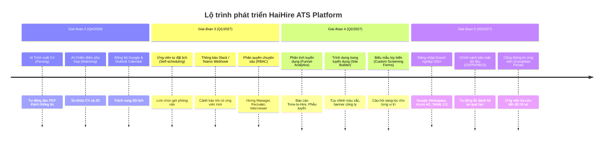

# 🗺️ HaiHire - Roadmap & Product Horizon

> **Tài liệu tổng quan lộ trình phát triển của hệ thống Tuyển dụng Hiện đại HaiHire (Applicant Tracking System).**  
> **Phiên bản hiện tại:** `v1.0.0` (Production-Ready)  
> **Cập nhật:** 01/10/2026  
> **Trạng thái:** Sẵn sàng triển khai Production (Verified qua 7 giai đoạn Audit & Hardening độc lập)

---

## 🧭 Tổng quan kiến trúc hệ thống (System Architecture)

- **Mô hình**: Monorepo (`pnpm workspaces`) với `@haihire/shared` chia sẻ kiểu dữ liệu và codec dùng chung
- **Backend**:
  - Runtime: **Node.js 26** LTS
  - Framework: **NestJS 12** (`@nestjs/core` 12.1.2) + Express + TypeScript
  - Database: **PostgreSQL 17** thông qua **Prisma 8** (Contract-First với `@prisma/composer`, `@prisma/orm-postgres`)
  - Cache & Queue: **Valkey 8** (tương thích 100% protocol Redis 7 / BullMQ)
  - Storage: **MinIO Object Storage** (S3-compatible) cho tài liệu và hồ sơ ứng viên với phân vùng tenant đa tầng (`tenants/<safeTenant>/...`)
  - Real-time: **Server-Sent Events (SSE)** thông qua RxJS Subject cho đồng bộ dữ liệu tức thì, cách ly hoàn toàn theo `organizationId`
  - Bảo mật:
    - Xác thực kép: **HttpOnly Cookie** (`haihire_token`, SameSite=Lax) kết hợp Authorization Bearer header
    - Mã hóa **AES-256-GCM** cho mật khẩu SMTP & API keys
    - Rate-limiting qua **Valkey / Redis Throttler** bảo vệ endpoint nhạy cảm (HTTP 429)
    - Kiểm định nhị phân sâu (Deep Binary Inspection): Kiểm tra magic bytes header & trailer (PDF `%%EOF`, DOCX EOCD trailer `PK\x05\x06` trong 65,557 bytes cuối)
    - Concurrency Control: **Optimistic Locking** cho bước chuyển trạng thái hồ sơ (HTTP 409 Conflict)
  - Email Service: Multi-provider (Simulated In-App, SMTP Server, Resend API, SendGrid API) + Trigger Hooks tự động
- **Frontend**:
  - Framework: **Next.js 16** (App Router, Server & Client Components) + **React 19**
  - Styling: **Tailwind CSS v4**, Lucide Icons, Responsive UI
  - State & Data Fetching: **TanStack Query v5** với cơ chế `keepPreviousData`
  - Đa ngôn ngữ (i18n): Hỗ trợ **Tiếng Việt & Tiếng Anh** đồng bộ 100% (bảo vệ bởi `check:i18n`)
  - Hỗ trợ mạng nội bộ (LAN): Lắng nghe `0.0.0.0`, tự động cấp quyền subnet `/24`, tích hợp Reverse Proxy Next.js cho MinIO & Backend API tránh lỗi CORS và PNA (Private Network Access)

---

## 📍 Bản đồ trạng thái tính năng (Feature Status Matrix)

| Trạng thái | Ký hiệu | Ý nghĩa |
| :--- | :---: | :--- |
| **Đã hoàn thành (Released)** | 🟢 | Tính năng đã được xây dựng hoàn chỉnh, có test tự động và nghiệm thu runtime 100% |
| **Đang chuẩn bị (Next Horizon - Q4/2026)** | 🟡 | Tính năng cốt lõi tiếp theo, có kế hoạch kỹ thuật cụ thể |
| **Tương lai đề xuất (Future Vision - 2027)** | 🔵 | Định hướng mở rộng dài hạn cho phân khúc Enterprise & Tự động hóa |

---

## 🟢 PHẦN 1: CÁC TÍNH NĂNG ĐÃ PHÁT HÀNH (RELEASED - v1.0.0 PRODUCTION)

Hệ thống hiện tại đã hoàn thiện trọn vẹn quy trình tuyển dụng cốt lõi, vượt qua 7 giai đoạn kiểm thử độc lập (IV&V) và đạt chuẩn vận hành production:

### 1. Phân hệ Xác thực & Bảo mật Phiên (Authentication & Security)
- 🟢 **Xác thực Đa tầng**: Hỗ trợ đồng thời HttpOnly Cookie (`haihire_token`) chống XSS và Bearer header cho API client.
- 🟢 **Bảo vệ Brute-Force & DoS**: Tích hợp Valkey / Redis Throttler trên các endpoint đăng nhập/đăng ký, trả về HTTP 429 Too Many Requests khi vượt ngưỡng.
- 🟢 **Quick Login**: Chế độ đăng nhập nhanh tài khoản Admin/Member cho môi trường phát triển & kiểm thử nội bộ.
- 🟢 **Khôi phục phiên (Session Persistence)**: Tự động duy trì đăng nhập qua `/auth/me`, xử lý mượt mà khi token hết hạn.
- 🟢 **Bảo vệ tuyến đường (Route Guard)**: Middleware Next.js bảo vệ các trang `/dashboard/*`, tự động chuyển hướng người dùng chưa đăng nhập.

### 2. Quản lý Tổ chức & Đa khách hàng (Organization & Multi-Tenancy)
- 🟢 **Onboarding & Khởi tạo Workspace**: Quy trình dẫn dắt tạo tổ chức ban đầu với slug duy nhất.
- 🟢 **Mời thành viên (Invite System)**: Tạo liên kết mời bảo mật kèm cấu hình thời hạn hết hạn (`expiresAt`), giới hạn số lượt sử dụng (`maxUses`), và theo dõi số lần dùng thực tế (`usesCount`).
- 🟢 **Quản trị thành viên (Member Management)**: Danh sách thành viên, chuyển đổi vai trò (`ADMIN` $\leftrightarrow$ `MEMBER`), thu hồi quyền truy cập hoặc xóa thành viên.
- 🟢 **Đồng bộ thời gian thực cách ly (Isolated SSE)**:
  - Sự kiện thời gian thực chỉ phát tán trong phạm vi cùng một `organizationId` (loại bỏ hoàn toàn rủi ro cross-tenant leak).
  - Khi thành viên bị xóa khỏi tổ chức $\rightarrow$ lập tức nhận tín hiệu SSE và bị đẩy về trang onboarding.
  - Khi thành viên được nâng/hạ quyền $\rightarrow$ giao diện tự động cập nhật mà không cần F5.

### 3. Quản lý Tin tuyển dụng & Cổng sự nghiệp (Job & Career Portal)
- 🟢 **CRUD Tin tuyển dụng**: Quản lý đầy đủ chức danh, phòng ban, địa điểm, mã bưu chính, loại hình làm việc, mức độ kinh nghiệm, mô tả, yêu cầu và dải lương.
- 🟢 **Trạng thái tin (Job Status)**: Bản nháp (`DRAFT`), Đã xuất bản (`PUBLISHED`), Đóng tuyển dụng (`CLOSED`), Lưu trữ (`ARCHIVED`).
- 🟢 **Trang Tuyển dụng Công khai (Public Career Portal)**:
  - Tuyến `/careers/[orgSlug]`: Hiển thị danh sách tất cả các vị trí đang mở tuyển (`PUBLISHED`) của công ty (các trạng thái khác trả về 404).
  - Tuyến `/careers/[orgSlug]/[jobSlug]`: Trang chi tiết công việc kèm biểu mẫu nộp CV trực tuyến cho ứng viên vãng lai.
- 🟢 **Giao diện hiển thị kép (Card / Table View)**: Chuyển đổi linh hoạt giữa dạng lưới thẻ trực quan và bảng dữ liệu chuyên sâu.

### 4. Quy trình Tuyển dụng & Quản lý Ứng viên (Candidate & Pipeline)
- 🟢 **Pipeline Kanban 6 giai đoạn chuẩn**:
  `APPLIED` $\rightarrow$ `SCREENING` $\rightarrow$ `INTERVIEW` $\rightarrow$ `OFFER` $\rightarrow$ `HIRED` $\rightarrow$ `REJECTED`.
- 🟢 **Kiểm soát đồng thời (Optimistic Locking)**:
  - Ngăn chặn triệt để tình trạng Last-Write-Wins khi nhiều chuyên viên tuyển dụng thao tác cùng lúc trên 1 hồ sơ.
  - Trả về HTTP 409 `APPLICATION_STAGE_CONFLICT` khi có xung đột phiên bản, frontend hiển thị thông báo tiếng Việt/Anh thân thiện yêu cầu làm mới.
- 🟢 **Kéo thả tương tác (Drag & Drop)**: Kéo thẻ ứng viên giữa các cột Kanban để cập nhật trạng thái tuyển dụng tức thì.
- 🟢 **Bảng dữ liệu ứng viên nâng cao (Candidate Data Table)**:
  - Tìm kiếm toàn văn theo họ tên, email, vị trí.
  - Sắp xếp đa cột (Sorting), phân trang (Pagination), tùy chỉnh ẩn/hiện cột hiển thị.

### 5. Kênh Tìm Nguồn & Ghi nhận Đóng góp (Sourcing & Candidate Attribution)
- 🟢 **Quản lý Link Tracking Nguồn**: Tạo liên kết tuyển dụng đính kèm tham số chiến dịch (LinkedIn, Facebook, Referral nội bộ, TopCV, v.v.).
- 🟢 **Theo dõi lượt truy cập (Click Tracking)**: Ghi nhận số lượt click và địa chỉ IP truy cập liên kết theo thời gian thực.
- 🟢 **Ghi nhận nguồn ứng viên tự động (Candidate Attribution)**: Tự động liên kết hồ sơ ứng viên với chiến dịch sourcing tương ứng khi nộp qua link tracking.
- 🟢 **Thống kê hiệu quả kênh (Sourcing Analytics)**: Thống kê số lượng click, số hồ sơ thu hút và tỷ lệ chuyển đổi theo từng kênh tìm kiếm.

### 6. Quản lý Tài liệu & Lưu trữ An toàn (Resume Storage & Deep Inspection)
- 🟢 **Cô lập Tenant MinIO**: Khử khuẩn đường dẫn tuyệt đối với regex `safeTenant` (`[^a-zA-Z0-9_-]`), lưu trữ hồ sơ theo tiền tố bắt buộc `tenants/<safeTenant>/...`.
- 🟢 **Kiểm định nhị phân sâu (Deep Binary Inspection)**:
  - PDF: Kiểm tra header `%PDF-` và chữ ký đuôi `%%EOF` trong 1024 bytes cuối (loại bỏ tệp bị cắt ngang / truncated).
  - DOCX: Kiểm tra header `PK\x03\x04` và chữ ký đuôi EOCD (`PK\x05\x06`) trong 65,557 bytes cuối (bảo đảm cấu trúc ZIP không bị hỏng).
  - Tự động từ chối tệp script giả mạo (`.sh`, `.bat`) hoặc tệp rỗng 0-byte với mã lỗi chuẩn `UPLOAD_TRUNCATED_FILE` và `VALIDATION_ERROR`.
- 🟢 **Trình xem trước PDF tại chỗ (In-App PDF Modal Viewer)**: Mở và đọc nội dung CV trực tiếp trên trình duyệt qua Server-Side Reverse Proxy an toàn.

### 7. Lịch phỏng vấn & Đánh giá ứng viên (Interviews & Scorecards)
- 🟢 **Đặt lịch phỏng vấn đa vòng**: HR Screening, Technical, Culture Fit, Final Round, Assessment.
- 🟢 **Hình thức họp đa dạng**: Google Meet, Zoom, Microsoft Teams, Trực tiếp tại văn phòng.
- 🟢 **Giao diện Lịch (Calendar View)**: Chế độ xem theo Tháng (Month) và theo Tuần (Week), trực quan hóa các buổi phỏng vấn.
- 🟢 **Hệ thống Phiếu đánh giá (Scorecard System)**:
  - Đánh giá từ 1 đến 5 sao theo 4 tiêu chí cốt lõi (Chuyên môn, Giao tiếp, Giải quyết vấn đề, Văn hóa).
  - Khuyến nghị tuyển dụng 5 mức: Strong Yes, Yes, Neutral, No, Strong No.

### 8. Hệ thống Email & Tự động hóa (Email & Communication Engine)
- 🟢 **Mẫu thư & Tự động hóa**: 4 mẫu thư mặc định (`APPLICATION_CONFIRMATION`, `INTERVIEW_INVITATION`, `REJECTION`, `OFFER`) cùng mẫu tùy biến `CUSTOM`.
- 🟢 **Tên tổ chức động & Chống XSS**: Trích xuất tên công ty chính xác từ cơ sở dữ liệu, tự động escape HTML các biến động ngăn ngừa injection.
- 🟢 **Két an toàn AES-256-GCM**: Mật khẩu SMTP và API Key được mã hóa trước khi lưu vào DB, che giấu dạng `••••••••` ra frontend.
- 🟢 **4 Chế độ gửi thư**: Simulated In-App, SMTP Server, Resend API, SendGrid API.

### 9. Dòng thời gian hoạt động & Kiểm toán (Candidate Activity Timeline)
- 🟢 **Nhật ký kiểm toán (`ActivityLog`)**: Tự động lưu vết mọi thao tác ứng tuyển, đổi stage, gửi email, lên lịch phỏng vấn, đánh giá và ghi chú.
- 🟢 **Bảo toàn Audit Trail khi xóa**: Soft-delete ứng viên vẫn bảo toàn đầy đủ lịch sử hoạt động để phục vụ kiểm toán nội bộ.

### 10. Hạ tầng Kỹ thuật & Chuẩn hóa Monorepo
- 🟢 **Gói chia sẻ `@ats/shared`**: Đồng bộ kiểu dữ liệu TypeScript, hằng số, DTOs giữa Backend và Frontend.
- 🟢 **Song ngữ Việt - Anh 100%**: 1682 / 1682 keys đồng nhất, hỗ trợ toàn bộ thông điệp lỗi kỹ thuật 400, 409, 429.
- 🟢 **Hệ thống Test Suite Toàn diện**: **276 / 276 tests tự động pass 100%** (169 Backend + 107 Frontend) kèm 31 kịch bản runtime zero-regression.

---

## 🟡 PHẦN 2: LỘ TRÌNH TÍNH NĂNG TƯƠNG LAI (FUTURE HORIZON ROADMAP)

---

### 🚀 Giai đoạn 2: Trí tuệ nhân tạo & Tự động hóa thông minh (Q4/2026)
*Mục tiêu: Giảm 70% thời gian nhập liệu thủ công và nâng cao tốc độ phản hồi hồ sơ.*

#### 1. Trích xuất CV tự động bằng AI (AI Resume Parsing)
- **Vấn đề giải quyết**: Thông tin kinh nghiệm, học vấn, kỹ năng trong CV hiện vẫn cần đọc thủ công.
- **Giải pháp**: Tích hợp OpenAI / Claude / Gemini API (qua tab `ai-configuration`):
  - Tự động bóc tách: Họ tên, số điện thoại, email, địa chỉ, số năm kinh nghiệm, kỹ năng chuyên môn.
  - Tự động điền vào hồ sơ ứng viên sau khi tải lên file PDF/DOCX.
- **Độ ưu tiên**: 🔴 Cao (P0)

#### 2. AI Đánh giá mức độ phù hợp (`matchScore` thông minh)
- Phân tích ngữ nghĩa (Semantic Matching) giữa Yêu cầu công việc (JD) và CV của ứng viên.
- Chấm điểm phù hợp từ 0 - 100 điểm kèm bản tóm tắt: "Điểm mạnh", "Điểm còn thiếu" và "Gợi ý câu hỏi phỏng vấn".
- **Độ ưu tiên**: 🟡 Trung bình cao (P1)

#### 3. AI Hỗ trợ viết thư & Tinh chỉnh Email (AI Email Copilot)
- Tích hợp nút **"Viết lại bằng AI"** trong modal gửi thư (`SendEmailModal`):
  - Viết lại thư từ chối với văn phong ấm áp, tôn trọng ứng viên.
  - Tùy chỉnh thư mời phỏng vấn hoặc thư gửi đề nghị (Offer) theo phong cách trang trọng.
- **Độ ưu tiên**: 🟢 Trung bình (P2)

---

### 🔗 Giai đoạn 3: Tích hợp Lịch & Kênh cộng tác nội bộ (Q1/2027)
*Mục tiêu: Đưa ATS trở thành trung tâm kết nối, loại bỏ thao tác thủ công qua lại giữa các ứng dụng bên ngoài.*

#### 1. Đồng bộ 2 chiều với Google Calendar & Microsoft 365
- Kết nối tài khoản Google Workspace hoặc Microsoft Outlook của người phỏng vấn.
- Khi tạo phỏng vấn trong ATS $\rightarrow$ tự động tạo sự kiện trên Calendar của người phỏng vấn và ứng viên.
- Tự động sinh link Google Meet / Microsoft Teams thực tế.
- **Độ ưu tiên**: 🔴 Cao (P0)

#### 2. Ứng viên tự chọn lịch phỏng vấn (Candidate Self-Scheduling)
- Hệ thống gửi email chứa liên kết độc nhất cho ứng viên.
- Ứng viên tự chọn khung thời gian rảnh phù hợp từ các slot trống của hội đồng phỏng vấn (tương tự Calendly).
- **Độ ưu tiên**: 🟡 Trung bình (P1)

#### 3. Tích hợp Thông báo Slack / Microsoft Teams Webhooks
- Nhận thông báo tức thì trên kênh làm việc nội bộ của công ty khi có ứng viên mới hoặc có người nộp Scorecard.
- **Độ ưu tiên**: 🟢 Trung bình (P2)

---

### 👥 Giai đoạn 4: Phân quyền chuyên sâu (RBAC) & Trải nghiệm Tuyển dụng (Q2/2027)
*Mục tiêu: Đáp ứng quy mô doanh nghiệp vừa và lớn với nhiều phòng ban tham gia phỏng vấn.*

#### 1. Hệ thống Phân quyền 4 vai trò (Granular RBAC)
- **Super Admin**: Toàn quyền cấu hình công ty, billing, tích hợp và bảo mật.
- **Recruiter**: Quản lý tất cả jobs, xem toàn bộ ứng viên, gửi thư, đặt lịch phỏng vấn, xem dải lương.
- **Hiring Manager**: Chỉ xem các Jobs và ứng viên thuộc phòng ban mình phụ trách, xem Scorecards, duyệt Offer.
- **Interviewer**: Chỉ xem hồ sơ ứng viên mình được phân công phỏng vấn, chỉ điền phiếu Scorecard của mình.
- **Độ ưu tiên**: 🔴 Cao (P0)

#### 2. Tùy biến trang tuyển dụng công ty (Career Site Customizer)
- Cho phép tải lên Banner, Logo công ty, Video giới thiệu môi trường làm việc.
- Cấu hình màu sắc chủ đạo của thương hiệu (Primary Brand Color), chuyên mục "Tại sao gia nhập chúng tôi".
- **Độ ưu tiên**: 🟡 Trung bình cao (P1)

#### 3. Biểu mẫu ứng tuyển tùy biến (Custom Screening Forms)
- Cho phép tạo câu hỏi sàng lọc riêng cho từng vị trí tuyển dụng với tính năng tự động loại hồ sơ không đạt yêu cầu tiên quyết.
- **Độ ưu tiên**: 🟡 Trung bình (P1)

---

### 📊 Giai đoạn 5: Báo cáo phân tích & Hiệu suất tuyển dụng (Q3/2027)
*Mục tiêu: Cung cấp dữ liệu định lượng cho Giám đốc nhân sự (CHRO) và Ban lãnh đạo.*

#### 1. Phễu tuyển dụng & Tỷ lệ chuyển đổi (Recruitment Funnel Analytics)
- Báo cáo trực quan dạng phễu: Số lượng và tỷ lệ chuyển đổi qua các vòng từ Applied đến Hired.
- **Độ ưu tiên**: 🟡 Trung bình cao (P1)

#### 2. Chỉ số Tốc độ Tuyển dụng (Hiring Velocity Metrics)
- Theo dõi các chỉ số: Time-to-Hire, Time-to-Fill, Cost-per-Hire theo từng vị trí và phòng ban.
- **Độ ưu tiên**: 🟡 Trung bình (P1)

---

### 🛡️ Giai đoạn 6: Bảo mật Doanh nghiệp & Tuân thủ (Enterprise & Compliance) (Q4/2027)
*Mục tiêu: Đạt chuẩn bảo mật cho khách hàng Doanh nghiệp và Tập đoàn đa quốc gia.*

#### 1. Đăng nhập một chạm Doanh nghiệp (Enterprise Single Sign-On - SSO)
- Hỗ trợ SAML 2.0 và OpenID Connect (OIDC) với Google Workspace, Azure AD, Okta.
- **Độ ưu tiên**: 🟡 Trung bình (P1)

#### 2. Chính sách Lưu trữ & Xóa dữ liệu (Privacy & Retention Policy)
- Tuân thủ GDPR Châu Âu và Nghị định 13/2023/NĐ-CP của Việt Nam về bảo vệ dữ liệu cá nhân.
- Tự động ẩn danh hoặc xóa hẳn hồ sơ sau khoảng thời gian quy định.
- **Độ ưu tiên**: 🟡 Trung bình (P1)

#### 3. Cổng thông tin ứng viên (Candidate Self-Service Portal)
- Trang tra cứu tiến độ ứng tuyển dành riêng cho ứng viên qua Magic Link.
- **Độ ưu tiên**: 🟢 Tương lai (P2)

---

## 🎯 Bảng tóm tắt các tính năng tương lai theo Mức độ ưu tiên

| Tính năng | Phân hệ | Độ phức tạp kỹ thuật | Giá trị mang lại | Ưu tiên |
| :--- | :--- | :---: | :---: | :---: |
| **AI Resume Parsing (Bóc tách CV tự động)** | AI & Automation | Trung bình | ⭐⭐⭐⭐⭐ Cực cao | 🔴 **P0** |
| **Google / Outlook Calendar 2-way Sync** | Integrations | Trung bình | ⭐⭐⭐⭐⭐ Cực cao | 🔴 **P0** |
| **Hệ thống phân quyền nâng cao (4 vai trò RBAC)** | Security & Team | Thấp - Trung bình | ⭐⭐⭐⭐⭐ Cực cao | 🔴 **P0** |
| **AI Candidate Matching & Scoring** | AI & Automation | Trung bình | ⭐⭐⭐⭐ Cao | 🟡 **P1** |
| **Candidate Self-Scheduling (Tự đặt lịch)** | Interviews | Trung bình | ⭐⭐⭐⭐ Cao | 🟡 **P1** |
| **Slack / MS Teams Webhook Alert** | Integrations | Thấp | ⭐⭐⭐⭐ Cao | 🟡 **P1** |
| **Career Site Builder (Tùy biến trang tuyển dụng)** | Public Portal | Thấp - Trung bình | ⭐⭐⭐⭐ Cao | 🟡 **P1** |
| **Phễu tuyển dụng & Time-to-Hire Analytics** | Analytics | Trung bình | ⭐⭐⭐⭐ Cao | 🟡 **P1** |
| **Chính sách dữ liệu GDPR / Nghị định 13** | Compliance | Trung bình | ⭐⭐⭐⭐ Cao | 🟡 **P1** |
| **Enterprise SSO (SAML 2.0 / Okta / Azure AD)** | Security | Trung bình - Cao | ⭐⭐⭐ Khá | 🔵 **P2** |
| **Cổng thông tin ứng viên (Candidate Portal)** | Experience | Trung bình | ⭐⭐⭐ Khá | 🔵 **P2** |

---

> 💡 *Tài liệu này là căn cứ chiến lược để định hướng các Sprint phát triển tiếp theo của dự án HaiHire ATS Platform.*
