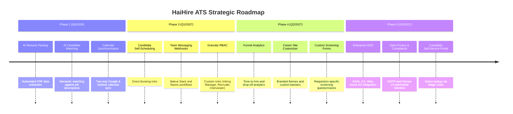

# 🗺️ HaiHire - Product Roadmap & Architectural Horizon

> **Comprehensive strategic roadmap for the HaiHire Enterprise Applicant Tracking System (ATS).**  
> **Current Version:** `v0.1.0` (Pre-release, Released 2026-10-14)  
> **Updated:** 2026-10-14  
> **Status:** Pre-release (20+ hardening tasks completed, 606 tests, 11 CI gates)

---

## 🧭 System Architecture Baseline

- **Monorepo Topology**: Managed via `pnpm workspaces` with `@haihire/shared` distributing cross-cutting contracts, error codes, and validation types.
- **Backend Architecture**:
  - Runtime: **Node.js 26** LTS
  - Framework: **NestJS 12** (`@nestjs/core` 12.1.2) + Express platform adapter
  - Database: **PostgreSQL 17** via **Prisma 8** (Contract-First schema)
  - Cache & Async Queue: **Valkey 8** (100% Redis 7 protocol and BullMQ compatible)
  - Object Storage: **MinIO S3** for resume and document retention with tenant path scoping (`tenants/<safeTenant>/...`)
  - Real-Time Layer: **Server-Sent Events (SSE)** via RxJS Subject providing tenant-isolated event streams scoped by `organizationId`
  - Security & Guardrails:
    - Dual Authentication: **HttpOnly Cookie** (`haihire_token`, SameSite=Lax) with Authorization Bearer header fallback
    - Cryptographic Security: **AES-256-GCM** for sensitive SMTP credentials and provider tokens
    - Rate Limiting: **Valkey / Redis Throttler** guarding authentication endpoints (HTTP 429)
    - Deep Binary Inspection: Magic bytes header & trailer inspection (PDF `%%EOF`, DOCX EOCD trailer `PK\x05\x06` in final 65,557 bytes)
    - Concurrency Control: **Optimistic Locking** guarding candidate pipeline stage transitions (HTTP 409 Conflict)
  - Notification Engine: Multi-provider email dispatch (Simulated In-App, SMTP Server, Resend API, SendGrid API) + Multi-channel Webhook Notifier (Telegram, Discord, Generic HMAC)
- **Frontend Architecture**:
  - Framework: **Next.js 16** (App Router, Server & Client Components) + **React 19**
  - Styling Engine: **Tailwind CSS v4**, Lucide React icons, responsive layout
  - Data Fetching & Caching: **TanStack Query v5** with `keepPreviousData` patterns
  - Localization (i18n): Zero hardcoded text, synchronized English & Vietnamese dictionaries
  - LAN & Private Network Access: Listening on `0.0.0.0` with subnet `/24` authorization; integrated Next.js reverse proxy rewrites bypassing CORS and browser Private Network Access (PNA) restrictions

---

## 📍 Feature Status Matrix

| Status | Badge | Definition |
| :--- | :---: | :--- |
| **Released** | 🟢 | Feature fully implemented, covered by automated test suites and runtime verification |
| **Next Horizon (Q4/2026)** | 🟡 | High-priority upcoming feature with defined technical implementation plan |
| **Future Vision (2027)** | 🔵 | Long-term enterprise extensions, AI workflows, and compliance tooling |

---

## 🟢 PART 1: RELEASED CAPABILITIES (v0.1.0 PRE-RELEASE)

### 1. Authentication & Security
- 🟢 **Dual-Layer Authentication**: HttpOnly cookie (`haihire_token`) preventing XSS attacks with Bearer token fallback for API consumers.
- 🟢 **Brute-Force & DoS Shield**: Integrated Valkey/Redis throttler on login/register endpoints returning HTTP 429 upon threshold breach.
- 🟢 **Developer Quick-Login**: Single-click demo authentication for Admin and Member accounts in non-production environments.
- 🟢 **Session Persistence**: Automatic session restoration via `/auth/me` with clean token expiration handling.
- 🟢 **Route Protection Middleware**: Next.js Edge middleware guarding `/dashboard/*` routes and redirecting unauthenticated traffic.

### 2. Multi-Tenancy & Organizations
- 🟢 **Tenant Onboarding**: Guided workspace creation generating isolated organization entities with unique slugs.
- 🟢 **Secure Member Invitations**: Time-bounded invite tokens with configurable `expiresAt`, `maxUses` limits, and real-time usage tracking.
- 🟢 **Role Management**: RBAC controls supporting role transitions (`ADMIN` $\leftrightarrow$ `MEMBER`), access revocation, and member deletion.
- 🟢 **Isolated Server-Sent Events (SSE)**:
  - Event broadcasts strictly scoped to caller's `organizationId` (zero cross-tenant leak).
  - Immediate session termination and redirect upon membership revocation.
  - Live UI state updates upon role mutation without browser reload.

### 3. Job Requisitions & Public Career Portal
- 🟢 **Full Job Requisition Lifecycle**: Draft (`DRAFT`), Published (`PUBLISHED`), Closed (`CLOSED`), and Archived (`ARCHIVED`).
- 🟢 **Public Career Portal**:
  - `/careers/[orgSlug]`: Lists open positions (`PUBLISHED`) for the target tenant with semantic SEO markup.
  - `/careers/[orgSlug]/[jobSlug]`: Server-rendered job detail view with inline candidate application modal.
- 🟢 **Dual View Layouts**: Seamless toggle between Kanban card views and tabular data grids.

### 4. Candidate Management & Pipeline Stages
- 🟢 **Standard 6-Stage Recruitment Pipeline**:
  `APPLIED` $\rightarrow$ `SCREENING` $\rightarrow$ `INTERVIEW` $\rightarrow$ `OFFER` $\rightarrow$ `HIRED` $\rightarrow$ `REJECTED`.
- 🟢 **Optimistic Concurrency Control**:
  - Prevents Last-Write-Wins overwrites when multiple recruiters review a candidate simultaneously.
  - Emits HTTP 409 `APPLICATION_STAGE_CONFLICT` upon version collision with localized user warnings.
- 🟢 **Drag-and-Drop Kanban Board**: Real-time card movement updating stage states with instant optimistic rollback on failure.
- 🟢 **Advanced Candidate Data Table**:
  - Full-text search across candidate name, email, and target requisition.
  - Multi-column sorting, server-side pagination, and customizable column visibility.

### 5. Sourcing & Attribution Tracking
- 🟢 **Campaign Tracking Link Engine**: Generate recruitment links tagged with 5 standard UTM campaign parameters (LinkedIn, Facebook, Referral, Job Boards).
- 🟢 **Real-Time Click Analytics**: Deduplicated IP tracking capturing engagement volume.
- 🟢 **Automatic Source Attribution**: Ingesting candidates binds them directly to their origin sourcing campaign.
- 🟢 **Channel Conversion Metrics**: Performance dashboards reporting clicks, applications generated, and conversion ratios.

### 6. Storage & Deep Binary Inspection
- 🟢 **MinIO Tenant Isolation**: Strict path sanitization (`tenants/<safeTenant>/...`) with alphanumeric regex scrubbing.
- 🟢 **Deep Binary Inspection**:
  - PDF: Header `%PDF-` validation and trailer `%%EOF` verification within final 1024 bytes.
  - DOCX: Header `PK\x03\x04` verification and EOCD trailer `PK\x05\x06` parsing within final 65,557 bytes.
  - Immediate rejection of malicious scripts (`.sh`, `.bat`) and 0-byte corrupt files.
- 🟢 **In-App PDF Viewer**: Secure PDF viewing via authenticated server-side reverse proxy.

### 7. Interviews & Scorecards
- 🟢 **Multi-Round Interview Scheduling**: HR Screening, Technical, Culture Fit, Final Round, Assessment.
- 🟢 **Platform Meeting Links**: Google Meet, Zoom, Microsoft Teams, and On-Site office configurations.
- 🟢 **Interactive Calendar Views**: Month and Week views visualizing upcoming scheduled rounds.
- 🟢 **Standardized Evaluation Scorecards**:
  - 1-to-5 star rating across 4 competencies (Technical, Communication, Problem Solving, Culture Fit).
  - 5-tier hiring recommendation: Strong Yes, Yes, Neutral, No, Strong No.

### 8. Transactional Email & Notifications
- 🟢 **Automated Templates**: 4 standard triggers (`APPLICATION_CONFIRMATION`, `INTERVIEW_INVITATION`, `REJECTION`, `OFFER`) + custom ad-hoc messaging.
- 🟢 **Dynamic Organization Branding & XSS Sanitization**: Dynamic variable interpolation with HTML entity escaping.
- 🟢 **AES-256-GCM Vault**: Encrypted storage of SMTP credentials and provider tokens.
- 🟢 **Multi-Channel Webhooks**: Webhook notifications to Telegram, Discord, and custom HTTP endpoints on DLQ triggers.

---

## 📦 Release Trajectory & Milestones

### v0.1.0 (Released 2026-10-14) — Pre-release

- First pre-release.
- 20+ hardening tasks completed.
- 11 CI gates, 606 tests, 14 Prometheus alerts.
- Feedback collection begins.
- Not API-stable yet.

### v0.1.x (Planned)

- Bug fixes from user feedback.
- Minor UX improvements.

### v0.2.0 (Planned)

- Split 5 God Files.
- Bundle optimization.
- More webhook providers.

### v0.3.0 (Planned)

- OpenAPI/Swagger.
- Business metrics.
- Account lockout.
- Correlation ID for background jobs.

### v1.0.0 (Future)

- Stable API.
- Production hardened.
- Enterprise-ready.
- Released when truly ready.

---

## 🟡 PART 2: FUTURE HORIZON ROADMAP

---

### Phase 2: AI & Intelligent Automation (Q4/2026)
- **AI Resume Parsing**: Automatic extraction of candidate work history, education, skills, and contact information into structured records using multimodal LLM APIs.
- **AI Candidate Matching & Semantic Scoring**: Algorithmic compatibility scoring (0 - 100) comparing resume text against job specifications with summary explanations.
- **AI Email Copilot**: Tone refinement tools in candidate communication modals for crafting professional offer or rejection letters.

### Phase 3: Integrations & Scheduling (Q1/2027)
- **Two-Way Google & Outlook Calendar Sync**: Automatic availability checks and calendar invite dispatch.
- **Candidate Self-Scheduling**: Shareable candidate booking links allowing applicants to select available committee slots.
- **Enhanced Team Chat Webhooks**: Direct messaging notifications for team channels upon candidate submissions and scorecard completion.

### Phase 4: Granular Permissions & Sourcing (Q2/2027)
- **4-Tier Granular RBAC**: Strict separation between Super Admin, Recruiter, Department Hiring Manager, and External Interviewer.
- **Branded Career Site Builder**: Custom styling, logo uploads, and company culture media sections.
- **Custom Screening Questionnaires**: Position-specific knockout questions filtering applicants automatically.

### Phase 5: Enterprise Analytics & Compliance (H2/2027)
- **Recruitment Funnel & Velocity Analytics**: Quantitative dashboards tracking Time-to-Hire, Time-to-Fill, and stage conversion ratios.
- **Enterprise Single Sign-On (SSO)**: SAML 2.0 and OpenID Connect integration for corporate identity providers (Google Workspace, Okta, Azure AD).
- **Data Privacy & Retention Automation**: Automated anonymization and purging complying with GDPR and Vietnam Decree 13/2023/ND-CP regulations.
