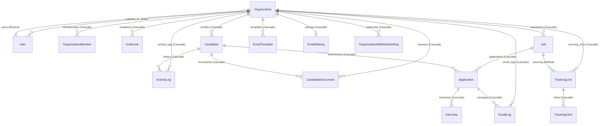

# HaiHire Data Model & Entity Architecture

> **Single Source of Truth for Data Models, Relationships, and Cascade Invariants**  
> Based on Prisma 8 contract definition (`backend/src/prisma/contract.prisma`).

---

## 1. Entity Relationship Overview

The HaiHire ATS data tier comprises 16 core entities organized around the tenant root (`Organization`):

---

## 2. Core Entities & Attributes

### 2.1 Multi-Tenant Identity & Access Management

#### 1. `Organization`

The tenant boundary root entity.

- `id` (`String` UUID, Primary Key)
- `name` (`String`)
- `slug` (`String` Unique)
- `ownerId` (`String`, Foreign Key referencing `User(id)` with `onDelete: Restrict`)
- `createdAt`, `updatedAt` (`DateTime`)
- **Key Invariants:** `ownerId` is non-nullable; an organization cannot be deleted if users or active owner constraints are unresolved.

#### 2. `User`

Universal user identity across tenants.

- `id` (`String` UUID, Primary Key)
- `email` (`String` Unique)
- `passwordHash` (`String`)
- `name` (`String?`)
- `role` (`Role` Enum: `ADMIN`, `RECRUITER`, `HIRING_MANAGER`, `INTERVIEWER`, `MEMBER`)
- `organizationId` (`String?`, Foreign Key referencing `Organization(id)`)
- `tokenVersion` (`Int` default 0, for instant JWT invalidation)
- `createdAt`, `updatedAt` (`DateTime`)
- **Cascade Behavior:** `User.organizationId` has no cascade (`onDelete: NoAction`). Organization deletion requires `updateMany` unlinking users before deleting the tenant.

#### 3. `OrganizationMember`

Explicit junction linking users to tenant organizations.

- `id` (`String` UUID, Primary Key)
- `organizationId` (`String`, Foreign Key referencing `Organization(id)`, `onDelete: Cascade`)
- `userId` (`String`, Foreign Key referencing `User(id)`, `onDelete: Cascade`)
- `role` (`Role` Enum)
- `joinedAt` (`DateTime`)
- **Key Index:** `@@unique([organizationId, userId])`

#### 4. `InviteLink`

Expiring member invitation tokens.

- `id` (`String` UUID, Primary Key)
- `organizationId` (`String`, `onDelete: Cascade`)
- `role` (`Role` Enum)
- `token` (`String` Unique)
- `expiresAt` (`DateTime`), `acceptedAt` (`DateTime?`)

---

### 2.2 Recruitment & Applicant Funnel

#### 5. `Job`

Job requisition with lifecycle states and customizable hiring pipelines.

- `id` (`String` UUID, Primary Key)
- `organizationId` (`String`, `onDelete: Cascade`)
- `title` (`String`), `slug` (`String`)
- `status` (`JobStatus` Enum: `DRAFT`, `PUBLISHED`, `CLOSED`, `ARCHIVED`)
- `pipelineStages` (`Json` Array defining hiring stages)
- `deletedAt` (`DateTime?`, for 30-day soft-delete grace period)
- **Key Indices:** `@@index([organizationId, status])`, `@@index([organizationId, deletedAt])`

#### 6. `Candidate`

Applicant profile.

- `id` (`String` UUID, Primary Key)
- `organizationId` (`String`, `onDelete: Cascade`)
- `name` (`String`), `email` (`String`), `phone` (`String?`)
- `deletedAt` (`DateTime?`, for 30-day soft-delete)
- **Key Indices:** `@@unique([organizationId, email])`, `@@index([organizationId, deletedAt])`

#### 7. `Application`

Candidate submission to a specific Job opening.

- `id` (`String` UUID, Primary Key)
- `candidateId` (`String`, `onDelete: Cascade`)
- `jobId` (`String`, `onDelete: Cascade`)
- `stage` (`String`, defaults to `APPLIED`)
- `status` (`ApplicationStatus` Enum: `ACTIVE`, `HIRED`, `REJECTED`)
- `trackingLinkId` (`String?`, `onDelete: SetNull`)
- **Key Indices:** `@@unique([candidateId, jobId])`, `@@index([jobId, stage])`

#### 8. `Interview`

Scheduled candidate evaluation round.

- `id` (`String` UUID, Primary Key)
- `applicationId` (`String`, `onDelete: Cascade`)
- `interviewerId` (`String?`)
- `scheduledAt` (`DateTime`), `status` (`InterviewStatus`)
- `scorecard` (`Json?`, criteria evaluation and rating)
- **Key Index:** `@@index([applicationId])`

#### 9. `CandidateDocument`

Resume and document attachment pointers to MinIO object storage.

- `id` (`String` UUID, Primary Key)
- `organizationId` (`String`, `onDelete: Cascade`)
- `candidateId` (`String`, `onDelete: Cascade`)
- `fileUrl` (`String`, tenant-isolated storage path)
- `fileName` (`String`), `fileSize` (`Int`), `mimeType` (`String`)
- `isEncrypted` (`Boolean` default false)

---

### 2.3 Communications, Auditing & Integrations

#### 10. `EmailTemplate`

Reusable organization email templates (`[organizationId, type]` unique).

#### 11. `EmailSetting`

Tenant email provider credentials (encrypted SMTP, SendGrid, or Resend API keys).

#### 12. `EmailLog`

Transactional email audit log with delivery status.

#### 13. `ActivityLog`

Recruitment audit trail tracking candidate funnel events (`APPLIED`, `STAGE_CHANGED`, `NOTE_ADDED`).

- Foreign keys: `candidateId` (non-nullable), `organizationId`, `applicationId?`.

#### 14. `TrackingLink` & 15. `TrackingClick`

Attribution links with 5-parameter UTM tagging and click analytics.

#### 16. `OrganizationWebhookSetting`

Tenant notification webhook targets (Discord, Telegram, Generic HTTP).

---

## 3. Database Cascade & Deletion Policies

| Parent Entity  | Dependent Entity                                  | Relation FK      | `onDelete` Policy       | Behavioral Rationale                                                                                     |
| :------------- | :------------------------------------------------ | :--------------- | :---------------------- | :------------------------------------------------------------------------------------------------------- |
| `Organization` | `Job`, `Candidate`, `CandidateDocument`           | `organizationId` | `Cascade`               | Deleting tenant purges all operational recruitment data.                                                 |
| `Organization` | `User`                                            | `organizationId` | `NoAction` / `Restrict` | Prevents deleting a tenant from silently deleting user accounts. `deleteMyOrg` explicitly unlinks users. |
| `User` (Owner) | `Organization`                                    | `ownerId`        | `Restrict`              | A user cannot be deleted while registered as an organization owner. Ownership must be transferred first. |
| `Job`          | `Application`                                     | `jobId`          | `Cascade`               | Deleting a job purges its active applications and interview rounds.                                      |
| `Candidate`    | `Application`, `CandidateDocument`, `ActivityLog` | `candidateId`    | `Cascade`               | Purging candidate purges all submissions, documents, and logs.                                           |
| `TrackingLink` | `Application`                                     | `trackingLinkId` | `SetNull`               | Deleting a tracking link preserves the candidate's application while unlinking attribution source.       |
