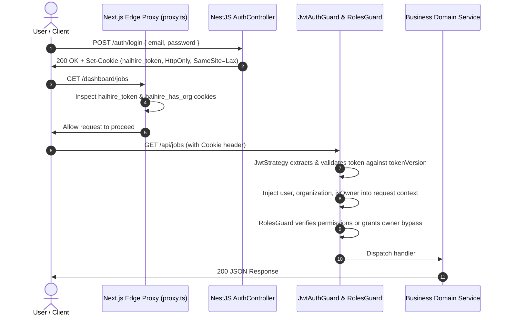

# Security, Authentication & Role-Based Access Control (RBAC)

> **Single Source of Truth for Security Architecture, Authentication Boundaries, and RBAC Matrix**  
> Declared in `@haihire/shared` (`packages/shared/src/permissions.ts`) and enforced via NestJS Guard Pipeline.

---

## 1. Authentication Architecture

HaiHire enforces a secure, cookie-based JWT authentication model across all client-server communications:



### Key Security Safeguards

1. **HttpOnly & Secure Session Cookies:** JWT tokens are stored exclusively in `HttpOnly`, `SameSite=Lax` cookies, preventing XSS-based credential theft.
2. **Session Revocation via `tokenVersion`:** `User.tokenVersion` in PostgreSQL enables instant invalidation of all issued refresh/access tokens upon password reset or account lock.
3. **Fail-Fast Edge Interception:** `frontend/src/proxy.ts` evaluates session presence at the edge, redirecting unauthorized traffic before rendering page components.

---

## 2. Dynamic Ownership Model (D-003)

Following the removal of the static `Role.OWNER` enum value in [D-003](../decisions/DECISIONS.md#d-003):

1. **Source of Truth:** Tenant ownership is defined solely by `Organization.ownerId` (`User.id`).
2. **Runtime Resolution:** `JwtStrategy` dynamically injects:
   ```typescript
   request.user.isOwner = Boolean(
     user.organization?.ownerId && user.organization.ownerId === user.id,
   );
   ```
3. **Super-Admin Bypass:** If `request.user.isOwner === true`, `RolesGuard` grants unconditional authorization across all tenant endpoints.
4. **Ownership Transfer:** The active owner can transfer ownership via `POST /organizations/my/transfer-ownership` (guarded by `org:transfer_ownership`). The previous owner retains the `ADMIN` role.

---

## 3. The 5 Fixed RBAC Roles

| Role                 | Domain Scope & Purpose                                                                                  |
| :------------------- | :------------------------------------------------------------------------------------------------------ |
| **`ADMIN`**          | Full tenant administrator managing settings, billing, members, and all recruitment entities.            |
| **`RECRUITER`**      | Primary operational role managing jobs, candidates, applications, sourcing links, and candidate emails. |
| **`HIRING_MANAGER`** | Department hiring lead reviewing candidates, moving pipeline stages, and managing interview schedules.  |
| **`INTERVIEWER`**    | Focused evaluation role conducting candidate interviews and submitting scorecards.                      |
| **`MEMBER`**         | Default base role with read-only visibility into active organization job listings.                      |

---

## 4. The 41 Granular Permissions Matrix

Declared in `@haihire/shared` (`packages/shared/src/permissions.ts`):

### 4.1 Organization & Administration (6 Permissions)

- `org:view`: View organization details and settings.
- `org:update`: Update organization profile, name, or metadata.
- `org:delete`: Soft-delete or terminate the organization (Owner / Admin only).
- `org:manage_members`: Invite, update roles, or remove tenant members.
- `org:manage_billing`: Access and modify subscription and billing tiers.
- `org:transfer_ownership`: Transfer tenant ownership to an existing member.

### 4.2 Job Requisitions & Pipelines (4 Permissions)

- `job:view`: View job listings and pipeline configurations.
- `job:create`: Create new job openings.
- `job:update`: Edit job details, stages, and requirements.
- `job:delete`: Archive or delete job requisitions.

### 4.3 Candidate Management (8 Permissions)

- `candidate:view`: Access complete candidate profiles.
- `candidate:view_basic`: Access non-sensitive candidate contact details.
- `candidate:create`: Manually add or import candidate profiles.
- `candidate:update`: Edit candidate information and tags.
- `candidate:delete`: Delete or soft-delete candidates.
- `candidate:document_upload`: Upload resumes and candidate attachments.
- `candidate:document_download`: Access and download stored candidate documents.
- `candidate:document_delete`: Remove attached documents from candidate profiles.

### 4.4 Applications & Funnel Progression (8 Permissions)

- `application:view`: View job submissions and applicant profiles.
- `application:create`: Submit applications to job openings.
- `application:update`: Modify applicant attributes.
- `application:update_stage`: Advance or reject applications in the recruitment pipeline.
- `application:delete`: Purge candidate applications.
- `application:document_upload`: Attach documents to a specific application.
- `application:document_download`: Download application attachments.
- `application:document_delete`: Remove application attachments.

### 4.5 Interview Scheduling & Scorecards (5 Permissions)

- `interview:view`: View scheduled interview rounds.
- `interview:create`: Schedule interviews with candidates and panel members.
- `interview:update`: Reschedule or modify interview details.
- `interview:delete`: Cancel scheduled interview rounds.
- `interview:scorecard_submit`: Submit interview evaluation feedback and ratings.

### 4.6 Sourcing & Attribution (4 Permissions)

- `sourcing:view`: View sourcing links and traffic analytics.
- `sourcing:create`: Generate new campaign tracking links.
- `sourcing:update`: Modify tracking link parameters.
- `sourcing:delete`: Deactivate or remove tracking links.

### 4.7 Communications & System Integration (6 Permissions)

- `email:view`: View transactional email history and logs.
- `email:send`: Send recruitment emails to candidates.
- `email:manage_templates`: Author and edit organization email templates.
- `email:manage_settings`: Configure SMTP, SendGrid, or Resend credentials.
- `email:manage_system`: Manage system-level email dispatches.
- `settings:manage_integrations`: Configure outbound webhooks (Discord, Telegram, Generic).

---

## 5. NestJS Guard Execution Pipeline

Controllers declare access requirements via `@RequirePermission(PERMISSIONS.<KEY>)`. The runtime guard pipeline executes in strict sequence:

```text
[HTTP Request]
       │
       ▼
[JwtAuthGuard]
  ├── Validates JWT cookie signature & expiration
  ├── Asserts tokenVersion matches User record
  └── Injects req.user, req.organization, and req.user.isOwner
       │
       ▼
[RolesGuard / RequirePermissionGuard]
  ├── IF req.user.isOwner === true ──► Bypass (ALLOW)
  ├── IF req.user is unauthenticated ──► 401 Unauthorized
  ├── Checks user.role against ROLE_PERMISSIONS[role]
  └── IF permission exists ──► ALLOW, ELSE ──► 403 Forbidden
       │
       ▼
[Controller Route Handler]
```

_For coding rules and guard implementation standards, refer to [`docs/architecture/conventions.md`](conventions.md)._
