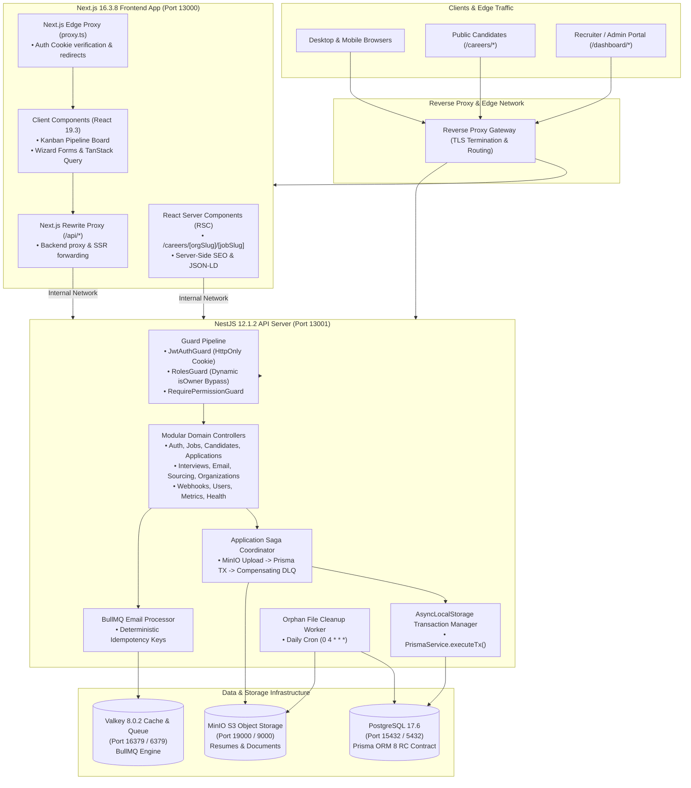

# HaiHire System Architecture & Design Overview

> **Enterprise Multi-Tenant Applicant Tracking System (ATS)**  
> Technical Architecture, Infrastructure Topology, and Core Design Patterns.

---

## 1. System Topology

---

## 2. Technology Stack Baseline

| Tier / Domain                 | Technology                |        Version         | Purpose                                                                 |
| :---------------------------- | :------------------------ | :--------------------: | :---------------------------------------------------------------------- |
| **Runtime Environment**       | Node.js                   |         `26.x`         | Modern Active LTS runtime across Docker and CI.                         |
| **Package Management**        | pnpm                      |        `12.6.0`        | Strict workspace dependency management, zero phantom dependencies.      |
| **Frontend Framework**        | Next.js (App Router)      |        `16.3.8`        | Hybrid RSC + Client architecture, Turbopack, standalone output.         |
| **UI Engine**                 | React                     |         `19.3`         | Modern concurrent rendering, Server Components, and transition hooks.   |
| **Styling Engine**            | Tailwind CSS              |        `v4.0.0`        | CSS-first zero-config design tokens, Slate palette.                     |
| **Backend Framework**         | NestJS                    |        `12.1.2`        | Modular enterprise server architecture, Express engine.                 |
| **Database & ORM**            | PostgreSQL + Prisma       | `17.6` / `8.0.0-rc.13` | Multi-tenant datastore with Prisma Contract-first schema compilation.   |
| **Distributed Cache & Queue** | Valkey (Redis-compatible) |        `8.0.2`         | Open-source Redis replacement for BullMQ queues and cache.              |
| **Object Storage**            | MinIO (S3-compatible)     |     `RELEASE.2025`     | Tenant-segregated PDF/DOCX resume storage with expiring presigned URLs. |
| **Language Baseline**         | TypeScript                |        `6.0.3`         | Strict type safety across backend, frontend, and shared packages.       |
| **Test Runners**              | Vitest + Playwright       |   `5.0.3` / `1.63.0`   | Comprehensive unit/integration tests and browser E2E test suite.        |

---

## 3. Service Topology & Request Flow

1. **Client Ingress:** Requests hit the Edge Gateway or Next.js Frontend depending on route.
2. **Edge Proxy Interception:** `frontend/src/proxy.ts` inspects session authentication cookies (`haihire_token`, `haihire_has_org`) and handles server-side redirects (e.g. unauthenticated users requesting `/dashboard` are redirected to `/auth/login`).
3. **API Routing:**
   - Client requests to `/api/*` are forwarded via Next.js proxy rewrites to the NestJS backend on internal port `13001`.
   - Direct requests to public career pages (`/careers/[orgSlug]/[jobSlug]`) execute as React Server Components (RSC) fetching metadata directly from the backend.
4. **Backend Security Pipeline:**
   - Every API request passes through `JwtAuthGuard`, extracting the user token and tenant context.
   - `RolesGuard` evaluates dynamic ownership via `Organization.ownerId` (granting super-admin bypass) and verifies permissions declared via `@RequirePermission()`.
   - Every controller `@Body()` parameter is validated by `DtoPipe` to enforce fail-fast Zod/class-validator schemas.
5. **Data Persistence:**
   - Relational entities are persisted to PostgreSQL 17 via Prisma 8 contract (`src/prisma/contract.prisma`).
   - Transactions use `PrismaService.executeTx()` with `AsyncLocalStorage` for propagation.
   - File uploads execute via the Saga coordinator combining MinIO S3 storage and DB commits with compensating rollbacks.
   - Background tasks (emails, webhooks, metrics) are dispatched to BullMQ queues powered by Valkey.

---

## 4. Backend Modules

The backend monolith is structured into domain modules located under `backend/src/`:

- `applications/`: Candidate application submissions, pipeline progression, and distributed Saga orchestration.
- `auth/`: Authentication, JWT issuance, cookie handling, passport strategies, and permission guards.
- `candidates/`: Candidate profiles, resumes, tags, and PII protection.
- `common/`: Global exception filters, `DtoPipe`, interceptors, and encryption helpers.
- `config/`: Centralized fail-fast Zod environment schema (`env.ts`).
- `email/`: Multi-provider transactional email delivery (Resend, SendGrid, SMTP, Simulated).
- `interviews/`: Interview scheduling, calendar invites, and interviewer scorecards.
- `jobs/`: Job requisitions, custom hiring pipelines, and stage management.
- `metrics/`: Prometheus metrics collection and alerting probes.
- `organizations/`: Multi-tenant organization boundaries, memberships, and dynamic ownership.
- `prisma/`: Prisma 8 contract, database client, and transaction management.
- `sourcing/`: Sourcing channels, tracking links, and attribution clicks.
- `webhook-settings/`: Outbound tenant webhook notifications (Discord, Telegram, Generic).
