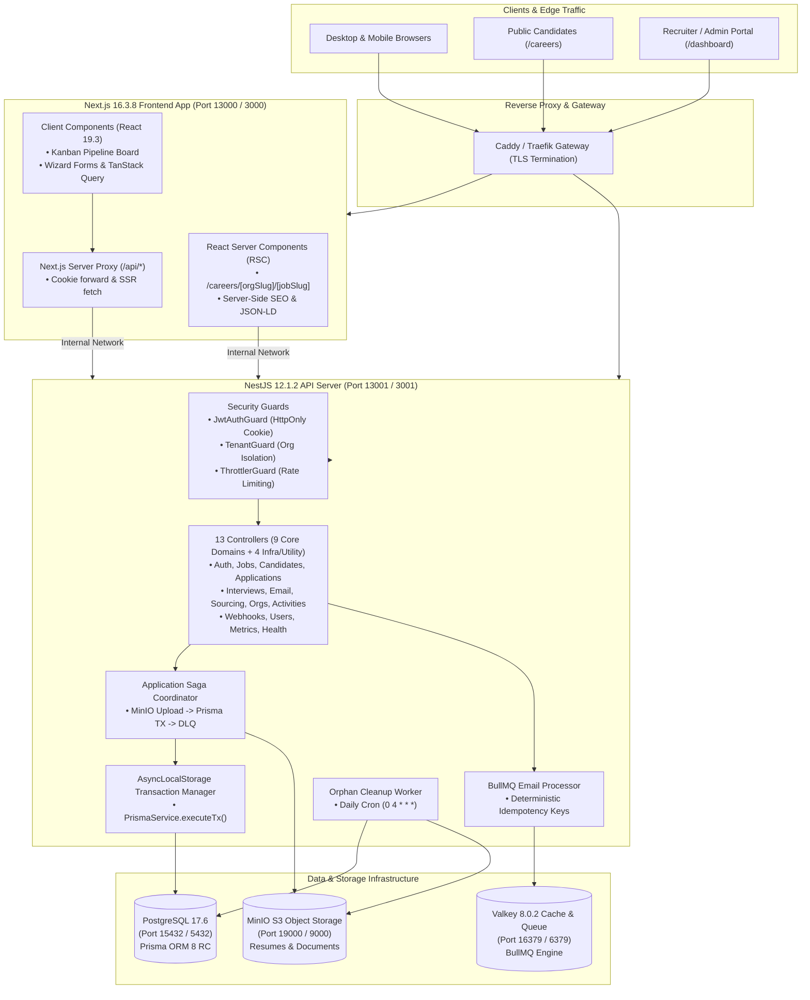

# HaiHire System Architecture & Design Overview

> **Enterprise Multi-Tenant Applicant Tracking System (ATS)**  
> Technical Architecture, Infrastructure Topology, and Core Design Patterns.

---

## 1. System Architecture Diagram



---

## 2. Technology Stack Baseline

| Tier / Domain | Technology | Version | Purpose |
| :--- | :--- | :---: | :--- |
| **Runtime Environment** | Node.js | `26.x` | Modern server runtime baseline across Docker and host. |
| **Package Management** | pnpm | `12.6.0` | Strict workspace dependency management, zero phantom dependencies. |
| **Frontend Framework** | Next.js (App Router) | `16.3.8` | Hybrid RSC + Client SPA architecture, Turbopack, standalone output. |
| **UI Library** | React | `19.3` | Modern concurrent rendering, Server Actions, transition primitives. |
| **Styling Engine** | Tailwind CSS | `v4.0.0` | CSS-first zero-config styling, modern design tokens, Slate palette. |
| **Backend Framework** | NestJS | `12.1.2` | Modular enterprise server architecture, Express adapter. |
| **Database & ORM** | PostgreSQL + Prisma | `17.6` / `8.0.0-rc.13` | Relational multi-tenant datastore with Prisma Contract-first schema. |
| **Distributed Cache & Queue**| Valkey (Redis-compatible) | `8.0.2` | Open-source Redis replacement for BullMQ queues and token blacklists. |
| **Object Storage** | MinIO (S3-compatible) | `RELEASE.2025` | Secure tenant-segregated PDF/DOCX resume storage with presigned URLs. |
| **Language Baseline** | TypeScript | `6.0.3` | 100% strict type-safety across backend, frontend, and shared packages. |
| **Testing Framework** | Vitest + Playwright | `5.0.3` / `1.63.0` | Comprehensive unit/integration tests and browser E2E test suite. |

---

## 3. Core Architectural Patterns

### 3.1 Distributed Saga Pattern (MinIO + Database Writes)
When a candidate submits an application with an attached CV, operations cross both MinIO (unmanaged file storage) and PostgreSQL (relational database). To prevent orphan files:
1. **Step 1 (Upload):** Buffer is uploaded to MinIO at `tenants/${orgId}/resumes/${filename}` with magic-byte verification.
2. **Step 2 (Transactional DB Write):** `PrismaService.executeTx()` atomically records `Candidate`, `Application`, and `CandidateDocument`.
3. **Step 3 (Compensating Rollback):** If DB insert fails, MinIO object deletion is immediately triggered.
4. **Step 4 (DLQ Fallback):** If MinIO delete fails (e.g. storage outage), an entry is pushed to BullMQ `orphan-cleanup-queue` with 5 retries and DLQ alerting.

### 3.2 AsyncLocalStorage Transaction Propagation
Nested service methods reuse the active Prisma transaction without explicit parameter threading:
```typescript
await this.prisma.executeTx(async (tx) => {
  // Nested calls automatically discover 'tx' via AsyncLocalStorage
  await this.candidatesService.create(...);
  await this.applicationsService.create(...);
});
```

### 3.3 Public Career Portal & React Server Components (RSC)
Public career routes (`/careers/[orgSlug]/[jobSlug]`) are rendered on the server as pure Server Components:
- Generates 100% semantic HTML with Google Schema `JobPosting` and `BreadcrumbList` JSON-LD for Generative Engine Optimization (GEO).
- Zero client-side API waterfalls.
- Interactive application modal isolated into an ultra-lean Client Component.
- Anti-FOUC theme script injected via Next.js `<Script id="theme-init" strategy="beforeInteractive">`.

### 3.4 Multi-Tenant Data Isolation
- Strict organizational scoping enforced at both the database layer (`where: { organizationId }`) and the NestJS guard layer (`TenantGuard`).
- Every authenticated request extracts tenant context from the verified JWT payload, preventing cross-tenant leakage.

### 3.5 7 CI Architecture Quality Gates
Every pull request and build must pass 7 automated quality gates:
1. `pnpm lint`: Zero ESLint warnings and zero TypeScript compilation errors.
2. `pnpm typecheck`: Full workspace `tsc --noEmit` validation.
3. `pnpm lint:dtopipe`: 100% of `@Body()` controller parameters guarded by validation pipes.
4. `pnpm lint:error-i18n`: 100% of machine-readable error codes mapped in English and Vietnamese.
5. `pnpm lint:api-contract`: Zero missing endpoints between controllers and client API modules.
6. `pnpm test:e2e`: 10/10 Playwright scenarios passing without console errors or hydration warnings.
7. `pnpm lint:env-sync`: 100% key parity between active `.env` and `.env.example` templates.
