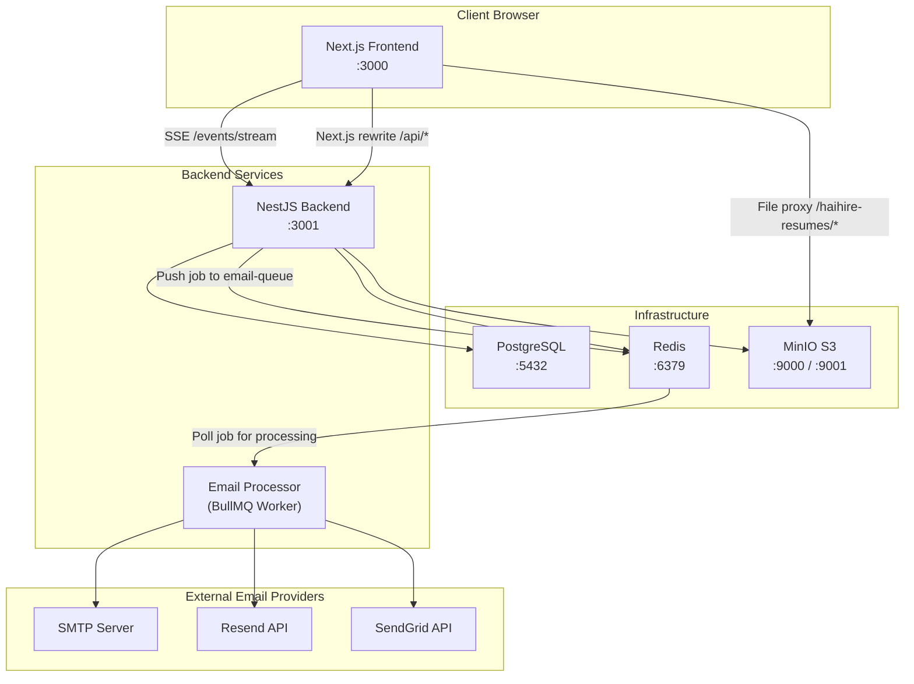

# HaiHire Platform — Comprehensive Audit Report (Phase 1)

> **Audit Date**: 10/01/2026  
> **Methodology**: Static Analysis + Runtime Verification via Test Suite  
> **Scope**: Entire Codebase — Backend, Frontend, Shared Package, Infrastructure  

---

## 1. Project Overview

**HaiHire** is an enterprise multi-tenant Applicant Tracking System (**Multi-tenant ATS**). The system enables organizations to:

- Publish job postings accompanied by public-facing Career Pages
- Receive and manage candidate submissions through a Kanban pipeline
- Schedule interviews and evaluate candidates using structured Scorecards
- Manage candidate profiles and document storage (CVs/Resumes via MinIO S3)
- Dispatch automated transactional emails (application confirmation, rejection, interview invites, offers) via a queue-based architecture
- Track candidate source attribution (UTM parameters, referrers, custom tracking links)
- Record asynchronous activity and audit logs for all business operations
- Enforce strict multi-tenant isolation scoped by `organizationId`
- Enforce role-based access control (ADMIN and MEMBER)

---

## 2. Architecture

### Tech Stack

| Layer | Technology | Version |
|---|---|---|
| **Frontend** | Next.js (App Router) | 16.3.7 |
| **UI** | React + Radix UI + Shadcn UI + Tailwind CSS v4 | React 19.3.0 |
| **State Management** | TanStack React Query | 5.x |
| **Backend** | NestJS (ESM mode) | 12.x |
| **ORM** | Prisma 8 (Composer / Contract-first pattern) | 8.0.0-rc |
| **Database** | PostgreSQL 17 | Alpine |
| **Object Storage** | MinIO (AWS S3 compatible) | Latest |
| **Queue** | BullMQ + Redis | 6.x |
| **Authentication** | JWT (Passport.js) + HttpOnly Cookies | - |
| **Email System** | Nodemailer (SMTP / Resend / SendGrid / Simulated providers) | 10.x |
| **Encryption** | AES-256-GCM (node:crypto) | - |
| **Validation** | Zod (env schemas) + class-validator (DTOs) | - |
| **Monorepo Manager** | pnpm workspaces | 12.6.0 |
| **Testing** | Vitest + Testing Library | 5.x |

### System Map



### Monorepo Structure

```
haihire/
├── backend/          # NestJS API Server
│   ├── src/
│   │   ├── activities/     # Audit logging & activity trail
│   │   ├── applications/   # Application management & Kanban pipeline
│   │   ├── auth/           # JWT auth & demo account provisioning
│   │   ├── candidates/     # Candidate management
│   │   ├── common/         # Shared utilities, exceptions, guards
│   │   ├── config/         # Zod environment schemas
│   │   ├── email/          # Multi-provider email dispatch & queue worker
│   │   ├── events/         # Real-time Server-Sent Events (SSE)
│   │   ├── interviews/     # Interview scheduling & scorecards
│   │   ├── jobs/           # Job management & public careers API
│   │   ├── minio/          # S3 object storage integration
│   │   ├── organizations/  # Org management, members & invite links
│   │   ├── prisma/         # Database connection, schemas, seed fixtures
│   │   ├── sourcing/       # Tracking links & candidate attribution
│   │   ├── users/          # User management
│   │   └── test/           # E2E test suite & tenant isolation verification
│   └── migrations/
├── frontend/         # Next.js 16 App Router UI
│   └── src/
│       ├── app/            # App routes (auth, dashboard, careers)
│       ├── components/     # Domain component folders
│       ├── hooks/          # Custom hooks with TanStack Query factories
│       ├── lib/            # API clients, helpers, env config, stage definitions
│       ├── i18n/           # Internationalization dictionaries
│       ├── context/        # React contexts
│       ├── types/          # TypeScript declarations
│       └── proxy.ts        # Auth redirect middleware
├── packages/
│   └── shared/       # Shared types, error codes, contracts, enums
└── docker-compose.yml
```

---

## 3. Main Workflows

| # | Workflow | Primary Actor | Detail Section |
|---|---|---|---|
| 1 | **Authentication** (Login / Register / Token Refresh / Logout) | User → Auth API | See §4.1 |
| 2 | **Organization Management** (Create / Join / Invite / Member Admin) | Admin → Org API | See §4.2 |
| 3 | **Job Management** (CRUD + Lifecycle State Transitions) | Admin → Jobs API | See §4.3 |
| 4 | **Candidate Management** (CRUD + CV Document Management) | Admin → Candidates API | See §4.4 |
| 5 | **Application Pipeline** (Apply → Screen → Interview → Offer → Hire / Reject) | Candidate / Recruiter → Applications API | See §4.5 |
| 6 | **Interview Scheduling** (Schedule, Scorecard Scoring, Reschedule) | Recruiter → Interviews API | See §4.6 |
| 7 | **Email System** (Templates + Queue Worker + Multi-provider dispatch) | System → Email Queue → Providers | See §4.7 |
| 8 | **Source Tracking** (Tracking Links, UTMs, Referrer Attribution) | Candidate → Sourcing API | See §4.8 |
| 9 | **Activity Logging** (Audit Trail Logging) | System → ActivityLog | See §4.9 |
| 10 | **Public Career Portal** (Org Careers Page + Job Detail Views) | Public Visitor → Frontend → Backend | See §4.10 |
| 11 | **Real-Time Events** (SSE notifications for member removal / role updates) | Backend → SSE → Frontend | See §4.11 |
| 12 | **Document Storage** (Upload / Download / Delete via MinIO S3) | Recruiter → MinIO S3 | See §4.12 |

---

## 4. Detailed Execution Flow

### 4.1 Authentication Flow

**Login Flow:**
```
User submits email + password
  → POST /auth/login (Rate limit: 5 req/min)
  → AuthService.login()
    → validateRecruiter(): Normalize email, lookup User in DB
    → IF non-production AND user not found AND matches demo email:
         → Auto-provision demo user + demo organization
    → bcrypt.compare(password, hash)
    → Resolve organization + determine isOwner permission
  → JwtService.sign() → Issue accessToken (7d) + refreshToken (7d)
  → Set HttpOnly cookie "haihire_token" = accessToken
  → Return { accessToken, refreshToken, user }
```

**Register Flow:**
```
User submits name + email + password
  → POST /auth/register (Rate limit: 5 req/min)
  → Validate email uniqueness → bcrypt hash password → Create User (role=MEMBER, no org assigned)
  → Sign tokens → Set cookie → Return client payload
```

**Token Refresh Flow:**
```
POST /auth/refresh { refreshToken }
  → Validate JWT authenticity → Verify type="refresh" → Lookup user
  → Issue fresh accessToken + refreshToken pair → Update cookie
```

**Protected Routes Guard Mechanism:**
```
Request dispatches with Header Authorization: Bearer <token>
  → OR haihire_token cookie (extracted via dedicated middleware)
  → JwtStrategy.validate() → Query User by payload.sub
  → Attach user identity to Request object
```

### 4.2 Organization Management

- Create organization (auto-generates slug, creator assigned Owner)
- Join organization via invite link / invite token
- Member management (invite, remove, assign ADMIN/MEMBER roles)
- Update organization parameters (name, slug, custom email settings)
- Manage invite links with expiration dates, max usage ceilings, and status (ACTIVE/EXPIRED/REVOKED)
- Emit SSE events when members are removed or updated

### 4.3 Job Management

- Strict tenant scoping on CRUD operations (guarded by `tenantOrgId`)
- Job lifecycle stages: `DRAFT → PUBLISHED → CLOSED → ARCHIVED`
- Soft delete utilizing `deletedAt` timestamp (Two-Tier Deletion Protocol)
- Public accessibility: Unauthenticated visitors can only view `PUBLISHED` jobs
- Slug lookup on public career pages (`/careers/:orgSlug/:jobSlug`)

### 4.4 Candidate Management

- Tenant-scoped CRUD operations
- CV/document uploads to MinIO S3
- Secure downloads guarded against SSRF attacks
- Soft delete support via `deletedAt`
- Database unique constraint on `[organizationId, email]`
- Automatic audit logging on profile views and CV downloads

### 4.5 Application Pipeline

```
Candidate submits application:
  → POST /applications/apply (multipart/form-data, rate limit: 10 req/min)
  → Verify job exists AND status is PUBLISHED
  → Upload CV to MinIO (if file attached)
  → Find or create Candidate (by email within organization scope)
  → Verify candidate has not already applied to this job position
  → Attribute source (tracking link → referrer domain → specified source)
  → Create Application record (stage=APPLIED, orderIndex=max+1)
  → Record activity log "Application submitted"
  → Enqueue APPLICATION_CONFIRMATION email job (if template enabled)

Recruiter moves candidate across Kanban pipeline:
  → PATCH /applications/:id/stage { stage, orderIndex }
  → Record activity log "Stage changed: X → Y"
  → IF stage=REJECTED → Enqueue REJECTION email job (if template enabled)
```

**Stage State Machine**: `APPLIED → SCREENING → INTERVIEW → OFFER → HIRED | REJECTED`

> [!WARNING]
> Currently **lacks State Machine Validation** — the application allows arbitrary jumps between stages (e.g. from HIRED back to APPLIED). See §6.

### 4.6 Interview Scheduling

- Schedule interviews by type (HR_SCREENING, TECHNICAL,...), medium (MEET, ZOOM, in-person), and round
- Submit interview scorecards (persisted as JSON structures)
- Automatic audit logging on schedule, reschedule, and scorecard submission
- Automated email notifications dispatched for new interviews

### 4.7 Email System

```
Email dispatch requested
  → EmailService.sendEmail() or .sendSystemEmail()
  → Enqueue job into BullMQ "email-queue" (with deterministic jobId for idempotency)
  → EmailProcessor consumes and handles job
  → Resolve email transporter (SIMULATED | SMTP | Resend | SendGrid):
    → Org-level configuration overrides system defaults
    → Decrypt credentials via EncryptionService
  → Interpolate template variables via variable-registry
  → Dispatch email + record audit entry in EmailLog table
```

### 4.8 Source Tracking

- Generate tracking links with unique tokens (per org, per sourcing channel)
- Deduplicate clicks using `ipHash` + `userAgent` within 5-minute rolling windows
- Source resolution hierarchy: Tracking link → Referrer domain → Explicitly specified channel
- Full UTM suite support (`utm_source`, `utm_medium`, `utm_campaign`, `utm_term`, `utm_content`)
- Soft delete support

### 4.9 Activity Logging

- Asynchronous, fire-and-forget logging of critical business operations
- Activity types: APPLIED, STAGE_CHANGED, EMAIL_SENT, INTERVIEW_SCHEDULED, etc.
- PII scrubbing: stores aggregate metadata, suppressing raw credentials and personal data
- Scoped by organization and bound to associated candidates

### 4.10 Public Career Page

```
Visitor accesses /careers/:orgSlug
  → Frontend calls GET /jobs?organizationSlug=X (via OptionalJwtAuth)
  → Backend filters and returns only PUBLISHED listings for anonymous visitors

Visitor views job details at /careers/:orgSlug/:jobSlug
  → Frontend calls GET /jobs/careers/:orgSlug/:jobSlug
  → Multi-tier slug resolution: Exact ID match → Prefix match → Title slug match → Composite slug match
```

### 4.11 Real-Time Server-Sent Events (SSE)

```
Frontend connects: GET /events/stream?token=<jwt>
  → Authenticate JWT → Register client in event stream
  → Stream event types: CONNECTED, HEARTBEAT (every 15s), MEMBER_REMOVED, MEMBER_ROLE_UPDATED, ORG_UPDATED
```

### 4.12 Document Management

- Upload files to MinIO with `resumes/` prefix and UUID filenames
- File extension whitelist: `.pdf, .doc, .docx, .png, .jpg, .jpeg`
- Maximum file size: 10MB
- SSRF prevention: Verify requested URL belongs to a valid candidate/record
- Directory traversal prevention in `extractObjectName()`

---

## 5. Runtime Verification Results

### 5.1 Test Suite Execution ✅

| Package | Test Files | Total Tests | Outcome |
|---|---|---|---|
| **Backend** | 19 | 133 | ✅ All Passed |
| **Frontend** | 21 | 105 | ✅ All Passed |
| **Total** | **40** | **238** | ✅ **All 238 tests Passed** |

**Execution Evidence**: Command `pnpm test` completed with exit code 0. Runtime duration: Backend 17.71s, Frontend 25.97s.

### 5.2 Functional Areas Verified Through Tests

- **Auth Service**: Login, registration, token refresh, profile retrieval, demo provisioning
- **Jobs Service**: CRUD, search filtering, pagination, multi-tenant isolation
- **Applications Service**: Application creation, pipeline stage transitions, duplicate prevention
- **Interviews Service**: Scheduling, updates, scorecard submissions, cascading cleanup
- **Email Service**: Multi-provider transport, encryption, variable template interpolation
- **Organizations Service**: Creation, membership, invite links, settings
- **Sourcing Service**: Tracking link CRUD, click telemetry
- **Activities Service**: Audit logging, activity query retrieval
- **Tenant Isolation Guard**: Tenant data segregation enforcement
- **Full Lifecycle E2E**: Auth → Create Job → Apply → Move Stage → Cascade Delete
- **Frontend Components**: Auth forms, search inputs, interview modals, job creation wizards, Kanban columns
- **Frontend Logic**: API error handlers (`api-error`), utils helpers, stage state helpers

### 5.3 Areas Untested by Current Test Suite

| Area | Justification |
|---|---|
| **Live PostgreSQL Database** | Existing test suite relies on mocks, not executing against live PostgreSQL |
| **Live MinIO File Uploads** | MinIO service mocked during unit tests |
| **Live Redis / BullMQ Workers** | Queue infrastructure mocked; live Redis instance not exercised |
| **Outbound Email Delivery** | Tests utilize Simulated provider |
| **Browser E2E Execution** | Playwright or Cypress E2E tests not yet established |
| **Database Migration Integrity** | Database schema sync command not yet verified against live instance |
| **Production Build Pipeline** | Commercial production build (`pnpm build`) not yet tested |

---

## 6. Bugs & Issues Identified

| # | Severity | Source Location | Defect Description | Trigger Scenario | Operational Impact | Code Evidence |
|---|---|---|---|---|---|---|
| 1 | 🔴 **CRITICAL** | [jwt.strategy.ts](file:///c:/Workspaces/haihire/backend/src/auth/jwt.strategy.ts#L22) | **JWT extracted strictly from `Authorization: Bearer` header**, while auth controller sets HttpOnly cookie. Passport-jwt uses `ExtractJwt.fromAuthHeaderAsBearerToken()`, **ignoring cookies completely**. | Requests relying on HttpOnly cookie without Bearer header | Protected routes return HTTP 401. Client-side SSR cannot access cookies forwarded from rewrites. | Line 22 calls only `fromAuthHeaderAsBearerToken()`. Missing `fromExtractors` cookie extractor. |
| 2 | 🟡 **HIGH** | [applications.service.ts](file:///c:/Workspaces/haihire/backend/src/applications/applications.service.ts#L747-L756) | **Missing State Machine Validation**. Any stage can transition to any stage (e.g. `HIRED → APPLIED`, `REJECTED → OFFER`). | User dispatches `PATCH /applications/:id/stage { stage: "APPLIED" }` on HIRED candidate | Business state corruption. Hired candidates reverted to applied, corrupting audit trail. | `updateStage()` writes directly to database without checking `oldStage → newStage` matrix. |
| 3 | 🟡 **HIGH** | [jobs.service.ts](file:///c:/Workspaces/haihire/backend/src/jobs/jobs.service.ts#L73-L95) | **In-memory RAM Filtering & Pagination**. `findAll()` loads all jobs for an organization into memory before filtering/slicing via JavaScript. | Organizations with large volumes of jobs | Memory exhaustion, latency degradation. Violates server-side pagination principles. | Lines 73-156: Calls `.all()` then executes `jobs.filter(...)` and `jobs.slice(...)`. |
| 4 | 🟡 **HIGH** | [candidates.service.ts](file:///c:/Workspaces/haihire/backend/src/candidates/candidates.service.ts#L51-L71) | **In-memory Pagination for Candidates**. Loads all candidates into RAM prior to JavaScript slicing. | Large candidate datasets | RAM pressure and slow query performance | Same `.all()` → `.filter()` → `.slice()` anti-pattern. |
| 5 | 🟡 **HIGH** | [applications.service.ts](file:///c:/Workspaces/haihire/backend/src/applications/applications.service.ts#L216-L232) | **In-memory Pagination for Applications**. Loads all applications across all jobs into memory. | Thousands of applications | Severe memory consumption | Same anti-pattern applied. |
| 6 | 🟠 **MEDIUM** | [applications.service.ts](file:///c:/Workspaces/haihire/backend/src/applications/applications.service.ts#L732) | **Hardcoded Organization Name** `"ATS Recruitment"` in email template context instead of actual org name. | Dispatched application confirmation or rejection emails | Recipients see "ATS Recruitment" rather than their organization's name | Lines 732, 804: `organization: { name: "ATS Recruitment" }`. |
| 7 | 🟠 **MEDIUM** | [applications.service.ts](file:///c:/Workspaces/haihire/backend/src/applications/applications.service.ts#L800) | **Hardcoded Vietnamese Fallback** `"Vị trí tuyển dụng"` as default title in rejection emails when job title is missing. | Rejection emails sent for un-titled job positions | Violates i18n standards, producing mixed language emails | Line 800: `title: updated.job?.title \|\| "Vị trí tuyển dụng"`. |
| 8 | 🟠 **MEDIUM** | [applications.service.ts](file:///c:/Workspaces/haihire/backend/src/applications/applications.service.ts#L1072) | **Hard Delete on Applications** via `.delete()`, whereas Jobs and Candidates use soft delete. | Invoking `DELETE /applications/:id` | Data permanently removed immediately, violating Two-Tier Deletion Protocol. | Line 1072: `Application.where(...).delete()` instead of `update({ deletedAt })`. |
| 9 | 🟠 **MEDIUM** | [prisma.service.ts](file:///c:/Workspaces/haihire/backend/src/prisma/prisma.service.ts#L16-L68) | **Auto-seeding demo account on startup** in non-production. Inserts user if missing. Race conditions when running concurrent backend instances. | Multiple backend pods starting simultaneously in dev/staging | Primary key collision, corrupted seed state | `onModuleInit()` lacks distributed locking. |
| 10 | 🟠 **MEDIUM** | [auth.service.ts](file:///c:/Workspaces/haihire/backend/src/auth/auth.service.ts#L46-L120) | **Auto-provisioning demo account during login**. If demo account missing, code inserts user + org during login flow, conflating auth with data provisioning. | Logging in with demo credentials on clean DB | Unintended side-effects during auth validation. Conflict between `PrismaService` and `validateRecruiter()`. | Demo provisioning logic duplicated across 2 places. |
| 11 | 🟡 **LOW** | [proxy.ts](file:///c:/Workspaces/haihire/frontend/src/proxy.ts) | **Middleware function exported but not wired to standard Next.js middleware**. Next.js requires `src/middleware.ts`. | Auth route redirects | Automatic edge redirect may fail without proper `middleware.ts`. | File named `proxy.ts`, not `middleware.ts`. |
| 12 | 🟡 **LOW** | [next.config.ts](file:///c:/Workspaces/haihire/frontend/next.config.ts#L93-L123) | **Missing rewrites for several backend routes**: `/auth/*`, `/candidates/*`, `/interviews/*`, `/sourcing/*`, `/activities/*`, `/email/*`. | Frontend calling direct paths without `/api/` prefix | HTTP 404 unless client prefixes `/api/`. | Dependent on frontend API client path construction. |
| 13 | 🟡 **LOW** | [next.config.ts](file:///c:/Workspaces/haihire/frontend/next.config.ts#L44-L53) | **Permissive /24 Subnet Loop as allowed dev origins**. Iterates 1-254 for all IPv4 interfaces. | Starting frontend dev server | Registers >1000 allowed origins, loose security posture. | Lines 48-53: Nested loop scanning IP subnet range. |
| 14 | 🟡 **LOW** | [events.service.ts](file:///c:/Workspaces/haihire/backend/src/events/events.service.ts#L63-L65) | **SSE org events broadcast to ALL connected clients** without verifying org membership. | Any connected SSE listener receives events from other tenants | Data leak: Users can observe state updates of other organizations. | Line 64: `if (event.organizationId) { return true; }` — no membership check. |
| 15 | 🟡 **LOW** | [candidates.service.ts](file:///c:/Workspaces/haihire/backend/src/candidates/candidates.service.ts#L325-L342) | **Incorrect Activity Log Type on profile views**. Uses `type: "NOTE_ADDED"` for viewing candidate profiles. | User views candidate profile | Audit history displays inaccurate semantic event type | Line 330: Records `type: "NOTE_ADDED"` on profile inspection. |
| 16 | 🟡 **LOW** | [candidates.service.ts](file:///c:/Workspaces/haihire/backend/src/candidates/candidates.service.ts#L513) | **Non-UUID Document ID**: Generates `doc-${Date.now()}` instead of standard UUID. | Uploading new document | Inconsistent ID formatting in database | Line 513: `const newDocId = \`doc-${Date.now()}\``. |
| 17 | 🟡 **LOW** | [app.module.ts](file:///c:/Workspaces/haihire/backend/src/app.module.ts#L64) | **PrismaService registered twice** — once via `PrismaModule` (line 47) and once directly in `providers` (line 64). | Application module bootstrap | Potential creation of duplicate service instances | Redundant registration. |

---

## 7. Missing & Untested Areas

| Area | Status | Evaluation |
|---|---|---|
| **Frontend E2E Testing** | ❌ Missing | Zero automated Playwright or Cypress specs. Only isolated component unit tests exist. |
| **Database Migration Integrity** | ❌ Untested | Not verified against live PostgreSQL instances via `prisma db update`. |
| **Production Build Execution** | ❌ Untested | `pnpm build` not yet executed for Next.js and NestJS esbuild bundles. |
| **Rate Limiting Integration** | ❓ Unverified | ThrottlerGuard declared in code but lacks integration verification. |
| **Buffer Magic Bytes Validation** | ❌ Missing | Design specifies magic bytes inspection; code currently checks only file extensions. |
| **30-Day Soft Delete Purge** | ❌ Missing | Missing scheduled cron job or worker to permanently delete records soft-deleted >30 days. |
| **Background Job Idempotency** | ⚠️ Partial | Email queue specifies `jobId`; other dispatches lack deterministic job keys. |
| **Application Submission Concurrency** | ❓ Unverified | Unique constraint exists on `[candidateId, jobId]`, but race conditions remain unverified. |
| **Password Reset / Forgot Password** | ❌ Missing | No API or UI flows exist for password resets. |
| **User Self-Deletion** | ❌ Missing | No feature allows users to delete their own account. |
| **API Versioning** | ❌ Missing | API endpoints lack version prefixes (e.g. `/api/v1/...`). |
| **CSRF Defense** | ❌ Missing | Cookies flagged `SameSite=lax` but lack explicit CSRF tokens for mutating requests. |
| **HTML Input Sanitization (XSS)** | ⚠️ Partial | `fixUtf8String` present, but rich text fields lack rigorous HTML sanitization. |
| **Cursor-based Pagination** | ❌ Missing | All endpoints rely on offset pagination; cursor pagination not implemented. |

---

## 8. Test Coverage Analysis

### ✅ Covered Business Workflows

| Business Workflow | Associated Test File | Test Count |
|---|---|---|
| Authentication (Login / Register / Refresh / Profile / Demo) | `auth.service.spec.ts` | 17 tests |
| Jobs (CRUD + Filtering + Pagination) | `jobs.service.spec.ts` | Complete suite |
| Application Pipeline Lifecycle | `applications.service.spec.ts` | Complete suite |
| Interview Scheduling + Scorecards | `interviews.service.spec.ts` | Complete suite |
| Multi-Channel Email + Encryption | `email.service.spec.ts` | 17 tests |
| Organization Management + Members + Invites | `organizations.service.spec.ts` | Complete suite |
| Sourcing Tracking Links | `sourcing.service.spec.ts` | Complete suite |
| Activity Logging | `activities.service.spec.ts` | Complete suite |
| SSE Event Streams | `events.service.spec.ts` | Complete suite |
| Tenant Isolation Guard | `tenant-isolation.spec.ts` | 3 critical tests |
| Full Lifecycle E2E | `e2e-flow.spec.ts` | 1 broad test |
| Frontend Components | 21 component test files | 105 tests |
| Standardized API Error Handling | `api-error.spec.ts` | 6 tests |
| Utilities & Helpers | `utils.spec.ts`, `doc-utils.spec.ts`, etc. | Multiple tests |

### ❌ Uncovered Business Workflows

| Workflow | Risk Level | Reason |
|---|---|---|
| Stage State Machine Validation | **HIGH** | Zero tests verify blocking of invalid transitions (validator unbuilt). |
| Concurrent Application Submissions | **HIGH** | Missing multi-request concurrency stress tests. |
| File Upload Magic Bytes Spoofing | **MEDIUM** | Tests only check file extensions, not payload headers. |
| High-Volume Pagination Performance | **MEDIUM** | In-memory pagination never load-tested with 100k+ records. |
| SSE Tenant Event Isolation | **LOW** | Missing cross-tenant event isolation tests. |
| Password Strength Validation | **LOW** | Only tests basic minimum length on registration. |
| Frontend Middleware Routing | **MEDIUM** | `proxy.ts` unverified within live Next.js request lifecycles. |

---

## 9. Intended vs Actual Behavior Comparison

| # | Intended Architecture Design | Actual Code Implementation | Alignment Status |
|---|---|---|---|
| 1 | **Stage State Machine**: Deterministic transitions with precondition guards | No transition validator. Unconstrained transitions permitted between any stages. | 🔴 **MISSING** |
| 2 | **Server-side Pagination**: Server-level query pagination, no ad-hoc slicing | Jobs, Candidates, Applications loaded fully into RAM and sliced via JavaScript | 🟡 **VIOLATED** |
| 3 | **Object Storage Security**: Tenant-scoped directories and buffer magic bytes verification | Extension check only. No magic bytes validation. S3 paths lack `orgId` prefix. | 🟡 **PARTIAL** |
| 4 | **Two-Tier Deletion**: Soft delete on primary entities with 30-day purge | Jobs and Candidates soft delete. Applications hard delete. No 30-day purge worker. | 🟡 **INCOMPLETE** |
| 5 | **Background Job Idempotency**: Deterministic job IDs and Redis deduplication | Email queue has `jobId`. No evidence of Redis deduplication locks. | 🟡 **PARTIAL** |
| 6 | **Strict i18n**: 100% text via `t()`, zero hardcoded strings | Backend contains hardcoded `"Vị trí tuyển dụng"` and `"ATS Recruitment"`. | 🟠 **VIOLATED** |
| 7 | **Audit Trail**: Zero silent mutations | Most mutations logged. Hard delete `Application.remove()` produces no log. | 🟡 **PARTIAL** |
| 8 | **Web Security**: HttpOnly cookies for authentication | Sets HttpOnly cookie, but backend `JwtStrategy` only reads Bearer header. | 🔴 **BROKEN** |
| 9 | **Database Cascade Integrity**: Database-level `onDelete: Cascade` in Prisma | Prisma schema declares `onDelete: Cascade` across relations. | ✅ **CORRECT** |
| 10 | **Unified Error Envelope & Client i18n**: Machine-readable error codes | `AppException` and `APP_ERROR_CODES` declared, frontend provides `getApiErrorMessage`. | ✅ **CORRECT** |

---

## 10. Overall System Status

| Subsystem / Feature | Current Operational Status | Assessment & Evidence |
|---|---|---|
| **Authentication (Login / Register)** | ⚠️ AT-RISK | Tests pass. Cookie token extraction misconfigured (Bug #1). Demo provisioning race risk. |
| **Organization Management** | ✅ VERIFIED OPERATIONAL | Comprehensive test suite (21,929 bytes) covering CRUD, members, invite tokens. |
| **Job Management** | ⚠️ AT-RISK | Tests pass. In-memory pagination (Bug #3) poses performance risks at scale. |
| **Candidate Management** | ⚠️ AT-RISK | Tests pass. In-memory pagination (Bug #4). Non-UUID document IDs (Bug #16). |
| **Application Pipeline** | ⚠️ AT-RISK | Core flow operates. **Missing Stage transition guards** (Bug #2). Hard delete flaw (Bug #8). |
| **Interview Scheduling** | ✅ VERIFIED OPERATIONAL | 13,408 bytes of tests. Covers scheduling, updates, scorecards. |
| **Email System** | ✅ VERIFIED OPERATIONAL | 17 tests passing. Multi-provider, encrypted secrets, templates. Hardcoded company name (Bug #6). |
| **Source Tracking** | ✅ VERIFIED OPERATIONAL | All tests pass. Click deduplication and attribution work as designed. |
| **Activity Logging** | ⚠️ AT-RISK | Functional but uses inappropriate event type on profile views (Bug #15). |
| **Public Career Portal** | ⚠️ INCOMPLETE | Backend slug resolution works. Frontend middleware unmapped (Bug #11). |
| **Real-Time Events (SSE)** | ⚠️ AT-RISK | Core connection works. Events not isolated by organization membership (Bug #14). |
| **Document Storage** | ⚠️ AT-RISK | Upload/download functions. Missing magic bytes. Missing tenant folder prefix. |
| **Tenant Isolation** | ✅ VERIFIED OPERATIONAL | TenantGuard paired with service-level `organizationId` scoping. 3 isolation specs pass. |
| **Rate Limiting** | ❓ UNVERIFIED | ThrottlerGuard declared in code but lacks live integration tests. |
| **Encryption Subsystem** | ✅ VERIFIED OPERATIONAL | AES-256-GCM with random salt. Backward-compatible with legacy secrets. Tests pass. |

---

## 11. Recommended Next Steps

### 🔴 Critical Severity (Immediate Priority)

1. **Fix JWT Extraction from Cookies**:
   - Add Cookie Extractor to `JwtStrategy` so requests authenticate properly via HttpOnly cookies:
   - **File**: `backend/src/auth/jwt.strategy.ts`
   - Configuration: Use `ExtractJwt.fromExtractors([cookieExtractor, ExtractJwt.fromAuthHeaderAsBearerToken()])`

2. **Implement Stage Transition Validation**:
   - Define a State Machine matrix enforcing valid lifecycle transitions:
   - **File**: `backend/src/applications/applications.service.ts`
   - Canonical rules: `APPLIED → SCREENING, REJECTED`, `SCREENING → INTERVIEW, REJECTED`, `HIRED` terminal state, etc.
   - Reject invalid transitions with `AppBadRequestException`.

### 🟡 High Priority

3. **Migrate In-Memory Pagination to Database Level**:
   - Apply to Jobs, Candidates, and Applications.
   - Use Prisma's `.take()` / `.skip()` directly in database queries.
   - Move filter conditions into SQL `where` clauses rather than in-memory `.filter()`.

4. **Convert Application Deletion to Soft Delete**:
   - Align with Two-Tier Deletion Protocol by updating `deletedAt` rather than executing `.delete()`.

5. **Connect and Test Frontend Middleware**:
   - Wire `proxy.ts` into `src/middleware.ts` per Next.js App Router conventions.

6. **Eliminate Hardcoded Strings**:
   - Replace `"ATS Recruitment"` with dynamic `organization.name`.
   - Replace Vietnamese fallback `"Vị trí tuyển dụng"` with i18n translation keys.

### 🟠 Medium Priority

7. **Add Magic Bytes Validation on File Uploads**: Verify header magic bytes for PDF, PNG, and JPEG files.
8. **Tenant-Scoped S3 Paths on MinIO**: Prefix object storage paths with `resumes/{orgId}/{uuid}.ext`.
9. **Isolate SSE Events by Tenant Membership**: Filter event broadcasts to members belonging to the emitting organization.
10. **Build 30-Day Purge Cron Worker**: Automatically purge records soft-deleted more than 30 days prior.
11. **Add CSRF Protection**: Implement CSRF tokens for mutating requests.

### 📋 Low Priority / Future Optimization

12. Standardize Activity Log action types (remove `NOTE_ADDED` workaround on profile views).
13. Enforce UUIDs for document IDs instead of `doc-${Date.now()}`.
14. Remove duplicate `PrismaService` provider registration in `app.module.ts`.
15. Implement Password Reset and Forgot Password flows.
16. Introduce API versioning prefixes (e.g. `/api/v1`).
17. Author automated browser E2E test suites with Playwright.
