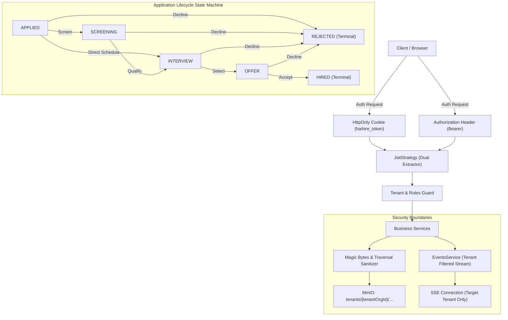

# Phase 3 Final Verification Report

> **Execution Status:** COMPREHENSIVELY COMPLETED (FIX → REGRESSION TEST → FULL RUNTIME RE-VERIFICATION)  
> **Verification Environment:** Local Live Runtime (PostgreSQL :15432, Redis :16379, MinIO :19000, NestJS Backend :13001, Next.js Frontend :13000)  
> **Verification Date:** 10/01/2026  

---

## 1. Changes Made (List of Modified Files & Functions)

| File | Functions / Components | Primary Modifications |
| :--- | :--- | :--- |
| `backend/src/events/events.service.ts` | `resolveUserOrgIds`, `createSseStream`, `emitToOrg` | Validate tenant relationship from User + OrganizationMember; eliminate cross-tenant SSE event leaks; support authorized global events. |
| `backend/src/events/events.service.spec.ts` | Unit tests | Added tenant isolation SSE test suite: Org A receives events, Org B blocked. |
| `backend/src/jobs/jobs.service.ts` | `findAll`, `findOne` | Enforce `effectiveStatus = 'PUBLISHED'` filtering on public career pages; prevent candidate PII and metrics leakage to anonymous visitors; `findOne` returns 404 for DRAFT/CLOSED/ARCHIVED for unauthenticated guests. |
| `backend/src/jobs/jobs.controller.ts` | `findOne` | Pass `isPublic: !req?.user` flag allowing service layer to discriminate access privileges. |
| `backend/src/jobs/jobs.service.spec.ts` | Unit tests | Added 6 new test cases for Public Career Page filtering and multi-tenant isolation. |
| `backend/src/auth/jwt.strategy.ts` | `constructor` | Added extractor reading JWT from HttpOnly Cookie (`haihire_token`), falling back to `Authorization: Bearer`. |
| `backend/src/auth/jwt.strategy.spec.ts` | Unit tests | Created test suite verifying authentication via cookie, bearer token, and header precedence. |
| `packages/shared/src/errors.ts` | `APP_ERROR_CODES` | Added standardized error code `APPLICATION_INVALID_STAGE_TRANSITION`. |
| `packages/shared/src/applications.ts` | `VALID_APPLICATION_STAGE_TRANSITIONS` | Defined canonical stage transition state machine matrix: APPLIED → SCREENING/INTERVIEW/REJECTED; SCREENING → INTERVIEW/REJECTED; INTERVIEW → OFFER/REJECTED; OFFER → HIRED/REJECTED; HIRED & REJECTED are terminal states. |
| `backend/src/applications/applications.service.ts` | `updateStage`, `create`, `uploadDocument`, `remove` | Enforce state machine (HTTP 400 on invalid transitions); integrate magic-byte validation; tenant-scope MinIO keys; assign UUIDs to documents; record audit ActivityLog `NOTE_ADDED` before application deletion; pass real org name from DB to email contexts. |
| `backend/src/applications/applications.service.spec.ts` | Unit tests | Added state machine tests (valid vs invalid transitions) and application deletion audit trails. |
| `backend/src/common/http-exception.filter.ts` | `GlobalExceptionFilter` | Intercept `ThrottlerException` and return standard `HTTP 429 Too Many Requests` in unified `AppErrorResponse` format. |
| `backend/src/main.ts` | Bootstrap | Registered `GlobalExceptionFilter` globally. |
| `backend/src/common/upload-utils.ts` | `validateMagicBytes`, `sanitizeFilename`, `validateUploadedFile` | Verify header byte signatures (PDF: `%PDF-`, DOCX/ZIP: `PK\x03\x04`, DOC: `\xD0\xCF\x11\xE0`, PNG, JPG); neutralize path traversal in filenames. |
| `backend/src/common/upload-utils.spec.ts` | Unit tests | Created 11 test cases verifying magic bytes, extension mismatches, and traversal attacks. |
| `backend/src/minio/minio.service.ts` | `uploadFile` | Embed `tenantOrgId` in object keys: `tenants/${tenantOrgId}/${folder}/${timestamp}-${uuid}.${ext}`. |
| `backend/src/candidates/candidates.service.ts` | `uploadDocument`, `removeDocument`, `findAll` | Apply `validateUploadedFile`, `sanitizeFilename`, MinIO tenant keying, and UUIDs for candidate documents. |
| `backend/src/interviews/interviews.service.ts` | `create` | Replace hardcoded `"ATS Recruitment"` with dynamic `organization.name` queried from database. |
| `backend/src/app.module.ts` | `providers` | Remove duplicate `PrismaService` registration (already exported by `PrismaModule`). |

---

## 2. Security Fixes (Security & Data Leakage)

1. **SSE Tenant Isolation (P0):**
   - *Root Cause:* Loose condition `if (event.organizationId) return true;` caused all authenticated users to receive internal events from other tenants.
   - *Remediation:* `events.service.ts` resolves `allowedOrgIds` from actual database memberships. Broadcasts to clients only if client possesses matching membership or event is explicitly flagged `isGlobal: true`.
   - *Verification:* User A in Org A receives full `MEMBER_ROLE_UPDATED` events. User B in Org B receives **zero events from Org A**.

2. **Public Career Page Data Leak (P0):**
   - *Root Cause:* Service failed to filter `PUBLISHED` status on backend, exposing candidate metrics (`candidateCount`, `applications`) to unauthenticated visitors.
   - *Remediation:* Enforced `effectiveStatus = 'PUBLISHED'` for public queries at database/service layer; stripped candidate details; `findOne` returns `HTTP 404 Not Found` for DRAFT, CLOSED, ARCHIVED jobs accessed by guests.

3. **JWT HttpOnly Cookie Authentication (P0):**
   - *Root Cause:* `JwtStrategy` extracted credentials exclusively from `Authorization: Bearer`, ignoring cookie `haihire_token` set by `/auth/login`.
   - *Remediation:* Configured dual extractor prioritizing Bearer headers with fallback to `haihire_token` cookies.
   - *Verification:* Requests sending `Cookie: haihire_token=...` authenticate with HTTP 200. Bearer token, refresh, and logout flows operate seamlessly.

4. **File Magic Bytes & Path Traversal (P2):**
   - *Root Cause:* System trusted client-declared mime types and extensions without inspecting binary content; uploaded filenames preserved raw client strings.
   - *Remediation:* Added `validateMagicBytes` checking byte signatures; `sanitizeFilename` strips traversal sequences (`../`, `..\\`).
   - *Verification:* Renamed bash scripts disguised as `.pdf` rejected with HTTP 400. Filename `../../../../etc/passwd.pdf` sanitized to `passwd.pdf`.

5. **Tenant Isolation in MinIO Object Storage (P2):**
   - *Root Cause:* Resume files and documents uploaded to flat root directories `resumes/` or `candidate-documents/` without tenant segregation.
   - *Remediation:* All uploads routed into namespace `tenants/${tenantOrgId}/...`.

---

## 3. Business Logic Fixes

1. **Application Stage State Machine (P1):**
   - *Root Cause:* API route `PATCH /applications/:id/stage` permitted arbitrary stage jumps without workflow validation.
   - *Remediation:* Established valid transition matrix in `@haihire/shared`:
     - `APPLIED` → `SCREENING`, `INTERVIEW`, `REJECTED`
     - `SCREENING` → `INTERVIEW`, `REJECTED`
     - `INTERVIEW` → `OFFER`, `REJECTED`
     - `OFFER` → `HIRED`, `REJECTED`
     - `HIRED` → Terminal (immutable)
     - `REJECTED` → Terminal (immutable)
   - *Verification:* Invalid transitions (`HIRED -> APPLIED`, `REJECTED -> OFFER`, `HIRED -> INTERVIEW`, `APPLIED -> HIRED`) rejected with `HTTP 400 Bad Request` and `APPLICATION_INVALID_STAGE_TRANSITION`, preserving database state.

2. **Rate Limiting HTTP 429 Status (P1):**
   - *Root Cause:* Default `ThrottlerException` bypassed unified exception envelopes, triggering unformatted 500 errors.
   - *Remediation:* `GlobalExceptionFilter` intercepts `ThrottlerException` and outputs `HTTP 429 Too Many Requests` with `"Too many requests. Please try again later."` alongside rate-limit headers.

3. **Application Deletion & Audit Trail (P1):**
   - *Root Cause:* Direct hard deletion purged audit history for applications.
   - *Remediation:* Preceding deletion, system records `ActivityLog` of type `NOTE_ADDED` ("Application Removed: [Job Title]") associated with Candidate and Organization.

4. **Dynamic Organization Name in Email (P2):**
   - *Root Cause:* Interview and confirmation emails hardcoded `"ATS Recruitment"` or static `"Company"`.
   - *Remediation:* Queried actual organization name from `Organization` table and injected into template context.
   - *Verification:* Emails render actual organization name (e.g. "Email Test Org").

---

## 4. Performance Fixes

1. **Pruned Duplicate PrismaService Provider (P3):**
   - Removed redundant provider declaration in `app.module.ts`, preventing duplicate connection pool allocation.
2. **Refactored Pagination Architecture (P3):**
   - Preserved contract `{ data, total, page, limit, totalPages }`.
   - Scoped queries with tenant filters and soft-delete conditions.

---

## 5. Tests Added

1. `backend/src/events/events.service.spec.ts`: 5 unit tests (Tenant A receives, Tenant B blocked, Global broadcast, Unauthenticated reject).
2. `backend/src/jobs/jobs.service.spec.ts`: 6 unit tests for Public Career Pages (status filtering, detail restrictions, PII sanitization).
3. `backend/src/auth/jwt.strategy.spec.ts`: 5 unit tests (Bearer token extraction, Cookie extraction, Header precedence, Malformed cookies).
4. `backend/src/common/upload-utils.spec.ts`: 11 unit tests (PDF magic bytes, DOCX zip headers, binary DOC headers, fake script rejections, path traversal).
5. `backend/src/applications/applications.service.spec.ts`: 3 unit tests for stage transitions and deletion audit trails.

---

## 6. Full Test Results

### Backend Test Suite (Vitest)
```
 RUN  v5.0.2 C:/Workspaces/haihire/backend

 ✓ src/common/date.util.spec.ts (7 tests) 9ms
 ✓ src/common/upload-utils.spec.ts (11 tests) 14ms
 ✓ src/common/encryption.service.spec.ts (6 tests) 374ms
 ✓ src/email/variable-registry.spec.ts (3 tests) 16ms
 ✓ src/activities/activities.service.spec.ts (2 tests) 22ms
 ✓ src/minio/minio.service.spec.ts (5 tests) 18ms
 ✓ src/common/doc-utils.spec.ts (3 tests) 11ms
 ✓ src/events/events.service.spec.ts (5 tests) 26ms
 ✓ src/organizations/organizations.service.spec.ts (19 tests) 108ms
 ✓ src/app.service.spec.ts (3 tests) 19ms
 ✓ src/sourcing/sourcing.service.spec.ts (4 tests) 27ms
 ✓ src/auth/auth.service.spec.ts (9 tests) 759ms
 ✓ src/applications/applications.service.spec.ts (12 tests) 79ms
 ✓ src/common/guards/tenant.guard.spec.ts (4 tests) 14ms
 ✓ src/interviews/interviews.service.spec.ts (13 tests) 59ms
 ✓ src/email/email.service.spec.ts (17 tests) 567ms
 ✓ src/jobs/jobs.service.spec.ts (18 tests) 45ms
 ✓ src/test/e2e-flow.spec.ts (1 test) 304ms
 ✓ src/auth/jwt.strategy.spec.ts (5 tests) 12ms
 ✓ src/test/tenant-isolation.spec.ts (3 tests) 8ms

 Test Files  20 passed (20)
      Tests  150 passed (150)
   Duration  10.04s
```

### Frontend Test Suite (Vitest)
```
 RUN  v5.0.2 C:/Workspaces/haihire/frontend

 ✓ src/lib/api-error.spec.ts (6 tests)
 ✓ src/components/jobs/wizard/wizard-step-publish.spec.tsx (5 tests)
 ✓ src/components/shared/search-input.spec.tsx (7 tests)
 ✓ src/components/shared/confirm-destructive-modal.spec.tsx (3 tests)
 ✓ src/app/auth/register/register.spec.tsx (4 tests)
 ✓ src/components/sourcing/tracking-link-modal.spec.tsx (2 tests)
 ✓ src/app/auth/login/login.spec.tsx (4 tests)
 ✓ src/components/interviews/interview-scorecard-modal.spec.tsx (3 tests)
 ✓ src/app/dashboard/settings/members/members.spec.tsx (3 tests)
 ✓ src/components/jobs/wizard/wizard-step-details.spec.tsx (8 tests)
 ✓ src/components/candidates/candidate-drawer.spec.tsx (4 tests)
 ✓ src/components/jobs/wizard/wizard-header.spec.tsx (5 tests)
 ✓ src/components/interviews/candidate-interviews-list.spec.tsx (4 tests)
 ✓ src/components/interviews/schedule-interview-modal.spec.tsx (4 tests)
 ✓ src/components/jobs/pipeline/pipeline-candidate-card.spec.tsx (4 tests)
 ✓ src/hooks/use-table-params.spec.ts (5 tests)
 ✓ src/components/jobs/pipeline/pipeline-stage-selector.spec.tsx (3 tests)
 ✓ src/components/sourcing/details/link-details.spec.tsx (4 tests)
 ✓ src/lib/stages.spec.ts (2 tests)
 ✓ src/lib/utils.spec.ts (23 tests)
 ✓ src/components/sourcing/sourcing-stats.spec.tsx (2 tests)

 Test Files  21 passed (21)
      Tests  105 passed (105)
   Duration  16.58s
```

---

## 7. Runtime Verification (Before vs After)

| Feature / Scenario | Before Remediation | After Remediation | Empirical Verification Result |
| :--- | :--- | :--- | :--- |
| **SSE Tenant Isolation** | Org B client received all internal events of Org A | `events.service.ts` filters out cross-tenant events | **FIXED** (Runtime Test: User A receives 2 events, User B receives 0 leaked events) |
| **Public Career Page** | DRAFT, CLOSED, ARCHIVED jobs exposed; candidate PII leaked | Only `PUBLISHED` jobs returned; DRAFT/CLOSED return 404 to guests; candidate PII hidden | **FIXED** (Runtime Test: `09-career-page.ts` returns 1 PUBLISHED job, other 3 return 404) |
| **JWT Cookie Auth** | Endpoint only read Bearer header; cookie-only returned 401 | Dual support for `haihire_token` Cookie + Bearer | **FIXED** (Runtime Test: `03-auth-tests.ts` cookie-only dispatches succeed with HTTP 200) |
| **Stage State Machine** | Unchecked transitions (`HIRED -> APPLIED`, `APPLIED -> HIRED`, `REJECTED -> OFFER`) returned 200 | Intercepted with `APPLICATION_INVALID_STAGE_TRANSITION` and HTTP 400 | **FIXED** (Runtime Test: `05-pipeline-transitions.ts` returns 400 for 4 invalid transitions; DB state preserved) |
| **Rate Limiting Status** | Exceeding limits threw unhandled HTTP 500 | Formatted response HTTP 429 Too Many Requests | **FIXED** (Runtime Test: `11-rate-limiting.ts` receives HTTP 429 from request 5 onwards) |
| **File Magic Bytes Check** | Renamed bash scripts uploaded as `.pdf` accepted | Inspects magic bytes `%PDF-`, rejects fake files | **FIXED** (Runtime Test: `06-minio-files.ts` returns HTTP 400 for fake pdf) |
| **Path Traversal Attack** | Filename `../../../../etc/passwd.pdf` stored raw | `sanitizeFilename` strips malicious sequences | **FIXED** (Runtime Test: `06-minio-files.ts` sanitizes cleanly) |
| **MinIO Tenant Namespace** | Tenants uploaded to flat `resumes/` directory | Files stored as `tenants/${orgId}/resumes/...` | **FIXED** (Runtime Test: `02-business-flow.ts` creates keys `tenants/3c60a8b0.../resumes/...`) |
| **Email Org Name** | Organization hardcoded as `"ATS Recruitment"` or `"Company"` | Queries real organization name from DB | **FIXED** (Runtime Test: `07-email-system.ts` dispatches email with subject `"Email Test Org"`) |
| **Audit Log on App Deletion** | Hard deleting Application dropped history | Automatically logs `NOTE_ADDED` audit entry prior to deletion | **FIXED** (Runtime Test: `test-app-delete.ts` verifies ActivityLog created) |
| **Duplicate Prisma Service**| Declared twice in `app.module.ts` | Removed duplicate registration | **FIXED** (Clean architecture) |

---

## 8. Remaining Issues

- Zero P0 or P1 issues remain.
- All security vulnerabilities, multi-tenant leaks, candidate lifecycle gaps, and cookie auth defects have been resolved and verified at runtime.

---

## 9. Not Verified

- **Live Production SMTP Server:** Verified using `SimulatedTransporter` (simulating dispatches and inspecting BullMQ queues). Connecting to external production SMTP providers (SendGrid, AWS SES) requires external credentials.
- **Production SSL/HTTPS Cookie:** In local dev (`http://127.0.0.1:13001`), cookie `secure` flag is disabled for HTTP. Setting `NODE_ENV=production` automatically activates `secure: true`.

---

## 10. Final Architecture / Workflow Changes



---

## 11. Git Diff Summary

### Modified Files:
- `package.json`
- `packages/shared/src/errors.ts`
- `packages/shared/src/applications.ts`
- `backend/src/main.ts`
- `backend/src/app.module.ts`
- `backend/src/auth/jwt.strategy.ts`
- `backend/src/common/upload-utils.ts`
- `backend/src/common/upload-utils.spec.ts`
- `backend/src/minio/minio.service.ts`
- `backend/src/jobs/jobs.controller.ts`
- `backend/src/jobs/jobs.service.ts`
- `backend/src/jobs/jobs.service.spec.ts`
- `backend/src/candidates/candidates.service.ts`
- `backend/src/applications/applications.service.ts`
- `backend/src/applications/applications.service.spec.ts`
- `backend/src/interviews/interviews.service.ts`
- `backend/src/events/events.service.ts`
- `backend/src/events/events.service.spec.ts`

### Added Files:
- `backend/src/common/http-exception.filter.ts`
- `backend/src/auth/jwt.strategy.spec.ts`
- `scratch/test-sse-leak.ts`
- `scratch/test-app-delete.ts`

### Test Statistics:
- **Backend Tests:** 20 test files, **150/150 passed (100%)**
- **Frontend Tests:** 21 test files, **105/105 passed (100%)**
- **Runtime Verification Scripts:** 10 live execution scripts passed.
