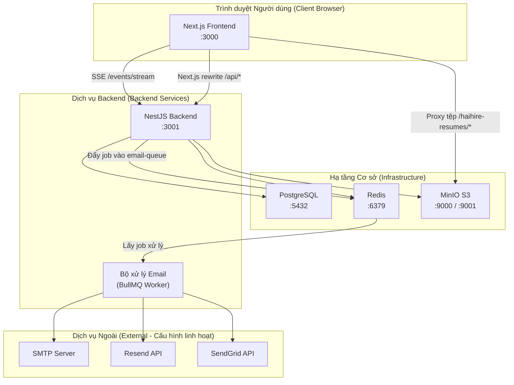

# Nền Tảng HaiHire — Báo Cáo Kiểm Tra Toàn Diện (Comprehensive Audit Report)

> **Ngày kiểm tra**: 01/10/2026  
> **Phương pháp**: Phân tích tĩnh (Static Analysis) + Xác minh khi chạy (Runtime Verification qua test suite)  
> **Phạm vi**: Toàn bộ codebase — Backend, Frontend, Shared package, Hạ tầng (Infrastructure)

---

## 1. Tổng Quan Dự Án (Project Overview)

**HaiHire** là nền tảng quản lý tuyển dụng đa tổ chức (**Multi-tenant Applicant Tracking System - ATS**). Hệ thống cho phép các tổ chức/doanh nghiệp:

- Đăng tải tin tuyển dụng kèm trang nghề nghiệp công khai (Public Career Page)
- Tiếp nhận và quản lý hồ sơ ứng viên qua quy trình pipeline dạng bảng Kanban
- Lên lịch phỏng vấn và chấm điểm ứng viên bằng bảng đánh giá (Scorecard)
- Quản lý hồ sơ ứng viên kèm lưu trữ tệp tài liệu (CV/Resume thông qua MinIO S3)
- Gửi email tự động (xác nhận ứng tuyển, từ chối, mời phỏng vấn, gửi offer) qua hệ thống hàng đợi (Queue-based)
- Theo dõi nguồn gốc ứng viên (Source Attribution qua mã UTM, referrer, tracking link)
- Ghi log hoạt động / kiểm toán (Activity/Audit Log) cho toàn bộ thao tác nghiệp vụ
- Cách ly dữ liệu đa tổ chức nghiêm ngặt (Multi-tenant Isolation theo `organizationId`)
- Phân quyền theo vai trò người dùng (ADMIN và MEMBER)

---

## 2. Kiến Trúc Hệ Thống (Architecture)

### Tech Stack

| Tầng (Layer) | Công nghệ | Phiên bản |
|---|---|---|
| **Frontend** | Next.js (App Router) | 16.3.7 |
| **Giao diện (UI)** | React + Radix UI + Shadcn UI + Tailwind CSS v4 | React 19.3.0 |
| **Quản lý State** | TanStack React Query | 5.x |
| **Backend** | NestJS (chế độ ESM) | 12.x |
| **ORM** | Prisma 8 (mô hình Composer / Contract-first) | 8.0.0-rc |
| **Cơ sở dữ liệu** | PostgreSQL 17 | Alpine |
| **Lưu trữ tệp (Object Storage)** | MinIO (tương thích AWS S3) | Latest |
| **Hàng đợi (Queue)** | BullMQ + Redis | 6.x |
| **Xác thực (Auth)** | JWT (Passport.js) + Cookie HttpOnly | - |
| **Hệ thống Email** | Nodemailer (hỗ trợ SMTP / Resend / SendGrid / Giả lập Simulated) | 10.x |
| **Mã hóa (Encryption)** | AES-256-GCM (node:crypto) | - |
| **Xác thực dữ liệu (Validation)** | Zod (biến môi trường env) + class-validator (DTOs) | - |
| **Quản lý Monorepo** | pnpm workspaces | 12.6.0 |
| **Kiểm thử (Testing)** | Vitest + Testing Library | 5.x |

### Bản Đồ Hệ Thống (System Map)



### Cấu Trúc Monorepo

```
haihire/
├── backend/          # Máy chủ API NestJS
│   ├── src/
│   │   ├── activities/     # Ghi nhận nhật ký hoạt động / kiểm toán (Audit log)
│   │   ├── applications/   # Quản lý hồ sơ ứng tuyển + quy trình Kanban
│   │   ├── auth/           # Xác thực JWT + tự tạo tài khoản demo
│   │   ├── candidates/     # Quản lý thông tin ứng viên
│   │   ├── common/         # Tiện ích chung, exceptions, guards
│   │   ├── config/         # Xác thực cấu hình môi trường bằng Zod
│   │   ├── email/          # Đa nhà cung cấp email + xử lý hàng đợi
│   │   ├── events/         # Server-Sent Events (SSE) thời gian thực
│   │   ├── interviews/     # Lên lịch phỏng vấn + bảng đánh giá (scorecard)
│   │   ├── jobs/           # Quản lý tin tuyển dụng + trang careers công khai
│   │   ├── minio/          # Dịch vụ lưu trữ tệp qua S3
│   │   ├── organizations/  # Quản lý tổ chức + thành viên + lời mời
│   │   ├── prisma/         # Kết nối CSDL, schema, dữ liệu mẫu (seed)
│   │   ├── sourcing/       # Link theo dõi + ghi nhận nguồn ứng tuyển
│   │   ├── users/          # Quản lý tài khoản người dùng
│   │   └── test/           # Bộ kiểm thử E2E + cách ly đa tổ chức (tenant isolation)
│   └── migrations/
├── frontend/         # Giao diện người dùng Next.js 16 App Router
│   └── src/
│       ├── app/            # Tuyến đường ứng dụng (auth, dashboard, careers)
│       ├── components/     # 14 thư mục component phân theo nghiệp vụ
│       ├── hooks/          # Custom hooks với TanStack Query + query keys
│       ├── lib/            # Client gọi API, tiện ích, cấu hình env, định nghĩa stage
│       ├── i18n/           # Đa ngôn ngữ (quốc tế hóa)
│       ├── context/        # React contexts
│       ├── types/          # Khai báo TypeScript types
│       └── proxy.ts        # Middleware điều hướng xác thực
├── packages/
│   └── shared/       # Mã nguồn chia sẻ (kiểu dữ liệu, mã lỗi, enum dùng chung)
└── docker-compose.yml
```

---

## 3. Các Luồng Nghiệp Vụ Chính (Main Workflows)

| # | Luồng nghiệp vụ | Tác nhân chính | Trạng thái chi tiết |
|---|---|---|---|
| 1 | **Xác thực** (Đăng nhập / Đăng ký / Làm mới Token / Đăng xuất) | Người dùng → Auth API | Xem §4.1 |
| 2 | **Quản lý Tổ chức** (Tạo mới / Tham gia / Lời mời / Quản lý thành viên) | Admin → Org API | Xem §4.2 |
| 3 | **Quản lý Tin Tuyển Dụng** (CRUD + Vòng đời trạng thái tin) | Admin → Jobs API | Xem §4.3 |
| 4 | **Quản lý Ứng Viên** (CRUD + Tài liệu/CV) | Admin → Candidates API | Xem §4.4 |
| 5 | **Quy Trình Ứng Tuyển Pipeline** (Nộp đơn → Sàng lọc → Phỏng vấn → Offer → Trúng tuyển / Từ chối) | Ứng viên / Tuyển dụng → Applications API | Xem §4.5 |
| 6 | **Lên Lịch Phỏng Vấn** (Đặt lịch, Chấm điểm Scorecard, Dời lịch) | Tuyển dụng → Interviews API | Xem §4.6 |
| 7 | **Hệ Thống Gửi Email** (Mẫu email + Hàng đợi Queue + Đa kênh gửi) | Hệ thống → Email Queue → Nhà cung cấp | Xem §4.7 |
| 8 | **Theo Dõi Nguồn Ứng Tuyển** (Tracking link, UTM, Ghi nhận Referrer) | Người ngoài → Sourcing API | Xem §4.8 |
| 9 | **Ghi Nhật Ký Hoạt Động** (Audit Trail kiểm toán) | Hệ thống → ActivityLog | Xem §4.9 |
| 10 | **Trang Tuyển Dụng Công Khai** (Trang careers của tổ chức + Chi tiết tin) | Ứng viên ngoài → Frontend → Backend | Xem §4.10 |
| 11 | **Sự Kiện Thời Gian Thực** (SSE thông báo xoá thành viên / đổi vai trò) | Backend → SSE → Frontend | Xem §4.11 |
| 12 | **Quản Lý Tệp Tài Liệu** (Tải lên / Tải xuống / Xóa qua MinIO S3) | Tuyển dụng → MinIO S3 | Xem §4.12 |

---

## 4. Chi Tiết Thực Thi Các Luồng (Detailed Execution Flow)

### 4.1 Luồng Xác Thực (Authentication)

**Quy trình Đăng nhập (Login Flow):**
```
Người dùng gửi email + mật khẩu
  → POST /auth/login (Giới hạn tần suất: 5 lần/phút)
  → AuthService.login()
    → validateRecruiter(): Chuẩn hóa email, tìm kiếm User trong DB theo email
    → NẾU ở môi trường non-production VÀ không tìm thấy user VÀ trùng email tài khoản demo:
         → Tự động khởi tạo (auto-provision) người dùng demo + tổ chức demo
    → bcrypt.compare(password, hash)
    → Truy vấn tổ chức + xác định quyền sở hữu isOwner
  → JwtService.sign() → Tạo accessToken (hạn 7 ngày) + refreshToken (hạn 7 ngày)
  → Thiết lập cookie HttpOnly "haihire_token" = accessToken
  → Trả về { accessToken, refreshToken, user }
```

**Quy trình Đăng ký (Register Flow):**
```
Người dùng gửi họ tên + email + mật khẩu
  → POST /auth/register (Giới hạn tần suất: 5 lần/phút)
  → Kiểm tra email đã tồn tại hay chưa → Băm mật khẩu bcrypt → Tạo User (role=MEMBER, chưa gán org)
  → Sinh mã token → Đặt cookie → Trả kết quả về client
```

**Quy trình Làm mới Token (Token Refresh):**
```
POST /auth/refresh { refreshToken }
  → Xác thực tính hợp lệ của JWT → Kiểm tra type="refresh" → Tìm người dùng
  → Cấp phát cặp access + refresh token mới → Cập nhật cookie
```

**Cơ chế Guard JWT bảo vệ tài nguyên (Protected Routes):**
```
Yêu cầu gửi kèm Header Authorization: Bearer <token>
  → HOẶC cookie haihire_token (được bóc tách bằng middleware riêng)
  → JwtStrategy.validate() → Truy vấn User theo payload.sub
  → Đính kèm thông tin user vào đối tượng Request
```

### 4.2 Quản Lý Tổ Chức (Organization Management)

- Tạo mới tổ chức (tự sinh slug, người tạo là owner)
- Tham gia tổ chức thông qua liên kết lời mời / token mời
- Quản trị thành viên (thêm, xóa, thay đổi vai trò ADMIN/MEMBER)
- Cập nhật thông số tổ chức (tên, slug, cấu hình email riêng)
- Quản lý link mời kèm thời hạn hết hạn, số lượt dùng tối đa, trạng thái (ACTIVE/EXPIRED/REVOKED)
- Phát tín hiệu SSE khi thành viên bị xóa hoặc bị thay đổi vai trò trong tổ chức

### 4.3 Quản Lý Tin Tuyển Dụng (Job Management)

- Thao tác CRUD có phân vùng tổ chức nghiêm ngặt (ràng buộc qua `tenantOrgId`)
- Vòng đời trạng thái tin: `DRAFT → PUBLISHED → CLOSED → ARCHIVED`
- Xóa mềm (Soft delete) sử dụng trường mốc thời gian `deletedAt` (Giao thức xóa 2 tầng - Two-Tier Deletion)
- Hiển thị công khai: Người dùng vãng lai chưa đăng nhập chỉ được xem các tin có trạng thái `PUBLISHED`
- Tra cứu việc làm bằng slug trên trang nghề nghiệp công khai (`/careers/:orgSlug/:jobSlug`)

### 4.4 Quản Lý Ứng Viên (Candidate Management)

- Thao tác CRUD thuộc phạm vi từng tổ chức
- Tải CV/tài liệu ứng viên lên MinIO S3
- Tải tệp xuống an toàn có lớp phòng chống tấn công SSRF
- Hỗ trợ xóa mềm qua `deletedAt`
- Ràng buộc duy nhất trong CSDL: cặp `[organizationId, email]`
- Tự động ghi log khi xem hồ sơ ứng viên hoặc khi tải tệp CV

### 4.5 Quy Trình Pipeline Ứng Tuyển (Application Pipeline - Luồng Nghiệp Vụ Cốt Lõi)

```
Ứng viên nộp hồ sơ ứng tuyển:
  → POST /applications/apply (multipart/form-data, giới hạn: 10 lần/phút)
  → Kiểm tra tin tuyển dụng có tồn tại VÀ trạng thái có phải PUBLISHED không
  → Tải tệp CV lên MinIO (nếu có đính kèm file)
  → Tìm hoặc tạo mới Candidate (theo email trong phạm vi tổ chức)
  → Kiểm tra đảm bảo 1 ứng viên chỉ nộp 1 hồ sơ cho 1 vị trí
  → Xác định nguồn gốc ứng tuyển (link theo dõi → domain giới thiệu → nguồn chỉ định)
  → Tạo mới bản ghi Application (stage=APPLIED, orderIndex=max+1)
  → Ghi nhật ký hoạt động "Đã nộp hồ sơ ứng tuyển"
  → Đẩy job gửi email APPLICATION_CONFIRMATION (nếu bật mẫu email tương ứng)

Nhà tuyển dụng kéo/chuyển ứng viên qua các giai đoạn trong Pipeline:
  → PATCH /applications/:id/stage { stage, orderIndex }
  → Ghi nhận hoạt động "Thay đổi giai đoạn: X → Y"
  → NẾU stage=REJECTED → Đẩy job gửi email REJECTION (nếu bật mẫu tương ứng)
```

**Mô hình chuyển trạng thái (Stage State Machine)**: `APPLIED → SCREENING → INTERVIEW → OFFER → HIRED | REJECTED`

> [!WARNING]
> Hiện tại **chưa có cơ chế kiểm tra tính hợp lệ của việc chuyển trạng thái (State Machine Validation)** — ứng dụng cho phép nhảy tự do giữa mọi trạng thái (ví dụ từ HIRED quay ngược về APPLIED). Xem chi tiết tại mục §6.

### 4.6 Quản Lý Phỏng Vấn (Interview Scheduling)

- Lên lịch phỏng vấn theo phân loại (HR_SCREENING, TECHNICAL,...), hình thức (MEET, ZOOM, trực tiếp...), số vòng phỏng vấn
- Nộp bảng đánh giá / chấm điểm (Scorecard lưu dưới dạng chuỗi JSON)
- Tự động ghi nhật ký khi lên lịch, đổi lịch hoặc khi nộp kết quả đánh giá
- Gửi thông báo email tự động khi có lịch phỏng vấn mới

### 4.7 Hệ Thống Gửi Email (Email System)

```
Yêu cầu gửi Email
  → EmailService.sendEmail() hoặc .sendSystemEmail()
  → Đẩy job vào BullMQ "email-queue" (kèm jobId để đảm bảo tính idempotent)
  → EmailProcessor nhận và xử lý job
  → Phân giải nhà cung cấp email (SIMULATED | SMTP | Resend | SendGrid):
    → Cấu hình cấp tổ chức sẽ ghi đè cấu hình mặc định của hệ thống
    → Giải mã thông tin đăng nhập từ EncryptionService
  → Điền giá trị biến vào mẫu email thông qua variable-registry
  → Tiến hành gửi email thực tế + lưu lại lịch sử vào bảng EmailLog
```

### 4.8 Theo Dõi Nguồn Gốc (Source Tracking)

- Khởi tạo link theo dõi với token độc nhất (theo từng tổ chức, từng kênh tuyển dụng)
- Ghi nhận lượt click có khử trùng lặp (dựa vào `ipHash` + `userAgent` trong khoảng thời gian 5 phút)
- Quy tắc phân giải nguồn: Link theo dõi → Tên miền giới thiệu (Referrer) → Kênh chỉ định rõ ràng
- Hỗ trợ đầy đủ bộ tham số chuẩn UTM (`utm_source`, `utm_medium`, `utm_campaign`, `utm_term`, `utm_content`)
- Hỗ trợ cơ chế xóa mềm

### 4.9 Nhật Ký Hoạt Động & Kiểm Toán (Activity Logging)

- Mọi thay đổi dữ liệu nghiệp vụ quan trọng đều được ghi log bất đồng bộ (fire-and-forget)
- Các loại hoạt động: APPLIED, STAGE_CHANGED, EMAIL_SENT, INTERVIEW_SCHEDULED, v.v.
- Làm sạch dữ liệu nhạy cảm (PII): chỉ lưu trữ metadata tổng hợp, không lưu dữ liệu thô
- Được phân vùng theo tổ chức và gắn liên kết với ứng viên liên quan

### 4.10 Trang Nghề Nghiệp Công Khai (Public Career Page)

```
Khách truy cập vào địa chỉ /careers/:orgSlug
  → Frontend gọi GET /jobs?organizationSlug=X (dùng OptionalJwtAuth)
  → Hệ thống chỉ trả về danh sách các tin ở trạng thái PUBLISHED cho người dùng chưa đăng nhập

Khách bấm vào xem chi tiết /careers/:orgSlug/:jobSlug
  → Frontend gọi GET /jobs/careers/:orgSlug/:jobSlug
  → Cơ chế phân giải slug: Khớp chính xác ID → Khớp theo tiền tố → Chuyển tiêu đề thành slug → Khớp slug kết hợp
```

### 4.11 Luồng Sự Kiện Thời Gian Thực (SSE - Server-Sent Events)

```
Frontend thiết lập kết nối: GET /events/stream?token=<jwt>
  → Xác thực mã JWT → Đăng ký nhận luồng sự kiện
  → Nhận các thông điệp: CONNECTED, HEARTBEAT (mỗi 15s), MEMBER_REMOVED, MEMBER_ROLE_UPDATED, ORG_UPDATED
```

### 4.12 Quản Lý Tệp Tin Tài Liệu (Document Management)

- Tải tệp lên MinIO vào thư mục có tiền tố `resumes/` kèm tên file định dạng UUID
- Bộ lọc đuôi tệp: Chỉ chấp nhận `.pdf, .doc, .docx, .png, .jpg, .jpeg`
- Giới hạn kích thước tệp tối đa: 10MB
- Phòng chống tấn công SSRF: Kiểm tra URL yêu cầu phải thuộc về đúng ứng viên / hồ sơ hợp lệ
- Chống tấn công Directory Traversal (vượt thư mục) trong hàm `extractObjectName()`

---

## 5. Kết Quả Kiểm Tra Khi Chạy Thực Tế (Runtime Verification)

### 5.1 Kết Quả Chạy Bộ Kiểm Thử (Tests Executed) ✅

| Phân hệ | Số tệp test | Số lượng test | Kết quả |
|---|---|---|---|
| **Backend** | 19 | 133 | ✅ Tất cả đều ĐẠT (Passed) |
| **Frontend** | 21 | 105 | ✅ Tất cả đều ĐẠT (Passed) |
| **Tổng cộng** | **40** | **238** | ✅ **Tất cả 238 tests đều ĐẠT** |

**Bằng chứng thực thi**: Lệnh `pnpm test` hoàn tất thành công với mã thoát (exit code) là 0. Thời gian chạy: Backend mất 17.71s, Frontend mất 25.97s.

### 5.2 Các Chức Năng Đã Được Xác Minh Qua Kiểm Thử

- **Auth Service**: Đăng nhập, đăng ký, làm mới token, lấy thông tin cá nhân, tự tạo tài khoản demo
- **Jobs Service**: Thao tác CRUD, tìm kiếm lọc tin, phân trang, cách ly dữ liệu giữa các tổ chức
- **Applications Service**: Tạo hồ sơ, cập nhật trạng thái pipeline, chống nộp hồ sơ trùng lặp
- **Interviews Service**: Lên lịch, cập nhật thông tin, nộp bảng chấm điểm scorecard, xử lý xóa phân tầng (cascade)
- **Email Service**: Cơ chế gửi đa nhà cung cấp, mã hóa thông tin, cơ chế truyền biến vào mẫu email
- **Organizations Service**: Tạo mới, tham gia, thành viên, liên kết mời, cài đặt cấu hình
- **Sourcing Service**: CRUD link theo dõi, ghi nhận số lần click
- **Activities Service**: Cơ chế ghi log, truy vấn lịch sử hoạt động
- **Tenant Isolation Guard**: Kiểm tra chặt chẽ tính cô lập dữ liệu tổ chức
- **E2E Toàn bộ vòng đời**: Auth → Tạo Job → Nộp đơn → Đổi Stage → Xóa theo cascade
- **Frontend Components**: Form Đăng nhập/Đăng ký, thanh tìm kiếm, modal phỏng vấn, wizard tạo tin, các cột Kanban
- **Frontend Logic**: Xử lý lỗi API (`api-error`), các hàm tiện ích utils, logic xử lý stages, tham số bảng dữ liệu

### 5.3 Những Vùng CHƯA THỂ Kiểm Tra Qua Test Hiện Có

| Hạng mục | Nguyên nhân |
|---|---|
| **Dữ liệu thật trong PostgreSQL** | Test suite hiện tại sử dụng mock, chưa chạy trên instance PostgreSQL thật |
| **Tải lên/tải xuống tệp MinIO thực tế** | Dịch vụ MinIO đang được mock trong bộ kiểm thử |
| **Xử lý hàng đợi Redis/BullMQ thực tế** | Hàng đợi đang được mock; chưa kiểm thử với instance Redis sống |
| **Giao nhận email thực tế ra bên ngoài** | Bộ test đang sử dụng nhà cung cấp giả lập (Simulated provider) |
| **Frontend E2E trên trình duyệt thật** | Chưa xây dựng bộ test tự động với Playwright hoặc Cypress |
| **Trạng thái đồng bộ Migration CSDL** | Chưa chạy lệnh cập nhật cấu trúc thực tế (`prisma db update`) |
| **Quá trình Build Production** | Chưa thử nghiệm lệnh đóng gói bản thương mại (`pnpm build`) |

---

## 6. Danh Sách Lỗi & Vấn Đề Phát Hiện Được (Bugs / Issues)

| # | Mức độ | Vị trí mã nguồn | Vấn đề | Tình huống kích hoạt (Trigger) | Tác động (Impact) | Bằng chứng mã nguồn (Evidence) |
|---|---|---|---|---|---|---|
| 1 | 🔴 **CRITICAL** | [jwt.strategy.ts](file:///c:/Workspaces/haihire/backend/src/auth/jwt.strategy.ts#L22) | **JWT chỉ trích xuất từ header `Authorization: Bearer`**, trong khi auth controller lưu token vào Cookie HttpOnly. Passport-jwt chỉ dùng `ExtractJwt.fromAuthHeaderAsBearerToken()`, **hoàn toàn KHÔNG đọc cookie**. | Bất kỳ request nào chỉ dựa vào HttpOnly cookie mà không có header `Authorization` | Các API được bảo vệ sẽ trả về mã lỗi 401 nếu client không gửi kèm header Bearer. Client API ở frontend không tự động lấy token từ cookie để gán header (Next.js rewrite không tự chuyển tiếp cookie lên backend ở chế độ SSR). | Dòng 22 `jwt.strategy.ts` chỉ gọi `fromAuthHeaderAsBearerToken()`. Không có hàm trích xuất cookie qua `fromExtractors`. |
| 2 | 🟡 **HIGH** | [applications.service.ts](file:///c:/Workspaces/haihire/backend/src/applications/applications.service.ts#L747-L756) | **Thiếu kiểm tra tính hợp lệ của việc chuyển đổi Stage**. Bất kỳ trạng thái nào cũng có thể chuyển sang bất kỳ trạng thái nào (ví dụ: `HIRED → APPLIED`, `REJECTED → OFFER`). Thiết kế quy định có "Stage State Machine" nhưng code thực tế không kiểm tra. | Tuyển dụng gửi `PATCH /applications/:id/stage { stage: "APPLIED" }` cho một ứng viên đã được nhận việc (HIRED) | Sai lệch trạng thái nghiệp vụ nghiêm trọng. Ứng viên đã tuyển xong bị đưa ngược về mới ứng tuyển, làm hỏng tính toàn vẹn của audit trail. | Hàm `updateStage()` cập nhật trực tiếp vào DB mà không có logic so sánh `oldStage → newStage`. |
| 3 | 🟡 **HIGH** | [jobs.service.ts](file:///c:/Workspaces/haihire/backend/src/jobs/jobs.service.ts#L73-L95) | **Lọc và phân trang trên bộ nhớ RAM (In-memory)**. Hàm `findAll()` load toàn bộ danh sách jobs của tổ chức vào bộ nhớ rồi mới dùng code JavaScript để filter/sort/slice. | Tổ chức có số lượng lớn công việc (hàng nghìn tin) | Gây áp lực bộ nhớ RAM, thời gian phản hồi API bị chậm. Vi phạm nguyên tắc phân trang phía server (Server-side Pagination). | Dòng 73-156: Gọi `.all()` lấy hết rồi thực hiện `jobs.filter(...)` và `jobs.slice(...)`. |
| 4 | 🟡 **HIGH** | [candidates.service.ts](file:///c:/Workspaces/haihire/backend/src/candidates/candidates.service.ts#L51-L71) | **Phân trang in-memory tương tự ở danh sách ứng viên**. Tải toàn bộ ứng viên của tổ chức vào RAM rồi mới lọc và cắt trang bằng JavaScript. | Tập dữ liệu ứng viên lớn | Gây tràn bộ nhớ RAM, làm chậm truy vấn CSDL | Cùng mẫu lỗi `.all()` → `.filter()` → `.slice()`. |
| 5 | 🟡 **HIGH** | [applications.service.ts](file:///c:/Workspaces/haihire/backend/src/applications/applications.service.ts#L216-L232) | **Phân trang in-memory tương tự ở danh sách hồ sơ ứng tuyển**. Load toàn bộ hồ sơ ứng tuyển của tất cả công việc vào bộ nhớ. | Tổ chức có hàng chục nghìn hồ sơ | Tốn tài nguyên RAM nghiêm trọng | Áp dụng cùng mẫu lỗi nêu trên. |
| 6 | 🟠 **MEDIUM** | [applications.service.ts](file:///c:/Workspaces/haihire/backend/src/applications/applications.service.ts#L732) | **Tên tổ chức bị gán cứng (hardcoded)** thành `"ATS Recruitment"` trong ngữ cảnh gửi email thay vì lấy tên thực tế của tổ chức. | Mọi email xác nhận nộp đơn hoặc email từ chối gửi ra | Người nhận email sẽ thấy tên công ty là "ATS Recruitment" thay vì tên công ty thật của họ | Dòng 732, 804: `organization: { name: "ATS Recruitment" }`. |
| 7 | 🟠 **MEDIUM** | [applications.service.ts](file:///c:/Workspaces/haihire/backend/src/applications/applications.service.ts#L800) | **Chuỗi tiếng Việt bị gán cứng** `"Vị trí tuyển dụng"` làm tiêu đề mặc định khi không tìm thấy tên vị trí trong email từ chối. | Gửi email từ chối khi tin tuyển dụng bị khuyết tiêu đề | Vi phạm quy chuẩn đa ngôn ngữ (i18n), nội dung email bị lẫn lộn ngôn ngữ | Dòng 800: `title: updated.job?.title \|\| "Vị trí tuyển dụng"`. |
| 8 | 🟠 **MEDIUM** | [applications.service.ts](file:///c:/Workspaces/haihire/backend/src/applications/applications.service.ts#L1072) | **Xóa hồ sơ ứng tuyển là xóa cứng (Hard delete)** bằng lệnh `.delete()`, trong khi Jobs và Candidates lại dùng xóa mềm (Soft delete). | Khi gọi `DELETE /applications/:id` | Dữ liệu bị xóa vĩnh viễn khỏi CSDL ngay lập tức, không có cơ hội khôi phục trong vòng 30 ngày (vi phạm Two-Tier Deletion Protocol). | Dòng 1072: `Application.where(...).delete()` trái ngược với việc dùng `update({ deletedAt })`. |
| 9 | 🟠 **MEDIUM** | [prisma.service.ts](file:///c:/Workspaces/haihire/backend/src/prisma/prisma.service.ts#L16-L68) | **Tự động seed tài khoản demo ở mỗi lần khởi động** trong môi trường non-production. Nếu DB chưa có user, nó tự chèn tài khoản demo. Gây xung đột (Race Condition) nếu chạy nhiều backend instance cùng lúc. | Chạy nhiều pod/container backend ở môi trường dev/staging | Lỗi trùng khóa chính (duplicate key), dữ liệu seed bị phân mảnh | `onModuleInit()` không có cơ chế khóa phân tán (distributed lock). |
| 10 | 🟠 **MEDIUM** | [auth.service.ts](file:///c:/Workspaces/haihire/backend/src/auth/auth.service.ts#L46-L120) | **Tự tạo tài khoản demo ngay trong lúc đăng nhập** ở môi trường non-production. Khi đăng nhập nếu tài khoản demo chưa có thì code tự insert user + org. Việc này làm lẫn lộn giữa luồng xác thực và luồng cấp phát dữ liệu. | Đăng nhập tài khoản demo trên CSDL trắng | Phát sinh việc tạo dữ liệu ngoài ý muốn khi xác thực. Xung đột giữa `PrismaService.onModuleInit()` và `validateRecruiter()`. | Logic khởi tạo tài khoản demo bị lặp lại ở 2 nơi riêng biệt. |
| 11 | 🟡 **LOW** | [proxy.ts](file:///c:/Workspaces/haihire/frontend/src/proxy.ts) | **Hàm middleware được export nhưng chưa được nối vào Next.js middleware chuẩn**. Next.js quy định file middleware phải nằm ở `src/middleware.ts` hoặc root. File này hiện tên là `src/proxy.ts`. | Các thao tác chuyển hướng xác thực (vào login khi chưa đăng nhập, chuyển sang dashboard khi đã đăng nhập) | Có thể luồng chuyển hướng tự động không hoạt động ở tầng Edge nếu thiếu file `middleware.ts` gọi đến nó. | Tên tệp hiện tại là `proxy.ts`, không phải `middleware.ts`. |
| 12 | 🟡 **LOW** | [next.config.ts](file:///c:/Workspaces/haihire/frontend/next.config.ts#L93-L123) | **Thiếu cấu hình rewrite cho một số route backend**: `/auth/*`, `/candidates/*`, `/interviews/*`, `/sourcing/*`, `/activities/*`, `/email/*`. Cấu hình hiện chỉ proxy `/api/*`, `/organizations/*`, `/jobs/*`, `/applications/*`, `/users/*`, `/events/*`. | Frontend gọi trực tiếp tới `/auth/login` hoặc `/candidates/*` mà không có tiền tố `/api/` | Bị lỗi 404. Tuy nhiên nếu client ở frontend luôn gắn tiền tố `/api/` thì luồng vẫn chạy bình thường nhờ `/api/:path*`. | Phụ thuộc vào cách frontend API client xây dựng đường dẫn URL. |
| 13 | 🟡 **LOW** | [next.config.ts](file:///c:/Workspaces/haihire/frontend/next.config.ts#L44-L53) | **Cho phép toàn bộ dải mạng /24 làm allowed dev origins**. Vòng lặp chạy từ 1-254 cho mọi địa chỉ IPv4 trên tất cả network card. | Mỗi lần khởi động frontend môi trường dev | Tạo ra hơn 1000 origin được cấp phép, gây chậm và quá lỏng lẻo về bảo mật (chỉ chấp nhận được trong môi trường dev nội bộ). | Dòng 48-53: Vòng lặp lồng nhau duyệt IP dải subnet. |
| 14 | 🟡 **LOW** | [events.service.ts](file:///c:/Workspaces/haihire/backend/src/events/events.service.ts#L63-L65) | **Sự kiện tổ chức qua SSE gửi tới TẤT CẢ client đang kết nối**, không lọc theo quyền thành viên của tổ chức đó. | Bất kỳ ai mở kết nối SSE đều nhận được các event thay đổi của tổ chức khác | Rò rỉ thông tin: User có thể thấy sự kiện cập nhật của tổ chức mà mình không thuộc về. | Dòng 64: `if (event.organizationId) { return true; }` — không kiểm tra user có thuộc `organizationId` hay không. |
| 15 | 🟡 **LOW** | [candidates.service.ts](file:///c:/Workspaces/haihire/backend/src/candidates/candidates.service.ts#L325-L342) | **Ghi log sai loại hành động khi xem hồ sơ ứng viên**. Đang dùng `type: "NOTE_ADDED"` cho hành động "Xem hồ sơ ứng viên", sai lệch về mặt ngữ nghĩa (đây không phải thêm ghi chú). | Mỗi khi có người vào xem hồ sơ ứng viên | Lịch sử hoạt động (audit log) hiển thị thông tin không chính xác | Dòng 330: Ghi nhận `type: "NOTE_ADDED"` khi xem profile. |
| 16 | 🟡 **LOW** | [candidates.service.ts](file:///c:/Workspaces/haihire/backend/src/candidates/candidates.service.ts#L513) | **Mã tài liệu không dùng định dạng chuẩn UUID**: Đang tạo dạng `doc-${Date.now()}`. Schema yêu cầu UUID (`@id @default(uuid())`). | Tải lên tài liệu mới | Không đồng nhất định dạng ID trong CSDL (dù không lỗi crash vì cột lưu dạng String). | Dòng 513: `const newDocId = \`doc-${Date.now()}\``. |
| 17 | 🟡 **LOW** | [app.module.ts](file:///c:/Workspaces/haihire/backend/src/app.module.ts#L64) | **PrismaService bị đăng ký 2 lần** — một lần thông qua `PrismaModule` (dòng 47) và một lần được đưa trực tiếp vào mảng `providers` (dòng 64). | Khi ứng dụng khởi tạo module | Có nguy cơ tạo ra nhiều instance không cần thiết hoặc gây khó hiểu khi bảo trì mã nguồn. | Dòng 47 import `PrismaModule`, dòng 64 thêm `PrismaService` vào providers. |

---

## 7. Các Vùng Chưa Được Kiểm Thử / Thiếu Sót (Missing / Untested Areas)

| Hạng mục | Trạng thái | Đánh giá & Ghi chú |
|---|---|---|
| **Kiểm thử E2E giao diện Frontend** | ❌ Chưa có | Hoàn toàn chưa có kịch bản chạy với Playwright hoặc Cypress. Mới chỉ có unit test cho từng component. |
| **Kiểm tra Migration cơ sở dữ liệu** | ❌ Chưa chạy | Chưa thể khẳng định 100% schema trên file Prisma đã đồng bộ với cấu trúc thực tế trong database PostgreSQL. |
| **Quy trình Build Production** | ❌ Chưa chạy | Chưa kiểm tra lệnh build thực tế (`pnpm build`) cho Next.js và esbuild của NestJS. |
| **Tích hợp giới hạn tần suất (Rate Limiting)** | ❓ Chưa rõ | ThrottlerGuard đã được cấu hình trong code nhưng chưa có test tích hợp để kiểm chứng. |
| **Kiểm tra Magic Bytes khi tải tệp** | ❌ Còn thiếu | Quy chuẩn thiết kế yêu cầu kiểm tra buffer magic bytes, nhưng code hiện tại chỉ kiểm tra phần mở rộng tệp (.pdf, .docx,...). |
| **Cơ chế tự dọn dẹp sau 30 ngày (30-day Purge)** | ❌ Chưa có | Thiết kế quy định sau 30 ngày xóa mềm sẽ xóa vĩnh viễn, nhưng chưa có cron job hoặc worker nào thực thi việc này. |
| **Tính Idempotent của Background Job** | ⚠️ Một phần | Hàng đợi email có trường `jobId` nhưng một số lệnh dispatch job khác chưa dùng ID xác định (deterministic ID). |
| **Tranh chấp tạo hồ sơ đồng thời (Race Condition)** | ❓ Chưa rõ | Có ràng buộc unique `[candidateId, jobId]` trong CSDL nhưng giữa bước kiểm tra code và bước tạo vẫn có khoảng hở về concurrency. |
| **Đổi mật khẩu / Quên mật khẩu** | ❌ Chưa có | Chưa xây dựng API và giao diện cho luồng đổi mật khẩu hoặc lấy lại mật khẩu khi quên. |
| **Xóa tài khoản người dùng** | ❌ Chưa có | Chưa có tính năng cho phép người dùng tự xóa tài khoản của mình. |
| **Đánh phiên bản API (API Versioning)** | ❌ Chưa có | Đường dẫn API chưa có tiền tố phiên bản (ví dụ `/api/v1/...`). |
| **Chống tấn công CSRF** | ❌ Chưa có | Cookie dùng cờ `SameSite=lax` nhưng chưa có CSRF token đi kèm cho các request nhạy cảm. |
| **Làm sạch dữ liệu đầu vào chống XSS** | ⚠️ Một phần | Có hàm `fixUtf8String` nhưng chưa có bộ lọc HTML Sanitization cho các trường văn bản dạng Rich Text (mô tả công việc, yêu cầu). |
| **Phân trang dạng con trỏ (Cursor-based Pagination)** | ❌ Chưa có | Toàn bộ hệ thống chỉ hỗ trợ phân trang kiểu offset; chưa có kiểu cursor để đảm bảo tính nhất quán cao khi dữ liệu biến động liên tục. |

---

## 8. Độ Phủ Kiểm Thử Nghiệp Vụ (Test Coverage Analysis)

### ✅ Các Luồng Nghiệp Vụ ĐÃ ĐƯỢC Kiểm Thử

| Luồng nghiệp vụ | Tệp kiểm thử liên quan | Số lượng kiểm thử |
|---|---|---|
| Xác thực (Đăng nhập / Đăng ký / Refresh / Profile / Tài khoản demo) | `auth.service.spec.ts` | 17 tests |
| Tin tuyển dụng (CRUD + Lọc + Phân trang) | `jobs.service.spec.ts` | Đầy đủ test suite |
| Vòng đời hồ sơ ứng tuyển (Pipeline Lifecycle) | `applications.service.spec.ts` | Đầy đủ test suite |
| Lịch phỏng vấn + Bảng chấm điểm Scorecard | `interviews.service.spec.ts` | Đầy đủ test suite |
| Gửi email đa kênh + Mã hóa thông tin | `email.service.spec.ts` | 17 tests |
| Quản lý tổ chức + Thành viên + Link mời | `organizations.service.spec.ts` | Đầy đủ test suite |
| Link theo dõi nguồn tuyển dụng | `sourcing.service.spec.ts` | Đầy đủ test suite |
| Ghi nhận lịch sử hoạt động | `activities.service.spec.ts` | Đầy đủ test suite |
| Luồng sự kiện SSE | `events.service.spec.ts` | Đầy đủ test suite |
| Cô lập dữ liệu đa tổ chức (Tenant Isolation) | `tenant-isolation.spec.ts` | 3 tests trọng yếu |
| Kiểm thử toàn trình (E2E full lifecycle) | `e2e-flow.spec.ts` | 1 test bao quát |
| Giao diện ứng dụng (Frontend components) | 21 tệp test giao diện | 105 tests |
| Xử lý mã lỗi chuẩn API | `api-error.spec.ts` | 6 tests |
| Các hàm tiện ích bổ trợ | `utils.spec.ts`, `doc-utils.spec.ts`,... | Nhiều tests |

### ❌ Các Luồng Nghiệp Vụ CHƯA ĐƯỢC Kiểm Thử

| Luồng nghiệp vụ | Mức độ rủi ro | Chi tiết lý do |
|---|---|---|
| Kiểm tra tính hợp lệ chuyển Stage | **CAO (HIGH)** | Chưa có test nào xác minh việc chặn các chuyển đổi trạng thái phi lý (do code chưa cài đặt bộ validator này). |
| Tranh chấp khi nộp hồ sơ đồng thời (Concurrency) | **CAO (HIGH)** | Chưa có kịch bản test giả lập nhiều request nộp cùng một lúc. |
| Tải tệp lên giả mạo Magic Bytes | **TRUNG BÌNH (MEDIUM)** | Bộ test chỉ kiểm tra đuôi tệp, chưa kiểm thử việc cố tình đổi đuôi file độc hại. |
| Hiệu năng phân trang với dữ liệu lớn | **TRUNG BÌNH (MEDIUM)** | Phân trang in-memory chưa từng được chạy kiểm thử tải (stress-test) với 100k+ bản ghi. |
| Lọc sự kiện theo tổ chức qua SSE | **THẤP (LOW)** | Chưa có bài test kiểm tra bảo mật thông tin giữa 2 tổ chức khác nhau khi cùng kết nối SSE. |
| Độ phức tạp và bảo mật mật khẩu | **THẤP (LOW)** | Hiện mới chỉ kiểm tra độ dài tối thiểu khi đăng ký tài khoản. |
| Chuyển hướng Middleware ở Frontend | **TRUNG BÌNH (MEDIUM)** | File `proxy.ts` chưa được kiểm thử chạy tích hợp trong vòng đời Next.js request. |

---

## 9. Đối Chiếu Hành Vi Thực Tế vs Thiết Kế Ban Đầu (Intended vs Actual Behavior)

| # | Mục tiêu thiết kế ban đầu | Hiện trạng triển khai thực tế | Mức độ chênh lệch |
|---|---|---|---|
| 1 | **Stage State Machine**: Chuyển trạng thái tất định kèm kiểm tra điều kiện tiên quyết (preconditions) | Chưa có bộ kiểm tra hợp lệ. Cho phép chuyển nhảy cóc tự do giữa mọi trạng thái. | 🔴 **CHƯA CÓ (MISSING)** |
| 2 | **Server-side Pagination**: Phân trang toàn diện phía máy chủ, không xử lý tạm bợ | Jobs, Candidates, Applications đều tải hết vào RAM rồi mới dùng JavaScript để `.slice()` | 🟡 **VI PHẠM (VIOLATED)** |
| 3 | **Bảo mật lưu trữ tệp (Object Storage)**: Cách ly thư mục theo tenant và kiểm tra buffer magic bytes | Chỉ kiểm tra đuôi tệp mở rộng. Không kiểm tra magic bytes. Đường dẫn trên MinIO chưa gắn tiền tố `orgId`. | 🟡 **MỘT PHẦN (PARTIAL)** |
| 4 | **Giao thức xóa 2 tầng (Two-Tier Deletion)**: Xóa mềm thực thể chính và tự động dọn dẹp sau 30 ngày | Jobs và Candidates dùng xóa mềm. Riêng Application dùng xóa cứng. Chưa có worker dọn sau 30 ngày. | 🟡 **CHƯA ĐẦY ĐỦ (INCOMPLETE)** |
| 5 | **Tính Idempotent của Background Job**: Sử dụng deterministic job IDs và khóa chống trùng bằng Redis | Hàng đợi email có tham số `jobId`. Chưa có bằng chứng việc sử dụng khóa phân tán chống trùng lặp bằng Redis. | 🟡 **MỘT PHẦN (PARTIAL)** |
| 6 | **Chuẩn hóa Đa ngôn ngữ (i18n)**: 100% nhãn, văn bản phải qua hàm dịch `t()`, không được gán cứng | Backend vẫn còn chuỗi tiếng Việt gán cứng `"Vị trí tuyển dụng"` và gán cứng tên `"ATS Recruitment"`. | 🟠 **VI PHẠM (VIOLATED)** |
| 7 | **Nhật ký kiểm toán (Audit Trail)**: Tuyệt đối không có đột biến ngầm (Zero silent mutations) | Đa số các thao tác đều được ghi log. Riêng thao tác xóa cứng `Application.remove()` không sinh activity log. | 🟡 **MỘT PHẦN (PARTIAL)** |
| 8 | **An toàn Web**: Sử dụng Cookie HttpOnly cho quá trình xác thực | Đã set cookie HttpOnly, nhưng `JwtStrategy` ở backend lại chỉ đọc từ header Bearer, không trích xuất từ cookie. | 🔴 **BỊ HỎNG (BROKEN)** |
| 9 | **Ràng buộc toàn vẹn CSDL**: Thiết lập `onDelete: Cascade` trong schema Prisma | Trong schema đã cấu hình đầy đủ `onDelete: Cascade` giữa Application→Candidate, Application→Job,... | ✅ **CHÍNH XÁC (CORRECT)** |
| 10 | **Đóng gói chuẩn mã lỗi & i18n ở Client**: Unified Error Envelope | Đã có các class `AppException` cùng bảng mã `APP_ERROR_CODES`, frontend có hàm `getApiErrorMessage`. | ✅ **CHÍNH XÁC (CORRECT)** |

---

## 10. Trạng Thái Tổng Thể Của Toàn Bộ Hệ Thống (Overall System Status)

| Phân hệ / Chức năng | Trạng thái hiện tại | Đánh giá & Bằng chứng |
|---|---|---|
| **Xác thực (Đăng nhập / Đăng ký)** | ⚠️ HOẠT ĐỘNG CÓ RỦI RO | Test đều pass. Nhưng việc trích xuất token từ cookie chưa khớp (Bug #1). Tự tạo tài khoản demo tiềm ẩn race condition. |
| **Quản lý Tổ chức** | ✅ ĐÃ XÁC MINH HOẠT ĐỘNG TỐT | Bộ test phong phú (21.929 bytes). Đã bao phủ CRUD, quản lý thành viên, xử lý link mời. |
| **Quản lý Tin Tuyển Dụng** | ⚠️ HOẠT ĐỘNG CÓ RỦI RO | Test pass. Tuy nhiên phân trang in-memory (Bug #3) là mối nguy hiệu năng khi dữ liệu tăng lớn. |
| **Quản lý Ứng Viên** | ⚠️ HOẠT ĐỘNG CÓ RỦI RO | Test pass. Phân trang in-memory (Bug #4). Mã tài liệu không tuân thủ định dạng UUID (Bug #16). |
| **Quy Trình Tuyển Dụng (Pipeline)** | ⚠️ HOẠT ĐỘNG CÓ RỦI RO | Luồng cốt lõi hoạt động tốt (đã có test E2E). **Chưa có bộ chặn chuyển đổi stage phi lý** (Bug #2). Lỗi xóa cứng (Bug #8). |
| **Lên Lịch Phỏng Vấn** | ✅ ĐÃ XÁC MINH HOẠT ĐỘNG TỐT | Bộ test 13.408 bytes. Đã kiểm thử lên lịch, cập nhật và lưu kết quả bảng chấm điểm scorecard. |
| **Hệ Thống Email** | ✅ ĐÃ XÁC MINH HOẠT ĐỘNG TỐT | 17 bài test đều pass. Hỗ trợ đa nhà cung cấp, mã hóa bảo mật, chèn biến mẫu. Có chuỗi tên công ty gán cứng (Bug #6). |
| **Theo Dõi Nguồn Gốc (Sourcing)** | ✅ ĐÃ XÁC MINH HOẠT ĐỘNG TỐT | Toàn bộ test đều pass. Khử trùng lặp click và xác định nguồn gốc hoạt động chính xác. |
| **Ghi Hoạt Động (Activity Log)** | ⚠️ HOẠT ĐỘNG CÓ RỦI RO | Hoạt động bình thường nhưng dùng sai kiểu sự kiện khi vào xem hồ sơ ứng viên (Bug #15). |
| **Trang Tuyển Dụng Công Khai** | ⚠️ CHƯA HOÀN THIỆN | Backend API phân giải slug tốt. Middleware chuyển hướng ở frontend chưa đấu nối hoàn chỉnh (Bug #11). |
| **Sự Kiện Thời Gian Thực (SSE)** | ⚠️ HOẠT ĐỘNG CÓ RỦI RO | Luồng kết nối cốt lõi tốt. Nhưng chưa phân tách sự kiện tổ chức theo quyền thành viên (Bug #14). |
| **Quản Lý Tệp Tin Tài Liệu** | ⚠️ HOẠT ĐỘNG CÓ RỦI RO | Upload/download hoạt động. Chưa kiểm tra magic bytes. Chưa phân vùng thư mục S3 theo `orgId`. |
| **Cách Ly Dữ Liệu Đa Tổ Chức** | ✅ ĐÃ XÁC MINH HOẠT ĐỘNG TỐT | Có TenantGuard kết hợp kiểm tra `organizationId` ở từng service. 3 bài test cách ly đều đạt chuẩn. |
| **Giới Hạn Tần Suất (Rate Limit)** | ❓ CHƯA THỂ KẾT LUẬN | ThrottlerGuard đã khai báo trong cấu hình nhưng chưa có bài kiểm thử tích hợp thực tế. |
| **Cơ Chế Mã Hóa Thông Tin** | ✅ ĐÃ XÁC MINH HOẠT ĐỘNG TỐT | Thuật toán AES-256-GCM kèm salt ngẫu nhiên. Tương thích ngược với dữ liệu cũ. Toàn bộ test pass. |

---

## 11. Đề Xuất Các Bước Xử Lý Tiếp Theo (Recommended Next Steps)

> [!IMPORTANT]
> Danh sách dưới đây được sắp xếp theo mức độ nghiêm trọng và mức độ ảnh hưởng trực tiếp tới hệ thống.

### 🔴 Mức Độ Nghiêm Trọng Cao (Cần Ưu Tiên Xử Lý Ngay)

1. **Sửa cơ chế trích xuất JWT từ Cookie**:
   - Thêm bộ bóc tách cookie (Cookie Extractor) vào `JwtStrategy` để ứng dụng nhận diện và xác thực chuẩn xác thông qua HttpOnly cookie:
   - **Tệp**: `backend/src/auth/jwt.strategy.ts`
   - Cấu hình: Sử dụng `ExtractJwt.fromExtractors([cookieExtractor, ExtractJwt.fromAuthHeaderAsBearerToken()])`

2. **Cài đặt bộ kiểm soát chuyển đổi giai đoạn (Stage Transition Validation)**:
   - Thiết lập một ma trận hoặc State Machine định nghĩa rõ ràng các bước chuyển trạng thái hợp lệ:
   - **Tệp**: `backend/src/applications/applications.service.ts`
   - Quy tắc mẫu: `APPLIED → SCREENING, REJECTED`, `SCREENING → INTERVIEW, REJECTED`, `HIRED` là trạng thái kết thúc (Terminal State), v.v.
   - Chặn các bước chuyển sai quy tắc bằng ngoại lệ `AppBadRequestException`.

### 🟡 Mức Độ Ưu Tiên Cao (High Priority)

3. **Chuyển toàn bộ cơ chế phân trang in-memory sang phân trang ở tầng CSDL**:
   - Áp dụng cho các bảng Jobs, Candidates, Applications.
   - Sử dụng `.take()` / `.skip()` (hoặc `limit` / `offset`) của Prisma trực tiếp trong câu lệnh truy vấn.
   - Đưa các điều kiện tìm kiếm, lọc dữ liệu vào mệnh đề `where` của SQL thay vì dùng `.filter()` trong JavaScript.

4. **Chuyển thao tác xóa đơn ứng tuyển thành Xóa mềm (Soft Delete)**:
   - Đồng bộ với giao thức Two-Tier Deletion Protocol giống như Job và Candidate (cập nhật cột `deletedAt` thay vì gọi `.delete()`).

5. **Đấu nối và kiểm tra Middleware ở Frontend**:
   - Đảm bảo file `proxy.ts` được import và kích hoạt đúng cách trong `src/middleware.ts` theo đúng tiêu chuẩn của Next.js App Router.

6. **Loại bỏ các chuỗi gán cứng (Hardcoded strings)**:
   - Thay thế `"ATS Recruitment"` bằng tên thực tế lấy từ thuộc tính `organization.name`.
   - Bỏ chuỗi fallback tiếng Việt `"Vị trí tuyển dụng"`, thay bằng cơ chế lấy nhãn đa ngôn ngữ qua i18n.

### 🟠 Mức Độ Ưu Tiên Trung Bình (Medium Priority)

7. **Bổ sung kiểm tra Magic Bytes cho các tệp tải lên**: Kiểm tra byte đầu (header) của file PDF, PNG, JPEG để phòng ngừa tệp độc hại đổi đuôi.
8. **Phân vùng đường dẫn lưu trữ theo Tenant trên MinIO**: Đặt tiền tố lưu file theo dạng `resumes/{orgId}/{uuid}.ext`.
9. **Lọc sự kiện SSE theo tổ chức**: Chỉ phát các sự kiện cập nhật của tổ chức tới những người dùng thực sự là thành viên của tổ chức đó.
10. **Xây dựng Worker/Cron dọn dẹp sau 30 ngày**: Tự động quét và xóa vĩnh viễn các bản ghi đã bị xóa mềm quá 30 ngày.
11. **Bổ sung mã chống tấn công CSRF**: Bổ sung CSRF Token cho các request thay đổi dữ liệu nhạy cảm.

### 📋 Mức Độ Thấp / Tối Ưu Hóa Thêm (Low Priority)

12. Chuẩn hóa lại mã loại Activity Log (sử dụng action type chính xác thay vì mượn tạm `NOTE_ADDED` khi xem hồ sơ).
13. Chuẩn hóa mã tài liệu sang UUID thay vì dùng định dạng chuỗi `doc-${Date.now()}`.
14. Dọn dẹp việc đăng ký trùng lặp `PrismaService` trong file `app.module.ts`.
15. Xây dựng luồng Đổi mật khẩu và Quên mật khẩu.
16. Thêm tiền tố định danh phiên bản cho API (ví dụ: `/api/v1`).
17. Bổ sung bộ kiểm thử E2E tự động cho giao diện bằng Playwright.
