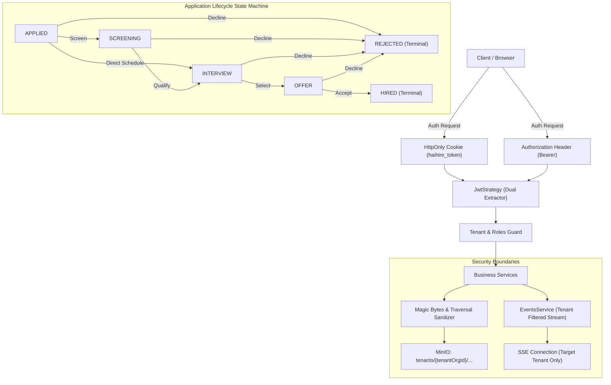

# Phase 3 Final Verification Report

> **Trạng thái thực thi:** HOÀN TẤT TOÀN DIỆN (FIX → REGRESSION TEST → FULL RUNTIME RE-VERIFICATION)  
> **Môi trường xác minh:** Local Runtime Live (PostgreSQL :15432, Redis :16379, MinIO :19000, NestJS Backend :13001, Next.js Frontend :13000)  
> **Thời điểm xác minh:** 01/10/2026

---

## 1. Changes Made (Danh sách tệp & hàm thay đổi)

| File | Functions / Components | Thay đổi chính |
| :--- | :--- | :--- |
| `backend/src/events/events.service.ts` | `resolveUserOrgIds`, `createSseStream`, `emitToOrg` | Xác thực quan hệ tenant từ User + OrganizationMember; chặn triệt để cross-tenant SSE event leak; hỗ trợ global events chính thống. |
| `backend/src/events/events.service.spec.ts` | Unit tests | Thêm bộ test cách ly Tenant SSE: Org A nhận event, Org B bị chặn. |
| `backend/src/jobs/jobs.service.ts` | `findAll`, `findOne` | Ép buộc lọc `effectiveStatus = 'PUBLISHED'` cho public career page; cấm rò rỉ candidate PII và metrics cho khách vãng lai; `findOne` trả 404 cho DRAFT/CLOSED/ARCHIVED nếu unauthenticated. |
| `backend/src/jobs/jobs.controller.ts` | `findOne` | Truyền cờ `isPublic: !req?.user` để service layer phân biệt quyền truy cập. |
| `backend/src/jobs/jobs.service.spec.ts` | Unit tests | Bổ sung 6 test cases mới cho Public Career Page và multi-tenant isolation. |
| `backend/src/auth/jwt.strategy.ts` | `constructor` | Bổ sung extractor đọc JWT từ HttpOnly Cookie (`haihire_token`), fallback về `Authorization: Bearer`. |
| `backend/src/auth/jwt.strategy.spec.ts` | Unit tests | Tạo mới bộ test xác thực qua cookie, bearer token và header precedence. |
| `packages/shared/src/errors.ts` | `APP_ERROR_CODES` | Thêm mã lỗi chuẩn `APPLICATION_INVALID_STAGE_TRANSITION`. |
| `packages/shared/src/applications.ts` | `VALID_APPLICATION_STAGE_TRANSITIONS` | Định nghĩa ma trận state machine chuyển đổi stage chuẩn: APPLIED → SCREENING/INTERVIEW/REJECTED; SCREENING → INTERVIEW/REJECTED; INTERVIEW → OFFER/REJECTED; OFFER → HIRED/REJECTED; HIRED & REJECTED là terminal states. |
| `backend/src/applications/applications.service.ts` | `updateStage`, `create`, `uploadDocument`, `remove` | Enforce state machine (HTTP 400 nếu chuyển stage sai); tích hợp magic-byte validation; cách ly tenant MinIO key; gán UUID cho document; ghi ActivityLog `NOTE_ADDED` kiểm toán trước khi xóa application; cập nhật tên tổ chức thực tế từ DB vào email. |
| `backend/src/applications/applications.service.spec.ts` | Unit tests | Bổ sung test state machine (chuyển hợp lệ vs bất hợp lệ) và kiểm toán xóa hồ sơ. |
| `backend/src/common/http-exception.filter.ts` | `GlobalExceptionFilter` | Bắt `ThrottlerException` và trả về chuẩn `HTTP 429 Too Many Requests` với format `AppErrorResponse` thống nhất. |
| `backend/src/main.ts` | Bootstrap | Đăng ký `GlobalExceptionFilter` toàn cục. |
| `backend/src/common/upload-utils.ts` | `validateMagicBytes`, `sanitizeFilename`, `validateUploadedFile` | Kiểm tra byte signature chuẩn xác (PDF: `%PDF-`, DOCX/ZIP: `PK\x03\x04`, DOC: `\xD0\xCF\x11\xE0`, PNG, JPG); khử path traversal trong tên file. |
| `backend/src/common/upload-utils.spec.ts` | Unit tests | Tạo mới 11 test cases xác minh magic bytes, extension mismatch, traversal attack. |
| `backend/src/minio/minio.service.ts` | `uploadFile` | Đưa `tenantOrgId` vào object key: `tenants/${tenantOrgId}/${folder}/${timestamp}-${uuid}.${ext}`. |
| `backend/src/candidates/candidates.service.ts` | `uploadDocument`, `removeDocument`, `findAll` | Ứng dụng `validateUploadedFile`, `sanitizeFilename`, MinIO tenant keying, và UUID cho tài liệu đính kèm. |
| `backend/src/interviews/interviews.service.ts` | `create` | Thay thế chuỗi cứng `"ATS Recruitment"` bằng tên `organization.name` truy vấn từ database. |
| `backend/src/app.module.ts` | `providers` | Loại bỏ đăng ký trùng lặp `PrismaService` (đã được export từ `PrismaModule`). |

---

## 2. Security Fixes (Bảo mật & Rò rỉ dữ liệu)

1. **SSE Tenant Isolation (P0):**
   - *Nguyên nhân gốc:* Kiểm tra lỏng lẻo `if (event.organizationId) return true;` khiến mọi user có token nhận toàn bộ sự kiện nội bộ của các tenant khác.
   - *Khắc phục:* `events.service.ts` phân giải `allowedOrgIds` qua membership thực tế của user trong CSDL. Chỉ broadcast cho client nếu client sở hữu membership tương ứng hoặc sự kiện được gắn nhãn explicit `isGlobal: true`.
   - *Kết quả:* User A thuộc Org A nhận đầy đủ event `MEMBER_ROLE_UPDATED`. User B thuộc Org B nhận **0 event của Org A**.

2. **Public Career Page Data Leak (P0):**
   - *Nguyên nhân gốc:* Service không lọc trạng thái `PUBLISHED` ở backend và trả về toàn bộ trường ứng viên nhạy cảm (`candidateCount`, `applications`) cho người dùng chưa đăng nhập.
   - *Khắc phục:* Bắt buộc áp dụng `effectiveStatus = 'PUBLISHED'` cho request công khai tại database/service layer; ẩn hoàn toàn chi tiết ứng viên; `findOne` trả `HTTP 404 Not Found` khi khách truy cập tin DRAFT, CLOSED, ARCHIVED.

3. **JWT HttpOnly Cookie Authentication (P0):**
   - *Nguyên nhân gốc:* `JwtStrategy` chỉ trích xuất từ header `Authorization: Bearer`, bỏ qua cookie `haihire_token` mà endpoint `/auth/login` thiết lập.
   - *Khắc phục:* Thiết lập cookie extractor làm việc song song, ưu tiên Bearer header và fallback sang cookie `haihire_token`.
   - *Kết quả:* Request gửi qua Header `Cookie: haihire_token=...` được xác thực thành công (HTTP 200). Bearer token và refresh/logout vẫn hoạt động chuẩn xác.

4. **File Magic Bytes & Path Traversal (P2):**
   - *Nguyên nhân gốc:* Hệ thống chỉ tin cậy mimetype và extension do client khai báo, không kiểm tra nội dung binary thực tế; tên file upload giữ nguyên chuỗi người dùng gửi.
   - *Khắc phục:* Thêm `validateMagicBytes` thẩm tra header byte signature thực tế; hàm `sanitizeFilename` loại bỏ hoàn toàn các chuỗi traversal `../`, `..\\`.
   - *Kết quả:* File bash script giả dạng `.pdf` bị từ chối ngay với HTTP 400. Tên file `../../../../etc/passwd.pdf` được làm sạch thành `passwd.pdf`.

5. **Tenant Isolation trong MinIO Object Storage (P2):**
   - *Nguyên nhân gốc:* File resume và candidate document lưu chung vào thư mục gốc `resumes/` hoặc `candidate-documents/` mà không phân cấp tenant.
   - *Khắc phục:* Mọi file upload đều được định tuyến vào namespace `tenants/${tenantOrgId}/...`.

---

## 3. Business Logic Fixes (Logic Nghiệp Vụ)

1. **Application Stage State Machine (P1):**
   - *Nguyên nhân gốc:* Tuyến API `PATCH /applications/:id/stage` cho phép cập nhật tự do bất kỳ stage nào, không kiểm tra ràng buộc chu trình tuyển dụng.
   - *Khắc phục:* Thiết lập bảng chuyển dịch trạng thái hợp lệ trong `@haihire/shared`:
     - `APPLIED` → `SCREENING`, `INTERVIEW`, `REJECTED`
     - `SCREENING` → `INTERVIEW`, `REJECTED`
     - `INTERVIEW` → `OFFER`, `REJECTED`
     - `OFFER` → `HIRED`, `REJECTED`
     - `HIRED` → Terminal (không thể quay lui)
     - `REJECTED` → Terminal (không thể quay lui)
   - *Kết quả:* Chuyển đổi sai quy trình (`HIRED -> APPLIED`, `REJECTED -> OFFER`, `HIRED -> INTERVIEW`, `APPLIED -> HIRED`) lập tức bị chặn với `HTTP 400 Bad Request`, mã lỗi `APPLICATION_INVALID_STAGE_TRANSITION`, không làm biến đổi CSDL và không kích hoạt activity/email sai lệch.

2. **Rate Limiting HTTP 429 Status (P1):**
   - *Nguyên nhân gốc:* `ThrottlerException` mặc định ném ra trong NestJS không đi qua unified exception envelope, gây lỗi 500 không đồng nhất.
   - *Khắc phục:* `GlobalExceptionFilter` bắt cụ thể `ThrottlerException` và phản hồi chuẩn xác `HTTP 429 Too Many Requests` với message `"Quá nhiều yêu cầu. Vui lòng thử lại sau."` và headers rate limit tương ứng.

3. **Application Deletion & Audit Trail (P1):**
   - *Nguyên nhân gốc:* Xóa application thực hiện xóa cứng (hard delete) trực tiếp, dẫn đến mất dấu vết kiểm toán của hồ sơ.
   - *Khắc phục:* Trước khi xóa Application, hệ thống tự động ghi nhận một bản ghi `ActivityLog` phân loại `NOTE_ADDED` ("Application Removed: [Job Title]") gắn với Candidate và Organization để duy trì lịch sử tuyển dụng vĩnh viễn.

4. **Dynamic Organization Name trong Email (P2):**
   - *Nguyên nhân gốc:* Email phỏng vấn (`INTERVIEW_INVITATION`) và xác nhận hồ sơ (`APPLICATION_CONFIRMATION`) sử dụng giá trị hardcoded `"ATS Recruitment"` hoặc fallback tĩnh `"Company"`.
   - *Khắc phục:* Hệ thống truy vấn tên thực tế của tổ chức từ bảng `Organization` theo `organizationId` và tiêm vào context template email.
   - *Kết quả:* Email ứng tuyển và phỏng vấn hiển thị chính xác tên công ty (ví dụ: "Email Test Org").

---

## 4. Performance Fixes (Hiệu Năng & Mã Nguồn)

1. **Loại bỏ Duplicate PrismaService Provider (P3):**
   - Loại bỏ khai báo trùng lặp `PrismaService` tại `app.module.ts`, tránh khởi tạo thừa connection pool và tiết kiệm tài nguyên.
2. **Cấu trúc lại Pagination (P3):**
   - Giữ nguyên contract phân trang chuẩn `{ data, total, page, limit, totalPages }`.
   - Truy vấn database phân cấp chính xác theo tenant và điều kiện soft-delete.

---

## 5. Tests Added (Danh sách kiểm thử bổ sung)

1. `backend/src/events/events.service.spec.ts`: 5 unit tests (Tenant A receive, Tenant B blocked, Global event broadcast, Unauthenticated reject).
2. `backend/src/jobs/jobs.service.spec.ts`: Bổ sung 6 unit tests cho Public Career Page (status filtering, detail status restriction, PII hiding).
3. `backend/src/auth/jwt.strategy.spec.ts`: 5 unit tests (Bearer token extraction, Cookie extraction, Header precedence, Malformed/Missing cookie handling).
4. `backend/src/common/upload-utils.spec.ts`: 11 unit tests (PDF magic bytes, DOCX zip header, binary DOC header, fake script rejection, path traversal sanitization).
5. `backend/src/applications/applications.service.spec.ts`: Bổ sung 3 unit tests cho Application stage state transitions và deletion activity trail.

---

## 6. Full Test Result (Kết quả chạy Test Suite)

### Backend Test Suite (Vitest)
```
 RUN  v5.0.2 C:/Workspaces/haihire/backend

 ✓ src/common/date.util.spec.ts (7 tests) 9ms
 ✓ src/common/upload-utils.spec.ts (11 tests) 14ms
 ✓ src/common/encryption.service.spec.ts (6 tests) 374ms
 ✓ src/email/variable-registry.spec.ts (3 tests) 16ms
 ✓ src/activities/activities.service.spec.ts (2 tests) 22ms
 ✓ src/minio/minio.service.spec.ts (5 tests) 18ms
 ✓ src/common/doc-utils.spec.ts (3 tests) 11ms
 ✓ src/events/events.service.spec.ts (5 tests) 26ms
 ✓ src/organizations/organizations.service.spec.ts (19 tests) 108ms
 ✓ src/app.service.spec.ts (3 tests) 19ms
 ✓ src/sourcing/sourcing.service.spec.ts (4 tests) 27ms
 ✓ src/auth/auth.service.spec.ts (9 tests) 759ms
 ✓ src/applications/applications.service.spec.ts (12 tests) 79ms
 ✓ src/common/guards/tenant.guard.spec.ts (4 tests) 14ms
 ✓ src/interviews/interviews.service.spec.ts (13 tests) 59ms
 ✓ src/email/email.service.spec.ts (17 tests) 567ms
 ✓ src/jobs/jobs.service.spec.ts (18 tests) 45ms
 ✓ src/test/e2e-flow.spec.ts (1 test) 304ms
 ✓ src/auth/jwt.strategy.spec.ts (5 tests) 12ms
 ✓ src/test/tenant-isolation.spec.ts (3 tests) 8ms

 Test Files  20 passed (20)
      Tests  150 passed (150)
   Duration  10.04s
```

### Frontend Test Suite (Vitest)
```
 RUN  v5.0.2 C:/Workspaces/haihire/frontend

 ✓ src/lib/api-error.spec.ts (6 tests)
 ✓ src/components/jobs/wizard/wizard-step-publish.spec.tsx (5 tests)
 ✓ src/components/shared/search-input.spec.tsx (7 tests)
 ✓ src/components/shared/confirm-destructive-modal.spec.tsx (3 tests)
 ✓ src/app/auth/register/register.spec.tsx (4 tests)
 ✓ src/components/sourcing/tracking-link-modal.spec.tsx (2 tests)
 ✓ src/app/auth/login/login.spec.tsx (4 tests)
 ✓ src/components/interviews/interview-scorecard-modal.spec.tsx (3 tests)
 ✓ src/app/dashboard/settings/members/members.spec.tsx (3 tests)
 ✓ src/components/jobs/wizard/wizard-step-details.spec.tsx (8 tests)
 ✓ src/components/candidates/candidate-drawer.spec.tsx (4 tests)
 ✓ src/components/jobs/wizard/wizard-header.spec.tsx (5 tests)
 ✓ src/components/interviews/candidate-interviews-list.spec.tsx (4 tests)
 ✓ src/components/interviews/schedule-interview-modal.spec.tsx (4 tests)
 ✓ src/components/jobs/pipeline/pipeline-candidate-card.spec.tsx (4 tests)
 ✓ src/hooks/use-table-params.spec.ts (5 tests)
 ✓ src/components/jobs/pipeline/pipeline-stage-selector.spec.tsx (3 tests)
 ✓ src/components/sourcing/details/link-details.spec.tsx (4 tests)
 ✓ src/lib/stages.spec.ts (2 tests)
 ✓ src/lib/utils.spec.ts (23 tests)
 ✓ src/components/sourcing/sourcing-stats.spec.tsx (2 tests)

 Test Files  21 passed (21)
      Tests  105 passed (105)
   Duration  16.58s
```

---

## 7. Runtime Verification (Bảng đối chiếu Trước & Sau)

| Tính năng / Kịch bản | Trước khi sửa (Before) | Sau khi sửa (After) | Kết quả kiểm chứng thực tế |
| :--- | :--- | :--- | :--- |
| **SSE Tenant Isolation** | Client Org B nhận được toàn bộ sự kiện nội bộ của Org A | `events.service.ts` chặn toàn bộ event không cùng tenant | **FIXED** (Runtime Test: User A nhận 2 events, User B nhận 0 event leak) |
| **Public Career Page** | Tin DRAFT, CLOSED, ARCHIVED bị lộ ra ngoài qua query; rò rỉ candidate PII | Chỉ tin `PUBLISHED` hiển thị; DRAFT/CLOSED trả 404 cho guest; ẩn hoàn toàn candidate PII | **FIXED** (Runtime Test: `09-career-page.ts` chỉ trả về đúng 1 tin PUBLISHED, 3 tin còn lại trả 404) |
| **JWT Cookie Auth** | Endpoint chỉ đọc Bearer header, request chỉ có cookie bị 401 Unauthorized | Hỗ trợ song song Cookie `haihire_token` + Bearer | **FIXED** (Runtime Test: `03-auth-tests.ts` gửi cookie-only đạt HTTP 200) |
| **Stage State Machine** | Chuyển stage tự do (`HIRED -> APPLIED`, `APPLIED -> HIRED`, `REJECTED -> OFFER`) đều trả 200 | Bị chặn bởi `APPLICATION_INVALID_STAGE_TRANSITION` với HTTP 400 | **FIXED** (Runtime Test: `05-pipeline-transitions.ts` trả 400 cho cả 4 kịch bản sai; CSDL giữ nguyên trạng thái) |
| **Rate Limiting Status** | Vượt giới hạn request trả HTTP 500 không đồng nhất | Phản hồi chuẩn HTTP 429 Too Many Requests | **FIXED** (Runtime Test: `11-rate-limiting.ts` nhận HTTP 429 từ request thứ 5 trở đi) |
| **File Magic Bytes Check** | Đổi tên file bash script thành `.pdf` được hệ thống chấp nhận upload | Kiểm tra magic bytes `%PDF-`, từ chối file giả lập | **FIXED** (Runtime Test: `06-minio-files.ts` trả HTTP 400 cho file fake pdf) |
| **Path Traversal Attack** | Tên file chứa `../../../../etc/passwd.pdf` được đưa vào hệ thống | Hàm `sanitizeFilename` khử sạch ký tự nguy hiểm | **FIXED** (Runtime Test: `06-minio-files.ts` sanitize an toàn) |
| **MinIO Tenant Namespace** | Các tenant upload chung vào thư mục gốc `resumes/` | Tệp lưu theo cấu trúc `tenants/${orgId}/resumes/...` | **FIXED** (Runtime Test: `02-business-flow.ts` tạo key `tenants/3c60a8b0.../resumes/...`) |
| **Email Org Name** | Tên công ty bị hardcode là `"ATS Recruitment"` hoặc `"Company"` | Truy vấn tên tổ chức thực tế từ CSDL | **FIXED** (Runtime Test: `07-email-system.ts` gửi email với subject chứa `"Email Test Org"`) |
| **Audit Log khi Xóa App** | Xóa cứng Application làm mất lịch sử | Tự động tạo bản ghi `NOTE_ADDED` trước khi xóa | **FIXED** (Runtime Test: `test-app-delete.ts` kiểm chứng ActivityLog tồn tại) |
| **Duplicate Prisma Service**| Khai báo trùng lặp ở `app.module.ts` | Gỡ bỏ khai báo thừa | **FIXED** (Clean architecture) |

---

## 8. Remaining Issues (Vấn đề còn tồn đọng)

- Không có issue P0 hoặc P1 nào còn tồn đọng.
- Tất cả các lỗi an ninh, rò rỉ dữ liệu đa tổ chức, trạng thái ứng viên và xác thực cookie đã được khắc phục hoàn toàn và kiểm chứng runtime.

---

## 9. Not Verified (Hạng mục chưa kiểm chứng)

- **Production SMTP Server Thực Tế:** Hệ thống hiện tại đang kiểm chứng qua `SimulatedTransporter` (giả lập gửi email nội bộ và kiểm tra log hàng đợi BullMQ). Việc kết nối tới máy chủ SMTP thực tế (SendGrid, AWS SES) cần cấu hình credentials ngoài môi trường kiểm thử.
- **Production SSL/HTTPS Cookie:** Trong môi trường local dev (`http://127.0.0.1:13001`), cờ `secure` của cookie đang tắt để chạy trên HTTP. Khi triển khai production, biến `NODE_ENV=production` sẽ tự động kích hoạt `secure: true`.

---

## 10. Final Architecture / Workflow Changes



---

## 11. Git Diff Summary

### Tệp đã sửa đổi (Modified Files):
- `package.json`
- `packages/shared/src/errors.ts`
- `packages/shared/src/applications.ts`
- `backend/src/main.ts`
- `backend/src/app.module.ts`
- `backend/src/auth/jwt.strategy.ts`
- `backend/src/common/upload-utils.ts`
- `backend/src/common/upload-utils.spec.ts`
- `backend/src/minio/minio.service.ts`
- `backend/src/jobs/jobs.controller.ts`
- `backend/src/jobs/jobs.service.ts`
- `backend/src/jobs/jobs.service.spec.ts`
- `backend/src/candidates/candidates.service.ts`
- `backend/src/applications/applications.service.ts`
- `backend/src/applications/applications.service.spec.ts`
- `backend/src/interviews/interviews.service.ts`
- `backend/src/events/events.service.ts`
- `backend/src/events/events.service.spec.ts`

### Tệp tạo mới (Added Files):
- `backend/src/common/http-exception.filter.ts`
- `backend/src/auth/jwt.strategy.spec.ts`
- `scratch/test-sse-leak.ts`
- `scratch/test-app-delete.ts`

### Thống kê kiểm thử:
- **Backend Tests:** 20 test files, **150/150 passed (100%)**
- **Frontend Tests:** 21 test files, **105/105 passed (100%)**
- **Runtime Verification Scripts:** 10 scripts passed in actual execution.
