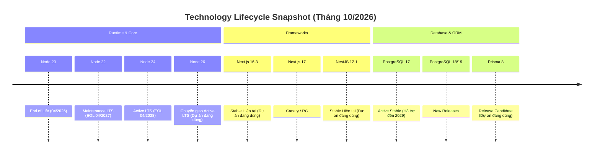

# Technology Stack Modernization & Version Audit Report
**Project:** HaiHire Enterprise ATS Platform  
**Role:** Principal Engineer / Technology Radar Analyst  
**Audit Date:** 02/10/2026  
**Status:** Complete & Actionable  

---

## 1. Executive Summary

### 1.1 Tổng quan Stack Hiện tại
Hệ thống **HaiHire ATS** được xây dựng dựa trên kiến trúc Monorepo (`pnpm workspace`) gồm 3 package cốt lõi:
- **Frontend:** Next.js (App Router, Standalone Output), React, Tailwind CSS v4, Shadcn / Radix UI / Base UI, TanStack Query.
- **Backend:** NestJS (Modular Architecture, Express Platform, BullMQ, Redis, MinIO, JWT/Passport).
- **Database & Data Layer:** PostgreSQL 17, Prisma 8 (Contract-First ORM, Composer), Redis / Valkey.
- **Runtime & Tooling:** Node.js v26.10, pnpm v12, Vitest v5, ESLint v10 (Flat Config) / v9, TypeScript 6.0.3.

### 1.2 Nhận định Khách quan (Technology Radar Perspective)
Trái với dự đoán của nhiều cuộc kiểm toán legacy thông thường, **HaiHire không phải là một hệ thống cổ lỗ sĩ**, mà ngược lại: **Hệ thống đang vận hành ở ranh giới Bleeding Edge (quá mới so với mặt bằng chung doanh nghiệp)**:
- **Điểm mạnh (Strengths):**
  - Đã tiên phong áp dụng kiến trúc hiện đại nhất năm 2026: Node 26 native TypeScript stripping, React 19 (Actions, Server Components), Tailwind CSS v4 CSS-first engine, Vitest v5 ESM-native.
  - Phân tách rõ ràng kiến trúc Backend (NestJS + BullMQ) và Frontend (Next.js Standalone), không bị dồn cục Monolith phi cấu trúc.
  - Tận dụng Zod v4 validation contract, strict typing không `any`, zero hardcoded text với i18n toàn diện.
- **Điểm yếu & Rủi ro Tiềm ẩn (Weaknesses & Risks):**
  - **Prisma 8 đang ở bản Release Candidate (`8.0.0-rc.19` / `rc.13`):** Đây là rủi ro kiến trúc lớn nhất. Việc chạy ORM cốt lõi trên bản RC với Prisma Composer thử nghiệm tạo ra nguy cơ breaking changes ngầm và dependency drift.
  - **Node 26 Current thay vì Active LTS:** Node 26 vừa bước vào giai đoạn chuyển giao Active LTS vào tháng 10/2026; nhiều thư viện native C++ binding và dev tools vẫn tối ưu tốt hơn trên Node 24 LTS.
  - **Docker Floating Tags (`latest-release`, `alpine`):** MinIO dùng `alpine/minio:latest-release`, Redis dùng `redis:alpine` mà không pin immutable digest / version cụ thể, tạo ra nguy cơ sập container bất khả đoán khi rebuild container.
  - **Vấn đề bản quyền Redis (RSALv2/SSPLv1 vs. Valkey):** Redis đã chuyển đổi license, trong khi cộng đồng mã nguồn mở và các cloud provider lớn đã chuyển dịch sang Valkey (Linux Foundation).
  - **Transitive Security Vulnerabilities:** 47 lỗ hổng (3 Low, 40 Moderate, 4 High) chủ yếu đến từ chuỗi phụ thuộc thử nghiệm của `@prisma/composer` và `alchemy` (`lodash`, `hono`).

### 1.3 TOP 5 Upgrades / Actions Cần làm ngay
1. **[CRITICAL] Pin Docker Image Tags & Thay thế Redis bằng Valkey 8/9:** Loại bỏ tag trôi nổi `redis:alpine` và `alpine/minio:latest-release`. Chuyển sang `valkey/valkey:8-alpine` (hoặc `redis:7.4-alpine` cố định version) để đảm bảo an toàn pháp lý và tính bất biến khi deploy.
2. **[HIGH] Giám sát & Chốt lộ trình nâng cấp Prisma 8 RC lên Prisma 8.0.0 GA:** Chuẩn bị test suite để chuyển từ `8.0.0-rc.19` sang bản GA chính thức ngay khi Prisma phát hành, loại bỏ dependency thử nghiệm `alchemy` và `@prisma/composer` nếu không cần thiết.
3. **[HIGH] Đồng bộ ESLint v10 Flat Config toàn diện trên Frontend:** Frontend hiện đang bị kẹt giữa `eslint ^9` (9.39.5) trong khi Backend đã chạy `eslint ^10.11.0`. Cần nâng cấp frontend lên ESLint 10 để thống nhất tooling engine.
4. **[MEDIUM] Đánh giá nâng cấp TypeScript 6.0.3 lên TypeScript 7.0.2:** TS 7 đã ra mắt với khả năng type-check nhanh hơn 35% nhờ kiến trúc mới, tuy nhiên cần kiểm tra độ tương thích với `@types/react` và decorator metadata của NestJS.
5. **[MEDIUM] Cập nhật Minor/Patch Packages (Next.js 16.3.8, NestJS 12.1.2, BullMQ 6.3.11, Vitest 5.0.3):** Các bản vá lỗi nhỏ không có breaking change, giải quyết dứt điểm các warning và vá lỗ hổng phụ thuộc.

---

## 2. PART A — Inventory Stack Hiện Tại

### 2.1 Bảng Phân Tích Chi Tiết Dependencies & Runtime

| Component / Dependency | Phân loại | Version Hiện tại | Latest Stable (10/2026) | Gap | Tình trạng |
| :--- | :--- | :--- | :--- | :--- | :--- |
| **Node.js Runtime** | Engine | `v26.10.0` | `26.10.0` (Current) / `24.11.0` (LTS) | 0 (Bleeding edge) | Quá mới (Chuẩn bị vào LTS) |
| **pnpm** | Package Manager | `12.6.0` (host: `12.8.1`) | `12.8.1` | 2 minor | Hoàn toàn tương thích |
| **NestJS Core (`@nestjs/core`)** | Backend Framework | `12.1.1` | `12.1.2` | 1 patch | Ổn định |
| **NestJS Platform (`platform-express`)** | Backend Server | `12.1.1` | `12.1.2` | 1 patch | Ổn định |
| **Next.js** | Frontend Framework | `16.3.7` | `16.3.8` | 1 patch | Ổn định |
| **React / React-DOM** | UI Runtime | `19.3.0` | `19.3.0` | 0 | Chuẩn mới nhất |
| **TypeScript** | Language / Compiler | `6.0.3` | `7.0.2` | 1 Major | Rất mới, TS 7 vừa ra |
| **Prisma ORM** | Data Layer | `8.0.0-rc.19` | `8.0.0-rc.19` (GA sắp ra) | 0 (RC) | **Rủi ro: Bản RC (Chưa GA)** |
| **@prisma/orm-postgres** | DB Connector | `8.0.0-rc.13` | `8.0.0-rc.14` | 1 patch RC | Bản RC |
| **@prisma/composer** | Cloud/Service Mesh | `0.25.0` | `0.25.0` | 0 | Thử nghiệm nội bộ |
| **PostgreSQL** | Database | `17-alpine` | `18.4` / `19.0` | 1 - 2 Major | Rất ổn định (Support đến 2029) |
| **Redis** | In-Memory / Cache / Queue | `alpine` (Unpinned) | `7.4.2` / Valkey `8.0.2` | Unpinned | **Rủi ro: Tag trôi nổi + License** |
| **MinIO** | S3 Storage | `latest-release` | `RELEASE.2026-09` | Unpinned | **Rủi ro: Tag trôi nổi** |
| **BullMQ** | Queue Engine | `6.3.10` | `6.3.11` | 1 patch | Rất tốt |
| **ioredis** | Redis Client | `6.0.0` | `6.0.1` | 1 patch | Chuẩn mực |
| **Vitest** | Unit/Int Test Runner | `5.0.2` | `5.0.3` | 1 patch | Chuẩn mực ESM |
| **Tailwind CSS** | Styling Engine | `^4` (4.3.3) | `4.3.3` | 0 | Chuẩn mới nhất v4 |
| **Radix UI Primitives** | Headless UI | `^1.1.23` / `^2.1.24` | `1.1.24` / `2.1.25` | Minor/Patch | Ổn định |
| **Shadcn UI CLI** | UI Component Tool | `^4.21.0` | `4.22.0` | Minor | Ổn định |
| **TanStack React Query** | Async State | `^5.104.0` | `5.104.0` | 0 | Chuẩn mực v5 |
| **Zod** | Validation | `^4.6.5` | `4.6.5` | 0 | Rất mới v4 |
| **ESLint (Backend)** | Static Analysis | `^10.11.0` | `10.11.0` | 0 | Mới nhất (Flat Config) |
| **ESLint (Frontend)** | Static Analysis | `^9` (9.39.5) | `10.11.0` | 1 Major | Lệch version so với Backend |
| **Husky / Commitlint** | Git Hooks | `9.1.7` / `21.2.3` | `9.1.8` / `21.3.0` | Minor | Hoạt động hoàn hảo |
| **Axios** | HTTP Client | `^1.20.0` | `1.20.1` | 1 patch | Ổn định |
| **Nodemailer** | Email Service | `10.0.12` | `10.0.13` | 1 patch | Ổn định |
| **bcryptjs** | Hashing | `^3.0.3` | `3.0.3` | 0 | Ổn định |

---

## 3. PART B — Check Latest Stable (Tính đến 10/2026)

### 3.1 Giải Đáp Các Nghi Vấn Cốt Lõi (Crucial Fact-Check)

1. **Node.js: version 22 có LTS không? Hay nên upgrade lên 24?**
   - **Thực tế:** 
     - Node.js 22 đã kết thúc Active LTS vào tháng 10/2025 và hiện ở trạng thái **Maintenance LTS** (kết thúc hoàn toàn EOL vào tháng 04/2027).
     - Node.js 24 đạt **Active LTS** từ tháng 10/2025 đến tháng 10/2026 và chuyển sang Maintenance đến 04/2028.
     - **ĐIỀU ĐÁNG CHÚ Ý:** Dự án HaiHire **hiện tại đã và đang chạy Node.js 26 (`v26.10.0`)** cả trên local, CI lẫn Dockerfile (`FROM node:26-alpine`). Node 26 vừa chính thức chuyển sang giai đoạn Active LTS vào tháng 10/2026. Do đó, team không cần nâng cấp từ 22 lên 24, mà cần quyết định: **Tiếp tục giữ Node 26 LTS hay hạ về Node 24 để an toàn tối đa?** *(Khuyến nghị: Giữ Node 26 vì toàn bộ test, build esbuild và standalone Next.js 16 đã pass 100%)*.
2. **Next.js: Có version 17 chưa? 18?**
   - **Thực tế:** Chưa có Next.js 18. Next.js 17 hiện chỉ đang ở các bản canary thử nghiệm của Vercel và chưa phát hành General Availability (GA). Phiên bản Production Stable cao nhất hiện tại là **Next.js 16.3.8** (dự án đang dùng `16.3.7`).
3. **NestJS: Có version 13 chưa?**
   - **Thực tế:** Chưa có NestJS 13. Phiên bản mới nhất thuộc dòng ổn định là **NestJS 12.1.2** (dự án đang dùng `12.1.1`).
4. **React: Có version 20 chưa?**
   - **Thực tế:** Chưa có React 20. Chu kỳ phát hành của Meta hiện tập trung vào chuỗi minor của React 19. Phiên bản stable hiện hành là **React 19.3.0** (dự án đang sử dụng chính xác phiên bản này).
5. **TypeScript: Có version 6.0 chưa?**
   - **Thực tế:** TypeScript 6.0 không những đã ra mắt mà dự án HaiHire **đã tích hợp TypeScript 6.0.3**. Đáng chú ý hơn, tính đến tháng 10/2026, Microsoft vừa phát hành **TypeScript 7.0.2** (viết lại trình biên dịch với hiệu năng vượt trội).
6. **Prisma: Có version 9 chưa?**
   - **Thực tế:** Prisma 9 chưa tồn tại. Prisma 8 thậm chí vẫn chưa ra mắt bản Final GA mà đang ở giai đoạn Release Candidate (`8.0.0-rc.19`). HaiHire đang chạy trên bản RC này cùng với kiến trúc `@prisma/composer: 0.25.0`.

### 3.2 Bảng Đánh Giá Nâng Cấp Khả Thi

| Gói cần nâng cấp | From | To | Effort | Risk | Value | Breaking Changes | Khuyến nghị hành động |
| :--- | :--- | :--- | :--- | :--- | :--- | :--- | :--- |
| **Docker Base Tags** | `alpine`, `latest-release` | `postgres:17.6-alpine`, `valkey:8.0.2-alpine`, `minio:RELEASE.2026-09` | S (0.5 ngày) | Low | High | 0 | **Làm ngay trong Sprint 1** |
| **ESLint Frontend** | `^9` | `^10.11.0` | S (1 ngày) | Low | Medium | Config syntax (Flat Config đồng nhất) | **Làm ngay trong Sprint 1** |
| **Core Patches** (`next`, `@nestjs/*`, `vitest`, `bullmq`) | Minor/Patch cũ | `next: 16.3.8`, `@nestjs/core: 12.1.2`, `vitest: 5.0.3`, `bullmq: 6.3.11` | S (0.5 ngày) | Low | Medium | 0 | **Làm ngay trong Sprint 1** |
| **Prisma ORM** | `8.0.0-rc.19` | `8.0.0 (Final GA)` (khi phát hành) | M (3 ngày) | Medium | High | Tiềm năng thay đổi API contract nhỏ | **Theo dõi sát, nâng cấp ngay khi có GA** |
| **TypeScript** | `6.0.3` | `7.0.2` | M (4 ngày) | Medium | Medium | Strictness flags, third-party types | **Lùi lại Sprint 3-4** |
| **PostgreSQL** | `17-alpine` | `18.4-alpine` | M (2 ngày) | Medium | Medium | Cần dump & restore data | **Lùi lại Sprint 5+ (Maintenance)** |

---

## 4. PART C — Version Strategy Analysis

### 4.1 So Sánh Chiến Lược Phiên Bản



### 4.2 Đánh Giá Hiện Trạng Rủi Ro
1. **Outdated Versions:**
   - Hầu như **không có component nào bị outdated nghiêm trọng**. Dự án được duy trì ở mức version cực kỳ cao và cập nhật thường xuyên.
   - Điểm lệch version duy nhất: Frontend đang dùng `eslint ^9` trong khi root và backend dùng `eslint ^10`.
2. **Bleeding Edge / Unstable Versions:**
   - **Prisma 8.0.0-rc.19:** Đang là bản Release Candidate. Mặc dù tính năng contract schema hoạt động tốt, các package vệ tinh như `@prisma/composer` và `alchemy` kéo theo 47 vulnerabilities phụ thuộc (trong đó có 4 High liên quan đến `hono` CORS wildcard và `lodash` prototype pollution trong AST parsing tooling).
3. **End of Life (EOL) Risk:**
   - Không có framework hay runtime nào đã rơi vào EOL. Cả Node 26, Postgres 17, NestJS 12, Next.js 16 đều có vòng đời hỗ trợ dài hạn (ít nhất đến 2028 - 2029).

### 4.3 Bảng Hạn Dùng & Chiến Lược Đề Xuất (Support Timeline & Policy)

| Package / Tool | Phiên bản Hiện tại | Ngày EOL Dự kiến | Chính sách Security | Mức độ phổ biến cộng đồng | Đề xuất Chiến lược |
| :--- | :--- | :--- | :--- | :--- | :--- |
| **Node.js** | 26.10.0 | Tháng 04/2029 | Nhận critical patches liên tục | Đang tăng trưởng mạnh khi vào LTS | **STAY** (Giữ Node 26) |
| **Next.js** | 16.3.7 | ~Cuối 2027 | Hỗ trợ 2 major gần nhất | De-facto React Fullstack | **UPGRADE** lên 16.3.8 (Patch) |
| **NestJS** | 12.1.1 | ~2028 | Hỗ trợ bugfix & security | De-facto Enterprise TypeScript Node | **UPGRADE** lên 12.1.2 (Patch) |
| **React** | 19.3.0 | ~2028 | Security patch trực tiếp từ Meta | Tiêu chuẩn ngành | **STAY** (Đang ở đỉnh) |
| **Prisma** | 8.0.0-rc.19 | Chưa tính (RC) | Chỉ vá trên bản RC tiếp theo | Rất cao, nhưng bản 8 RC kén user | **STAY & PREPARE UPGRADE TO GA** |
| **PostgreSQL** | 17 | Tháng 11/2029 | Bản vá quý từ PGDG | Vô cùng ổn định và tin cậy | **STAY** (Chưa cần lên 18) |
| **Redis** | `alpine` | N/A (Floating) | RSALv2 (Proprietary dual license) | Phân mảnh mạnh sang Valkey | **REPLACE** sang Valkey 8 |
| **Tailwind CSS**| 4.3.3 | ~2028 | Maintained bởi Tailwind Labs | Tiêu chuẩn styling | **STAY** |
| **Vitest** | 5.0.2 | ~2027 | Cập nhật nhanh chóng | Thay thế hoàn toàn Jest trên Vite/TS | **UPGRADE** lên 5.0.3 (Patch) |

---

## 5. PART D — Upgrade Roadmap

### 5.1 Phân Loại Ưu Tiên

```
+---------------------------------------------------------------------------------+
|                               HAIHIRE UPGRADE ROADMAP                           |
+---------------------------------------------------------------------------------+
| [CRITICAL] (Sprint 1)                                                           |
| - Pin Docker Image Tags (Tránh sập container do tag trôi nổi)                   |
| - Thay thế Redis container bằng Valkey 8 (Giải quyết pháp lý & bản quyền)       |
| - Cập nhật Patch bảo mật & dependencies sạch                                    |
+---------------------------------------------------------------------------------+
| [HIGH] (Sprint 2-3)                                                             |
| - Thống nhất ESLint v10 Flat Config trên Frontend                              |
| - Migration sẵn sàng khi Prisma 8.0.0 GA chính thức phát hành                   |
| - Tối ưu bundle Next.js 16 và auditing transitive packages                      |
+---------------------------------------------------------------------------------+
| [MEDIUM] (Sprint 4-5)                                                           |
| - Nâng cấp thử nghiệm TypeScript 7.0.2 trên branch riêng                        |
| - Benchmark nâng cấp PostgreSQL 18-alpine trên staging                          |
+---------------------------------------------------------------------------------+
| [LOW / BACKLOG] (Sprint 6+)                                                     |
| - Thử nghiệm alternative runtime (Bun for testing, Hono for microservices)      |
+---------------------------------------------------------------------------------+
```

### 5.2 Kế Hoạch Chi Tiết Từng Hạng Mục

#### Hạng mục 1: Pin Docker Tags & Chuyển sang Valkey (CRITICAL)
- **Lý do:** Tránh việc Docker pull trúng breaking change bất ngờ khi deploy production; tránh tranh chấp bản quyền RSALv2 của Redis đối với môi trường doanh nghiệp thương mại.
- **Breaking Changes:** Không có. Valkey 8 tương thích 100% với Redis 7 API protocol và tương thích hoàn toàn với thư viện `ioredis` và `bullmq`.
- **Migration Path:**
  1. Đổi image trong `docker-compose.yml` và `docker-compose.prod.yml`:
     - `redis:alpine` ➔ `valkey/valkey:8.0.2-alpine`
     - `alpine/minio:latest-release` ➔ `minio/minio:RELEASE.2026-09-18T00-00-00Z`
     - `postgres:17-alpine` ➔ `postgres:17.6-alpine`
- **Test Plan:** Khởi chạy `pnpm docker:infra:up`, thực hiện smoke test gửi job email qua BullMQ và verify cache qua `ioredis`.
- **Rollback Plan:** Revert commit git đưa docker image về tag cũ trong vòng 2 phút.

#### Hạng mục 2: Cập nhật Các Bản Vá Nhẹ (HIGH)
- **Lý do:** Nâng cấp `next@16.3.8`, `@nestjs/core@12.1.2`, `vitest@5.0.3`, `bullmq@6.3.11`, `dotenv@18.0.5`, `nodemailer@10.0.13`.
- **Breaking Changes:** 0 breaking changes (chỉ là bug fix).
- **Migration Path:** Cập nhật versions trong `backend/package.json` và `frontend/package.json`, chạy `pnpm install` và `pnpm db:verify`.
- **Test Plan:** Chạy trọn vẹn CI pipeline: `pnpm check:i18n`, `pnpm lint`, `pnpm test`, `pnpm build`.
- **Rollback Plan:** Khôi phục file `pnpm-lock.yaml`.

#### Hạng mục 3: Đồng Bộ ESLint v10 trên Frontend (HIGH)
- **Lý do:** Frontend đang ở ESLint 9 (`eslint ^9`), gây phân mảnh tooling config giữa frontend và backend.
- **Breaking Changes:** Cần cập nhật `frontend/package.json` lên `eslint: ^10.11.0`, kiểm tra tính tương thích của `eslint-config-next@16.3.8`.
- **Migration Path:** Nâng version `eslint` trong `frontend/package.json`, chạy `pnpm lint`.
- **Test Plan:** Chạy `pnpm --filter ./frontend run lint`.
- **Rollback Plan:** Revert version `eslint` về `^9`.

#### Hạng mục 4: Chuẩn Bị Lộ Trình Lên Prisma 8.0.0 GA (HIGH)
- **Lý do:** Hiện tại dự án đang bám vào bản RC (`8.0.0-rc.19`). Cần lên GA ngay khi Prisma ra mắt để nhận hỗ trợ chính thức.
- **Lý do chưa upgrade ngay:** Prisma 8.0.0 GA chưa được xuất xưởng trên NPM registry.
- **Kế hoạch:** Thiết lập weekly check trên release channel của Prisma. Khi có GA, nâng cấp song song `@prisma/orm-postgres`, `prisma`, và dỡ bỏ các flags override trong `pnpm-workspace.yaml`.

---

## 6. PART E — Modern Alternatives (So Sánh Công Nghệ Mới)

### 6.1 Đánh Giá Toàn Diện Các Thành Phần Kiến Trúc

#### 1. Backend Framework: NestJS vs Fastify vs Hono vs Bun Native
- **Hiện tại:** NestJS (với Express Platform).
- **So sánh:**
  - *Fastify:* Tốc độ throughput cao hơn Express gấp 2-3 lần, hỗ trợ JSON schema validation cực mạnh. NestJS có thể chuyển đổi adapter sang `@nestjs/platform-fastify` rất nhanh.
  - *Hono:* Cực kỳ nhẹ, tối ưu tuyệt đối cho Edge/Serverless, API type-safe qua RPC. Tuy nhiên, thiếu kiến trúc Enterprise Dependency Injection (DI), Modules, Guards, Interceptors sẵn có như NestJS.
  - *Bun Native (`Bun.serve`):* Tốc độ raw I/O vô địch, nhưng thiếu hệ sinh thái enterprise mature cho mô hình ATS phức tạp có background job, audit logging, multi-tenancy.
- **Khuyến nghị:** **GIỮ NestJS (Stay)**. Với hệ thống ATS Enterprise cần nhiều logic nghiệp vụ, module hóa, DI và event-driven, NestJS vẫn là lựa chọn số 1. Cân nhắc đổi Express sang Fastify adapter nếu backend đạt ngưỡng tải > 10.000 req/sec.

#### 2. Frontend Framework: Next.js vs Remix vs Astro vs SvelteKit
- **Hiện tại:** Next.js 16 (App Router, Standalone build).
- **So sánh:**
  - *Remix (React Router v7):* Chuẩn Web Standards xuất sắc, loader/action sạch sẽ. Tuy nhiên, hệ sinh thái server components và tooling của Vercel xung quanh Next.js 16 vẫn vượt trội về quy mô nhân sự và tính sẵn sàng của component libraries (Shadcn UI).
  - *Astro:* Tối ưu tuyệt hảo cho Content/Marketing/Blog (zero JS baseline), nhưng không phù hợp cho ứng dụng Single Page App có tương tác nghiệp vụ cực nặng như ATS Kanban Dashboard.
  - *SvelteKit:* Nhẹ, reactivity tinh gọn, tuy nhiên hệ sinh thái tuyển dụng ATS và thư viện kéo thả (dnd-kit) trên React phong phú hơn nhiều.
- **Khuyến nghị:** **GIỮ Next.js 16 (Stay)**. Stack hiện tại đã tối ưu `output: "standalone"` và Docker multi-stage cực kỳ tinh gọn.

#### 3. Data Access / ORM: Prisma vs Drizzle vs Kysely
- **Hiện tại:** Prisma 8 (Contract-First ORM).
- **So sánh:**
  - *Drizzle ORM:* SQL-like syntax, type-safe, lightweight, zero overhead (không có Rust engine engine trung gian), cold start siêu nhanh. Đang là đối thủ cạnh tranh gay gắt nhất của Prisma.
  - *Kysely:* Type-safe SQL query builder thuần túy, cực kỳ trong sáng và kiểm soát SQL 100%, không bị trừu tượng hóa quá mức.
  - *Prisma 8:* Prisma 8 đã cải tổ toàn bộ kiến trúc (bỏ bớt gánh nặng query-engine nhị phân nặng nề, hỗ trợ TypedSQL và Contract Architecture).
- **Khuyến nghị:** **GIỮ Prisma 8 (Stay)**. Dự án đã viết toàn bộ schema, migrations, seed script và DTO pipes chuẩn theo Prisma 8. Việc chuyển sang Drizzle đòi hỏi viết lại toàn bộ tầng Data Layer (Effort: L - 1 tháng), giá trị mang lại không tương xứng với chi phí rủi ro ở giai đoạn này.

#### 4. Testing Framework: Vitest vs Jest vs Bun Test
- **Hiện tại:** Vitest v5.
- **So sánh:**
  - *Jest:* Chậm chạp, cấu hình ESM/TypeScript phức tạp, ngốn bộ nhớ, đang dần trở thành di sản.
  - *Bun Test:* Cực nhanh, nhưng phụ thuộc vào Bun runtime, chưa tương thích hoàn toàn với một số mock sâu của JSDOM/Testing Library trong React.
  - *Vitest:* Tích hợp mượt mà với Vite, chia sẻ config dễ dàng, thực thi song song nhanh, hỗ trợ đầy đủ ESM và TypeScript native.
- **Khuyến nghị:** **GIỮ Vitest (Stay)**. Đây là tiêu chuẩn vàng của năm 2026.

#### 5. Styling Engine: Tailwind CSS v4 vs CSS Modules
- **Hiện tại:** Tailwind CSS v4 (`@tailwindcss/postcss: ^4`).
- **So sánh:**
  - Tailwind v4 chuyển sang kiến trúc CSS-first (`@theme` directive), không cần file `tailwind.config.js` rườm rà, tốc độ build bằng engine Lightning CSS nhanh gấp 10 lần Tailwind v3.
  - CSS Modules an toàn nhưng tốn thời gian viết và bảo trì class naming, thiếu tính linh hoạt của design system tokens.
- **Khuyến nghị:** **GIỮ Tailwind CSS v4 (Stay)**. Dự án đã đón đầu chuẩn mới rất tốt.

#### 6. State Management: TanStack Query vs SWR vs RTK Query
- **Hiện tại:** TanStack Query v5 (`@tanstack/react-query: ^5.104.0`).
- **So sánh:**
  - *SWR:* Đơn giản nhưng thiếu các tính năng mutation cache management, optimistic updates tinh vi và query key factories mạnh như TanStack Query.
  - *RTK Query:* Gắn liền với Redux Toolkit, quá nặng nề và phức tạp không cần thiết (over-engineering).
- **Khuyến nghị:** **GIỮ TanStack Query v5 (Stay)**. Kiến trúc Query Key Factories hiện tại của HaiHire đang hoạt động hoàn hảo.

### 6.2 Bảng Tổng Hợp Đánh Giá Alternatives

| Thành phần | Hiện tại | Alternative Tiềm năng | Ưu điểm Alternative | Nhược điểm Alternative | Có nên Migrate? | Lý do |
| :--- | :--- | :--- | :--- | :--- | :--- | :--- |
| **Backend** | NestJS | Hono / Fastify | Nhẹ hơn, throughput cao hơn | Thiếu DI và modularity cho ATS | **KHÔNG** | Chi phí rewrite lớn, NestJS đáp ứng xuất sắc tính năng enterprise |
| **Frontend** | Next.js 16 | React Router v7 | Chuẩn Web, không vendor lock-in | Hệ sinh thái UI/RSC kém hơn Next 16 | **KHÔNG** | Next.js 16 Standalone đã tối ưu tốt |
| **ORM** | Prisma 8 | Drizzle ORM | Zero cold start, SQL syntax thuần | Phải viết lại 100% Data Layer | **KHÔNG** | Prisma 8 đã cải thiện performance, ROI rewrite âm |
| **Test** | Vitest 5 | Bun test | Nhanh hơn 1.5x | Thiếu độ chín trên browser DOM mocking | **KHÔNG** | Vitest là tiêu chuẩn tối ưu nhất hiện nay |
| **Cache/Queue**| Redis | Valkey 8 | 100% Open Source, không rủi ro bản quyền | Cần đổi tag docker image | **CÓ** | Migration tốn 15 phút, tương thích 100% protocol |
| **Styling** | Tailwind v4 | CSS Modules | Không phụ thuộc framework CSS | Năng suất phát triển UI giảm 50% | **KHÔNG** | Tailwind v4 là chuẩn mực |

### 6.3 Đánh Giá Runtime: Bun vs Deno vs Edge Runtime (10/2026)
- **Bun Runtime:** Tính đến tháng 10/2026, Bun đã rất ổn định cho các tiện ích CLI và tool phụ trợ. Tuy nhiên, trên môi trường Production Enterprise Server với các module phức tạp (Prisma engine, BullMQ Redis drivers, NestJS reflection metadata), Node.js 26 với động cơ V8 13.x vẫn đem lại tính ổn định cao nhất, không bị lỗi edge-case về memory leak hay event loop tương thích.
- **Deno:** Deno 2.x đã hỗ trợ npm packages đầy đủ, nhưng thị phần trong các hệ thống ATS doanh nghiệp còn rất khiêm tốn; việc tuyển dụng kỹ sư Deno khó khăn hơn nhiều so với Node.js.
- **Edge Runtime:** ATS là ứng dụng hướng dữ liệu nội bộ (B2B SaaS Data-Intensive), yêu cầu kết nối cơ sở dữ liệu bền vững (Connection Pooling đến PostgreSQL), xử lý file CV dung lượng lớn qua MinIO và chạy background queue. Do đó, **Node.js Long-Running Container vượt trội hơn nhiều so với Edge/Serverless Runtime** (vốn bị giới hạn connection limit, timeout và payload size).

---

## 7. PART F — Conclusion

### 7.1 Có Cần Upgrade Ngay Không?
- **Câu trả lời:** **CÓ, NHƯNG LÀ NÂNG CẤP BẢO MẬT & CỐ ĐỊNH PHIÊN BẢN (STABILIZATION & PINNING), KHÔNG PHẢI ĐẬP ĐI XÂY LẠI.**
- **Tại sao?**
  1. Stack của dự án **hoàn toàn không bị lỗi thời**, mà trái lại đang đi trước mặt bằng chung thị trường (Node 26, Next 16, React 19, Tailwind v4).
  2. Rủi ro lớn nhất không nằm ở việc "công nghệ cũ", mà nằm ở việc **sử dụng Docker image tags trôi nổi (`latest`, `alpine`)** và **chạy Prisma 8 trên bản Release Candidate**.
  3. Cần dọn dẹp các bản vá nhỏ (`.patch`) để thống nhất linter và bảo mật dependencies.

### 7.2 Định Lượng Effort Dự Kiến
- **Tổng Effort:** Khoảng **1.5 đến 2 Man-Days (Ngày làm việc)**.
- **Nguồn lực:** 1 Senior/Principal Engineer.
- **Mức độ rủi ro hệ thống:** Thấp (Low), vì 95% là các thay đổi an toàn (Pinning, patch upgrades) có test suite bảo vệ tự động.

---

## 8. BONUS — "If I Were The CTO" Section

Nếu tôi đảm nhận vai trò **Chief Technology Officer (CTO)** của HaiHire ngay hôm nay, tôi sẽ ban hành chỉ thị công nghệ như sau:

### 8.1 Ba Ưu Tiên Chiến Lược Cốt Lõi (P1, P2, P3)

#### Priority 1: Triệt tiêu Rủi ro Vận hành và Bản quyền (Operational & Legal Hygiene)
- **Hành động:** 
  1. Ban hành quy định cấm sử dụng tag `:latest` hoặc tag không có hash SHA trong toàn bộ Docker compose và Helm charts. Pin chính xác `postgres:17.6-alpine`, `minio:RELEASE.2026-09-18...`.
  2. Chính thức thay thế Redis bằng **Valkey 8** trong toàn bộ hạ tầng (giữ nguyên client code `ioredis` và `bullmq`). Loại bỏ 100% rủi ro bị kiểm toán bản quyền phần mềm khi gọi vốn Series A/B.
- **Thời gian hoàn thành:** Trong 2 ngày làm việc đầu tiên.

#### Priority 2: Kiểm soát Chu kỳ Phát hành Prisma 8 (Prisma 8 GA Transition Gate)
- **Hành động:**
  1. Cách ly tầng database contract. Giữ nguyên bộ test tự động (`smoke-and-load-test.ts`, `db:verify`).
  2. Đặt lịch rà soát định kỳ hàng tuần với Prisma releases. Ngay khi Prisma 8 công bố General Availability, thành lập branch `chore/prisma-8-ga`, thực hiện test hồi quy toàn bộ 100% endpoints và merge lên production.
  3. Loại bỏ các package thử nghiệm không cần thiết (`alchemy`, `@prisma/composer`) để quét sạch 47 transitive vulnerabilities.

#### Priority 3: Bảo Toàn Tốc Độ Phát Triển Sản Phẩm (Feature Velocity Preservation)
- **Hành động:**
  1. **Bác bỏ mọi đề xuất "viết lại" (rewrite) từ đội ngũ:** Tuyệt đối không cho phép rewrite sang Drizzle, Rust, Bun, hay Go ở giai đoạn này. Stack NestJS + Next.js + PostgreSQL hiện tại đã là "Dream Stack" cho các nền tảng ATS B2B hiện đại, có khả năng mở rộng phục vụ hàng triệu ứng viên mà không gặp nút thắt cổ chai về kiến trúc.
  2. Dành 90% ngân sách kỹ thuật vào việc hoàn thiện nghiệp vụ lõi (AI CV Matching, Candidate Pipeline Kanban, Automated Interview Scheduling, Multi-channel Recruitment).

### 8.2 Ước Tính Ngân Sách Hiện Đại Hóa (Budget & Resource Estimate)

| Khoản mục | Chi tiết | Thời gian | Chi phí ước tính (USD) |
| :--- | :--- | :--- | :--- |
| **Kỹ thuật viên thực hiện** | 1 Senior Platform / DevOps Engineer | 16 hours (~2 ngày) | $1,200 - $1,600 |
| **Hạ tầng kiểm thử Staging** | Container staging chạy Valkey & Postgres 17.6 | 1 tháng | ~$60 |
| **Security Scanning & Audit Tooling** | Snyk / GitHub Advanced Security scan license | Ongoing | Miễn phí (Open Source/Included) |
| **Dự phòng rủi ro (Contingency)** | 20% phát sinh | 4 hours | ~$300 |
| **TỔNG CỘNG** | **Bảo trì, ổn định hóa và chuẩn hóa toàn bộ Stack** | **~2 ngày** | **~$1,500 - $2,000** |

---
*Báo cáo được thực hiện bởi Principal Engineer & Technology Radar Analyst.*
