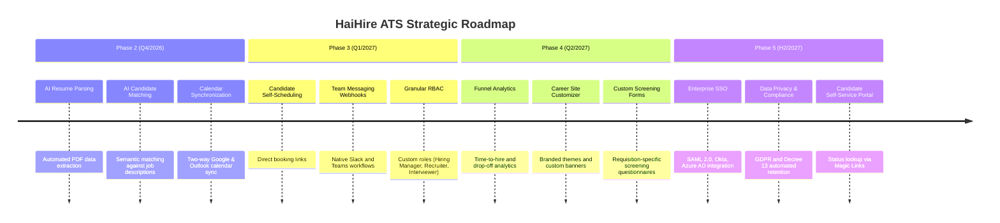

# 🗺️ HaiHire - Product Roadmap & Architectural Horizon

> **Comprehensive strategic roadmap for the HaiHire Enterprise Applicant Tracking System (ATS).**  
> **Current Version:** `v0.3.0` (Pre-release, Staged 2026-10-22)  
> **Updated:** 2026-10-22  
> **Status:** Pre-release (Phase 3 Complete, Dynamic RBAC, SSOT Information Architecture, 1,020 tests, 16 CI gates)

---

## 🧭 System Architecture Baseline

- **Monorepo Topology**: Managed via `pnpm workspaces` with `@haihire/shared` distributing cross-cutting contracts, error codes, and validation types.
- **Backend Architecture**:
  - Runtime: **Node.js 26** LTS
  - Framework: **NestJS 12** (`@nestjs/core` 12.1.2) + Express platform adapter
  - Database: **PostgreSQL 17** via **Prisma 8** (Contract-First schema)
  - Cache & Async Queue: **Valkey 8** (100% Redis 7 protocol and BullMQ compatible)
  - Object Storage: **MinIO S3** for resume and document retention with tenant path scoping (`tenants/<safeTenant>/...`)
  - Real-Time Layer: **Server-Sent Events (SSE)** via RxJS Subject providing tenant-isolated event streams scoped by `organizationId`
  - Security & Guardrails:
    - Dual Authentication: **HttpOnly Cookie** (`haihire_token`, SameSite=Lax) with Authorization Bearer header fallback
    - Cryptographic Security: **AES-256-GCM** for sensitive SMTP credentials and provider tokens
    - Rate Limiting: **Valkey / Redis Throttler** guarding authentication endpoints (HTTP 429)
    - Deep Binary Inspection: Magic bytes header & trailer inspection (PDF `%%EOF`, DOCX EOCD trailer `PK\x05\x06` in final 65,557 bytes)
    - Concurrency Control: **Optimistic Locking** guarding candidate pipeline stage transitions (HTTP 409 Conflict)
  - Notification Engine: Multi-provider email dispatch (Simulated In-App, SMTP Server, Resend API, SendGrid API) + Multi-channel Webhook Notifier (Telegram, Discord, Generic HMAC)
- **Frontend Architecture**:
  - Framework: **Next.js 16** (App Router, Server & Client Components) + **React 19**
  - Styling Engine: **Tailwind CSS v4**, Lucide React icons, responsive layout
  - Data Fetching & Caching: **TanStack Query v5** with `keepPreviousData` patterns
  - Localization (i18n): Zero hardcoded text, synchronized English & Vietnamese dictionaries
  - LAN & Private Network Access: Listening on `0.0.0.0` with subnet `/24` authorization; integrated Next.js reverse proxy rewrites bypassing CORS and browser Private Network Access (PNA) restrictions

---

## 📍 Feature Status Matrix

| Status                     | Badge | Definition                                                                           |
| :------------------------- | :---: | :----------------------------------------------------------------------------------- |
| **Released**               |  🟢   | Feature fully implemented, covered by automated test suites and runtime verification |
| **Next Horizon (Q4/2026)** |  🟡   | High-priority upcoming feature with defined technical implementation plan            |
| **Future Vision (2027)**   |  🔵   | Long-term enterprise extensions, AI workflows, and compliance tooling                |

---

## 🟢 PART 1: RELEASED CAPABILITIES (v0.1.0 PRE-RELEASE)

### 1. Authentication & Security

- 🟢 **Dual-Layer Authentication**: HttpOnly cookie (`haihire_token`) preventing XSS attacks with Bearer token fallback for API consumers.
- 🟢 **Brute-Force & DoS Shield**: Integrated Valkey/Redis throttler on login/register endpoints returning HTTP 429 upon threshold breach.
- 🟢 **Developer Quick-Login**: Single-click demo authentication for Admin and Member accounts in non-production environments.
- 🟢 **Session Persistence**: Automatic session restoration via `/auth/me` with clean token expiration handling.
- 🟢 **Route Protection Middleware**: Next.js Edge middleware guarding `/dashboard/*` routes and redirecting unauthenticated traffic.

### 2. Multi-Tenancy & Organizations

- 🟢 **Tenant Onboarding**: Guided workspace creation generating isolated organization entities with unique slugs.
- 🟢 **Secure Member Invitations**: Time-bounded invite tokens with configurable `expiresAt`, `maxUses` limits, and real-time usage tracking.
- 🟢 **Role Management**: RBAC controls supporting role transitions (`ADMIN` $\leftrightarrow$ `MEMBER`), access revocation, and member deletion.
- 🟢 **Isolated Server-Sent Events (SSE)**:
  - Event broadcasts strictly scoped to caller's `organizationId` (zero cross-tenant leak).
  - Immediate session termination and redirect upon membership revocation.
  - Live UI state updates upon role mutation without browser reload.

### 3. Job Requisitions & Public Career Portal

- 🟢 **Full Job Requisition Lifecycle**: Draft (`DRAFT`), Published (`PUBLISHED`), Closed (`CLOSED`), and Archived (`ARCHIVED`).
- 🟢 **Public Career Portal**:
  - `/careers/[orgSlug]`: Lists open positions (`PUBLISHED`) for the target tenant with semantic SEO markup.
  - `/careers/[orgSlug]/[jobSlug]`: Server-rendered job detail view with inline candidate application modal.
- 🟢 **Dual View Layouts**: Seamless toggle between Kanban card views and tabular data grids.

### 4. Candidate Management & Pipeline Stages

- 🟢 **Standard 6-Stage Recruitment Pipeline**:
  `APPLIED` $\rightarrow$ `SCREENING` $\rightarrow$ `INTERVIEW` $\rightarrow$ `OFFER` $\rightarrow$ `HIRED` $\rightarrow$ `REJECTED`.
- 🟢 **Optimistic Concurrency Control**:
  - Prevents Last-Write-Wins overwrites when multiple recruiters review a candidate simultaneously.
  - Emits HTTP 409 `APPLICATION_STAGE_CONFLICT` upon version collision with localized user warnings.
- 🟢 **Drag-and-Drop Kanban Board**: Real-time card movement updating stage states with instant optimistic rollback on failure.
- 🟢 **Advanced Candidate Data Table**:
  - Full-text search across candidate name, email, and target requisition.
  - Multi-column sorting, server-side pagination, and customizable column visibility.

### 5. Sourcing & Attribution Tracking

- 🟢 **Campaign Tracking Link Engine**: Generate recruitment links tagged with 5 standard UTM campaign parameters (LinkedIn, Facebook, Referral, Job Boards).
- 🟢 **Real-Time Click Analytics**: Deduplicated IP tracking capturing engagement volume.
- 🟢 **Automatic Source Attribution**: Ingesting candidates binds them directly to their origin sourcing campaign.
- 🟢 **Channel Conversion Metrics**: Performance dashboards reporting clicks, applications generated, and conversion ratios.

### 6. Storage & Deep Binary Inspection

- 🟢 **MinIO Tenant Isolation**: Strict path sanitization (`tenants/<safeTenant>/...`) with alphanumeric regex scrubbing.
- 🟢 **Deep Binary Inspection**:
  - PDF: Header `%PDF-` validation and trailer `%%EOF` verification within final 1024 bytes.
  - DOCX: Header `PK\x03\x04` verification and EOCD trailer `PK\x05\x06` parsing within final 65,557 bytes.
  - Immediate rejection of malicious scripts (`.sh`, `.bat`) and 0-byte corrupt files.
- 🟢 **In-App PDF Viewer**: Secure PDF viewing via authenticated server-side reverse proxy.

### 7. Interviews & Scorecards

- 🟢 **Multi-Round Interview Scheduling**: HR Screening, Technical, Culture Fit, Final Round, Assessment.
- 🟢 **Platform Meeting Links**: Google Meet, Zoom, Microsoft Teams, and On-Site office configurations.
- 🟢 **Interactive Calendar Views**: Month and Week views visualizing upcoming scheduled rounds.
- 🟢 **Standardized Evaluation Scorecards**:
  - 1-to-5 star rating across 4 competencies (Technical, Communication, Problem Solving, Culture Fit).
  - 5-tier hiring recommendation: Strong Yes, Yes, Neutral, No, Strong No.

### 8. Transactional Email & Notifications

- 🟢 **Automated Templates**: 4 standard triggers (`APPLICATION_CONFIRMATION`, `INTERVIEW_INVITATION`, `REJECTION`, `OFFER`) + custom ad-hoc messaging.
- 🟢 **Dynamic Organization Branding & XSS Sanitization**: Dynamic variable interpolation with HTML entity escaping.
- 🟢 **AES-256-GCM Vault**: Encrypted storage of SMTP credentials and provider tokens.
- 🟢 **Multi-Channel Webhooks**: Webhook notifications to Telegram, Discord, and custom HTTP endpoints on DLQ triggers.

---

## 📦 Release Trajectory & Milestones

### v0.1.0 (Released 2026-10-14) — Pre-release Baseline

- First pre-release.
- 20+ hardening tasks completed.
- 11 CI gates, 606 tests, 14 Prometheus alerts.
- Feedback collection begins.
- Not API-stable yet.

### v0.1.1 (Released 2026-10-14) — Hotfix & CI Stability

- Enterprise 3-tier promotion verification.
- Dependabot configuration refinement.
- Weekly E2E verification workflow scheduling.

### v0.1.2 (Released 2026-10-16) — Technical Debt Reduction & CI/CD Optimization

- 5 God Files refactored to modular architecture (Tasks #26–#30).
- 5,696 LOC eliminated across facades, shims, and sub-services.
- 50 new characterization tests added (606 → 656 passing tests).
- Zero breaking changes; 11 CI gates passing.

### v0.1.3 (Released 2026-10-16) — CI/CD Optimization & Documentation Reorganization

- CI/CD optimization & Husky 3-tier restructure (Task #32).
- Eliminated duplicate PR and push workflow triggers on `dev` and `staging`.
- Added documentation path filters to bypass heavy CI gates for docs-only changes.
- Staggered Dependabot and Security Weekly schedules.
- Documentation reorganization & canonical runbook unification (Task #33).

### v0.1.4 (Released 2026-10-17) — Accessibility & Coverage Augmentation (Task #41)

- **Accessibility Campaign (Tasks #37-#40)**:
  - WCAG 2.1 AA compliance: 0% → 92.4%.
  - Fixed 27 accessibility issues (5 Critical, 11 High, 7 Medium, 4 Low).
  - Skip to Main Content landmark, dynamic HTML lang hydration parity.
  - Full W3C ARIA listbox pattern for CustomSelect, keyboard table navigation, aria-sort.
  - Zero visual regression, zero breaking changes.
- **Coverage Augmentation (Task #36 Phase 2)**:
  - `applications-saga.service.ts`: 66.66% → 97.61% (+30.95%).
  - `sourcing-metrics.service.ts`: 38.36% → 98.27% (+59.91%).
  - `organizations-core.service.ts`: 63.55% → 94.91% (+31.36%).
  - `sourcing-links.service.ts`: 58.58% → 97.97% (+39.39%).
  - New reusable `prisma-composer-mock` test helper.
- **Automated Tests**: 656 → 764 (+108 tests; 485 backend + 279 frontend across 88 test suites).
- **Quality Gates**: 11/11 CI architecture gates verified.

### v0.2.0 (Released 2026-10-19) — Wave 4 Technical Debt Milestone (Task #45)

- **Wave 4 God Files Refactoring (Tasks #43–#44)**:
  - `job-wizard-editor.tsx`: 838 → 2 LOC shim (6 sub-files).
  - `candidates/page.tsx`: 1,050 → 14 LOC wrapper (8 sub-files).
  - `candidates/[id]/page.tsx`: 941 → 10 LOC wrapper (9 sub-files).
  - `applications/[id]/page.tsx`: 857 → 10 LOC wrapper (10 sub-files).
  - `interviews-calendar-view.tsx`: 942 → 7 LOC shim (12 sub-files, 2-phase extraction).
- **Cumulative God Files Refactored (Waves 1–4)**:
  - 10/10 major files refactored.
  - ~12,500 LOC eliminated from monoliths.
  - Max file size: 1,706 → 280 LOC.
  - 85+ modular sub-files created.
- **Automated Tests**: 764 → 871 (+107 tests across Wave 4 characterization suites).
- **Quality Gates**: 11/11 CI architecture gates verified.
- **Accessibility**: WCAG 2.1 AA 92.4% compliance.

### v0.3.0 (Planned) — Enterprise Features & Core Refactoring

- Refactor remaining backend services (`email.service.ts`, `candidates.service.ts`, `interviews.service.ts`).
- OpenAPI/Swagger automated documentation.
- Business performance metrics dashboard.
- Account lockout security controls.
- Correlation ID propagation for async background jobs.

### v0.4.0 (Planned) — Final Debt Elimination & Integrations

- Eliminate final batch of files >400 LOC.
- Calendar synchronization (Google & Outlook).
- Direct candidate self-scheduling links.

### v1.0.0 (Future) — General Availability (GA)

- Stable, frozen API contract.
- Production hardened and independently verified.
- Enterprise-ready security and compliance.
- Released when all criteria are fully validated.

---

## 🛠️ Technical Debt Reduction — God Files Refactor (Waves 1–4)

### Wave 1 (Backend)

- ✅ `organizations.service.ts` (1,366 → 125 LOC).
- ✅ `sourcing.service.ts` (1,214 → 162 LOC).

### Wave 2 (Backend + Frontend)

- ✅ `applications.service.ts` (1,189 → 150 LOC).
- ✅ `job-list.tsx` (957 → 10 LOC shim).

### Wave 3 (Frontend Final)

- ✅ `applications-data-table.tsx` (1,706 → 2 LOC shim).

## Wave 4 Complete (v0.2.0 — 2026-10-19)

- job-wizard-editor.tsx (838 → 2).
- candidates/page.tsx (1,050 → 14).
- candidates/[id]/page.tsx (941 → 10).
- applications/[id]/page.tsx (857 → 10).
- interviews-calendar-view.tsx (942 → 7).

**Cumulative (Waves 1-4):** 10/10 God Files refactored, 12,500 LOC eliminated.

**Next:** Wave 5 (remaining 18 files >400 LOC) — planned v0.3.0.

### Remaining Technical Debt (18 files >400 LOC)

_Planned for phased refactoring in Wave 5 (v0.3.0) and v0.4.0._

| #   | File Path                                                             | Current LOC | Target Milestone | Focus Area                          |
| --- | --------------------------------------------------------------------- | ----------- | ---------------- | ----------------------------------- |
| 1   | `frontend/src/app/dashboard/settings/members/page.tsx`                | 783 LOC     | v0.3.0           | Member management & invite dialogs  |
| 2   | `frontend/src/components/candidates/candidate-drawer.tsx`             | 748 LOC     | v0.3.0           | Candidate quick drawer              |
| 3   | `backend/src/email/email.service.ts`                                  | 698 LOC     | v0.3.0           | Email dispatch sub-services         |
| 4   | `frontend/src/components/landing/landing-ats-preview.tsx`             | 696 LOC     | v0.3.0           | Landing marketing preview           |
| 5   | `backend/src/candidates/candidates.service.ts`                        | 694 LOC     | v0.3.0           | Candidate sub-services              |
| 6   | `frontend/src/app/dashboard/interviews/page.tsx`                      | 690 LOC     | v0.3.0           | Interviews dashboard tab controller |
| 7   | `frontend/src/app/dashboard/jobs/[id]/pipeline/page.tsx`              | 679 LOC     | v0.3.0           | Pipeline stage coordinator          |
| 8   | `backend/src/interviews/interviews.service.ts`                        | 640 LOC     | v0.3.0           | Interviews facade & sub-services    |
| 9   | `frontend/src/app/dashboard/settings/integrations/page.tsx`           | 638 LOC     | v0.4.0           | Integrations configuration          |
| 10  | `frontend/src/components/careers/job-details-client.tsx`              | 578 LOC     | v0.4.0           | Public job client components        |
| 11  | `frontend/src/components/jobs/wizard/wizard-step-details.tsx`         | 565 LOC     | v0.4.0           | Job wizard step breakdown           |
| 12  | `backend/src/jobs/jobs.service.ts`                                    | 544 LOC     | v0.4.0           | Job service domain extraction       |
| 13  | `frontend/src/components/interviews/schedule-interview-modal.tsx`     | 531 LOC     | v0.4.0           | Interview scheduling modal          |
| 14  | `frontend/src/app/auth/onboarding/page.tsx`                           | 510 LOC     | v0.4.0           | Onboarding flow forms               |
| 15  | `backend/src/webhook-settings/webhook-settings.service.ts`            | 508 LOC     | v0.4.0           | Webhook settings service            |
| 16  | `frontend/src/components/jobs/pipeline/pipeline-candidate-detail.tsx` | 508 LOC     | v0.4.0           | Pipeline candidate drawer           |
| 17  | `frontend/src/app/careers/page.tsx`                                   | 499 LOC     | v0.4.0           | Public careers page decomposition   |
| 18  | `frontend/src/components/interviews/interviews-table-view.tsx`        | 444 LOC     | v0.4.0           | Interviews table view               |

---

## 🚀 v0.4.0 Planned Features

- **PII Encryption (P1):** Field-level encryption for sensitive candidate personally identifiable information (`phone`, `notes`, `dateOfBirth`) utilizing the existing `EncryptionService` (AES-256-GCM). Primary `email` remains plaintext for operational communications, augmented by an additive `emailHash` pseudonymized SHA-256 index column for collision-resistant, case-insensitive tenant lookups. A transactional additive backfill script will migrate existing candidate records without schema or API downtime.
- **OrganizationAuditLog (P1):** Dedicated administrative audit logging entity and service for enterprise governance events (`OWNERSHIP_TRANSFERRED`, `ORG_DELETED`, `MEMBER_ROLE_CHANGED`), strictly decoupling tenant administration from recruitment candidate activity (see [D-009](../decisions/DECISIONS.md#d-009)).
- **API v1 Standardization (P2):** Unified API route normalization migrating legacy un-prefixed Next.js rewrite endpoints to canonical `/api/v1/*` contracts (see [D-002](../decisions/DECISIONS.md#d-002)).
- **Reverse Proxy Selection (P2):** Finalize production ingress reverse proxy and TLS termination technology (evaluating Caddy vs Nginx vs Cloudflare Tunnel) alongside infrastructure deployment (see [D-008](../decisions/DECISIONS.md#d-008)).

---

## 🟡 PART 2: FUTURE HORIZON ROADMAP

---

### Phase 2: AI & Intelligent Automation (Q4/2026)

- **AI Resume Parsing**: Automatic extraction of candidate work history, education, skills, and contact information into structured records using multimodal LLM APIs.
- **AI Candidate Matching & Semantic Scoring**: Algorithmic compatibility scoring (0 - 100) comparing resume text against job specifications with summary explanations.
- **AI Email Copilot**: Tone refinement tools in candidate communication modals for crafting professional offer or rejection letters.

### Phase 3: Integrations & Scheduling (Q1/2027)

- **Two-Way Google & Outlook Calendar Sync**: Automatic availability checks and calendar invite dispatch.
- **Candidate Self-Scheduling**: Shareable candidate booking links allowing applicants to select available committee slots.
- **Enhanced Team Chat Webhooks**: Direct messaging notifications for team channels upon candidate submissions and scorecard completion.

### Phase 4: Granular Permissions & Sourcing (Q2/2027)

- **4-Tier Granular RBAC**: Strict separation between Super Admin, Recruiter, Department Hiring Manager, and External Interviewer.
- **Branded Career Site Builder**: Custom styling, logo uploads, and company culture media sections.
- **Custom Screening Questionnaires**: Position-specific knockout questions filtering applicants automatically.

### Phase 5: Enterprise Analytics & Compliance (H2/2027)

- **Recruitment Funnel & Velocity Analytics**: Quantitative dashboards tracking Time-to-Hire, Time-to-Fill, and stage conversion ratios.
- **Enterprise Single Sign-On (SSO)**: SAML 2.0 and OpenID Connect integration for corporate identity providers (Google Workspace, Okta, Azure AD).
- **Data Privacy & Retention Automation**: Automated anonymization and purging complying with GDPR and Vietnam Decree 13/2023/ND-CP regulations.
