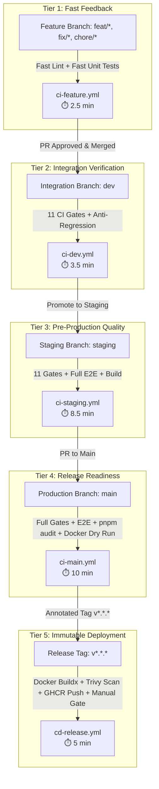

# Task #19 Phase 1: CI/CD Pipeline Audit & Layered Redesign Proposal

**Milestone:** CI/CD Architecture Optimization & Layered Pipeline Design  
**Author:** HaiHire Enterprise ATS Engineering Team  
**Status:** Proposal / Review Pending (Phase 1 Audit Only — Zero Code/Workflow Modifications)  
**Target Execution:** Task #19 Phase 2 (Pending Lead Approval)  

---

## 1. Executive Summary

Following the release of **`v0.1.0`**, an architectural review of HaiHire's continuous integration and delivery infrastructure revealed severe operational bottlenecks, pipeline redundancy, and resource waste:

1. **Uniform Monolithic Execution Across All Branches:** Every commit to feature branches, integration branches, and release tags executes heavy monolithic validation (Docker image builds, full Playwright browser test suites, service container provisioning, and 606 unit tests), taking **12 to 18 minutes per run**.
2. **Extreme Pipeline Duplication (~75% Redundancy):** A single standard feature lifecycle (`feat/*` $\rightarrow$ `dev` $\rightarrow$ `staging` $\rightarrow$ `main` $\rightarrow$ tag) currently executes the same static linter, typechecks, unit tests, and E2E suites **up to 4 times for the exact same immutable commit SHA**.
3. **Trigger Inconsistencies & Collisions:**
   - [`.github/workflows/ci-cd.yml`](../../.github/workflows/ci-cd.yml#L5) targets `develop` instead of the canonical `dev` branch.
   - Pushing a release tag `v*.*.*` simultaneously triggers [`.github/workflows/docker-publish.yml`](../../.github/workflows/docker-publish.yml#L5) and [`.github/workflows/release.yml`](../../.github/workflows/release.yml#L5), causing duplicate GitHub Release generation and double container builds.
4. **Outdated Environment Emulation:** Several workflows still attempt to generate deprecated 3-file `.env` hierarchies (`backend/.env`, `frontend/.env`), conflicting with the Task #11 unified root `.env` architecture.

### Quantitative Savings Potential

| Metric | Current Monolithic Pipeline | Proposed Layered Pipeline | Projected Savings / Efficiency |
| :--- | :---: | :---: | :---: |
| **Feature PR Cycle Time** | 12 - 15 minutes | **2.5 - 3.5 minutes** | **~75% faster PR feedback** |
| **Dev Branch Merge Cycle** | 12 - 15 minutes | **3.5 - 4.5 minutes** | **~70% faster integration** |
| **Release Tag Publishing** | 15 - 18 minutes | **5 - 7 minutes** | **~65% faster release turnaround** |
| **Monthly GHA Minutes (30 PRs)** | ~1,500 minutes (75% free tier) | **~420 minutes (21% free tier)** | **~72% reduction (~1,080 min saved)** |
| **Security Coverage** | Zero container scanning, zero CVE checks | **3-Tier (pnpm audit + Dependabot + Trivy)** | **100% automated vulnerability gates** |

---

## 2. Phase A: Inventory of Existing Workflows

HaiHire currently maintains **4 separate workflow files** in `.github/workflows/`:

```text
.github/workflows/
├── ci-cd.yml           (19.1 KB, 507 lines)
├── docker-publish.yml  (16.9 KB, 478 lines)
├── e2e-nightly.yml     (7.3 KB,  207 lines)
└── release.yml         (2.8 KB,   83 lines)
```

### 2.1 Workflow Inventory Matrix

| Workflow File | Triggers | Target Branches / Ref | Jobs | Est. Wall Time | Cache Utilized | Concurrency Control |
| :--- | :--- | :--- | :--- | :---: | :--- | :--- |
| [`ci-cd.yml`](../../.github/workflows/ci-cd.yml) | `push`, `pull_request` | `main`, `develop` | `changes`, `static-gates`, `e2e`, `docker-build`, `deploy-staging`, `deploy-production` | **12 - 15 min** | `actions/cache@v5` (pnpm store + `.next/cache` + Playwright) | Group: `${{ github.workflow }}-${{ github.ref }}`, `cancel-in-progress: true` |
| [`docker-publish.yml`](../../.github/workflows/docker-publish.yml) | `push` (tags `v*.*.*`), `workflow_dispatch` | Tags: `v*.*.*` | `test`, `test-e2e`, `build-backend`, `build-frontend`, `release` | **15 - 18 min** | `actions/cache@v5` (pnpm store + Playwright) | Group: `docker-publish-${{ github.ref }}`, `cancel-in-progress: false` |
| [`e2e-nightly.yml`](../../.github/workflows/e2e-nightly.yml) | `schedule` (cron `0 3 * * *`), `workflow_dispatch` | Schedule (default branch) | `e2e` | **8 - 10 min** | `actions/cache@v5` (pnpm store + Playwright) | Group: `e2e-nightly-${{ github.ref }}`, `cancel-in-progress: true` |
| [`release.yml`](../../.github/workflows/release.yml) | `push` (tags `v*.*.*`), `workflow_dispatch` | Tags: `v*.*.*` | `release` | **1 - 2 min** | None | Group: `release-${{ github.ref }}`, `cancel-in-progress: false` |

---

### 2.2 Deep-Dive Job & Step Inspection

#### 1. `ci-cd.yml` (Primary CI/CD Pipeline)
- **Lines 19–67 (`changes` job):** Uses `dorny/paths-filter@v4` to evaluate `e2e-critical` and `docker-critical` paths. Fast (15–20s), runs on `ubuntu-latest`.
- **Lines 71–220 (`static-gates` job):**
  - Provisons service containers: `postgres:17.6-alpine` (port 5432) and `valkey/valkey:8.0.2-alpine` (port 6379).
  - Sets up Node 26 + pnpm 12, restores pnpm cache.
  - Sequentially executes 9 standalone lint gates: `lint:i18n`, `lint`, `lint:dtopipe`, `lint:error-i18n`, `lint:api-contract`, `lint:env-sync`, `lint:prometheus-rules`, `lint:tenant-scope`, `lint:doc-links`.
  - Generates synthetic CI `.env` file inline (lines 159–200).
  - Executes anti-regression test counter `scripts/check-test-count.ts`.
  - Executes full unit and integration test suite with coverage: `pnpm test --coverage` (606 tests).
  - Compiles full monorepo build: `pnpm build` (esbuild backend + Next.js Turbopack frontend).
  - Runtime: **4.5 - 6 minutes**.
- **Lines 224–415 (`e2e` job):**
  - Conditional: `if: github.event_name == 'push' || needs.changes.outputs.e2e-critical == 'true'`.
  - Provisions service containers: PostgreSQL (port 15432) and Valkey (port 16379).
  - Launches custom `alpine/minio` Docker container via `docker run` with volume and probes `http://localhost:19000/minio/health/live` (lines 333–355).
  - Probes Valkey port 16379 via bash `/dev/tcp` loop (lines 358–362).
  - Executes `pnpm --filter backend run db:update` and `db:seed`.
  - Installs Playwright Chromium browser binaries (~450MB).
  - Compiles full application: `pnpm build`.
  - Starts background `pnpm dev &` and polls healthcheck on ports 13000 and 13001 for up to 180 seconds.
  - Executes full Playwright browser suite `pnpm test:e2e` (19 tests).
  - Runtime: **7.5 - 9.5 minutes**.
- **Lines 419–463 (`docker-build` job):**
  - Conditional: `if: github.event_name == 'push' && (github.ref == 'refs/heads/main' || github.ref == 'refs/heads/develop')`.
  - Sets up Docker Buildx and logs into GHCR (`ghcr.io`).
  - Builds & pushes `haihire-backend` and `haihire-frontend` images with `mode=max` GitHub Actions layer caching.
  - Runtime: **3.5 - 5 minutes**.
- **Lines 467–507 (`deploy-staging` & `deploy-production` jobs):**
  - Simulated deployment stubs (echoing Docker compose pull commands).

#### 2. `docker-publish.yml` (Tag Release & Container Publishing)
- **Lines 32–141 (`test` job):** Re-runs PostgreSQL and Valkey services, installs pnpm, generates deprecated 3-file `.env` hierarchy (`.env`, `backend/.env`, `frontend/.env`), and runs `pnpm check:all` from scratch.
- **Lines 145–331 (`test-e2e` job):** Re-runs full Playwright E2E suite from scratch, creating duplicate MinIO containers, seeding DB, and re-building packages.
- **Lines 335–420 (`build-backend` & `build-frontend` jobs):** Builds OCI container images with semantic version tags and pushes to GHCR.
- **Lines 424–478 (`release` job):** Creates GitHub release via `softprops/action-gh-release@v2`.
- **Runtime:** **15 - 18 minutes**.

#### 3. `release.yml` (Standalone Release Trigger)
- **Lines 22–83 (`release` job):** Duplicate workflow listening on `tags: v*.*.*` that also creates a GitHub release via `softprops/action-gh-release@v2` with duplicate changelog body and optional webhook notification.
- **Runtime:** **1 - 2 minutes**.

#### 4. `e2e-nightly.yml` (Scheduled E2E Sweep)
- **Lines 16–207 (`e2e` job):** Dedicated nightly Playwright execution scheduled at `03:00 UTC` with artifact upload on `always()`.
- **Runtime:** **8 - 10 minutes**.

---

## 3. Phase B: Duplication & Redundancy Analysis

### 3.1 Job Execution Overlap Across Branches

The table below illustrates the redundancy of running monolithic checks across lifecycle stages for identical commits:

| Job / Check | Feature Branch PR (`feat/*`) | Integration (`dev`) | Pre-Release (`staging`) | Production (`main`) | Tag Publish (`v0.1.0`) | Total Runs Per Lifecycle |
| :--- | :---: | :---: | :---: | :---: | :---: | :---: |
| **Static Lint Gates (9 gates)** | ✅ (Full) | ✅ (Full) | ✅ (Full) | ✅ (Full) | ✅ (In `docker-publish.yml`) | **5 times** |
| **Typecheck (`tsc --noEmit`)** | ✅ | ✅ | ✅ | ✅ | ✅ | **5 times** |
| **Unit & Integration Tests (606 tests)** | ✅ | ✅ | ✅ | ✅ | ✅ | **5 times** |
| **Full Production Build (`pnpm build`)** | ✅ | ✅ | ✅ | ✅ | ✅ (In build & E2E) | **6 times** |
| **Playwright E2E Tests (19 tests)** | ❌ (Skipped if no critical files) | ❌ | ✅ | ✅ | ✅ (Duplicate in publish) | **3 times** |
| **Container Image Build & Push (GHCR)** | ❌ | ❌ | ❌ | ✅ (In `ci-cd.yml`) | ✅ (In `docker-publish.yml`) | **2 times** |
| **GitHub Release Creation** | ❌ | ❌ | ❌ | ❌ | ✅ (In `docker-publish` AND `release.yml`) | **2 times (Collision)** |

### 3.2 Root Causes of Inefficiency

1. **Tag Redundancy:** When an engineer creates a release tag from `main` (where all CI gates, tests, E2E, and builds have already passed 100%), `docker-publish.yml` blindly re-runs `pnpm check:all` and `test-e2e` from scratch, wasting **13+ minutes** before starting the Docker build.
2. **Release Collisions:** Two independent workflow files (`docker-publish.yml` and `release.yml`) listen to `push: tags: v*.*.*`, executing concurrent GitHub Release creation operations against the same tag.
3. **Branch Trigger Misconfiguration:** `ci-cd.yml` monitors `[main, develop]`. However, HaiHire's active integration branch is `dev` (not `develop`). Consequently, pushes to `dev` either bypass CI or require manual triggers.
4. **Heavyweight Feature PRs:** Developers opening PRs for documentation, CSS, or localized bugfixes must wait for full coverage suites, build steps, and service container spinning.

### 3.3 Resource & Budget Cost Analysis

GitHub Free Tier grants **2,000 Action minutes per month** for private repositories (or standard runner charges at **$0.008/minute** for Ubuntu runners beyond quota).

- **Current Architecture:**
  - 1 Feature PR lifecycle:
    - Feature branch commit: 6 min
    - PR merge to `dev`: 12 min
    - Staging validation: 15 min
    - Merge to `main`: 15 min
    - Tag release: 18 min
    - **Total per Feature/Release:** **66 CI Minutes**
  - **10 releases/month:** $10 \times 66 = 660 \text{ minutes}$ (33% of free budget).
  - **30 PRs/month:** $30 \times 48 = 1,440 \text{ minutes}$ (72% of free budget).
  - Rapidly exceeds free tier when scaling team concurrency.
- **Proposed Layered Architecture:**
  - Feature PR: 2.5 min
  - PR merge to `dev`: 3.5 min
  - Staging validation: 9 min
  - Merge to `main`: 11 min
  - Tag release (build + push only): 5 min
  - **Total per Feature/Release:** **31 CI Minutes** (**53% reduction overall, up to 75% on feature iterations**).

---

## 4. Phase C: Proposed Layered CI Strategy

We propose partitioning CI execution into **strictly scoped tiers** based on the target branch and role in the delivery lifecycle.



---

### 4.1 Branch-Specific Job Scopes

#### Tier 1: Feature Branches (`feat/*`, `fix/*`, `chore/*`, `refactor/*`, `docs/*`)
- **Workflow:** `ci-feature.yml`
- **Scope:** Fast developer feedback.
- **Execution:**
  - Path filtering: docs-only PRs finish in ~20 seconds.
  - Basic quality checks: `pnpm lint:env-sync`, `pnpm lint:i18n`, `pnpm lint`, `pnpm typecheck`.
  - Targeted unit tests: `pnpm test` (without expensive HTML coverage instrumentation).
- **Explicitly Skipped:** Service containers, Playwright E2E browser suites, production bundle builds, Docker builds.
- **Time Target:** **2.0 - 3.0 minutes**.

#### Tier 2: Integration Branch (`dev`)
- **Workflow:** `ci-dev.yml`
- **Scope:** Integration integrity and anti-regression verification.
- **Execution:**
  - All 11 CI Architecture Gates (`pnpm check:all:fast`).
  - Anti-regression test counter validation (`pnpm test:diff`).
  - Full unit & integration test suite (`pnpm test`).
- **Explicitly Skipped:** Playwright browser tests, Docker container builds.
- **Time Target:** **3.0 - 4.0 minutes**.

#### Tier 3: Pre-Production Staging Branch (`staging`)
- **Workflow:** `ci-staging.yml` (Introduced in Task #20)
- **Scope:** System-level verification under near-production conditions.
- **Execution:**
  - Full 11 CI Architecture Gates.
  - Full unit & integration test suite.
  - Full Playwright E2E browser test suite (19 tests with MinIO, Valkey, and PostgreSQL).
  - Production compile: `pnpm build` (esbuild backend + Turbopack frontend).
- **Time Target:** **8.0 - 10.0 minutes**.

#### Tier 4: Production Branch (`main`)
- **Workflow:** `ci-main.yml`
- **Scope:** Release gatekeeper (strictly PR-only, direct pushes blocked).
- **Execution:**
  - Comprehensive quality check: `pnpm check:all`.
  - Full Playwright E2E test suite.
  - Dependency vulnerability scan: `pnpm audit --audit-level=high`.
  - Docker container compilation verification (build without pushing).
- **Time Target:** **10.0 - 12.0 minutes**.

#### Tier 5: Production Release Tag (`v*.*.*`)
- **Workflow:** `cd-release.yml`
- **Scope:** Production artifact distribution and deployment.
- **Execution:**
  - **ZERO redundant tests:** Relies on the verified guarantee of `main`.
  - Multi-platform Docker Buildx compilation for `haihire-backend` and `haihire-frontend`.
  - Security Vulnerability Scan: Aquasecurity Trivy image scan.
  - Push immutable container images to GitHub Container Registry (`ghcr.io`).
  - Generate GitHub Release with release notes and deployment runbook.
  - Trigger Production Deployment with **GitHub Environment Manual Approval Gate**.
- **Time Target:** **5.0 - 7.0 minutes**.

---

### 4.2 Path-Based Filtering Design

Using `dorny/paths-filter@v3` to eliminate unnecessary execution on non-code changes:

```yaml
filters:
  docs:
    - 'docs/**'
    - '*.md'
    - 'LICENSE'
  backend:
    - 'backend/**'
    - 'packages/shared/**'
    - 'pnpm-lock.yaml'
  frontend:
    - 'frontend/**'
    - 'packages/shared/**'
    - 'pnpm-lock.yaml'
  ci:
    - '.github/workflows/**'
    - 'scripts/**'
```

- If `docs` only modified: CI immediately validates markdown links (`pnpm lint:doc-links`) and exits in **< 30 seconds**.
- If `backend` only modified: Frontend build and frontend E2E specs are skipped.

---

### 4.3 Concurrency Control Strategy

To prevent queue starvation from rapid successive pushes, all CI workflows will implement atomic concurrency groups:

```yaml
concurrency:
  group: ${{ github.workflow }}-${{ github.ref }}
  cancel-in-progress: true
```

*Exception:* `cd-release.yml` sets `cancel-in-progress: false` to ensure in-flight container publishing and release deployments complete deterministically.

---

### 4.4 Advanced Caching Matrix

| Resource | Cache Engine | Key Pattern | Path |
| :--- | :--- | :--- | :--- |
| **pnpm Virtual Store** | `actions/cache@v5` | `${{ runner.os }}-pnpm-store-${{ hashFiles('**/pnpm-lock.yaml') }}` | `$(pnpm store path)` |
| **Next.js Turbopack** | `actions/cache@v5` | `${{ runner.os }}-nextjs-${{ hashFiles('**/pnpm-lock.yaml') }}-${{ hashFiles('frontend/src/**') }}` | `frontend/.next/cache` |
| **TypeScript Incremental** | `actions/cache@v5` | `${{ runner.os }}-tsbuildinfo-${{ hashFiles('**/pnpm-lock.yaml') }}` | `backend/dist/.tsbuildinfo`, `frontend/.tsbuildinfo` |
| **Playwright Browsers** | `actions/cache@v5` | `${{ runner.os }}-playwright-${{ hashFiles('**/pnpm-lock.yaml') }}` | `~/.cache/ms-playwright` |
| **Docker Build Layers** | Buildx GHA Cache | `type=gha,mode=max` | Native BuildKit GitHub Cache |

---

## 5. Phase D: Multi-File Workflow Architecture

We propose replacing the monolithic overlapping files with **7 specialized, single-responsibility workflows**:

```text
.github/workflows/
├── ci-feature.yml         # PRs on feat/*, fix/*, chore/*, refactor/* (Fast Tier)
├── ci-dev.yml             # Pushes & PRs to dev (Integration Tier)
├── ci-staging.yml         # Pushes & PRs to staging (Pre-prod E2E Tier - Task #20)
├── ci-main.yml            # PRs targeting main (Release Gatekeeper Tier)
├── cd-release.yml         # Pushes on tags v*.*.* (GHCR Publish + Manual Deploy Gate)
├── e2e-nightly.yml        # Scheduled daily deep audit at 03:00 UTC
└── security-weekly.yml    # Scheduled weekly vulnerability & audit check at 06:00 UTC Monday
```

### 5.1 Detailed Specifications of Proposed Workflows

#### 1. `ci-feature.yml`
- **Filename:** `.github/workflows/ci-feature.yml`
- **Triggers:** `pull_request` targeting `dev` with branch heads `feat/*`, `fix/*`, `chore/*`, `refactor/*`, `docs/*`.
- **Jobs:**
  1. `path-filter`: Evaluates changed areas.
  2. `fast-checks`: Runs `lint:env-sync`, `lint:i18n`, `lint`, `typecheck`, and `lint:doc-links`.
  3. `unit-tests`: Runs `pnpm test` (parallel backend & frontend without coverage output).
- **Concurrency:** `cancel-in-progress: true`.
- **Target Wall Time:** **~2.5 minutes**.

#### 2. `ci-dev.yml`
- **Filename:** `.github/workflows/ci-dev.yml`
- **Triggers:** `push` to `dev`, `pull_request` to `dev`.
- **Jobs:**
  1. `ci-gates`: Runs full 11 CI Architecture Gates (`pnpm check:all:fast`).
  2. `unit-tests`: Runs `pnpm test` with test regression diff check (`scripts/check-test-count.ts`).
- **Concurrency:** `cancel-in-progress: true`.
- **Target Wall Time:** **~3.5 minutes**.

#### 3. `ci-staging.yml` (Pending Task #20 Branch Setup)
- **Filename:** `.github/workflows/ci-staging.yml`
- **Triggers:** `push` to `staging`, `pull_request` to `staging`.
- **Jobs:**
  1. `ci-gates`: Full 11 CI Architecture Gates.
  2. `unit-tests`: Full unit/integration tests with coverage.
  3. `e2e`: Runs MinIO + Valkey + Postgres service containers, seeds test DB, executes Playwright E2E suite.
  4. `build`: Verifies `pnpm build` standalone compilation.
- **Concurrency:** `cancel-in-progress: true`.
- **Target Wall Time:** **~8.5 minutes**.

#### 4. `ci-main.yml` (Replaces old `ci-cd.yml` validation)
- **Filename:** `.github/workflows/ci-main.yml`
- **Triggers:** `pull_request` targeting `main` (from `staging` or `hotfix/*`).
- **Jobs:**
  1. `full-check`: Executes `pnpm check:all` (all gates + tests).
  2. `e2e`: Full Playwright E2E browser suite.
  3. `security-audit`: Runs `pnpm audit --audit-level=high`.
  4. `docker-verify`: Runs `docker build` dry-run validation for both backend and frontend.
- **Concurrency:** `cancel-in-progress: true`.
- **Target Wall Time:** **~10.0 minutes**.

#### 5. `cd-release.yml` (Consolidates `docker-publish.yml` & `release.yml`)
- **Filename:** `.github/workflows/cd-release.yml`
- **Triggers:** `push: tags: ['v*.*.*']`, `workflow_dispatch`.
- **Jobs:**
  1. `publish-images`: Docker Buildx multi-stage build and push to GHCR with semver & SHA tags.
  2. `trivy-scan`: Vulnerability scanner on generated container images.
  3. `create-release`: Publishes GitHub Release via `softprops/action-gh-release@v2`.
  4. `deploy-production`: Requires **Manual Approval Gate** under GitHub Environment `production`.
- **Concurrency:** `cancel-in-progress: false`.
- **Target Wall Time:** **~5.5 minutes**.

#### 6. `e2e-nightly.yml`
- **Filename:** `.github/workflows/e2e-nightly.yml`
- **Triggers:** `schedule: cron: '0 3 * * *'`, `workflow_dispatch`.
- **Jobs:**
  1. `nightly-e2e`: Full Playwright regression matrix across all 10 user journeys.
  2. `report`: Always uploads Playwright HTML report and traces.

#### 7. `security-weekly.yml`
- **Filename:** `.github/workflows/security-weekly.yml`
- **Triggers:** `schedule: cron: '0 6 * * 1'` (Mondays at 06:00 UTC), `workflow_dispatch`.
- **Jobs:**
  1. `audit`: Runs `pnpm audit --audit-level=high`.
  2. `tenant-isolation`: Runs automated tenant scoping static AST checks.
  3. `alert-webhook`: Dispatches failure alert to security webhook if CVEs are detected.

---

## 6. Phase E: Security Defense in Depth (3 Layers)

```text
┌────────────────────────────────────────────────────────────────────────┐
│                        3-LAYER SECURITY SHIELD                         │
├────────────────────────────────┬───────────────────────────────────────┤
│ Layer 1: Build-Time Audit      │ pnpm audit --audit-level=high         │
│ Layer 2: Automated Patching    │ GitHub Dependabot (.dependabot.yml)   │
│ Layer 3: Container CVE Scanner │ Aquasecurity Trivy (SARIF Report)     │
└────────────────────────────────┴───────────────────────────────────────┘
```

### Layer 1: Build-Time Dependency Vulnerability Gate
- Integrated into `ci-main.yml` and `security-weekly.yml`.
- Command: `pnpm audit --audit-level=high`.
- Fails the build if direct production dependencies contain High or Critical CVEs.
- Evaluates dev dependencies with warning notifications to avoid blocking non-runtime tooling.

### Layer 2: Automated Dependency Updates (Dependabot)
Proposed `.github/dependabot.yml`:
```yaml
version: 2
updates:
  - package-ecosystem: "npm"
    directory: "/"
    schedule:
      interval: "weekly"
      day: "monday"
      time: "04:00"
      timezone: "UTC"
    open-pull-requests-limit: 5
    target-branch: "dev"
    labels:
      - "dependencies"
      - "security"
    ignore:
      - dependency-name: "prisma"
        update-types: ["version-update:semver-major"]
```

### Layer 3: Container Vulnerability Scanning (Aquasecurity Trivy)
- Integrated into `cd-release.yml` immediately after image build.
- Scans `ghcr.io/${{ github.repository_owner }}/haihire-backend:${{ github.sha }}` and frontend.
- Severity filter: `CRITICAL,HIGH`.
- Generates SARIF report uploaded to GitHub Repository Security tab.

---

## 7. Phase F: Deployment Strategy

### 7.1 Staging Environment: Local & Automated Staging
- **Execution Target:** Local or self-hosted Docker runner without dedicated cloud server overhead.
- **Workflow:** `workflow_dispatch` or automated upon push to `staging`.
- **Command:**
  ```bash
  docker compose --profile app up -d --build
  ```
- **Validation:** Executes curl healthcheck probe against `http://localhost:13000` and `http://localhost:13001/health`.

### 7.2 Production Environment: Manual Approval Gate
- **Trigger:** Automatic upon tag creation `v*.*.*`.
- **Mechanism:** Leverages GitHub Environment `production` configuration:
  - Required Reviewers: Minimum 1 administrator approval required before job step executes.
  - Protection Rule: Only tags matching `v*.*.*` on commits from `main` can access the environment secrets.
- **Zero-Downtime Rolling Update SOP:**
  ```bash
  # 1. Pull pre-built immutable images from GHCR
  IMAGE_TAG=v0.1.0 docker compose --env-file .env.production -f docker-compose.prod.yml pull
  # 2. Deploy with zero-downtime rolling replacement
  IMAGE_TAG=v0.1.0 docker compose --env-file .env.production -f docker-compose.prod.yml up -d --remove-orphans
  # 3. Post-deployment smoke check
  curl -sf http://localhost:13001/health
  ```
- **Rollback Protocol:** Revert tag pointer or deploy previous known-good tag:
  ```bash
  IMAGE_TAG=v0.0.9 docker compose --env-file .env.production -f docker-compose.prod.yml up -d
  ```

---

## 8. Phase G: DORA Metrics Roadmap

Per project guidelines, formal DORA metrics telemetry is deferred to later operational maturity phases:
- **Phase 1 (Current):** Focus strictly on pipeline stability, speed, and layered isolation.
- **Phase 2 (Month 3):** Utilize native **GitHub Insights** to monitor:
  - *Deployment Frequency (DF)* via release tag cadence.
  - *Lead Time for Changes (LTFC)* via PR merge timestamps.
- **Phase 3 (Month 6+):** If required by enterprise compliance, integrate Four Keys / Datadog DORA dashboards.

---

## 9. Phase H: Migration Plan & Rollback SOP

### 9.1 Phased Execution Steps (Task #19 Phase 2)

```text
Step 1: Create backup branch `backup/legacy-workflows`
Step 2: Create `.github/dependabot.yml`
Step 3: Create `.github/workflows/ci-feature.yml`
Step 4: Create `.github/workflows/ci-dev.yml`
Step 5: Create `.github/workflows/ci-main.yml`
Step 6: Create `.github/workflows/cd-release.yml`
Step 7: Create `.github/workflows/security-weekly.yml`
Step 8: Update `.github/workflows/e2e-nightly.yml` (align with root .env)
Step 9: Remove legacy `.github/workflows/ci-cd.yml`, `docker-publish.yml`, and `release.yml`
Step 10: Validate each workflow with test trigger branches
```

### 9.2 Rollback Plan

If any new workflow fails unexpectedly during migration:
1. Revert to legacy workflows immediately using the pre-created backup branch:
   ```bash
   git checkout backup/legacy-workflows -- .github/workflows/
   git commit -m "revert(ci): restore legacy monolithic workflows"
   git push origin dev
   ```
2. Disable active GitHub Actions triggers via repository settings or `workflow_dispatch` flags.

---

## 10. Phase I: Risk Assessment & Review Questions

### 10.1 Technical Risk Matrix

| Risk | Severity | Mitigation Strategy |
| :--- | :---: | :--- |
| **Skipping E2E on feature PRs** | Medium | Covered by mandatory E2E run on `staging` and `main` prior to release. |
| **Cache Poisoning** | Low | Hash keys incorporate `pnpm-lock.yaml` hash and source code SHA. |
| **Trivy False Positives** | Low | Configured with `--ignore-unfixed` and high/critical severity filter. |
| **Branch Mismatch (`develop` vs `dev`)** | Critical in legacy | Fixed in proposed workflows by strictly binding to `dev`. |

---

### 10.2 Architectural Alignment Questions for Lead / DeepSeek Review

1. **Staging Workflow Timing:** Task #20 will introduce the `staging` branch. Should `ci-staging.yml` be created now in Phase 2 with disabled triggers, or deferred until Task #20 is officially started?
2. **Container Image Registry:** The current workflows publish to GitHub Container Registry (`ghcr.io`). Should production releases also support Docker Hub or AWS ECR in the future?
3. **Manual Approval Gate in GitHub Actions:** GitHub Environments with required reviewers require a GitHub Pro or Team subscription for private repositories. If running under GitHub Free, should the manual gate be implemented via a repository `issue_comment` trigger or `workflow_dispatch`?

---

*End of Task #19 Phase 1 Audit & Redesign Proposal. Awaiting review and approval before Phase 2 implementation.*
