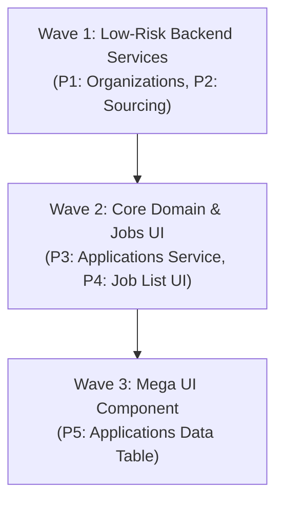

# Task #26 Phase 1: God Files Refactor Audit Report

**Date**: 2026-10-16T09:15:00+07:00  
**Author**: Antigravity (AI Senior Systems & Refactoring Specialist)  
**Agent**: `code-archaeologist`  
**Status**: AUDIT COMPLETE (Zero Code Modified, Evidence-Based AST Analysis)  
**Next Phase**: Task #26 Phase 2 (Implementation upon Architectural Review & Approval)  

---

## 1. Executive Summary

Following the production deployment of HaiHire Enterprise ATS `v0.1.1`, this audit investigates architectural debt accumulated in large source files (>400 LOC) with a targeted deep-dive into the **5 primary "God Files"**.

### Key Audit Metrics
- **Total Monorepo Source Files Audited**: 142 TypeScript/React files (excluding test suites, generated database contracts, and translation dictionaries).
- **Files Exceeding 400 LOC Threshold**: **28 files** across backend and frontend.
- **Combined Volume of Top 5 God Files**: **6,429 LOC**.
- **Average Cyclomatic Complexity of Core God Methods**: 35.8 (with individual functions reaching up to 199 in frontend and 76 in backend).
- **Refactoring Strategy Proposed**: **Strangler Fig / Facade Architecture** preserving 100% backward compatibility for all consumers and maintaining zero breaking changes.

---

## 2. Phase A: Measurement & Broad Inventory

### 2.1 Exact LOC Verification (The 5 Target God Files)

| File Path | Measured LOC | Blank / Comment Ratio | Primary Concern |
|---|:---:|:---:|---|
| `frontend/src/components/applications/applications-data-table.tsx` | **1,707** | ~14% | Massive monolithic UI containing table, drawer, multiple modals, filters, and note taking |
| `backend/src/organizations/organizations.service.ts` | **1,366** | ~11% | Mixed concerns: Org lifecycle, Membership RBAC, and Token-based Invite Links |
| `backend/src/sourcing/sourcing.service.ts` | **1,214** | ~9% | Mixed concerns: Link CRUD, Redis click concurrency locks, and massive aggregation metrics |
| `backend/src/applications/applications.service.ts` | **1,189** | ~12% | Mixed concerns: Application CRUD, 8-stage state machine, MinIO doc streaming & S3 saga |
| `frontend/src/components/jobs/job-list.tsx` | **957** | ~10% | Mixed concerns: Job cards, stage aggregation badges, multi-column filters, and drawer state |
| **Total** | **6,429** | - | - |

---

### 2.2 Top 28 Non-Generated Application Files > 400 LOC

*Note: Autogenerated files such as `backend/src/prisma/contract.d.ts` (6,229 LOC), `backend/src/prisma/seed.ts` (2,057 LOC), database migrations (`backend/migrations/**`), and translation dictionaries (`frontend/src/i18n/locales/*.ts`) are excluded from this refactoring list as they are generated or content data.*

| Rank | File Path | LOC | Domain | Primary Responsibility |
|:---:|---|:---:|:---:|---|
| 1 | `frontend/src/components/applications/applications-data-table.tsx` | **1,707** | Frontend | Monolithic candidate applications table & drawer |
| 2 | `backend/src/organizations/organizations.service.ts` | **1,366** | Backend | Org lifecycle, membership, and invite links |
| 3 | `backend/src/sourcing/sourcing.service.ts` | **1,214** | Backend | Sourcing links, attribution, and click locks |
| 4 | `backend/src/applications/applications.service.ts` | **1,189** | Backend | Applications CRUD, stage transitions, document storage |
| 5 | `frontend/src/components/jobs/job-list.tsx` | **957** | Frontend | Job catalog list, stage counts, and drawer |
| 6 | `frontend/src/app/dashboard/candidates/[id]/page.tsx` | **941** | Frontend | Candidate profile details page |
| 7 | `frontend/src/app/dashboard/candidates/page.tsx` | **907** | Frontend | Candidates directory & search page |
| 8 | `frontend/src/app/dashboard/applications/[id]/page.tsx` | **857** | Frontend | Application detail view page |
| 9 | `frontend/src/components/interviews/interviews-calendar-view.tsx` | **849** | Frontend | Calendar scheduling grid & event manager |
| 10 | `frontend/src/components/jobs/job-wizard-editor.tsx` | **839** | Frontend | Multi-step job creation wizard |
| 11 | `frontend/src/app/dashboard/settings/members/page.tsx` | **783** | Frontend | Organization member list & invite manager |
| 12 | `frontend/src/components/candidates/candidate-drawer.tsx` | **748** | Frontend | Candidate details slide-over panel |
| 13 | `backend/src/email/email.service.ts` | **698** | Backend | SMTP/Resend/SendGrid dispatch & BullMQ processing |
| 14 | `frontend/src/components/landing/landing-ats-preview.tsx` | **696** | Frontend | Marketing landing page interactive ATS demo |
| 15 | `backend/src/candidates/candidates.service.ts` | **694** | Backend | Candidate deduplication, notes, and profile CRUD |
| 16 | `frontend/src/app/dashboard/interviews/page.tsx` | **690** | Frontend | Interviews dashboard tab controller |
| 17 | `frontend/src/app/dashboard/jobs/[id]/pipeline/page.tsx` | **679** | Frontend | Job candidate kanban board pipeline |
| 18 | `backend/src/interviews/interviews.service.ts` | **640** | Backend | Interview scheduling, scorecards, and calendar sync |
| 19 | `frontend/src/app/dashboard/settings/integrations/page.tsx` | **638** | Frontend | Webhook and third-party integrations UI |
| 20 | `frontend/src/components/careers/job-details-client.tsx` | **578** | Frontend | Public job application client form |
| 21 | `frontend/src/components/jobs/wizard/wizard-step-details.tsx` | **565** | Frontend | Job wizard step 2 form component |
| 22 | `backend/src/jobs/jobs.service.ts` | **544** | Backend | Job management, status toggling, and queries |
| 23 | `frontend/src/components/interviews/schedule-interview-modal.tsx` | **531** | Frontend | Interview date/time picker modal |
| 24 | `frontend/src/app/auth/onboarding/page.tsx` | **510** | Frontend | Organization onboarding stepper |
| 25 | `backend/src/webhook-settings/webhook-settings.service.ts` | **508** | Backend | Multi-channel webhook configuration service |
| 26 | `frontend/src/components/jobs/pipeline/pipeline-candidate-detail.tsx` | **508** | Frontend | Pipeline candidate detail modal |
| 27 | `frontend/src/app/careers/page.tsx` | **499** | Frontend | Public careers portal landing page |
| 28 | `frontend/src/components/interviews/interviews-table-view.tsx` | **444** | Frontend | Tabular interview schedule listing |

---

### 2.3 Dependency Analysis for Top 5 God Files

| File | LOC | Imports | Exports | Functions / Methods Count | Direct Consumers | Test Files |
|---|:---:|:---:|:---:|:---:|:---:|:---:|
| `applications-data-table.tsx` | 1,707 | 31 | 1 | 9 | 2 | 1 (`table.spec.tsx`) |
| `organizations.service.ts` | 1,366 | 10 | 2 | 17 | 2 | 2 (`organizations.service.spec.ts`, `transactions.spec.ts`) |
| `sourcing.service.ts` | 1,214 | 9 | 2 | 11 | 2 | 1 (`sourcing.service.spec.ts`) |
| `applications.service.ts` | 1,189 | 18 | 2 | 12 | 4 | 4 (`applications.service.spec.ts`, `e2e-flow.spec.ts`, etc.) |
| `job-list.tsx` | 957 | 17 | 1 | 7 | 1 | 0 direct unit tests |

---

## 3. Phase B: Deep-Dive Analysis Per God File

---

### 3.1 File #1: `frontend/src/components/applications/applications-data-table.tsx` (1,707 LOC)

#### B.1.1 Import Analysis
- **Total Imports**: 31
- **Internal Imports (27)**:
  - Shared UI widgets: `@/components/shared/slide-over`, `custom-select`, `loading-spinner`, `pagination`, `search-input`, `segmented-tabs`, `stage-badge`.
  - Application modals: `@/components/applications/application-documents-section`, `document-preview-modal`, `delete-application-modal`.
  - Interview components: `@/components/interviews/schedule-interview-modal`, `candidate-interviews-list`.
  - Utilities & Core: `@/hooks/use-persisted-columns`, `@/lib/api-error`, `@/lib/stages`, `@/lib/api`, `@/lib/jobs`, `@/types`, `@/i18n`, `@/context/auth-context`.
- **External Imports (4)**: `react` (hooks), `next/navigation` (`useRouter`, `useSearchParams`), `@tanstack/react-query` (`useQuery`, `useMutation`, `useQueryClient`), `sonner` (`toast`).
- **Type Imports (1)**: `@/types` (`Application`, `Job`, `Candidate`, `ApplicationStage`).

#### B.1.2 Export Analysis
- **Exports**: 1 named export (`export function ApplicationsDataTable`).
- **Default Export**: None.
- **Direct Consumers**:
  1. `frontend/src/app/dashboard/applications/page.tsx`
  2. `frontend/src/app/dashboard/jobs/[id]/table/page.tsx`

#### B.1.3 Responsibility Analysis & Violations
- **Single Responsibility Violation**: Extreme.
- **Responsibilities Accumulated (6 distinct concerns)**:
  1. **Table Layout & Sorting UI**: Column definitions, persisted column visibility, sort direction, header rendering.
  2. **Filtering State Management**: Job dropdown selector, multi-stage popover checkbox filter, search input debouncing, reset buttons.
  3. **Candidate Slide-Over Drawer**: Right-hand drawer showing applicant profile, contact details, rating, resume preview, and timeline.
  4. **Notes Management**: Drawer form input for adding notes to candidates with API mutation.
  5. **Interview Scheduling Integration**: Embedded modal state, interview list fetch, interview cancellation handler.
  6. **Document Handling & Deletion**: Resume PDF preview modal, document presigned download dispatch, delete application confirmation modal.

#### B.1.4 Function / Method Inventory
| Function / Hook | Lines | LOC | Cyclomatic Complexity | Extractable? | Target Destination |
|---|:---:|:---:|:---:|:---:|---|
| `ApplicationsDataTable` (Component Body) | 100–1706 | 1,607 | **199** | Partially (Orchestrator) | `applications-data-table/index.tsx` |
| `handleAddDrawerNote` | 183–202 | 20 | 5 | Yes | `drawer/application-notes-tab.tsx` |
| `handleCancelInterview` | 204–233 | 30 | 13 | Yes | `hooks/use-application-interviews.ts` |
| `setJobFilter` | 241–248 | 8 | 3 | Yes | `filters/table-filter-bar.tsx` |
| `handleClickOutside` | 266–273 | 8 | 3 | Yes | `filters/stage-filter-popover.tsx` |
| `toggleStage` / `handleClearStages` | 313–332 | 20 | 6 | Yes | `filters/stage-filter-popover.tsx` |
| `handleResetFilters` | 401–407 | 7 | 1 | Yes | `filters/table-filter-bar.tsx` |
| `handleSort` | 423–430 | 8 | 3 | Yes | `hooks/use-table-sorting.ts` |
| `handleStageChange` | 433–452 | 20 | 5 | Yes | `hooks/use-stage-transition.ts` |
| `handleConfirmDelete` | 454–469 | 16 | 4 | Yes | `modals/delete-application-dialog.tsx` |
| `handleDownloadDoc` | 471–489 | 19 | 7 | Yes | `hooks/use-document-download.ts` |

#### B.1.5 Proposed Split Architecture
```text
frontend/src/components/applications/applications-data-table/
├── index.tsx                         # Thin Orchestrator (~120 LOC)
├── columns.tsx                       # Table column definitions & headers (~150 LOC)
├── types.ts                          # Component-specific props & interfaces (~40 LOC)
├── hooks/
│   ├── use-applications-filters.ts   # Stage & Job filter state, debounce (~110 LOC)
│   ├── use-applications-actions.ts   # Stage transition, notes, delete mutations (~130 LOC)
│   └── use-table-sorting.ts          # Sorting state & column visibility (~80 LOC)
├── filters/
│   ├── table-filter-bar.tsx          # Search input & filter controls (~140 LOC)
│   └── stage-filter-popover.tsx      # Multi-stage checkbox popover (~100 LOC)
├── drawer/
│   ├── application-detail-drawer.tsx # SlideOver container (~160 LOC)
│   └── application-notes-tab.tsx     # Note input & activity list (~110 LOC)
└── rows/
    ├── application-table-row.tsx     # Single row rendering (~150 LOC)
    └── row-actions-menu.tsx          # Action dropdown (Stage, Interview, Delete) (~90 LOC)
```
*Backward Compatibility*: `frontend/src/components/applications/applications-data-table.tsx` re-exports `ApplicationsDataTable` from `./applications-data-table/index`. Zero import modifications needed in caller pages.

---

### 3.2 File #2: `backend/src/organizations/organizations.service.ts` (1,366 LOC)

#### B.2.1 Import Analysis
- **Total Imports**: 10
- **Internal Imports (6)**: `../prisma/prisma.service`, `../events/events.service`, `./dto/create-org.dto`, `./dto/join-org.dto`, `./dto/update-org.dto`, `../common/date.util`.
- **External Imports (4)**: `@nestjs/common`, `@prisma/orm-postgres`, `node:crypto`, `bcryptjs`.
- **Type Imports**: Cleanly scoped DTOs.

#### B.2.2 Export Analysis
- **Exports**: `OrganizationsService` (Injectable class), plus helper types.
- **Direct Consumers**:
  1. `backend/src/organizations/organizations.controller.ts`
  2. `backend/src/organizations/organizations.module.ts`

#### B.2.3 Responsibility Analysis & Violations
- **Concerns Identified (3 distinct domains)**:
  1. **Organization Core Lifecycle**: Organization creation, lookup (`getMyOrg`, `getMyOrgs`), update, soft delete, tenant switching (`switchOrg`).
  2. **Membership & RBAC Management**: Membership backfilling, member listing with pagination, role modification (`OWNER`, `ADMIN`, `MEMBER`), and member removal.
  3. **Invite Link Token Engine**: Cryptographic token generation, expiration checks, public link inspection, and token redemption (`joinByToken`).

#### B.2.4 Method Inventory
| Method | Lines | LOC | Complexity | Extractable? | Sub-Domain |
|---|:---:|:---:|:---:|:---:|---|
| `executeTx` | 46–55 | 10 | 3 | Yes | Shared helper |
| `onModuleInit` / `backfillMemberships` | 57–121 | 64 | 10 | Yes | `organizations-membership.service.ts` |
| `create` | 124–195 | 72 | 3 | Yes | `organizations-core.service.ts` |
| `join` (legacy join) | 197–316 | 120 | 12 | Yes | `organizations-membership.service.ts` |
| `getMyOrg` / `getMyOrgs` | 318–393 | 75 | 7 | Yes | `organizations-core.service.ts` |
| `switchOrg` | 395–485 | 91 | 11 | Yes | `organizations-core.service.ts` |
| `updateMyOrg` | 487–558 | 72 | 11 | Yes | `organizations-core.service.ts` |
| `deleteMyOrg` | 560–621 | 62 | 6 | Yes | `organizations-core.service.ts` |
| `getMembers` | 623–725 | 103 | 14 | Yes | `organizations-membership.service.ts` |
| `updateMemberRole` | 727–832 | 106 | 14 | Yes | `organizations-membership.service.ts` |
| `removeMember` | 834–928 | 95 | 15 | Yes | `organizations-membership.service.ts` |
| `createInviteLink` | 933–1039 | 107 | **23** | Yes | `organizations-invites.service.ts` |
| `getInviteLinks` | 1041–1120 | 80 | 16 | Yes | `organizations-invites.service.ts` |
| `revokeInviteLink` | 1122–1159 | 38 | 6 | Yes | `organizations-invites.service.ts` |
| `getPublicInvite` | 1161–1237 | 77 | 12 | Yes | `organizations-invites.service.ts` |
| `joinByToken` | 1239–1347 | 109 | 14 | Yes | `organizations-invites.service.ts` |
| `getPublicOrg` | 1349–1364 | 16 | 2 | Yes | `organizations-core.service.ts` |

#### B.2.5 Proposed Split Architecture
```text
backend/src/organizations/
├── organizations.service.ts            # Facade delegating to specialized services (~140 LOC)
├── services/
│   ├── organizations-core.service.ts   # CRUD, switchOrg, deleteMyOrg (~320 LOC)
│   ├── organizations-members.service.ts# RBAC, getMembers, removeMember (~380 LOC)
│   └── organizations-invites.service.ts# Invite links, token hashing, joinByToken (~410 LOC)
└── organizations.module.ts             # Provides all sub-services & registers Facade
```

---

### 3.3 File #3: `backend/src/applications/applications.service.ts` (1,189 LOC)

#### B.3.1 Import Analysis
- **Total Imports**: 18
- **Internal Imports (12)**: `../minio/minio.service`, `../prisma/prisma.service`, `./dto/*`, `../common/upload-utils`, `../common/date.util`, `../common/doc-utils`, `../interviews/constants`, `../activities/activities.service`, `../email/email.service`, `../email/variable-registry`.
- **External Imports (3)**: `@nestjs/bullmq`, `bullmq`, `node:crypto`.
- **Type Imports (1)**: `Queue` from `bullmq`.

#### B.3.2 Export Analysis
- **Exports**: `fixUtf8String` (string utility), `ApplicationsService` (class).
- **Direct Consumers**:
  1. `backend/src/applications/applications.controller.ts`
  2. `backend/src/applications/applications.module.ts`
  3. `backend/src/interviews/interviews.service.ts`
  4. `backend/src/jobs/jobs.service.ts`

#### B.3.3 Responsibility Analysis & Violations
- **Concerns Identified (4 distinct domains)**:
  1. **Candidate Application Creation & Saga Pattern**: Handling resume upload, MinIO object streaming, database rollback transaction, and automated email enqueueing (`create` - 360 LOC).
  2. **Application Retrieval & Filtering**: Paginated search across jobs, stages, and tags (`findAll` - 180 LOC, `findByJob` - 94 LOC, `findOne` - 85 LOC).
  3. **Stage Transition State Machine**: Validating allowable stage transitions (`APPLIED` $\rightarrow$ `SCREENING` $\rightarrow$ `INTERVIEW` $\rightarrow$ `OFFER` $\rightarrow$ `HIRED` / `REJECTED`), updating timestamps, and logging activity trails (`updateStage` - 100 LOC).
  4. **Document Streaming & S3 Integration**: Candidate resume download presigning, additional document uploads, and soft deletion (`uploadDocument`, `prepareDocumentDownload`, `deleteDocument` - 230 LOC).

#### B.3.4 Method Inventory
| Method | Lines | LOC | Complexity | Extractable? | Sub-Domain |
|---|:---:|:---:|:---:|:---:|---|
| `executeTx` | 53–62 | 10 | 3 | Yes | Shared helper |
| `findByJob` | 64–157 | 94 | 22 | Yes | `applications-query.service.ts` |
| `findAll` | 159–338 | 180 | **40** | Yes | `applications-query.service.ts` |
| `findOne` | 340–424 | 85 | 19 | Yes | `applications-query.service.ts` |
| `create` (Saga + Storage + DB) | 426–785 | **360** | **76** | Yes | `applications-saga.service.ts` |
| `updateStage` (State Machine) | 787–886 | 100 | 22 | Yes | `applications-stage.service.ts` |
| `updateCandidate` | 888–907 | 20 | 8 | Yes | `applications-query.service.ts` |
| `uploadDocument` | 909–991 | 83 | 15 | Yes | `applications-documents.service.ts` |
| `prepareDocumentDownload` | 993–1087 | 95 | 23 | Yes | `applications-documents.service.ts` |
| `deleteDocument` | 1089–1116 | 28 | 5 | Yes | `applications-documents.service.ts` |
| `getCandidateDocuments` | 1118–1140 | 23 | 3 | Yes | `applications-documents.service.ts` |
| `remove` | 1142–1187 | 46 | 11 | Yes | `applications-query.service.ts` |

#### B.3.5 Proposed Split Architecture
```text
backend/src/applications/
├── applications.service.ts             # Facade preserving existing public API (~150 LOC)
├── services/
│   ├── applications-query.service.ts   # findAll, findOne, findByJob, remove (~320 LOC)
│   ├── applications-saga.service.ts    # create (Saga, MinIO upload, DB tx, email) (~340 LOC)
│   ├── applications-stage.service.ts   # updateStage & state machine validation (~140 LOC)
│   └── applications-documents.service.ts# uploadDocument, prepareDocumentDownload (~210 LOC)
└── applications.module.ts              # Dependency wiring
```

---

### 3.4 File #4: `backend/src/sourcing/sourcing.service.ts` (1,214 LOC)

#### B.4.1 Import Analysis
- **Total Imports**: 9
- **Internal Imports (5)**: `../prisma/prisma.service`, `../activities/activities.service`, `./dto/create-tracking-link.dto`, `./dto/update-tracking-link.dto`, `../common/date.util`.
- **External Imports (2)**: `@nestjs/common`, `node:crypto`.
- **Type Imports**: Cleanly scoped DTO interfaces.

#### B.4.2 Export Analysis
- **Exports**: `SourcingService` (class), `RedisLockClient` (interface).
- **Direct Consumers**:
  1. `backend/src/sourcing/sourcing.controller.ts`
  2. `backend/src/sourcing/sourcing.module.ts`

#### B.4.3 Responsibility Analysis & Violations
- **Concerns Identified (3 distinct domains)**:
  1. **Tracking Link CRUD & Token Engine**: Token generation, short link creation, editing UTM tags, and soft deletion (`createLink`, `updateLink`, `deleteLink`, `findLinkByToken` - 180 LOC).
  2. **Click Tracking & Concurrency Lock**: Distributed Valkey lock handling concurrent redirect clicks to prevent double-counting (`recordClick`, `withClickLock` - 133 LOC).
  3. **Attribution & Metrics Aggregation**: Complex SQL/Prisma aggregations calculating clicks, applications, hires, conversion rates, and time-series analytics (`getStats` - 282 LOC, `getLinkDetails` - 306 LOC, `getAttributionLog` - 108 LOC).

#### B.4.4 Method Inventory
| Method | Lines | LOC | Complexity | Extractable? | Sub-Domain |
|---|:---:|:---:|:---:|:---:|---|
| `parseDomain` | 33–45 | 13 | 5 | Yes | Utility |
| `withClickLock` | 61–126 | 66 | 12 | Yes | `sourcing-lock.service.ts` |
| `getStats` | 128–409 | 282 | **50** | Yes | `sourcing-metrics.service.ts` |
| `getLinks` | 411–543 | 133 | **32** | Yes | `sourcing-links.service.ts` |
| `getLinkDetails` | 545–850 | 306 | **70** | Yes | `sourcing-metrics.service.ts` |
| `createLink` | 852–936 | 85 | 17 | Yes | `sourcing-links.service.ts` |
| `updateLink` | 938–986 | 49 | 23 | Yes | `sourcing-links.service.ts` |
| `deleteLink` | 988–1016 | 29 | 4 | Yes | `sourcing-links.service.ts` |
| `getAttributionLog` | 1018–1125 | 108 | 17 | Yes | `sourcing-metrics.service.ts` |
| `recordClick` | 1127–1193 | 67 | 10 | Yes | `sourcing-lock.service.ts` |
| `findLinkByToken` | 1195–1212 | 18 | 2 | Yes | `sourcing-links.service.ts` |

#### B.4.5 Proposed Split Architecture
```text
backend/src/sourcing/
├── sourcing.service.ts                 # Facade (~120 LOC)
├── services/
│   ├── sourcing-links.service.ts       # CRUD operations & token generation (~240 LOC)
│   ├── sourcing-metrics.service.ts     # Aggregations, getStats, getLinkDetails (~540 LOC)
│   └── sourcing-lock.service.ts        # Valkey distributed click locks (~120 LOC)
└── sourcing.module.ts                  # Module registration
```

---

### 3.5 File #5: `frontend/src/components/jobs/job-list.tsx` (957 LOC)

#### B.5.1 Import Analysis
- **Total Imports**: 17
- **Internal Imports (14)**: `@/components/shared/slide-over`, `custom-select`, `pagination`, `search-input`, `segmented-tabs`, `job-status-badge`, `@/hooks/use-persisted-columns`, `@/lib/stages`, `@/lib/utils`, `@/lib/jobs`, `@/i18n`, `@/types`.
- **External Imports (3)**: `react`, `next/link`, `next/navigation`.

#### B.5.2 Export Analysis
- **Exports**: 1 named export (`export function JobList`).
- **Direct Consumers**:
  1. `frontend/src/app/dashboard/jobs/page.tsx`

#### B.5.3 Responsibility Analysis & Violations
- **Concerns Identified (4 distinct domains)**:
  1. **Job Table / Card Rendering**: Table header sorting, custom column selection, empty states, and pagination.
  2. **Multi-Dimension Filtering**: Department filter, Employment Type filter, Location filter, Status segmented tabs, and search query.
  3. **Stage Metrics Aggregation**: Computing candidate counts across pipeline stages per job.
  4. **Job Slide-Over Quick Details**: Displaying job description, requirements, salary range, and quick status actions.

#### B.5.4 Method Inventory
| Function / Hook | Lines | LOC | Complexity | Extractable? | Target Destination |
|---|:---:|:---:|:---:|:---:|---|
| `JobList` (Main Component) | 69–956 | 888 | **106** | Partially | `job-list/index.tsx` |
| `handleClickOutside` | 122–129 | 8 | 3 | Yes | `filters/job-filters-bar.tsx` |
| `handleFilterUpdate` | 170–202 | 33 | 12 | Yes | `hooks/use-job-filters.ts` |
| `toggleFilter` | 204–213 | 10 | 2 | Yes | `hooks/use-job-filters.ts` |
| `handleResetFilters` | 215–233 | 19 | 2 | Yes | `filters/job-filters-bar.tsx` |
| `getJobStageCounts` | 315–328 | 14 | 9 | Yes | `utils/stage-counts.ts` |

#### B.5.5 Proposed Split Architecture
```text
frontend/src/components/jobs/job-list/
├── index.tsx                         # Main container (~130 LOC)
├── types.ts                          # Props and filter interfaces (~30 LOC)
├── hooks/
│   ├── use-job-filters.ts            # Department/Type/Location state (~110 LOC)
│   └── use-job-stage-counts.ts       # Stage aggregation query helper (~70 LOC)
├── filters/
│   └── job-filters-bar.tsx           # Search, custom-selects, tabs (~150 LOC)
├── drawer/
│   └── job-quick-detail-drawer.tsx   # SlideOver job preview (~140 LOC)
└── rows/
    ├── job-table-row.tsx             # Table view row (~130 LOC)
    └── job-stage-badge-group.tsx     # Stage counts badges (~80 LOC)
```
*Backward Compatibility*: `frontend/src/components/jobs/job-list.tsx` re-exports `JobList` from `./job-list/index`.

---

## 4. Phase C: Risk Matrix & Assessment

| File | LOC | Test Suites Covering | Consumers | Architectural Risk | Implementation Risk | Priority |
|---|:---:|:---:|:---:|:---:|:---:|:---:|
| `backend/src/organizations/organizations.service.ts` | 1,366 | 2 suites (20 tests passed) | 2 | **Low** (Clean service boundaries) | **Low** (Decoupled invite token & member logic) | **P1 (Wave 1)** |
| `backend/src/sourcing/sourcing.service.ts` | 1,214 | 1 suite (11 tests passed) | 2 | **Low** (No circular deps) | **Low** (Extract metrics aggregations to helper) | **P2 (Wave 1)** |
| `backend/src/applications/applications.service.ts` | 1,189 | 4 suites (28 tests passed) | 4 | **Medium** (Saga pattern + MinIO S3) | **Medium** (Ensure transactions and saga rollbacks intact) | **P3 (Wave 2)** |
| `frontend/src/components/jobs/job-list.tsx` | 957 | 0 direct unit tests | 1 | **Low** (Isolated to 1 page) | **Medium** (Needs characterization test before split) | **P4 (Wave 2)** |
| `frontend/src/components/applications/applications-data-table.tsx` | 1,707 | 1 unit test (`table.spec.tsx`) | 2 | **High** (Massive state dependencies) | **High** (Multiple modals, drawers, query invalidations) | **P5 (Wave 3)** |

---

## 5. Phase D: Recommended Implementation Order & Rollout

We recommend a **3-Wave Staged Rollout** across separate, bite-sized Pull Requests to minimize regression blast radius and preserve continuous delivery velocity:



### Rationale
1. **Wave 1 (Low Risk, High Confidence)**:
   - `organizations.service.ts` and `sourcing.service.ts` have high test coverage (20 and 11 unit tests), clear sub-domain boundaries (Invites vs RBAC, Metrics vs Links), and only 2 direct consumers each.
   - Refactoring these first establishes the **NestJS Sub-Service Facade Pattern** across the backend.
2. **Wave 2 (Core Business Logic & Medium UI)**:
   - `applications.service.ts` requires careful attention to the MinIO upload saga and stage machine validation. With Wave 1's facade pattern proven, splitting this becomes mechanical.
   - `job-list.tsx` is only consumed by 1 page (`/dashboard/jobs`). Before refactoring, write a focused component characterization test.
3. **Wave 3 (Highest Complexity UI)**:
   - `applications-data-table.tsx` is the largest file in the repository (1,707 LOC). Leaving it for Wave 3 allows all frontend patterns (hooks, row extractions, drawer decomposition) to be refined on `job-list.tsx` first.

---

## 6. Phase E: Standard Refactoring Pattern Proposals

### 6.1 Frontend Pattern (React Modular Component Directory)
When any React component exceeds 400 LOC:
1. Convert the file into a directory with an `index.tsx` entry point.
2. The root file (`<component>.tsx`) acts as a backward-compatible shim re-exporting `<component>/index.tsx`.
3. Separate concerns into standard subdirectories:
   - `types.ts`: Interface definitions.
   - `hooks/`: Component-specific state and React Query hooks (`use-*-filters.ts`, `use-*-actions.ts`).
   - `filters/`: Toolbar, search, and filter popovers.
   - `drawer/` or `modals/`: Secondary interactive viewports.
   - `rows/` or `cards/`: Item-level rendering.

### 6.2 Backend Pattern (NestJS Facade Service Architecture)
When any NestJS service exceeds 500 LOC:
1. Retain `<name>.service.ts` as an `@Injectable()` **Facade**.
2. Inject specialized sub-services into the facade:
   ```typescript
   @Injectable()
   export class OrganizationsService {
     constructor(
       private readonly core: OrganizationsCoreService,
       private readonly members: OrganizationsMembersService,
       private readonly invites: OrganizationsInvitesService,
     ) {}

     // Delegate public methods 1:1 with zero breaking changes for controllers:
     create(dto: CreateOrgDto, userId: string) { return this.core.create(dto, userId); }
     getMembers(orgId: string, query: MemberQueryDto) { return this.members.getMembers(orgId, query); }
     createInviteLink(orgId: string, role: string) { return this.invites.createInviteLink(orgId, role); }
   }
   ```
3. Register all sub-services in `<name>.module.ts`. Controllers and external services continue injecting `<name>.service.ts` seamlessly.

---

## 7. Strategic Questions & Next Steps

1. **Characterization Tests**: For `job-list.tsx` (which currently lacks dedicated unit test coverage), should we write a unit test suite (`job-list.spec.tsx`) as the preliminary step in Wave 2 before breaking apart the component?
2. **Batching Strategy**: Do you prefer 1 PR per file (5 PRs total: PR #1 Org, PR #2 Sourcing, PR #3 App Service, PR #4 Job List, PR #5 App Table), or 3 PRs corresponding to Wave 1, Wave 2, and Wave 3? (Recommendation: 1 PR per file for cleanest git blame and easiest review).
3. **Approval to Proceed**: Once this audit report is reviewed and approved, we will begin Task #26 Phase 2 with Wave 1 (`backend/src/organizations/organizations.service.ts`).
