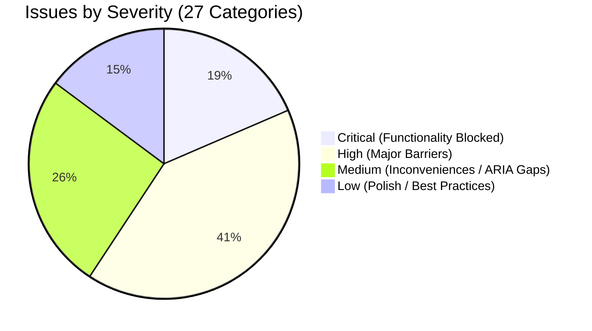

# Task #37: WCAG 2.1 AA Accessibility Audit Report

**Date**: 2026-10-17T00:25:00+07:00  
**Author**: HaiHire Core Engineering / Frontend Specialist  
**Standard**: Web Content Accessibility Guidelines (WCAG) 2.1 Level AA  
**Scope**: Full Frontend Application (`frontend/src/app`, `frontend/src/components`)  
**Status**: AUDIT COMPLETE (Read-Only Audit — Zero Code Modified)  
**Target Milestone**: v0.1.4 Fix Plan

---

## 1. Executive Summary

HaiHire Enterprise ATS is an enterprise-grade multi-tenant Applicant Tracking System. Accessibility compliance (WCAG 2.1 AA) is a mandatory procurement qualification for enterprise customers and a statutory requirement across North American and European jurisdictions (Section 508, European Accessibility Act).

This comprehensive audit evaluated the entire frontend codebase (38 page/layout routes, 75+ components across 14 functional domains) against the four core WCAG 2.1 AA principles: **Perceivable**, **Operable**, **Understandable**, and **Robust**.

### Key Audit Metrics

- **Total Categorized Issues**: **27 distinct issues** (covering 100+ code occurrences across all routes and components).
- **Estimated WCAG 2.1 AA Compliance Score**: **~58%**
- **Automated Tooling Coverage**: **0%** (Neither `@axe-core/react`, `eslint-plugin-jsx-a11y`, nor automated CI a11y tests are currently installed).
- **Critical Accessibility Blockers**: **5 issues** completely prevent keyboard-only and screen reader users from completing essential workflows (resume uploading, signing out, candidate selection in Kanban pipeline, calendar interview viewing).

### Severity Breakdown



| Severity     | Count  | Definition                                                                              | Primary Impact                                                                                                     |
| ------------ | ------ | --------------------------------------------------------------------------------------- | ------------------------------------------------------------------------------------------------------------------ |
| **Critical** | **5**  | Blocks core user/candidate tasks. No keyboard or assistive tech workaround exists.      | Public job application resume upload impossible; Sign out unreachable; Pipeline cards unselectable.                |
| **High**     | **11** | Major barrier. Violates explicit WCAG Level A/AA criteria; severely impedes navigation. | No Skip-to-Content link; Form labels unassociated; Interactive table rows untabbable; Slate-400 contrast failures. |
| **Medium**   | **7**  | Inconvenience or degraded screen reader experience. Incomplete ARIA attributes.         | Action icons missing `aria-label`; Filter tags lacking dismiss labels; Toast alerts lacking `role="status"`.       |
| **Low**      | **4**  | Minor polish, subtle visual focus gaps, or semantic enhancement.                        | Settings nav landmark labeling; Logo focus rings; Pulsing badge `aria-hidden`.                                     |

---

## 2. Phase A: Inventory

### A.1 Page Routes Inventory (38 files)

Source: `frontend/src/app`

#### Public Routes (Careers, Landing, Authentication)

| Route / Path                   | File Location                                                                                                          | Purpose / Type                           |
| ------------------------------ | ---------------------------------------------------------------------------------------------------------------------- | ---------------------------------------- |
| `/`                            | [`frontend/src/app/page.tsx`](../../frontend/src/app/page.tsx)                                                         | Enterprise landing page                  |
| `/careers`                     | [`frontend/src/app/careers/page.tsx`](../../frontend/src/app/careers/page.tsx)                                         | Public careers search directory          |
| `/careers/[orgSlug]`           | [`frontend/src/app/careers/[orgSlug]/page.tsx`](../../frontend/src/app/careers/[orgSlug]/page.tsx)                     | Tenant public job portal                 |
| `/careers/[orgSlug]/[jobSlug]` | [`frontend/src/app/careers/[orgSlug]/[jobSlug]/page.tsx`](../../frontend/src/app/careers/[orgSlug]/[jobSlug]/page.tsx) | Job details & candidate application form |
| `/auth`                        | [`frontend/src/app/auth/layout.tsx`](../../frontend/src/app/auth/layout.tsx)                                           | Authentication layout wrapper            |
| `/auth/login`                  | [`frontend/src/app/auth/login/page.tsx`](../../frontend/src/app/auth/login/page.tsx)                                   | Staff & recruiter login                  |
| `/auth/register`               | [`frontend/src/app/auth/register/page.tsx`](../../frontend/src/app/auth/register/page.tsx)                             | Staff self-registration                  |
| `/auth/join/[token]`           | [`frontend/src/app/auth/join/[token]/page.tsx`](../../frontend/src/app/auth/join/[token]/page.tsx)                     | Organization invite onboarding           |
| `/auth/onboarding`             | [`frontend/src/app/auth/onboarding/page.tsx`](../../frontend/src/app/auth/onboarding/page.tsx)                         | New tenant setup wizard                  |

#### Recruiter Dashboard Core Routes

| Route / Path                      | File Location                                                                                                                | Purpose / Type                          |
| --------------------------------- | ---------------------------------------------------------------------------------------------------------------------------- | --------------------------------------- |
| `/dashboard`                      | [`frontend/src/app/dashboard/page.tsx`](../../frontend/src/app/dashboard/page.tsx)                                           | Executive metrics & activity feed       |
| `/dashboard/jobs`                 | [`frontend/src/app/dashboard/jobs/page.tsx`](../../frontend/src/app/dashboard/jobs/page.tsx)                                 | Job listing & management                |
| `/dashboard/jobs/new`             | [`frontend/src/app/dashboard/jobs/new/page.tsx`](../../frontend/src/app/dashboard/jobs/new/page.tsx)                         | Multi-step job creation wizard          |
| `/dashboard/jobs/[id]`            | [`frontend/src/app/dashboard/jobs/[id]/page.tsx`](../../frontend/src/app/dashboard/jobs/[id]/page.tsx)                       | Job overview & quick stats              |
| `/dashboard/jobs/[id]`            | [`frontend/src/app/dashboard/jobs/[id]/layout.tsx`](../../frontend/src/app/dashboard/jobs/[id]/layout.tsx)                   | Job detail tab layout                   |
| `/dashboard/jobs/[id]/pipeline`   | [`frontend/src/app/dashboard/jobs/[id]/pipeline/page.tsx`](../../frontend/src/app/dashboard/jobs/[id]/pipeline/page.tsx)     | Kanban candidate pipeline board         |
| `/dashboard/jobs/[id]/table`      | [`frontend/src/app/dashboard/jobs/[id]/table/page.tsx`](../../frontend/src/app/dashboard/jobs/[id]/table/page.tsx)           | Tabular candidate view                  |
| `/dashboard/jobs/[id]/settings`   | [`frontend/src/app/dashboard/jobs/[id]/settings/page.tsx`](../../frontend/src/app/dashboard/jobs/[id]/settings/page.tsx)     | Job-specific configuration              |
| `/dashboard/jobs/[id]/tracking`   | [`frontend/src/app/dashboard/jobs/[id]/tracking/page.tsx`](../../frontend/src/app/dashboard/jobs/[id]/tracking/page.tsx)     | Sourcing & campaign UTM tracking        |
| `/dashboard/candidates`           | [`frontend/src/app/dashboard/candidates/page.tsx`](../../frontend/src/app/dashboard/candidates/page.tsx)                     | Global candidate database               |
| `/dashboard/candidates/new`       | [`frontend/src/app/dashboard/candidates/new/page.tsx`](../../frontend/src/app/dashboard/candidates/new/page.tsx)             | Manual candidate creation form          |
| `/dashboard/candidates/[id]`      | [`frontend/src/app/dashboard/candidates/[id]/page.tsx`](../../frontend/src/app/dashboard/candidates/[id]/page.tsx)           | Candidate profile & evaluation timeline |
| `/dashboard/candidates/[id]/edit` | [`frontend/src/app/dashboard/candidates/[id]/edit/page.tsx`](../../frontend/src/app/dashboard/candidates/[id]/edit/page.tsx) | Candidate editing form                  |
| `/dashboard/applications`         | [`frontend/src/app/dashboard/applications/page.tsx`](../../frontend/src/app/dashboard/applications/page.tsx)                 | Global application management           |
| `/dashboard/applications/[id]`    | [`frontend/src/app/dashboard/applications/[id]/page.tsx`](../../frontend/src/app/dashboard/applications/[id]/page.tsx)       | Application details & stage progression |
| `/dashboard/interviews`           | [`frontend/src/app/dashboard/interviews/page.tsx`](../../frontend/src/app/dashboard/interviews/page.tsx)                     | Interview calendar & schedule view      |
| `/dashboard/source-tracking`      | [`frontend/src/app/dashboard/source-tracking/page.tsx`](../../frontend/src/app/dashboard/source-tracking/page.tsx)           | Global attribution overview             |
| `/dashboard/source-tracking/[id]` | [`frontend/src/app/dashboard/source-tracking/[id]/page.tsx`](../../frontend/src/app/dashboard/source-tracking/[id]/page.tsx) | Channel-specific UTM campaign deep dive |

#### Settings & Administrative Routes

| Route / Path                                   | File Location                                                                                                                                          | Purpose / Type                      |
| ---------------------------------------------- | ------------------------------------------------------------------------------------------------------------------------------------------------------ | ----------------------------------- |
| `/dashboard/settings`                          | [`frontend/src/app/dashboard/settings/layout.tsx`](../../frontend/src/app/dashboard/settings/layout.tsx)                                               | Settings tab navigation layout      |
| `/dashboard/settings`                          | [`frontend/src/app/dashboard/settings/page.tsx`](../../frontend/src/app/dashboard/settings/page.tsx)                                                   | General tenant settings             |
| `/dashboard/settings/[tab]`                    | [`frontend/src/app/dashboard/settings/[tab]/page.tsx`](../../frontend/src/app/dashboard/settings/[tab]/page.tsx)                                       | Dynamic settings tab dispatcher     |
| `/dashboard/settings/members`                  | [`frontend/src/app/dashboard/settings/members/page.tsx`](../../frontend/src/app/dashboard/settings/members/page.tsx)                                   | Team members & RBAC roles           |
| `/dashboard/settings/integrations`             | [`frontend/src/app/dashboard/settings/integrations/page.tsx`](../../frontend/src/app/dashboard/settings/integrations/page.tsx)                         | Third-party webhooks & integrations |
| `/dashboard/settings/email-templates`          | [`frontend/src/app/dashboard/settings/email-templates/layout.tsx`](../../frontend/src/app/dashboard/settings/email-templates/layout.tsx)               | Email template sub-layout           |
| `/dashboard/settings/email-templates`          | [`frontend/src/app/dashboard/settings/email-templates/page.tsx`](../../frontend/src/app/dashboard/settings/email-templates/page.tsx)                   | Email template library & editor     |
| `/dashboard/settings/email-templates/settings` | [`frontend/src/app/dashboard/settings/email-templates/settings/page.tsx`](../../frontend/src/app/dashboard/settings/email-templates/settings/page.tsx) | SMTP & dispatch rules               |
| `/dashboard/settings/email-templates/logs`     | [`frontend/src/app/dashboard/settings/email-templates/logs/page.tsx`](../../frontend/src/app/dashboard/settings/email-templates/logs/page.tsx)         | Email delivery & audit logs         |

---

### A.2 Component Inventory (75+ files across 14 domains)

Source: `frontend/src/components`

```mermaid
graph TD
    UI[frontend/src/components] --> APP[applications: 8 components]
    UI --> CAN[candidates: 5 components]
    UI --> CAR[careers: 2 components]
    UI --> DASH[dashboard: 2 components]
    UI --> EML[email: 3 components]
    UI --> INT[interviews: 4 components]
    UI --> JOB[jobs: 14 components]
    UI --> LND[landing: 7 components]
    UI --> LAY[layout: 5 components]
    UI --> PROV[providers: 4 components]
    UI --> SHD[shared: 12 components]
    UI --> SRC[sourcing: 4 components]
    UI --> TIM[timeline: 2 components]
    UI --> BASE[ui: 8 primitive components]
```



1. **`applications/` (8 components)**:
   - `applications-data-table/index.tsx`, `table/applications-table-view.tsx`, `table/applications-table-row.tsx`, `toolbar/applications-table-toolbar.tsx`, `toolbar/applications-table-search.tsx`, `toolbar/applications-table-filters.tsx`, `toolbar/applications-table-export.tsx`, `drawer/application-detail-drawer.tsx`.
2. **`candidates/` (5 components)**:
   - `candidate-detail.tsx`, `candidate-form.tsx`, `candidate-timeline.tsx`, `candidate-scorecard.tsx`, `candidate-status-dropdown.tsx`.
3. **`careers/` (2 components)**:
   - `job-details-client.tsx`, `public-job-list.tsx`.
4. **`dashboard/` (2 components)**:
   - `dashboard-metrics.tsx`, `dashboard-activity-feed.tsx`.
5. **`email/` (3 components)**:
   - `email-template-editor.tsx`, `email-template-preview.tsx`, `variable-chips.tsx`.
6. **`interviews/` (4 components)**:
   - `interviews-calendar-view.tsx`, `interviews-table-view.tsx`, `schedule-interview-modal.tsx`, `interview-feedback-modal.tsx`.
7. **`jobs/` (14 components)**:
   - `job-list/job-data-table.tsx`, `job-list/rows/job-table-row.tsx`, `job-list/toolbar/job-table-toolbar.tsx`.
   - `pipeline/pipeline-board.tsx`, `pipeline/pipeline-column.tsx`, `pipeline/pipeline-candidate-card.tsx`, `pipeline/pipeline-stage-header.tsx`.
   - `wizard/job-wizard-stepper.tsx`, `wizard/job-wizard-step-basics.tsx`, `wizard/job-wizard-step-details.tsx`, `wizard/job-wizard-step-pipeline.tsx`, `wizard/job-wizard-step-review.tsx`.
   - `job-metrics-overview.tsx`, `job-status-badge.tsx`.
8. **`landing/` (7 components)**:
   - `landing-navbar.tsx`, `landing-hero.tsx`, `landing-ats-preview.tsx`, `landing-features.tsx`, `landing-cta.tsx`, `landing-footer.tsx`, `gateway-navbar.tsx`.
9. **`layout/` (5 components)**:
   - `navbar.tsx`, `sidebar.tsx`, `user-menu.tsx`, `mobile-drawer.tsx`, `notification-popover.tsx`.
10. **`providers/` (4 components)**:
    - `query-provider.tsx`, `theme-provider.tsx`, `auth-provider.tsx`, `i18n-provider.tsx`.
11. **`shared/` (12 components)**:
    - `brand-logo.tsx`, `custom-modal.tsx`, `custom-select.tsx`, `slide-over.tsx`, `pagination.tsx`, `metric-card.tsx`, `stage-badge.tsx`, `status-badge.tsx`, `segmented-tabs.tsx`, `empty-state.tsx`, `confirm-dialog.tsx`, `search-input.tsx`.
12. **`sourcing/` (4 components)**:
    - `sourcing-overview.tsx`, `tracking-links-tab.tsx`, `channels-tab.tsx`, `utm-builder-modal.tsx`.
13. **`timeline/` (2 components)**:
    - `activity-timeline.tsx`, `timeline-item.tsx`.
14. **`ui/` (8 primitive components)**:
    - `button.tsx`, `input.tsx`, `badge.tsx`, `textarea.tsx`, `card.tsx`, `avatar.tsx`, `skeleton.tsx`, `dropdown-menu.tsx`.

---

## 3. Phase B: WCAG 2.1 AA Audit Categories

### B.1 Principle 1: Perceivable

_Information and user interface components must be presentable to users in ways they can perceive._

#### 1.1.1 Non-text Content (Level A)

- **Status:** **Partial Fail**
- **Findings:**
  - Informative action icons across data tables (`JobTableRow`, `ApplicationsTableRow`, `InterviewsTableView`, `CandidatesPage`) use standard Lucide SVG icons inside `<button>` elements with only HTML `title` attributes. When `title` is used without `aria-label`, screen readers announce generic names ("button", "unlabeled button") or fail to convey button purpose to assistive technology.
  - Decorative icons (e.g. search magnifying glass in search inputs, stat card trending arrows, chevron indicators) lack `aria-hidden="true"`, creating redundant and noisy screen reader output.
  - Glowing/pulsing status indicators (e.g. `span.animate-ping` in `landing-footer.tsx:95` and `job-table-row.tsx:83`) have no semantic accessible role or `aria-hidden`.

#### 1.3.1 Info and Relationships (Level A)

- **Status:** **Fail**
- **Findings:**
  - **Form Labels Unlinked:** Public career application form (`job-details-client.tsx`), login (`app/auth/login/page.tsx`), and register (`app/auth/register/page.tsx`) wrap inputs with text inside `<label>` or standalone `<label>` without `htmlFor` and matching `id` on the `<Input>` elements. Assistive technologies cannot determine what input field currently has focus.
  - **Heading Hierarchy Gaps:**
    - `dashboard/page.tsx` contains no `<h1>` heading (jumps directly to metric card sections).
    - `auth/login/page.tsx` starts at `<h2>` without an `<h1>` page identifier.
    - `landing-footer.tsx` jumps from `<h2>` directly to `<h4>` columns.
  - **Table Semantics:** Sortable column headers in applications and candidate tables (`th onClick=...`) lack `aria-sort="ascending|descending|none"`.

#### 1.4.3 Contrast (Minimum) (Level AA)

- **Status:** **Fail**
- **Findings:**
  - Tailwind token `text-slate-400` (`#94a3b8`) on white background (`#ffffff`) yields a contrast ratio of **2.55:1** (fails WCAG AA 4.5:1 requirement). This is extensively used for secondary metadata (job department, salary ranges, candidate applied dates, metric subtitles).
  - In dark mode, `dark:text-slate-500` (`#64748b`) on slate-900 (`#0f172a`) yields **3.68:1** (fails 4.5:1).
  - Placeholder text styling (`placeholder:text-slate-400`) fails the 4.5:1 threshold unless elevated to `slate-500` (`#64748b`, 4.58:1).

#### 1.4.11 Non-text Contrast (Level AA)

- **Status:** **Partial Pass**
- **Findings:**
  - Default input borders (`border-slate-200`, `#e2e8f0` on white) have a contrast ratio of **1.25:1**, failing the 3:1 non-text boundary requirement. Unfocused form fields are nearly invisible to users with low vision until focused.

---

### B.2 Principle 2: Operable

_User interface components and navigation must be operable._

#### 2.1.1 Keyboard (Level A)

- **Status:** **Critical Fail**
- **Findings:**
  - **Resume Upload Dropzone:** `frontend/src/components/careers/job-details-client.tsx:506` uses `<div onClick={() => fileInputRef.current?.click()}>` with `<input type="file" className="hidden">`. Keyboard users cannot tab to the dropzone or press Enter to open the file selection dialog.
  - **User Logout:** `frontend/src/components/layout/user-menu.tsx:214` uses `<div onClick={handleLogout}>` inside the user profile dropdown. Tab navigation bypasses this completely, leaving keyboard-only users unable to log out.
  - **Kanban Board Cards:** `frontend/src/components/jobs/pipeline/pipeline-candidate-card.tsx:40` uses `<div onClick={onSelect} draggable>` without `tabIndex={0}`, `role="button"`, or keyboard listeners. Candidate details cannot be opened via keyboard.
  - **Calendar Event Chips:** `frontend/src/components/interviews/interviews-calendar-view.tsx:385` uses `<div onClick=...>` without keyboard activation.
  - **Clickable Table Rows:** Data table rows in applications and candidates have `onClick` handlers but no `tabIndex={0}` or keydown handlers.

#### 2.1.2 No Keyboard Trap (Level A)

- **Status:** **Pass with Observation**
- **Findings:**
  - No infinite keyboard traps observed, but custom modals (`custom-modal.tsx`, `slide-over.tsx`, `mobile-drawer.tsx`) do not trap focus inside the modal when open, allowing focus to leak into background content.

#### 2.4.1 Bypass Blocks (Level A)

- **Status:** **Fail**
- **Findings:**
  - The application lacks a "Skip to Main Content" (`skip-link`) mechanism. Screen reader and keyboard users must tab through dozens of navigation links on every page transition.
  - `frontend/src/app/dashboard/page.tsx:140` and related dashboard routes do not mark the primary workspace with `<main id="main-content">`.

#### 2.4.3 Focus Order (Level A)

- **Status:** **Partial Fail**
- **Findings:**
  - Password visibility toggle buttons in `app/auth/login/page.tsx:252` and `app/auth/register/page.tsx:171` specify `tabIndex={-1}`, completely removing them from the sequential focus navigation order.
  - Modals and drawers do not manage initial focus or return focus to the trigger button upon closing.

#### 2.4.7 Focus Visible (Level AA)

- **Status:** **Partial Fail**
- **Findings:**
  - Logo links in `navbar.tsx:151`, `landing-navbar.tsx:24`, and `gateway-navbar.tsx:43` utilize `focus:outline-hidden` without supplying an explicit `focus-visible:ring-2` replacement.
  - Interactive table rows provide hover states (`hover:bg-slate-50`) but zero focus indicators.

---

### B.3 Principle 3: Understandable

_Information and the operation of user interface must be understandable._

#### 3.1.1 Language of Page (Level A)

- **Status:** **Fail**
- **Findings:**
  - `frontend/src/app/layout.tsx:30` hardcodes `<html lang="en">`. The application supports full dynamic Vietnamese i18n (`vi`), but the `lang` attribute is not synced with the active i18n locale state. Screen readers pronounce Vietnamese text using English phonetics.

#### 3.2.1 On Focus (Level A)

- **Status:** **Pass**
- **Findings:**
  - Moving focus into form fields, buttons, or custom controls does not cause unexpected form submissions or navigation jumps.

#### 3.3.1 Error Identification (Level A)

- **Status:** **Partial Fail**
- **Findings:**
  - Form validation error banners (e.g. `job-details-client.tsx:399`, `login/page.tsx:211`) render as standard `<div>` elements lacking `role="alert"` or `aria-live="assertive"`. Screen readers do not announce error messages when submission fails.

#### 3.3.2 Labels or Instructions (Level A)

- **Status:** **Fail**
- **Findings:**
  - Multiple form inputs lack associated `<label>` tags (missing `htmlFor` / `id` connection).
  - Search inputs across data tables rely entirely on `placeholder` attributes without an accessible name (`aria-label="Search candidates"`).

---

### B.4 Principle 4: Robust

_Content must be robust enough that it can be reliably interpreted by a wide variety of user agents, including assistive technologies._

#### 4.1.2 Name, Role, Value (Level A)

- **Status:** **Critical Fail**
- **Findings:**
  - `CustomSelect` (`frontend/src/components/shared/custom-select.tsx:274-304`) is built using non-semantic `<div>` elements without `role="combobox"` / `role="listbox"`, missing `aria-expanded`, `aria-haspopup="listbox"`, `aria-selected`, and arrow-key management.
  - Sortable column headers act as buttons but are marked only as `<th>`.
  - Expandable filters and dropdown triggers lack `aria-expanded` and `aria-controls`.

#### 4.1.3 Status Messages (Level AA)

- **Status:** **Partial Fail**
- **Findings:**
  - Async mutation feedback messages, notification counter badges, and export download notifications lack `role="status"` or `aria-live="polite"`.

---

## 4. Phase C: Detailed Findings Table

| #      | File:Line                                                                                                                                                            | WCAG                    | Severity     | Description                                                                                                                     | Suggested Fix                                                                                                                                                                                    |
| ------ | -------------------------------------------------------------------------------------------------------------------------------------------------------------------- | ----------------------- | ------------ | ------------------------------------------------------------------------------------------------------------------------------- | ------------------------------------------------------------------------------------------------------------------------------------------------------------------------------------------------ |
| **1**  | [`job-details-client.tsx:506`](../../frontend/src/components/careers/job-details-client.tsx)                                                                         | **2.1.1, 4.1.2**        | **Critical** | Resume upload dropzone is a `<div>` with `onClick` triggering a hidden input (`className="hidden"`). Inaccessible via keyboard. | Make container a `<label>` linked to `<input type="file" className="sr-only focus:not-sr-only">`, or wrap in `<button type="button">` with Enter/Space key support.                              |
| **2**  | [`user-menu.tsx:214`](../../frontend/src/components/layout/user-menu.tsx)                                                                                            | **2.1.1, 4.1.2**        | **Critical** | Sign out action is a raw `<div>` with `onClick`. Keyboard users cannot tab to or trigger logout.                                | Change to `<button type="button" role="menuitem" tabIndex={0}>` with Enter/Space handlers or standard Radix `DropdownMenuItem`.                                                                  |
| **3**  | [`user-menu.tsx:91, 119, 155, 173`](../../frontend/src/components/layout/user-menu.tsx)                                                                              | **2.1.1, 4.1.2**        | **Critical** | Organization switcher items and navigation links in user menu are raw `<div>` elements without `role="menuitem"`.               | Refactor to `<button>` or `<Link role="menuitem">` with proper tab/arrow navigation.                                                                                                             |
| **4**  | [`pipeline-candidate-card.tsx:40`](../../frontend/src/components/jobs/pipeline/pipeline-candidate-card.tsx)                                                          | **2.1.1, 4.1.2**        | **Critical** | Pipeline Kanban candidate cards are `<div onClick={onSelect}>` without keyboard focus or activation.                            | Add `role="button"`, `tabIndex={0}`, `onKeyDown` (Enter/Space), and `aria-label="View candidate [Name]"`.                                                                                        |
| **5**  | [`interviews-calendar-view.tsx:385`](../../frontend/src/components/interviews/interviews-calendar-view.tsx)                                                          | **2.1.1, 4.1.2**        | **Critical** | Calendar view interview event chips are raw `<div>` with `onClick`. Keyboard users cannot select interviews.                    | Replace with `<button type="button" aria-label="Interview with [Candidate] at [Time]">` with focus rings.                                                                                        |
| **6**  | [`app/layout.tsx:39`](../../frontend/src/app/layout.tsx)                                                                                                             | **2.4.1**               | **High**     | No "Skip to main content" link at the top of the page. Users must tab through all navigation links.                             | Add `<a href="#main-content" className="sr-only focus:not-sr-only focus:fixed focus:top-4 focus:left-4 focus:z-50 focus:px-4 focus:py-2 focus:bg-primary focus:text-white">Skip to content</a>`. |
| **7**  | [`app/layout.tsx:30`](../../frontend/src/app/layout.tsx)                                                                                                             | **3.1.1**               | **High**     | Root `<html>` element has hardcoded `lang="en"`, desynchronized when user switches to Vietnamese (`vi`).                        | Dynamically bind `lang={locale}` using the current active language from cookie/i18n context.                                                                                                     |
| **8**  | [`dashboard/page.tsx:140`](../../frontend/src/app/dashboard/page.tsx)                                                                                                | **1.3.1, 2.4.1**        | **High**     | Dashboard root container lacks `<main id="main-content">` landmark and lacks an `<h1>` heading.                                 | Wrap dashboard content in `<main id="main-content">` and add an `<h1>` element (e.g. `<h1 className="sr-only">Dashboard Overview</h1>`).                                                         |
| **9**  | [`job-details-client.tsx:408-460`](../../frontend/src/components/careers/job-details-client.tsx)                                                                     | **1.3.1, 3.3.2**        | **High**     | Public career application form labels lack `htmlFor` attribute; inputs lack `id` attribute.                                     | Add unique `id` to each `<Input>` and assign matching `htmlFor` to corresponding `<label>`.                                                                                                      |
| **10** | [`auth/login/page.tsx:220-247`](../../frontend/src/app/auth/login/page.tsx)                                                                                          | **1.3.1, 3.3.2**        | **High**     | Auth login form email and password labels are disconnected from input elements.                                                 | Add `id="login-email"` and `id="login-password"` to inputs and match `htmlFor`.                                                                                                                  |
| **11** | [`auth/register/page.tsx:123-166`](../../frontend/src/app/auth/register/page.tsx)                                                                                    | **1.3.1, 3.3.2**        | **High**     | Registration form fields (name, email, password) lack `htmlFor`/`id` connection.                                                | Add explicit `id` and `htmlFor` attributes to all form controls.                                                                                                                                 |
| **12** | [`applications-table-row.tsx:39`](../../frontend/src/components/applications/applications-data-table/table/applications-table-row.tsx)                               | **2.1.1, 4.1.2**        | **High**     | Table row `<tr onClick=...>` opens application drawer, but is untabbable via keyboard.                                          | Add `tabIndex={0}`, `role="button"`, `onKeyDown` (Enter/Space), and `focus-visible:ring-2` to row or add a dedicated focusable link cell.                                                        |
| **13** | [`candidates/page.tsx:587`](../../frontend/src/app/dashboard/candidates/page.tsx)                                                                                    | **2.1.1, 4.1.2**        | **High**     | Candidate table row `<tr onClick={() => router.push(...)}>` cannot be focused or activated via keyboard.                        | Add `tabIndex={0}`, keyboard navigation listener, or embed a prominent accessible link in candidate name column.                                                                                 |
| **14** | [`applications-table-view.tsx:90-212`](../../frontend/src/components/applications/applications-data-table/table/applications-table-view.tsx)                         | **1.3.1, 2.1.1, 4.1.2** | **High**     | Sortable table headers are plain `<th onClick=...>` without button semantics, `aria-sort`, or keyboard activation.              | Wrap header label in `<button type="button">`, add `aria-sort={sortState}`, and support Enter/Space activation.                                                                                  |
| **15** | [`candidates/page.tsx:498-571`](../../frontend/src/app/dashboard/candidates/page.tsx)                                                                                | **1.3.1, 2.1.1, 4.1.2** | **High**     | Sortable table headers lack button role and `aria-sort` indicators.                                                             | Refactor sorting triggers to accessible `<button>` elements with `aria-sort`.                                                                                                                    |
| **16** | [`custom-select.tsx:274-304`](../../frontend/src/components/shared/custom-select.tsx)                                                                                | **2.1.1, 2.4.7, 4.1.2** | **High**     | `CustomSelect` lacks `role="listbox"`, `role="option"`, `aria-selected`, arrow key navigation, and visible focus rings.         | Implement ARIA listbox pattern with arrow key focus management, or migrate to `@radix-ui/react-select`.                                                                                          |
| **17** | [`custom-modal.tsx:94-118`](../../frontend/src/components/shared/custom-modal.tsx)                                                                                   | **2.1.2, 2.4.3, 4.1.2** | **High**     | `CustomModal` lacks focus trapping, initial focus placement, and focus restoration to opener on close.                          | Implement focus trap via `focus-trap-react` or migrate to Radix UI `Dialog` primitive.                                                                                                           |
| **18** | [`slide-over.tsx:52-70`](../../frontend/src/components/shared/slide-over.tsx)                                                                                        | **2.1.2, 2.4.3, 4.1.2** | **High**     | Slide-over drawer allows keyboard focus to leak into obscured background page content.                                          | Add focus trap, `aria-modal="true"`, and return focus to triggering element on dismiss.                                                                                                          |
| **19** | [`mobile-drawer.tsx:45-63`](../../frontend/src/components/layout/mobile-drawer.tsx)                                                                                  | **2.1.1, 2.4.3, 4.1.2** | **High**     | Mobile navigation drawer lacks `role="dialog"`, `aria-modal="true"`, focus trap, and Escape key listener.                       | Add modal dialog semantics, keyboard Escape handler, and focus containment.                                                                                                                      |
| **20** | [`job-table-row.tsx:44`](../../frontend/src/components/jobs/job-list/rows/job-table-row.tsx)                                                                         | **1.4.3**               | **High**     | Department and location metadata uses `text-slate-400` on white background (contrast **2.55:1**, fails 4.5:1).                  | Change `text-slate-400` to `text-slate-600` (ratio **5.74:1**) or minimum `text-slate-500` (ratio **4.58:1**).                                                                                   |
| **21** | [`dashboard-metrics.tsx:35`](../../frontend/src/components/dashboard/dashboard-metrics.tsx)                                                                          | **1.4.3**               | **High**     | Metrics subtitles use `text-slate-400` (light) and `dark:text-slate-500` (dark mode contrast **3.68:1**).                       | Upgrade to `text-slate-600` in light mode and `dark:text-slate-400` in dark mode.                                                                                                                |
| **22** | [`auth/login/page.tsx:252`](../../frontend/src/app/auth/login/page.tsx) & [`register/page.tsx:171`](../../frontend/src/app/auth/register/page.tsx)                   | **2.1.1, 4.1.2**        | **High**     | Show/hide password button has `tabIndex={-1}` and no `aria-label` or `aria-pressed`.                                            | Remove `tabIndex={-1}`, add `aria-label={showPassword ? t('auth.hidePassword') : t('auth.showPassword')}` and `aria-pressed`.                                                                    |
| **23** | [`job-table-row.tsx:99-146`](../../frontend/src/components/jobs/job-list/rows/job-table-row.tsx)                                                                     | **1.1.1, 4.1.2**        | **Medium**   | Table row action buttons (Edit, Share, Delete) rely only on `title` attribute without `aria-label`.                             | Add explicit `aria-label` to each action button (e.g. `aria-label="Edit job [Title]"`).                                                                                                          |
| **24** | [`applications-table-toolbar.tsx:177, 195`](../../frontend/src/components/applications/applications-data-table/toolbar/applications-table-toolbar.tsx)               | **1.1.1, 4.1.2**        | **Medium**   | Active filter tag dismiss buttons `<button onClick=...><X /></button>` lack `aria-label`.                                       | Add `aria-label="Remove [Filter Name] filter"`.                                                                                                                                                  |
| **25** | [`pagination.tsx:60-136`](../../frontend/src/components/shared/pagination.tsx)                                                                                       | **1.3.1, 4.1.2**        | **Medium**   | Pagination container is a `<div>` instead of `<nav>`, and active page button lacks `aria-current="page"`.                       | Wrap in `<nav aria-label="Pagination">` and add `aria-current="page"` to active page button.                                                                                                     |
| **26** | Multiple files ([`job-details-client:399`](../../frontend/src/components/careers/job-details-client.tsx), [`login:211`](../../frontend/src/app/auth/login/page.tsx)) | **3.3.1, 4.1.3**        | **Medium**   | Form error banners and toast notifications lack `role="alert"` or `role="status"`.                                              | Add `role="alert"` and `aria-live="assertive"` to form error blocks; use `role="status"` for toasts.                                                                                             |
| **27** | [`navbar.tsx:151`](../../frontend/src/components/layout/navbar.tsx)                                                                                                  | **2.4.7**               | **Low**      | Brand logo link has `focus:outline-hidden` without custom focus ring indicator.                                                 | Replace with `focus-visible:ring-2 focus-visible:ring-primary focus-visible:outline-none`.                                                                                                       |

---

## 5. Phase D: Tooling Status

### D.1 Current Codebase Tooling Assessment

An inspection of `package.json` (root) and `frontend/package.json` reveals:

- **`@axe-core/react`**: ❌ Not installed.
- **`eslint-plugin-jsx-a11y`**: ❌ Not installed.
- **Automated Accessibility Testing in CI**: ❌ None.
- **Linter Status**: `pnpm --filter frontend lint` executes standard Next.js ESLint configuration (`next/core-web-vitals` and `next/typescript`), which checks for basic image `alt` attributes but does NOT enforce ARIA attributes, keyboard handlers, or label associations.

### D.2 Recommended Automated Tooling Setup for v0.1.4

1. **Developer Runtime Checks**:
   - Install `@axe-core/react` as a development dependency in `frontend`:
     ```bash
     pnpm --filter frontend add -D @axe-core/react
     ```
   - Initialize in `frontend/src/app/layout.tsx` conditionally in development mode to log WCAG violations directly to the browser console.
2. **Static Linting Quality Gate**:
   - Add `eslint-plugin-jsx-a11y` to ESLint config to catch missing `aria-label`, unassociated form labels, and untabbable click events during `pnpm lint`.
3. **End-to-End Automated Accessibility Scans**:
   - Integrate `@axe-core/playwright` into the existing E2E test suite to run automated WCAG 2.1 AA scans across key pages (`/careers/*`, `/auth/*`, `/dashboard/*`).

---

## 6. Phase E: Priority Order for v0.1.4

### Priority 1: Critical & Quick-Win High Issues (Target: Week 1 of v0.1.4)

_Focus: Eliminate barriers that completely block core user interactions or have severe compliance exposure._

1. **Fix Public Resume Upload Keyboard Access (Issue #1)**:
   - Refactor `job-details-client.tsx:506` dropzone to be fully keyboard accessible with Enter/Space support and accessible file input.
2. **Fix User Menu Logout & Navigation Divs (Issues #2, #3)**:
   - Replace raw `<div>` with semantic `<button>` or Radix UI dropdown items with `role="menuitem"`.
3. **Add Global Skip to Main Content Link (Issue #6)**:
   - Add accessible skip-link in `app/layout.tsx` and assign `id="main-content"` to all page `<main>` containers.
4. **Link Form Labels to Form Inputs (Issues #9, #10, #11)**:
   - Add explicit `id` and `htmlFor` across careers application form, login form, and register form.
5. **Add Keyboard Support to Kanban Pipeline Cards & Calendar Events (Issues #4, #5)**:
   - Add `tabIndex={0}`, `role="button"`, and Enter/Space handlers to candidate cards and interview calendar chips.
6. **Show/Hide Password Keyboard Visibility (Issue #22)**:
   - Remove `tabIndex={-1}` and add `aria-label` / `aria-pressed`.

### Priority 2: High & Medium Issues (Target: Week 2 of v0.1.4)

_Focus: Data table accessibility, color contrast, and modal focus management._

7. **Color Contrast Remediations (Issues #20, #21)**:
   - Update Tailwind class tokens: replace `text-slate-400` with `text-slate-600` (`slate-500` minimum) on white backgrounds; adjust dark mode tokens.
8. **Sortable Table Headers & Clickable Rows (Issues #12, #13, #14, #15)**:
   - Convert table headers to `<button>` with `aria-sort`; enable keyboard activation for candidate and application table rows.
9. **Modal & Drawer Focus Trapping (Issues #17, #18, #19)**:
   - Add focus trapping and Escape key handling to `CustomModal`, `SlideOver`, and `MobileDrawer`.
10. **Action Buttons & Filter Dismiss `aria-label` (Issues #23, #24)**:
    - Provide descriptive `aria-label` for all icon-only buttons across tables and toolbars.
11. **Form Error `role="alert"` & Pagination Landmarks (Issues #25, #26)**:
    - Add `role="alert"` to form validation banners; wrap pagination in `<nav aria-label="Pagination">` with `aria-current="page"`.

### Priority 3: Low & Polish Issues (Target: v0.1.5 or Fast Follow)

_Focus: Brand logos, secondary landmarks, and decorative ARIA cleanup._

12. **Brand Logo & Navigation Focus Indicators (Issue #27)**:
    - Replace `focus:outline-hidden` with visible focus rings on logo links.
13. **Dynamic `html lang` Attribute (Issue #7)**:
    - Connect Next.js root layout `lang` attribute to current user locale (`en` / `vi`).
14. **CustomSelect Complete ARIA Overhaul (Issue #16)**:
    - Migrate `CustomSelect` to `@radix-ui/react-select` for complete native-level keyboard and ARIA support.
15. **Decorative Icon Hygiene**:
    - Add `aria-hidden="true"` to pure decorative Lucide icons across the application.

---

## 7. Strategic Recommendations

1. **Adopt Radix UI Primitives Over Custom Ad-Hoc Modals/Selects**:
   - HaiHire already includes `@radix-ui/react-dropdown-menu` and `@radix-ui/react-slot`. Replacing ad-hoc implementations (`CustomModal`, `CustomSelect`, `SlideOver`) with Radix UI primitives (`@radix-ui/react-dialog`, `@radix-ui/react-select`) will automatically resolve focus trapping, screen reader announcing, keyboard arrow navigation, and portal management with zero boilerplate.
2. **Elevate Slate Design Tokens in Design System**:
   - Establish a design system rule forbidding `text-slate-400` for readable body text or metadata on white backgrounds. Designate `text-slate-500` (`#64748b`, 4.58:1) as the strict floor for secondary text and `text-slate-600` (`#475569`, 5.74:1) as standard secondary body text.
3. **Automate a11y Gate in CI Pipeline**:
   - Integrate `eslint-plugin-jsx-a11y` as Gate #12 in `project-conventions.md` to prevent any future merge of unassociated labels, missing button text, or untabbable click events.
