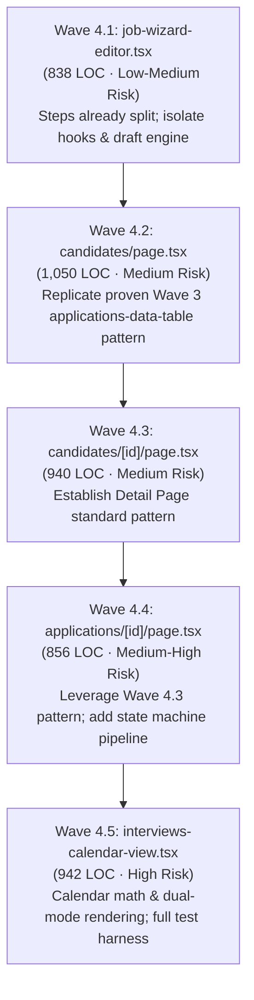

# Task #43 Phase 1: Wave 4 Audit Report (Frontend God Files)

**Date**: 2026-10-17T18:59:00+07:00  
**Author**: Antigravity (AI Senior Frontend Architect & Refactoring Specialist)  
**Agent**: `frontend-specialist`  
**Status**: AUDIT COMPLETE (Zero Code Modified, Evidence-Based AST & Test Coverage Analysis)  
**Next Phase**: Task #43 Phase 2 (Wave 4.1 Execution upon Architectural Approval)

---

## 1. Executive Summary

Following Waves 1–3 which successfully decomposed the top 5 God Files (`organizations.service.ts`, `sourcing.service.ts`, `applications.service.ts`, `job-list.tsx`, and `applications-data-table.tsx`), **Wave 4** tackles the next 5 major monolithic frontend files identified in the Task #26 inventory (previously ranked #6 to #10):

1. `frontend/src/app/dashboard/candidates/[id]/page.tsx` (940 LOC)
2. `frontend/src/app/dashboard/candidates/page.tsx` (1,050 LOC)
3. `frontend/src/app/dashboard/applications/[id]/page.tsx` (856 LOC)
4. `frontend/src/components/interviews/interviews-calendar-view.tsx` (942 LOC)
5. `frontend/src/components/jobs/job-wizard-editor.tsx` (838 LOC)

### Key Audit Metrics

- **Total Combined LOC**: **4,626 LOC** (verified exact via PowerShell `Get-Content -LiteralPath`).
- **Baseline Test Coverage**: 4 of the 5 files have **0.00% statement/line test coverage**. Only `interviews-calendar-view.tsx` has partial test coverage (66.16% line coverage via 1 accessibility test).
- **Characterization Test Gap**: **4 files (3,684 LOC)** strictly require characterization tests before any decomposition begins to ensure zero functional regression.
- **Estimated Decomposition Effort**: **34 – 42 engineering hours** across 5 sequential sub-waves.
- **Decomposition Target**: 38 focused sub-files ($\le 200$ comfortable LOC, hard ceiling $250$ LOC) adhering to 4-layer separation of concerns (UI, Logic/Hooks, Data/API, Types).
- **Compatibility Mandate**: Thin page wrappers ($\le 45$ LOC) and backward-compatible export shims (2–10 LOC) to guarantee zero consumer breakage.

---

## 2. Phase A: Measurement & Dependency Inventory

### 2.1 Exact LOC Verification

Measured directly in the workspace using PowerShell `Get-Content -LiteralPath`:

```powershell
Path                                                            Lines
----                                                            -----
frontend/src/app/dashboard/candidates/[id]/page.tsx               940
frontend/src/app/dashboard/candidates/page.tsx                   1050
frontend/src/app/dashboard/applications/[id]/page.tsx             856
frontend/src/components/interviews/interviews-calendar-view.tsx   942
frontend/src/components/jobs/job-wizard-editor.tsx                838
---------------------------------------------------------------------
TOTAL                                                            4626
```

> **Variance Analysis vs Task #26 Baseline:**
>
> - `candidates/page.tsx`: 907 → **1,050 LOC** (+143 LOC). Expanded with synchronized URL parameters (`useTableParams`), multi-select responsive filter tabs (`SegmentedTabs`), and column picker persistence (`usePersistedColumns`).
> - `interviews-calendar-view.tsx`: 849 → **942 LOC** (+93 LOC). Expanded with an Outlook-style "+N more" day details dialog, weekend styling, and keyboard navigation.
> - `job-wizard-editor.tsx`: 839 → **838 LOC** (-1 LOC). Form steps were split into `./wizard/`, but the 26+ state variables, draft persistence engine, and submission handlers remained in the root file.

---

### 2.2 Test Coverage Analysis (v8 Engine)

Measured by executing `pnpm --filter frontend test -- --coverage --run <scope>`:

| Target File                    |  % Stmts   |  % Branch  |  % Funcs   |  % Lines   | Uncovered Lines   | Existing Test Files                          |
| ------------------------------ | :--------: | :--------: | :--------: | :--------: | ----------------- | -------------------------------------------- |
| `candidates/[id]/page.tsx`     | **0.00%**  | **0.00%**  | **0.00%**  | **0.00%**  | 1–940             | _None_                                       |
| `candidates/page.tsx`          | **0.00%**  | **0.00%**  | **0.00%**  | **0.00%**  | 1–1050            | _None_                                       |
| `applications/[id]/page.tsx`   | **0.00%**  | **0.00%**  | **0.00%**  | **0.00%**  | 1–856             | _None_                                       |
| `interviews-calendar-view.tsx` | **65.75%** | **43.88%** | **50.00%** | **66.16%** | 333, 402, 448–924 | `interviews-calendar-view.spec.tsx` (1 test) |
| `job-wizard-editor.tsx`        | **0.00%**  | **0.00%**  | **0.00%**  | **0.00%**  | 1–838             | _None directly_ (isolated step tests only)   |

---

### 2.3 Import & Consumer Dependency Analysis

```
Import Statistics:
--------------------------------------------------------------------------------
File                               Total  External  Internal  Type-only  Consumers
--------------------------------------------------------------------------------
candidates/[id]/page.tsx             26         5        21          1          0 (App Router)
candidates/page.tsx                  26         4        22          2          0 (App Router)
applications/[id]/page.tsx           30         5        25          2          0 (App Router)
interviews-calendar-view.tsx          8         2         6          1          2 (1 prod, 1 test)
job-wizard-editor.tsx                10         4         6          1          2 (2 prod)
```

#### Consumer Registry:

- **`interviews-calendar-view.tsx`**:
  - `frontend/src/app/dashboard/interviews/page.tsx` (Line 37 & 494)
  - `frontend/src/components/interviews/interviews-calendar-view.spec.tsx` (Line 3 & 69)
- **`job-wizard-editor.tsx`**:
  - `frontend/src/app/dashboard/jobs/new/page.tsx` (Line 7 & 24)
  - `frontend/src/app/dashboard/jobs/[id]/settings/page.tsx` (Line 7 & 28)

---

## 3. Phase B: Per-File Deep Dive

---

### B.1 File #1: `candidates/[id]/page.tsx` (940 LOC)

#### Responsibilities (7 Concerns):

1. **Routing & Auth Gate:** Extracts route params, validates UUID via `isValidUuid`, checks user editing permissions via `canEdit`, renders 404 screen on failure.
2. **Profile & Contact Details:** Renders candidate header, mail/phone hyperlinks, parsed candidate metadata (first name, last name, display name, gender label, date of birth, notes, created/updated timestamps).
3. **Application Lifecycle History:** Applications tab listing all jobs applied to, stage tracking with `StageBadge`, embedded `CandidateInterviewsList`.
4. **Document Aggregation & Storage:** Aggregates direct candidate CVs and cross-application attachments; authenticated document download and secure upload handling.
5. **Document Viewer Engine:** Embedded full-height `iframe` PDF preview viewer with preview navigation state.
6. **Activity & Audit Trail:** Activity and email timeline container (`CandidateTimeline`).
7. **Modal Orchestration:** Manages 5 separate dialogs: `ApplyToJobModal`, `DeleteCandidateModal`, `DeleteDocumentModal`, `ScheduleInterviewModal`, and `SendEmailModal`.

#### Technical Inventory:

- **Components Imported:** `AuthGuard`, `Navbar`, `LoadingSpinner`, `CustomSelect`, `StageBadge`, `Button`, `CandidateInterviewsList`, `CandidateTimeline`, 5 modals, 15 Lucide icons.
- **Hooks Used:** `useParams()`, `useRouter()`, `useAuth()`, `useI18n()`, `useState()` (8 instances), `useMemo()` (4 instances), `useRef()` (`docInputRef`).
- **React Query Hooks:**
  - Queries: `useCandidate(id)`, `useAllJobs(organizationId)`
  - Mutations: `useUploadCandidateDocumentMutation()`, `useDeleteCandidateMutation()`, `useDeleteCandidateDocumentMutation()`, `useDeleteDocumentMutation()`, `useDeleteInterviewMutation()`
- **Event Handlers:** `handleCancelInterview`, `handleDocumentUpload`, `handleConfirmDelete`, `handleDownloadDoc`, `handleConfirmDeleteDoc`.

#### Proposed Decomposition Plan:

Target: `frontend/src/app/dashboard/candidates/[id]/`

```
candidates/[id]/
├── page.tsx                             (~40 LOC thin wrapper with AuthGuard)
├── candidate-detail-view.tsx             (~160 LOC coordinator container)
├── hooks/
│   ├── use-candidate-detail-state.ts     (~120 LOC state, queries, & document aggregation)
│   └── use-candidate-document-actions.ts (~90 LOC upload, download, & delete handlers)
├── sections/
│   ├── candidate-detail-header.tsx       (~120 LOC hero header, contact links, action buttons)
│   ├── candidate-profile-card.tsx        (~110 LOC personal details grid & parsed notes)
│   ├── candidate-applications-tab.tsx    (~140 LOC application cards & interview list)
│   ├── candidate-documents-tab.tsx       (~160 LOC documents list & empty state)
│   └── candidate-document-preview.tsx    (~80 LOC full-height iframe PDF viewer)
└── modals/
    └── candidate-detail-modals.tsx       (~110 LOC coordinator for the 5 dialogs)
```

---

### B.2 File #2: `candidates/page.tsx` (1,050 LOC)

#### Responsibilities (7 Concerns):

1. **URL Synchronization & Server Pagination:** Bidirectional binding with query parameters (`page`, `limit`, `search`) via `useTableParams`.
2. **Tabbed Profile Status Filtering:** Quick status tabs (`ALL`, `WITH_RESUME`, `HAS_APPLICATIONS`, `UNASSIGNED`) with client-side counter calculation.
3. **Column Visibility & LocalStorage Persistence:** Column picker dropdown with outside-click detection and persistence (`usePersistedColumns`).
4. **Client Table Sorting:** Sort state (`name`, `email`, `phone`, `applications`, `added`) with asc/desc direction toggles and accessibility headers.
5. **Data Table Rendering:** Responsive candidate table rows with click-to-preview row selection and action triggers (view, edit, delete).
6. **Slide-Over Filter Drawer:** Secondary filter drawer with job selector, profile status pills, sort overrides, and reset controls.
7. **Slide-Over Profile Drawer & Modals:** Integrates `CandidateDrawer`, `ApplyToJobModal`, `ScheduleInterviewModal`, `DeleteCandidateModal`.

#### Technical Inventory:

- **Components Imported:** `AuthGuard`, `Navbar`, `LoadingSpinner`, `Pagination`, `SearchInput`, `SegmentedTabs`, `SlideOver`, `CustomSelect`, `Button`, `CandidateDrawer`, 3 modals, 13 Lucide icons.
- **Hooks Used:** `useRouter()`, `useAuth()`, `useI18n()`, `useTableParams()`, `usePersistedColumns()`, `useState()` (10 instances), `useMemo()` (7 instances), `useEffect()` (outside-click), `useRef()` (`columnsRef`).
- **React Query Hooks:**
  - Queries: `useAllJobs(organizationId)`, `useCandidates(organizationId, params)`, `useCandidate(selectedCandidateId)`
  - Mutations: `useDeleteCandidateMutation()`
- **Event Handlers:** `handleSort`, `handleResetFilters`, `handleConfirmDeleteCandidate`, `toggleCandidateFilter`.

#### Proposed Decomposition Plan:

Target: `frontend/src/app/dashboard/candidates/`

```
candidates/
├── page.tsx                             (~45 LOC thin wrapper with Suspense & AuthGuard)
├── candidates-view.tsx                  (~150 LOC coordinator component)
├── hooks/
│   ├── use-candidates-filter-sort.ts    (~130 LOC secondary filtering, tab counts, multi-column sorting)
│   └── use-candidates-drawer-state.ts   (~80 LOC selection, drawer, and modal state)
├── table/
│   ├── candidates-table.tsx             (~160 LOC table structure, headers with a11y sort)
│   └── candidate-table-row.tsx          (~120 LOC row rendering, cell formatting, actions)
├── toolbar/
│   ├── candidates-toolbar.tsx           (~130 LOC segmented tabs, search box, filter toggle)
│   ├── candidates-column-picker.tsx     (~80 LOC column dropdown menu with persisted state)
│   └── candidates-active-filters.tsx    (~60 LOC filter chips bar & reset button)
└── drawers/
    └── candidates-filter-drawer.tsx     (~120 LOC slide-over filter by job and status)
```

---

### B.3 File #3: `applications/[id]/page.tsx` (856 LOC)

#### Responsibilities (7 Concerns):

1. **Routing, Validation & 404 Management:** Route ID extraction, UUID validation, error screen with internationalized fallbacks.
2. **State Machine Transition Bar:** Pre-condition checking via `canTransition()`, human-readable disable reasons with `getTransitionDisabledReason()`, inline mutation dispatch, and query cache invalidation.
3. **Candidate Summary Card:** Initials avatar, candidate details, stage badge, email action modal launcher, and job comparison button.
4. **Composite Overview Tab with Customizer:** Multi-section overview (AI analysis, interview list, documents list, custom note stream, properties) controlled by an interactive popover (`OverviewSectionsPopover`).
5. **9-Tab Content Switcher:** Sub-navigation across 9 tabs (`overview`, `inbox`, `ai`, `interviews`, `documents`, `responses`, `notes`, `timeline`, `properties`).
6. **Application Notes Engine:** Delimited note parser, live note appending, keyboard shortcut (`Enter` to submit), and mutation dispatch.
7. **Modal Orchestration:** 4 dialogs: `DocumentPreviewModal`, `DeleteApplicationModal`, `ScheduleInterviewModal`, `SendEmailModal`.

#### Technical Inventory:

- **Components Imported:** `AuthGuard`, `Navbar`, `LoadingSpinner`, `Button`, `StageBadge`, `StageSelector`, `CandidateInterviewsList`, `ApplicationDocumentsSection`, `CandidateTimeline`, `OverviewSectionsPopover`, 4 modals, 13 Lucide icons.
- **Hooks Used:** `useParams()`, `useRouter()`, `useAuth()`, `useI18n()`, `useQueryClient()`, `useState()` (9 instances), `useMemo()` (4 instances), `useEffect()` (notes parser), `useRef()` (`overviewBtnRef`).
- **React Query Hooks:**
  - Queries: `useApplication(id)`, `useAllJobs(organizationId)`
  - Mutations: `useUpdateStageMutation()`, `useDeleteApplicationMutation()`, `useUpdateCandidateMutation()`, `useDeleteInterviewMutation()`
- **Event Handlers:** `handleStageChange`, `handleAddNote`, `handleConfirmDelete`, `handleDownloadDoc`, `handleCancelInterview`.

#### Proposed Decomposition Plan:

Target: `frontend/src/app/dashboard/applications/[id]/`

```
applications/[id]/
├── page.tsx                                (~40 LOC thin wrapper with AuthGuard)
├── application-detail-view.tsx              (~170 LOC coordinator container)
├── hooks/
│   ├── use-application-detail-state.ts      (~130 LOC queries, notes parsing, tab state)
│   └── use-application-stage-actions.ts    (~90 LOC stage transition state machine & interview deletion)
├── sections/
│   ├── application-detail-header.tsx        (~120 LOC applicant hero card, avatar, contact)
│   ├── application-stage-bar.tsx            (~90 LOC state machine action bar & deletion button)
│   ├── application-nav-tabs.tsx             (~110 LOC 9-tab bar + overview sections popover trigger)
│   ├── application-overview-tab.tsx         (~160 LOC composite widget rendering dynamic sections)
│   └── application-notes-card.tsx           (~100 LOC live note stream & submission form)
└── modals/
    └── application-detail-modals.tsx        (~100 LOC container for the 4 dialogs)
```

---

### B.4 File #4: `interviews-calendar-view.tsx` (942 LOC)

#### Responsibilities (6 Concerns):

1. **Calendar Date Mathematics:** Local date calculations, Monday-start week normalization, previous/next month padding (35 or 42 cells), week days array.
2. **Calendar Header Controls:** Month/week navigation, Today button, mode pill switcher, internationalized date title formatting.
3. **Month Grid View:** 7-column calendar grid with weekend styling, event limit (max 4 per cell), Outlook-style event chips with scorecard indicators, and "+N more" overflow triggers.
4. **Week Time Grid View:** 7-column detailed day cards, displaying interviewer name, round type, star ratings, meeting URL join links, and scorecard actions.
5. **Day Details Modal:** Pop-up list of all interviews scheduled for a specific day when "+N more" is clicked.
6. **Interview Details & Action Modal:** Detailed scorecard and interview modal allowing editing schedule, viewing evaluation feedback, or launching scorecard entry.

#### Technical Inventory:

- **Components Imported:** `Button`, `CustomModal`, 5 domain helper functions, 8 Lucide icons.
- **Hooks Used:** `useI18n()`, `useState()` (4 instances), `useMemo()` (7 instances).
- **Event Handlers:** `handlePrevMonth`, `handleNextMonth`, `handleToday`, `onScheduleDate`, `onEditSchedule`, `onOpenScorecard`.

#### Proposed Decomposition Plan:

Target: `frontend/src/components/interviews/calendar/`

```
frontend/src/components/interviews/
├── interviews-calendar-view.tsx           (3 LOC backward-compatible shim)
└── calendar/
    ├── index.tsx                          (~130 LOC coordinator component)
    ├── types.ts                           (~50 LOC interfaces & EventItem models)
    ├── hooks/
    │   ├── use-calendar-date-math.ts      (~130 LOC date calculations, month/week day generator)
    │   └── use-calendar-events.ts         (~80 LOC grouping & sorting interviews by date key)
    ├── components/
    │   ├── calendar-header.tsx            (~90 LOC navigation buttons, today jump, mode switcher)
    │   ├── calendar-month-view.tsx        (~170 LOC 7-col month grid, day cells, event chips)
    │   └── calendar-week-view.tsx         (~180 LOC 7-col week cards, interviewer/rating details)
    └── modals/
        ├── calendar-day-details-modal.tsx (~100 LOC "+N more" daily event list modal)
        └── calendar-event-modal.tsx       (~150 LOC full interview detail & scorecard action modal)
```

---

### B.5 File #5: `job-wizard-editor.tsx` (838 LOC)

#### Responsibilities (6 Concerns):

1. **Multi-Step Wizard Lifecycle:** Active step control (`StepId` 1–4), step-switching validation checks, mobile sticky bottom bar navigation.
2. **Step 1 Form State & Validation:** 15+ form fields, salary range parser/formatter, touched state tracking, validation rule engine.
3. **LocalStorage Draft Sync Engine:** Debounced auto-saving (800ms) to `haihire_job_wizard_draft`, mount draft restoration, restore notification banner, draft discard logic.
4. **Screening & Scoring Management:** Dynamic question array operations (add, remove) and scoring criteria weighting adjustments.
5. **Publish/Save Mutation Dispatch:** Mode branching (`create` vs `edit`), salary range serialization, status mapping (`PUBLISHED`, `CLOSED`, `DRAFT`), error/success alert states.
6. **Modal State Coordination:** Candidate ATS preview dialog with responsive device preview (`desktop`, `tablet`, `mobile`), and job deletion modal.

#### Technical Inventory:

- **Components Imported:** `Button`, `cn`, 7 wizard step components, 3 Lucide icons.
- **Hooks Used:** `useRouter()`, `useAuth()`, `useI18n()`, `useState()` (26 state variables), `useEffect()` (3 effects).
- **React Query Hooks:**
  - Mutations: `useCreateJobMutation()`, `useUpdateJobMutation()`, `useDeleteJobMutation()`
- **Event Handlers:** `handleStep1Continue`, `handleStepClick`, `handleAddQuestion`, `handleRemoveQuestion`, `handleAddCriterion`, `handleUpdateWeight`, `handleRemoveCriterion`, `handleSaveJob`, `handleDeleteJob`, `handleCancel`, `handleDiscardDraft`.

#### Proposed Decomposition Plan:

Target: `frontend/src/components/jobs/wizard/`

```
frontend/src/components/jobs/
├── job-wizard-editor.tsx                 (3 LOC backward-compatible shim)
└── wizard/
    ├── index.ts                          (barrel re-exports)
    ├── job-wizard-editor.tsx             (~160 LOC clean coordinator component)
    ├── hooks/
    │   ├── use-job-wizard-form-state.ts  (~160 LOC form field states for steps 1-4, criteria, questions)
    │   ├── use-job-wizard-validation.ts  (~90 LOC step 1 touched tracking & field validation)
    │   ├── use-job-wizard-draft.ts       (~120 LOC localStorage auto-save, draft restore, discard)
    │   └── use-job-wizard-submit.ts      (~110 LOC create/update/delete mutations & payload formatters)
    └── components/
        ├── wizard-draft-banner.tsx       (~60 LOC draft restored notification banner)
        └── wizard-mobile-footer.tsx      (~80 LOC sticky bottom action bar for mobile viewports)
```

---

## 4. Phase C: Test Coverage Strategy & Gap Remediation

### 4.1 Characterization Test Mandate

To strictly uphold the HaiHire **Verified-Ship Mindset**, no file with 0% coverage will be modified without an initial suite of characterization tests establishing the regression safety net:

| Target File                    |     Has Test?      | Characterization Test Action Plan                                                                                                                                                              |
| ------------------------------ | :----------------: | ---------------------------------------------------------------------------------------------------------------------------------------------------------------------------------------------- |
| `candidates/[id]/page.tsx`     |       ❌ No        | Create `candidate-detail.spec.tsx` verifying: 404 on bad UUID, candidate contact rendering, switching between applications and documents tabs, document iframe trigger, and modal open states. |
| `candidates/page.tsx`          |       ❌ No        | Create `candidates-page.spec.tsx` verifying: table row rendering, URL search query synchronization, quick filter tabs, column dropdown toggles, and drawer selection.                          |
| `applications/[id]/page.tsx`   |       ❌ No        | Create `application-detail.spec.tsx` verifying: 404 handling, stage pipeline transition buttons, 9-tab switching, notes addition, and modal triggers.                                          |
| `interviews-calendar-view.tsx` | ⚠️ Partial (66.2%) | Expand `interviews-calendar-view.spec.tsx` to cover: Month/Week switching, next/prev period calculation, "+N more" modal opening, event detail modal opening, and scorecard action callback.   |
| `job-wizard-editor.tsx`        |       ❌ No        | Create `job-wizard-editor.spec.tsx` verifying: Step 1 validation errors, draft restoration from localStorage, step navigation (1 $\to$ 4), draft discard, and job creation mutation dispatch.  |

---

## 5. Phase D: Decomposition Plan & Target Architecture

| Wave Sub-task | Target File                    | Pre-Refactor LOC |    Sub-files     |  Target Max LOC   |   Est. Effort   |
| ------------- | ------------------------------ | :--------------: | :--------------: | :---------------: | :-------------: |
| **Wave 4.1**  | `job-wizard-editor.tsx`        |       838        |   6 sub-files    |   $\le 160$ LOC   |  **5 – 7 hrs**  |
| **Wave 4.2**  | `candidates/page.tsx`          |      1,050       |   8 sub-files    |   $\le 160$ LOC   | **8 – 10 hrs**  |
| **Wave 4.3**  | `candidates/[id]/page.tsx`     |       940        |   8 sub-files    |   $\le 160$ LOC   | **8 – 10 hrs**  |
| **Wave 4.4**  | `applications/[id]/page.tsx`   |       856        |   8 sub-files    |   $\le 170$ LOC   |  **6 – 8 hrs**  |
| **Wave 4.5**  | `interviews-calendar-view.tsx` |       942        |   8 sub-files    |   $\le 180$ LOC   |  **7 – 9 hrs**  |
| **TOTAL**     | **5 God Files**                |    **4,626**     | **38 sub-files** | **$\le 180$ LOC** | **34 – 42 hrs** |

---

## 6. Phase E: Risk Assessment Matrix

```
Risk Matrix:
┌──────────────────────────────┬──────┬────────────┬──────────┬───────────┬──────────────┬──────────┐
│ File                         │ LOC  │ Complexity │ Test Cov │ Consumers │ Risk Level   │ Priority │
├──────────────────────────────┼──────┼────────────┼──────────┼───────────┼──────────────┼──────────┤
│ job-wizard-editor.tsx        │  838 │ Medium     │ 0%       │ 2         │ Low-Medium   │ Wave 4.1 │
│ candidates/page.tsx          │ 1050 │ Medium     │ 0%       │ 0 (Route) │ Medium       │ Wave 4.2 │
│ candidates/[id]/page.tsx     │  940 │ Medium     │ 0%       │ 0 (Route) │ Medium       │ Wave 4.3 │
│ applications/[id]/page.tsx   │  856 │ High       │ 0%       │ 0 (Route) │ Medium-High  │ Wave 4.4 │
│ interviews-calendar-view.tsx │  942 │ Critical   │ 66.2%    │ 2         │ High         │ Wave 4.5 │
└──────────────────────────────┴──────┴────────────┴──────────┴───────────┴──────────────┴──────────┘
```

---

## 7. Phase F: Recommended Wave 4 Order



---

## 8. Questions for Architectural Review

1. **Page Route Wrapper vs Export Shim:**
   - For App Router page files (`candidates/[id]/page.tsx`, `candidates/page.tsx`, `applications/[id]/page.tsx`), Next.js requires an exported page function (`export default function Page()`). We propose maintaining a thin ~40 LOC `page.tsx` that wraps `<CandidateDetailView />` inside `<AuthGuard>`. Is this wrapper convention approved?
2. **Sub-directory Co-location:**
   - Shall page-specific subcomponents reside co-located inside the route directory (e.g., `src/app/dashboard/candidates/table/`), or moved under `src/components/candidates/`?
   - _Recommendation:_ Keep strictly route-specific components inside their app directory, and reusable components under `src/components/candidates/`.
3. **Characterization Test Strategy:**
   - Both container integration tests and hook unit tests (`renderHook`) are planned. Are there specific edge cases or permissions scenarios you would like highlighted?
4. **Draft Key Retention:**
   - `localStorage.getItem("haihire_job_wizard_draft")` will be preserved identically in `use-job-wizard-draft.ts` to guarantee zero loss for active users with existing drafts.

---

_Report exported to: [`docs/reports/72-task-43-phase-1-wave-4-audit-report.md`](./72-task-43-phase-1-wave-4-audit-report.md)_
