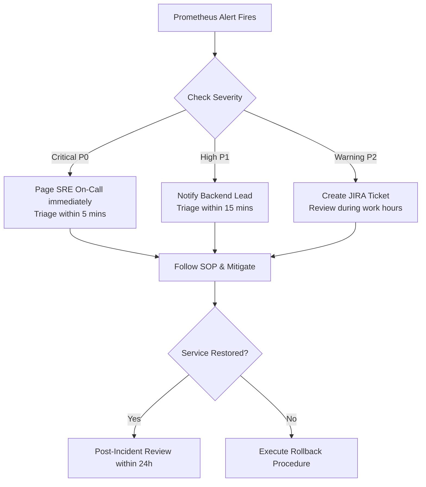

# Runbook: HaiHire Production Monitoring & Alert Incident Response

**System:** HaiHire Enterprise ATS  
**Alert Rules Source:** [`monitoring/prometheus/alert-rules.yml`](file:///c:/Workspaces/haihire/monitoring/prometheus/alert-rules.yml)  
**Metrics Endpoint:** `http://localhost:3001/metrics` (Production) / `http://localhost:13001/metrics` (Development)  
**Health Check Endpoint:** `http://localhost:3001/health` (Production) / `http://localhost:13001/health` (Development)

This runbook establishes standard operating procedures (SOPs) for responding to alerts generated by the Prometheus alerting pipeline.

---

## Alert Catalog & Response Matrix

| Alert Name | Severity | Condition | Threshold / For | Priority |
| :--- | :--- | :--- | :--- | :--- |
| **`HaiHireBackendDown`** | Critical | `up{job="haihire-backend"} == 0` | 1m | P0 |
| **`HaiHirePostgresDown`** | Critical | `haihire_service_health{service="postgres"} == 0` | 30s | P0 |
| **`HaiHireRedisDown`** | Critical | `haihire_service_health{service="redis"} == 0` | 30s | P0 |
| **`HaiHireMinioDown`** | High | `haihire_service_health{service="minio"} == 0` | 1m | P1 |
| **`HaiHireHighHttp5xxErrorRate`** | High | `5xx_rate / total_rate * 100 > 5` | 2m | P1 |
| **`HaiHireHighHttpLatencyP95`** | Warning | `http_request_duration_ms{p95} > 1000` | 3m | P2 |
| **`HaiHireHighRateLimit429Rate`** | Warning | `rate(429_requests[5m]) > 50` | 2m | P2 |

---

## 1. `HaiHireBackendDown` (Critical, P0)

### Description
The NestJS backend application instance is completely unreachable by Prometheus scraper for > 1 minute.

### Triage & Diagnostics
1. **Verify container status:**
   ```bash
   docker compose -f docker-compose.prod.yml ps backend
   ```
2. **Inspect backend logs for OOM or crash traces:**
   ```bash
   docker compose -f docker-compose.prod.yml logs backend --tail=100
   ```
3. **Check container memory consumption:**
   ```bash
   docker stats --no-stream haihire-prod-backend
   ```

### Remediation
- **If crashed (exit code != 0):** Restart backend container:
  ```bash
  docker compose -f docker-compose.prod.yml restart backend
  ```
- **If Out-Of-Memory (OOMKilled):** Check Node memory heap or adjust memory limits in `docker-compose.prod.yml` (`deploy.resources.limits.memory`).
- **If database connection pool exhausted:** Verify PostgreSQL status and connection counts before restarting.

---

## 2. `HaiHirePostgresDown` (Critical, P0)

### Description
The backend health check reported database connectivity failure or timeout for > 30 seconds.

### Triage & Diagnostics
1. **Verify PostgreSQL container health:**
   ```bash
   docker compose -f docker-compose.prod.yml ps postgres
   ```
2. **Execute healthcheck inside container:**
   ```bash
   docker exec -it haihire-prod-postgres pg_isready -U haihire_user -d haihire_db
   ```
3. **Inspect PostgreSQL engine logs:**
   ```bash
   docker compose -f docker-compose.prod.yml logs postgres --tail=100
   ```
4. **Check active database connections:**
   ```bash
   docker exec -it haihire-prod-postgres psql -U haihire_user -d haihire_db -c "SELECT count(*), state FROM pg_stat_activity GROUP BY state;"
   ```

### Remediation
- **If container stopped:** Restart service:
  ```bash
  docker compose -f docker-compose.prod.yml start postgres
  ```
- **If disk full:** Inspect volume storage:
  ```bash
  df -h /var/lib/docker/volumes
  ```
- **If corrupt data:** Initiate disaster recovery restoration from the latest verified snapshot per [backup-and-restore.md](file:///c:/Workspaces/haihire/docs/runbooks/backup-and-restore.md).

---

## 3. `HaiHireRedisDown` (Critical, P0)

### Description
Valkey / Redis health check failed or ping timeout exceeded 30 seconds. This impacts session validation, caching, rate limiting, and BullMQ async queues.

### Triage & Diagnostics
1. **Verify Valkey container status:**
   ```bash
   docker compose -f docker-compose.prod.yml ps redis
   ```
2. **Test Valkey ping directly:**
   ```bash
   docker exec -it haihire-prod-redis valkey-cli ping
   # Or with auth:
   docker exec -it haihire-prod-redis valkey-cli -a "$REDIS_PASSWORD" ping
   ```
3. **Inspect Valkey logs:**
   ```bash
   docker compose -f docker-compose.prod.yml logs redis --tail=100
   ```

### Remediation
- Restart Valkey container:
  ```bash
  docker compose -f docker-compose.prod.yml restart redis
  ```
- If memory limit exceeded, review Valkey `maxmemory-policy` (e.g. `volatile-lru` or `allkeys-lru`) and memory sizing.

---

## 4. `HaiHireMinioDown` (High, P1)

### Description
MinIO S3 storage health check failed for > 1 minute. Candidate resume uploads and downloads will fail.

### Triage & Diagnostics
1. **Check MinIO container status:**
   ```bash
   docker compose -f docker-compose.prod.yml ps minio
   ```
2. **Test MinIO live probe:**
   ```bash
   docker exec -it haihire-prod-minio wget -q -O - http://127.0.0.1:9000/minio/health/live
   ```
3. **Inspect MinIO logs:**
   ```bash
   docker compose -f docker-compose.prod.yml logs minio --tail=100
   ```

### Remediation
- Restart MinIO container:
  ```bash
  docker compose -f docker-compose.prod.yml restart minio
  ```
- Check storage capacity on `/data` volume mount.

---

## 5. `HaiHireHighHttp5xxErrorRate` (High, P1)

### Description
HTTP 5xx server errors exceed 5% of total requests over a sustained 2-minute window.

### Triage & Diagnostics
1. **Query recent 500 error logs from backend:**
   ```bash
   docker compose -f docker-compose.prod.yml logs backend --tail=500 | grep -E "ERROR|500"
   ```
2. **Inspect Prometheus error metrics by route:**
   ```promql
   sum by (route) (rate(http_requests_total{status=~"5.."}[5m]))
   ```
3. **Verify external service health:** Check email providers (Resend, SendGrid, SMTP) or external OAuth providers.

### Remediation
- Identify failing controller/service through correlation IDs in logs (`reqId`).
- If caused by unhandled exceptions in a new release, execute rollback procedure per [production-deployment-plan.md](file:///c:/Workspaces/haihire/docs/runbooks/production-deployment-plan.md).

---

## 6. `HaiHireHighHttpLatencyP95` (Warning, P2)

### Description
95th percentile request latency exceeds 1000ms for 3 consecutive minutes.

### Triage & Diagnostics
1. **Identify slow endpoints in Prometheus:**
   ```promql
   topk(5, sum by (route) (http_request_duration_ms{quantile="0.95"}))
   ```
2. **Check database slow queries:**
   ```bash
   docker exec -it haihire-prod-postgres psql -U haihire_user -d haihire_db -c "SELECT query, calls, total_exec_time, mean_exec_time FROM pg_stat_statements ORDER BY mean_exec_time DESC LIMIT 10;"
   ```
3. **Review database locks:**
   ```bash
   docker exec -it haihire-prod-postgres psql -U haihire_user -d haihire_db -c "SELECT pid, locktype, mode, granted FROM pg_locks WHERE NOT granted;"
   ```

### Remediation
- Add missing database indexes if sequential scans are detected.
- Optimize N+1 Prisma queries using `select` / `include` or batch loader.
- Verify Valkey cache hit rates.

---

## 7. `HaiHireHighRateLimit429Rate` (Warning, P2)

### Description
More than 50 requests/second are being rejected with HTTP 429 (Too Many Requests), indicating potential brute-force attack, credential stuffing, scraping, or misconfigured client retry loop.

### Triage & Diagnostics
1. **Identify targeted routes in logs:**
   ```bash
   docker compose -f docker-compose.prod.yml logs backend --tail=200 | grep "429"
   ```
2. **Analyze top source IP addresses from reverse proxy / cloud load balancer.**
3. **Check if authentication endpoints (`/auth/login`, `/auth/register`) are targeted.**

### Remediation
- If malicious DDoS/scraping: Block offender IP ranges at Cloudflare or Nginx reverse proxy level.
- If legitimate customer traffic spike: Review rate limit configuration in `src/auth/auth.controller.ts` and ThrottlerModule configuration.

---

## Incident Escalation Workflow


