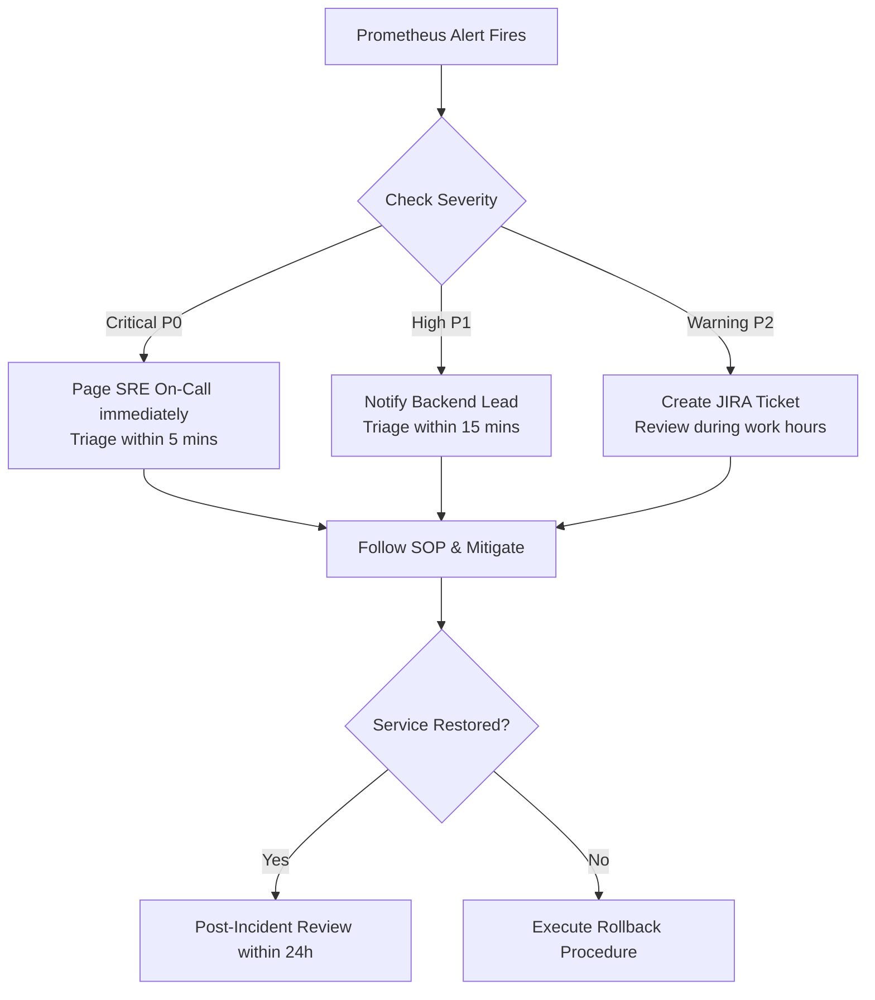

# Runbook: HaiHire Production Monitoring & Alert Incident Response

**System:** HaiHire Enterprise ATS  
**Alert Rules Source:** [`monitoring/prometheus/alert-rules.yml`](../../monitoring/prometheus/alert-rules.yml)  
**Metrics Endpoint:** `http://localhost:3001/metrics` (Production) / `http://localhost:13001/metrics` (Development)  
**Health Check Endpoint:** `http://localhost:3001/health` (Production) / `http://localhost:13001/health` (Development)

This runbook establishes standard operating procedures (SOPs) for responding to alerts generated by the Prometheus alerting pipeline.

---

## Alert Catalog & Response Matrix

| Alert Name | Severity | Condition | Threshold / For | Priority |
| :--- | :--- | :--- | :--- | :--- |
| **`HaiHireBackendDown`** | Critical | `up{job="haihire-backend"} == 0` | 1m | P0 |
| **`HaiHirePostgresDown`** | Critical | `haihire_service_health{service="postgres"} == 0` | 30s | P0 |
| **`HaiHireRedisDown`** | Critical | `haihire_service_health{service="redis"} == 0` | 30s | P0 |
| **`HaiHireMinioDown`** | High | `haihire_service_health{service="minio"} == 0` | 1m | P1 |
| **`HaiHireHighHttp5xxErrorRate`** | High | `5xx_rate / total_rate * 100 > 5` | 2m | P1 |
| **`HaiHireHighHttpLatencyP95`** | Warning | `http_request_duration_ms{p95} > 1000` | 3m | P2 |
| **`HaiHireHighRateLimit429Rate`** | Warning | `rate(429_requests[5m]) > 50` | 2m | P2 |
| **`HaiHireBullMqDlqGrowing`** | Warning | `bullmq_queue_depth{queue="orphan-cleanup-dlq"} > 10` | 5m | P2 |
| **`HaiHireBullMqDlqCritical`** | Critical | `bullmq_queue_depth{queue="orphan-cleanup-dlq"} > 100` | 2m | P0 |
| **`HaiHireEmailQueueBacklog`** | Warning | `bullmq_queue_depth{queue="email-queue"} > 500` | 10m | P2 |
| **`HaiHireBullMqRedisDown`** | Critical | `bullmq_queue_depth{queue="orphan-cleanup-queue"} == -1` | 2m | P0 |
| **`HaiHireOrphanCleanupSpikeWarning`** | Warning | `minio_orphan_cleanup_orphans_found_total > 50` | 0m | P2 |
| **`HaiHireOrphanCleanupSpikeCritical`** | Critical | `minio_orphan_cleanup_orphans_found_total > 500` | 0m | P0 |
| **`HaiHireOrphanCleanupCronMissing`** | Critical | `time() - last_run_timestamp_seconds > 90000` | 5m | P0 |

---

## 1. `HaiHireBackendDown` (Critical, P0)

### Description
The NestJS backend application instance is completely unreachable by Prometheus scraper for > 1 minute.

### Triage & Diagnostics
1. **Verify container status:**
   ```bash
   docker compose -f docker-compose.prod.yml ps backend
   ```
2. **Inspect backend logs for OOM or crash traces:**
   ```bash
   docker compose -f docker-compose.prod.yml logs backend --tail=100
   ```
3. **Check container memory consumption:**
   ```bash
   docker stats --no-stream haihire-prod-backend
   ```

### Remediation
- **If crashed (exit code != 0):** Restart backend container:
  ```bash
  docker compose -f docker-compose.prod.yml restart backend
  ```
- **If Out-Of-Memory (OOMKilled):** Check Node memory heap or adjust memory limits in `docker-compose.prod.yml` (`deploy.resources.limits.memory`).
- **If database connection pool exhausted:** Verify PostgreSQL status and connection counts before restarting.

---

## 2. `HaiHirePostgresDown` (Critical, P0)

### Description
The backend health check reported database connectivity failure or timeout for > 30 seconds.

### Triage & Diagnostics
1. **Verify PostgreSQL container health:**
   ```bash
   docker compose -f docker-compose.prod.yml ps postgres
   ```
2. **Execute healthcheck inside container:**
   ```bash
   docker exec -it haihire-prod-postgres pg_isready -U haihire_user -d haihire_db
   ```
3. **Inspect PostgreSQL engine logs:**
   ```bash
   docker compose -f docker-compose.prod.yml logs postgres --tail=100
   ```
4. **Check active database connections:**
   ```bash
   docker exec -it haihire-prod-postgres psql -U haihire_user -d haihire_db -c "SELECT count(*), state FROM pg_stat_activity GROUP BY state;"
   ```

### Remediation
- **If container stopped:** Restart service:
  ```bash
  docker compose -f docker-compose.prod.yml start postgres
  ```
- **If disk full:** Inspect volume storage:
  ```bash
  df -h /var/lib/docker/volumes
  ```
- **If corrupt data:** Initiate disaster recovery restoration from the latest verified snapshot per [backup-and-restore.md](backup-and-restore.md).

---

## 3. `HaiHireRedisDown` (Critical, P0)

### Description
Valkey / Redis health check failed or ping timeout exceeded 30 seconds. This impacts session validation, caching, rate limiting, and BullMQ async queues.

### Triage & Diagnostics
1. **Verify Valkey container status:**
   ```bash
   docker compose -f docker-compose.prod.yml ps redis
   ```
2. **Test Valkey ping directly:**
   ```bash
   docker exec -it haihire-prod-redis valkey-cli ping
   # Or with auth:
   docker exec -it haihire-prod-redis valkey-cli -a "$REDIS_PASSWORD" ping
   ```
3. **Inspect Valkey logs:**
   ```bash
   docker compose -f docker-compose.prod.yml logs redis --tail=100
   ```

### Remediation
- Restart Valkey container:
  ```bash
  docker compose -f docker-compose.prod.yml restart redis
  ```
- If memory limit exceeded, review Valkey `maxmemory-policy` (e.g. `volatile-lru` or `allkeys-lru`) and memory sizing.

---

## 4. `HaiHireMinioDown` (High, P1)

### Description
MinIO S3 storage health check failed for > 1 minute. Candidate resume uploads and downloads will fail.

### Triage & Diagnostics
1. **Check MinIO container status:**
   ```bash
   docker compose -f docker-compose.prod.yml ps minio
   ```
2. **Test MinIO live probe:**
   ```bash
   docker exec -it haihire-prod-minio wget -q -O - http://127.0.0.1:9000/minio/health/live
   ```
3. **Inspect MinIO logs:**
   ```bash
   docker compose -f docker-compose.prod.yml logs minio --tail=100
   ```

### Remediation
- Restart MinIO container:
  ```bash
  docker compose -f docker-compose.prod.yml restart minio
  ```
- Check storage capacity on `/data` volume mount.

---

## 5. `HaiHireHighHttp5xxErrorRate` (High, P1)

### Description
HTTP 5xx server errors exceed 5% of total requests over a sustained 2-minute window.

### Triage & Diagnostics
1. **Query recent 500 error logs from backend:**
   ```bash
   docker compose -f docker-compose.prod.yml logs backend --tail=500 | grep -E "ERROR|500"
   ```
2. **Inspect Prometheus error metrics by route:**
   ```promql
   sum by (route) (rate(http_requests_total{status=~"5.."}[5m]))
   ```
3. **Verify external service health:** Check email providers (Resend, SendGrid, SMTP) or external OAuth providers.

### Remediation
- Identify failing controller/service through correlation IDs in logs (`reqId`).
- If caused by unhandled exceptions in a new release, execute rollback procedure per [production-deployment-plan.md](production-deployment-plan.md).

---

## 6. `HaiHireHighHttpLatencyP95` (Warning, P2)

### Description
95th percentile request latency exceeds 1000ms for 3 consecutive minutes.

### Triage & Diagnostics
1. **Identify slow endpoints in Prometheus:**
   ```promql
   topk(5, sum by (route) (http_request_duration_ms{quantile="0.95"}))
   ```
2. **Check database slow queries:**
   ```bash
   docker exec -it haihire-prod-postgres psql -U haihire_user -d haihire_db -c "SELECT query, calls, total_exec_time, mean_exec_time FROM pg_stat_statements ORDER BY mean_exec_time DESC LIMIT 10;"
   ```
3. **Review database locks:**
   ```bash
   docker exec -it haihire-prod-postgres psql -U haihire_user -d haihire_db -c "SELECT pid, locktype, mode, granted FROM pg_locks WHERE NOT granted;"
   ```

### Remediation
- Add missing database indexes if sequential scans are detected.
- Optimize N+1 Prisma queries using `select` / `include` or batch loader.
- Verify Valkey cache hit rates.

---

## 7. `HaiHireHighRateLimit429Rate` (Warning, P2)

### Description
More than 50 requests/second are being rejected with HTTP 429 (Too Many Requests), indicating potential brute-force attack, credential stuffing, scraping, or misconfigured client retry loop.

### Triage & Diagnostics
1. **Identify targeted routes in logs:**
   ```bash
   docker compose -f docker-compose.prod.yml logs backend --tail=200 | grep "429"
   ```
2. **Analyze top source IP addresses from reverse proxy / cloud load balancer.**
3. **Check if authentication endpoints (`/auth/login`, `/auth/register`) are targeted.**

### Remediation
- If malicious DDoS/scraping: Block offender IP ranges at Cloudflare or Nginx reverse proxy level.
- If legitimate customer traffic spike: Review rate limit configuration in `src/auth/auth.controller.ts` and ThrottlerModule configuration.

---

## 8. `HaiHireBullMqDlqGrowing` (Warning, P2)

**Trigger:** `bullmq_queue_depth{queue="orphan-cleanup-dlq",state="waiting"} > 10` for 5m  
**Severity:** Warning  
**Impact:** Dead-Letter Queue `orphan-cleanup-dlq` is accumulating failed file cleanup jobs. If left unaddressed, storage leaks in MinIO will compound over time.

### Verify
```bash
# Check waiting jobs in DLQ (Production)
curl -s http://localhost:3001/metrics | grep bullmq_queue_depth | grep orphan-cleanup-dlq
```

### Diagnose
1. Inspect backend DLQ worker logs for failure traces:
   ```bash
   docker compose -f docker-compose.prod.yml logs backend --tail=100 | grep -E "DLQ|OrphanCleanup"
   ```
2. Verify MinIO accessibility from backend:
   ```bash
   docker exec -it haihire-prod-backend wget -q -O - http://minio:9000/minio/health/live
   ```
3. Check whether target S3 objects actually exist or if errors stem from `NoSuchKey` / credential desynchronization.

### Mitigate
- If MinIO is experiencing IOPS saturation or temporary stalls, restart MinIO container:
  ```bash
  docker compose -f docker-compose.prod.yml restart minio
  ```
- Restart backend container to re-establish worker connections:
  ```bash
  docker compose -f docker-compose.prod.yml restart backend
  ```

### Resolve
1. Review failed job error messages and stack traces in BullMQ DLQ.
2. Fix any missing permissions or corrupted key references.
3. Drain DLQ or re-run orphan cleanup manual scan once storage connectivity is verified.

### Runbook
Detailed procedure: [`dlq-recovery.md`](dlq-recovery.md)

---

## 9. `HaiHireBullMqDlqCritical` (Critical, P0)

**Trigger:** `bullmq_queue_depth{queue="orphan-cleanup-dlq",state="waiting"} > 100` for 2m  
**Severity:** Critical  
**Impact:** Severe storage leakage risk in MinIO. More than 100 failed cleanup jobs accumulated in the dead-letter queue. Immediate escalation required.

### Verify
```bash
curl -s http://localhost:3001/metrics | grep bullmq_queue_depth | grep orphan-cleanup-dlq
```

### Diagnose
1. Check MinIO container status and volume disk consumption:
   ```bash
   docker ps --filter "name=minio"
   df -h /var/lib/docker/volumes
   ```
2. Inspect backend logs for recurring unhandled exceptions:
   ```bash
   docker compose -f docker-compose.prod.yml logs backend --tail=200 | grep -E "DLQ|ERROR"
   ```

### Mitigate
- Page SRE On-Call immediately.
- Restart MinIO and backend services if unresponsive:
  ```bash
  docker compose -f docker-compose.prod.yml restart minio backend
  ```

### Resolve
1. Identify and resolve storage connectivity failure or schema desynchronization.
2. Execute manual orphan cleanup script to drain pending files:
   ```bash
   node --import tsx scripts/cleanup-orphan-minio.ts
   ```
3. Verify DLQ queue depth returns to 0.

### Runbook
Detailed procedure: [`dlq-recovery.md`](dlq-recovery.md)

---

## 10. `HaiHireEmailQueueBacklog` (Warning, P2)

**Trigger:** `bullmq_queue_depth{queue="email-queue",state="waiting"} > 500` for 10m  
**Severity:** Warning  
**Impact:** Candidate communications (interview invitations, rejection letters, authentication magic links) are experiencing severe delivery delays.

### Verify
```bash
curl -s http://localhost:3001/metrics | grep bullmq_queue_depth | grep email-queue
```

### Diagnose
1. Inspect `EmailProcessor` worker logs:
   ```bash
   docker compose -f docker-compose.prod.yml logs backend --tail=100 | grep -E "EmailProcessor|EmailService"
   ```
2. Check email provider reachability and status:
   - SMTP host TCP reachability: `nc -zv smtp.gmail.com 587`
   - Resend status: https://status.resend.com
   - SendGrid status: https://status.sendgrid.com
3. Check for API rate limiting (`HTTP 429`) or quota exhaustion in logs.

### Mitigate
- If the current provider is down, switch to fallback provider in `.env.production` (e.g. switch from SMTP to RESEND or vice versa) and reload:
  ```bash
  docker compose -f docker-compose.prod.yml restart backend
  ```

### Resolve
1. Restore provider credentials or request quota increases.
2. Monitor email queue drain rate until waiting jobs drop below 50.

### Runbook
Detailed procedure: [`email-queue.md`](email-queue.md)

---

## 11. `HaiHireBullMqRedisDown` (Critical, P0)

**Trigger:** `bullmq_queue_depth{queue="orphan-cleanup-queue",state="waiting"} == -1` for 2m  
**Severity:** Critical  
**Impact:** BullMQ cannot communicate with Valkey/Redis within the 2.5s timeout. All asynchronous queues (email delivery, orphan cleanup, background jobs) are completely halted.

### Verify
```bash
curl -s http://localhost:3001/metrics | grep bullmq_queue_depth
# All queue depth metrics return -1
```

### Diagnose
1. Check Valkey container status:
   ```bash
   docker compose -f docker-compose.prod.yml ps redis
   ```
2. Test Valkey ping directly:
   ```bash
   docker exec -it haihire-prod-redis valkey-cli ping
   ```
3. Check if container was terminated by Linux OOMKiller:
   ```bash
   docker stats --no-stream haihire-prod-redis
   dmesg -T | grep -i oom
   ```

### Mitigate
- Restart Valkey container immediately:
  ```bash
  docker compose -f docker-compose.prod.yml restart redis
  ```
- Restart backend to re-establish Redis connection pools:
  ```bash
  docker compose -f docker-compose.prod.yml restart backend
  ```

### Resolve
1. Review Redis memory configuration (`maxmemory` and eviction policy `maxmemory-policy`).
2. Scale Redis memory limits in `docker-compose.prod.yml` if memory exhaustion is recurring.
3. Verify metric returns positive queue depth values across all queues.

### Runbook
Detailed procedure: [`redis-recovery.md`](redis-recovery.md)

---

## 12. `HaiHireOrphanCleanupSpikeWarning` (Warning, P2)

**Trigger:** `minio_orphan_cleanup_orphans_found_total > 50` for 0m  
**Severity:** Warning  
**Impact:** Over 50 unreferenced orphan files detected in MinIO during nightly cron scan. Indicates possible resume upload aborts or Saga transaction rollback anomalies.

### Verify
```bash
curl -s http://pushgateway:9091/metrics | grep minio_orphan_cleanup
```

### Diagnose
1. Inspect last cron run metrics:
   - `minio_orphan_cleanup_orphans_found_total`
   - `minio_orphan_cleanup_preserved_total` (files within 30-day grace period)
2. Check backend application logs for upload failures or Saga rollbacks in the last 24h:
   ```bash
   docker compose -f docker-compose.prod.yml logs backend --since 24h | grep -i "rollback\|minio\|upload"
   ```

### Mitigate
- Files are protected by the 30-day grace period; no immediate deletion occurs.
- Monitor next day's run to check if trend continues or normalizes.

### Resolve
1. If caused by an issue in candidate resume upload Saga, patch transaction rollback logic.
2. If confirmed valid unreferenced files, allow automated cron to purge after the 30-day grace period expires.

### Runbook
Detailed procedures: [`dlq-recovery.md`](dlq-recovery.md) and [`orphan-cleanup.md`](orphan-cleanup.md)

---

## 13. `HaiHireOrphanCleanupSpikeCritical` (Critical, P0)

**Trigger:** `minio_orphan_cleanup_orphans_found_total > 500` for 0m  
**Severity:** Critical  
**Impact:** Massive spike of over 500 orphan files detected in MinIO. Severe indicator of upload flow regression, MinIO desynchronization, or active attack/misconfiguration.

### Verify
```bash
curl -s http://pushgateway:9091/metrics | grep minio_orphan_cleanup
```

### Diagnose
1. Check candidate application and resume upload failure rates:
   ```bash
   docker compose -f docker-compose.prod.yml logs backend --tail=500 | grep -i "upload.*error"
   ```
2. Verify database connection integrity: check if uploads succeed in MinIO but fail to persist in PostgreSQL.
3. Check Pushgateway metric timestamp to determine exact execution time:
   ```bash
   curl -s http://pushgateway:9091/metrics | grep minio_orphan_cleanup_last_run_timestamp_seconds
   ```

### Mitigate
- Escalate to on-call engineers immediately.
- Temporarily pause automated deletion if data loss is suspected.
- Verify MinIO bucket permissions and database transaction logs.

### Resolve
1. Fix upstream regression in upload or Saga coordinator service.
2. Run database integrity check to ensure valid candidate files are not erroneously flagged.
3. Trigger manual cleanup run when system stabilizes:
   ```bash
   node --import tsx scripts/cleanup-orphan-minio.ts
   ```

### Runbook
Detailed procedures: [`dlq-recovery.md`](dlq-recovery.md) and [`orphan-cleanup.md`](orphan-cleanup.md)

---

## 14. `HaiHireOrphanCleanupCronMissing` (Critical, P0)

**Trigger:** `time() - minio_orphan_cleanup_last_run_timestamp_seconds > 90000` for 5m  
**Severity:** Critical  
**Impact:** Orphan cleanup nightly cron has not reported metrics in over 25 hours. Unreferenced files will accumulate indefinitely in MinIO storage without being purged.

### Verify
```bash
curl -s http://pushgateway:9091/metrics | grep minio_orphan_cleanup_last_run_timestamp_seconds
```

### Diagnose
1. Check cron job scheduler or container status:
   ```bash
   docker compose -f docker-compose.prod.yml ps orphan-cleanup
   ```
2. Check cron execution logs on the host:
   ```bash
   docker compose -f docker-compose.prod.yml logs orphan-cleanup --tail=100
   ```
3. Check Pushgateway connectivity:
   ```bash
   curl -I http://pushgateway:9091/
   ```

### Mitigate
- Trigger manual orphan cleanup execution immediately:
  ```bash
  docker compose -f docker-compose.prod.yml run --rm orphan-cleanup node --import tsx scripts/cleanup-orphan-minio.ts
  ```

### Resolve
1. Restart cron scheduler container if stopped or crashed:
   ```bash
   docker compose -f docker-compose.prod.yml restart orphan-cleanup
   ```
2. Verify cron schedule in crontab or container entrypoint (`0 4 * * *`).
3. Ensure Pushgateway endpoint is reachable from the cron environment.

### Runbook
Detailed procedures: [`dlq-recovery.md`](dlq-recovery.md) and [`orphan-cleanup.md`](orphan-cleanup.md)

---

## Incident Escalation Workflow


