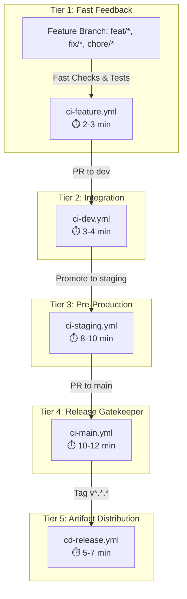

# CI/CD Operations & Runbook

> **Operational guide for HaiHire's Layered CI/CD pipeline, manual deployment protocols, and rollback procedures.**  
> **Platform Version:** v0.1.0+  
> **Last Updated:** 2026-10-14  

---

## 1. Pipeline Architecture & Tiers

HaiHire utilizes a **5-tier layered CI/CD architecture** to balance rapid developer feedback with strict production release guarantees:



### 1.1 Workflow Directory Inventory

All workflows are located in [`.github/workflows/`](../../.github/workflows/):

| Workflow | Target Scope | Key Operations | Time Target |
| :--- | :--- | :--- | :---: |
| [`ci-feature.yml`](../../.github/workflows/ci-feature.yml) | PRs targeting `dev` (`feat/*`, `fix/*`, etc.) | Path filtering, lint, typecheck, unit tests | 2 - 3 min |
| [`ci-dev.yml`](../../.github/workflows/ci-dev.yml) | Push & PR to `dev` | 11 CI architecture gates (`check:all:fast`), anti-regression diff | 3 - 4 min |
| [`ci-staging.yml`](../../.github/workflows/ci-staging.yml) | Push & PR to `staging` (manual until Task #20) | 11 CI gates, coverage, Playwright E2E suite, production build | 8 - 10 min |
| [`ci-main.yml`](../../.github/workflows/ci-main.yml) | PRs targeting `main` | Full checks (`check:all`), Playwright E2E, `pnpm audit`, Docker dry-run | 10 - 12 min |
| [`cd-release.yml`](../../.github/workflows/cd-release.yml) | Annotated tags `v*.*.*` | Docker Buildx, GHCR publish, Trivy container scan, GitHub release | 5 - 7 min |
| [`e2e-nightly.yml`](../../.github/workflows/e2e-nightly.yml) | Schedule: `0 3 * * *` (03:00 UTC daily) | Complete Playwright test regression matrix | 8 - 10 min |
| [`security-weekly.yml`](../../.github/workflows/security-weekly.yml) | Schedule: `0 6 * * 1` (06:00 UTC Mondays) | Moderate & high CVE audits, tenant scoping AST sweep, outdated report | 3 - 5 min |

---

## 2. 3-Tier Security Defenses

1. **Layer 1: Dependency Vulnerability Audit (`pnpm audit`)**
   - Automatically executed in `ci-main.yml` and `security-weekly.yml`.
   - Command: `pnpm audit --audit-level=high --prod`.
   - Direct production dependencies with Critical/High CVEs fail the build immediately.
2. **Layer 2: Automated Vulnerability Patching (Dependabot)**
   - Configured in [`.github/dependabot.yml`](../../.github/dependabot.yml).
   - Scans dependencies weekly on Mondays at 04:00 UTC and generates automated PRs targeting `dev`.
   - Major version bumps for `@prisma/*` and `prisma` are locked to maintain Contract-First architecture compatibility.
3. **Layer 3: Container Vulnerability Scanning (Aquasecurity Trivy)**
   - Automatically executed in `cd-release.yml` on backend and frontend container images.
   - Evaluates against the GitHub Advisory Database and CVE feeds.
   - Publishes SARIF reports directly to GitHub Repository Security tab.

---

## 3. Manual Production Deployment SOP

Per platform governance, container publishing to GitHub Container Registry (`ghcr.io`) is automated upon release tag creation, while production deployment remains an explicit operator action.

### 3.1 Standard Deployment Procedure

1. **Log in to Target Production Host:**
   ```bash
   ssh deploy@production.haihire.internal
   cd /opt/haihire
   ```

2. **Verify Target Release Tag:**
   ```bash
   # Confirm tag exists on GHCR
   export RELEASE_TAG=v0.1.0
   ```

3. **Pull Pre-built Immutable Images (Zero Rebuild Overhead):**
   ```bash
   IMAGE_TAG=${RELEASE_TAG} docker compose --env-file .env.production -f docker-compose.prod.yml pull
   ```

4. **Execute Rolling Update:**
   ```bash
   IMAGE_TAG=${RELEASE_TAG} docker compose --env-file .env.production -f docker-compose.prod.yml up -d --remove-orphans
   ```

5. **Verify System Health:**
   ```bash
   # Check service status
   docker compose -f docker-compose.prod.yml ps

   # Probe backend healthcheck
   curl -f http://localhost:13001/health

   # Check application logs
   docker compose -f docker-compose.prod.yml logs -f --tail=100 backend
   ```

---

## 4. Rollback Procedures

### 4.1 Production Container Rollback (< 2 Minutes)

If a newly deployed release exhibits runtime regressions:

1. **Identify Previous Known-Good Tag:**
   ```bash
   # Example: rolling back from v0.1.1 to v0.1.0
   export PREVIOUS_TAG=v0.1.0
   ```

2. **Deploy Previous Image:**
   ```bash
   IMAGE_TAG=${PREVIOUS_TAG} docker compose --env-file .env.production -f docker-compose.prod.yml up -d
   ```

3. **Verify Health:**
   ```bash
   curl -f http://localhost:13001/health
   ```

### 4.2 CI/CD Pipeline Rollback

If a newly migrated GitHub Actions workflow fails:

1. **Restore Workflows from Backup Branch:**
   ```bash
   git checkout backup/legacy-workflows-20261014 -- .github/workflows/
   git commit -m "revert(ci): restore legacy monolithic workflows"
   git push origin dev
   ```

2. **Verify Workflow Triggering:**
   Check GitHub Actions dashboard under the repository `Actions` tab.

---

## 5. Troubleshooting Guide

| Issue | Symptom | Diagnostic Step | Remediation |
| :--- | :--- | :--- | :--- |
| **`pnpm audit` Failure** | CI fails on `security-audit` | Check runner log for failing package | Run `pnpm audit` locally. Update or patch the affected package in `package.json`. |
| **Playwright Healthcheck Timeout** | E2E job times out waiting for ports 13000/13001 | Check step output for `connection refused` | Verify MinIO and Valkey readiness steps passed. Inspect background `pnpm dev` logs. |
| **GHCR Login Error** | `docker login` fails with 403 Forbidden | Check workflow `permissions:` block | Ensure `packages: write` is declared in workflow job permissions. |
| **Dorny Path Filter Misclassification** | Fast checks skipped when code changed | Review path filter patterns | Verify edited files match patterns in `ci-feature.yml` (`filters:` block). |
