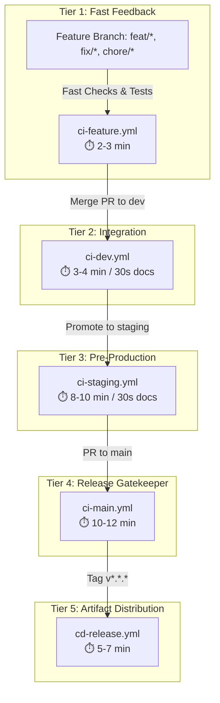

# CI/CD Operations & Runbook

> **Operational guide for HaiHire's Layered CI/CD pipeline, manual deployment protocols, and rollback procedures.**  
> **Platform Version:** v0.1.2+  
> **Last Updated:** 2026-10-16

---

## 1. Pipeline Architecture & Tiers

HaiHire utilizes a **5-tier layered CI/CD architecture** to balance rapid developer feedback with strict production release guarantees:



### 1.1 Workflow Directory Inventory

All workflows are located in [`.github/workflows/`](../../.github/workflows/):

| Workflow                                                             | Target Scope                                           | Key Operations                                                                                        |           Time Target           |
| :------------------------------------------------------------------- | :----------------------------------------------------- | :---------------------------------------------------------------------------------------------------- | :-----------------------------: |
| [`ci-feature.yml`](../../.github/workflows/ci-feature.yml)           | PRs targeting `dev` (`feat/*`, `fix/*`, etc.)          | Path filtering, lint, typecheck, unit tests                                                           |            2 - 3 min            |
| [`ci-dev.yml`](../../.github/workflows/ci-dev.yml)                   | Push to `dev` (post-merge integration)                 | Path filtering (code vs docs-only), 11 CI architecture gates (`check:all:fast`), anti-regression diff | 3 - 4 min (code) / ~30s (docs)  |
| [`ci-staging.yml`](../../.github/workflows/ci-staging.yml)           | Push to `staging` (pre-production verification)        | Path filtering (code vs docs-only), 11 CI gates, coverage, Playwright E2E suite, production build     | 8 - 10 min (code) / ~30s (docs) |
| [`ci-main.yml`](../../.github/workflows/ci-main.yml)                 | PRs targeting `main` (production gatekeeper)           | Full checks (`check:all`), Playwright E2E, `pnpm audit`, Docker dry-run                               |           10 - 12 min           |
| [`cd-release.yml`](../../.github/workflows/cd-release.yml)           | Annotated tags `v*.*.*`                                | Docker Buildx, GHCR publish, Trivy container scan, GitHub release                                     |            5 - 7 min            |
| [`e2e-weekly.yml`](../../.github/workflows/e2e-weekly.yml)           | Schedule: `0 3 * * 1` (03:00 UTC Mondays on `staging`) | Complete Playwright test regression sweep on pre-production                                           |           8 - 10 min            |
| [`security-weekly.yml`](../../.github/workflows/security-weekly.yml) | Schedule: `0 6 * * 3` (06:00 UTC Wednesdays)           | Moderate & high CVE audits, tenant scoping AST sweep, outdated report                                 |            3 - 5 min            |

---

## 2. Staging Branch & Environment Operations

The `staging` branch is HaiHire's pre-production validation gate where integrated changes are verified under full production-like conditions (database migrations, Playwright E2E, and production build).

### 2.1 Staging Promotion Workflow

1. **Promotion from `dev` to `staging`:**
   - After feature branches merge into `dev` and pass `ci-dev.yml`:
   - Open Pull Request: `dev` -> `staging`.
   - Requires: **1 peer review approval**.
2. **Automated Verification:**
   - Once merged to `staging`, `ci-staging.yml` executes:
     - 11 Architecture Quality Gates (`pnpm check:all:fast`).
     - Unit & Integration Tests with Coverage (`vitest --coverage`).
     - Playwright End-to-End Suite against local test containers (Postgres, Valkey, MinIO).
     - Full Monorepo Production Build (`pnpm build`).
   - Expected runtime: **8 - 10 minutes**.
3. **QA & UAT Validation:**
   - QA team validates against the local Docker staging environment.
4. **Promotion from `staging` to `main`:**
   - When staging testing is verified without regressions:
   - Open Pull Request: `staging` -> `main`.
   - Requires: **2 peer review approvals** + passing `ci-main.yml` checks.
5. **Release Tagging:**
   - After merging into `main`, tag the release (`git tag -a vX.Y.Z -m "Release vX.Y.Z"`).
   - This triggers immutable container publishing via `cd-release.yml`.

### 2.2 Manual Deploy to Staging (Local Docker)

To run the complete production-grade stack locally from the staging branch:

```bash
git checkout staging
git pull origin staging

# Start all services with local build
docker compose --profile app up -d --build

# Verify web application at http://localhost:13000
# Verify backend API health at http://localhost:13001/health
```

---

## 3. 3-Tier Security Defenses

1. **Layer 1: Dependency Vulnerability Audit (`pnpm audit`)**
   - Automatically executed in `ci-main.yml` and `security-weekly.yml`.
   - Command: `pnpm audit --audit-level=high --prod`.
   - Direct production dependencies with Critical/High CVEs fail the build immediately.
2. **Layer 2: Automated Vulnerability Patching (Dependabot)**
   - Configured in [`.github/dependabot.yml`](../../.github/dependabot.yml).
   - Scans dependencies weekly on Saturdays at 04:00 UTC and generates automated PRs targeting `dev`.
   - Major version bumps for `@prisma/*` and `prisma` are locked to maintain Contract-First architecture compatibility.
3. **Layer 3: Container Vulnerability Scanning (Aquasecurity Trivy)**
   - Automatically executed in `cd-release.yml` on backend and frontend container images.
   - Evaluates against the GitHub Advisory Database and CVE feeds.
   - Publishes SARIF reports directly to GitHub Repository Security tab.

---

## 4. Manual Production Deployment SOP

Per platform governance, container publishing to GitHub Container Registry (`ghcr.io`) is automated upon release tag creation, while production deployment remains an explicit operator action.

### 4.1 Standard Deployment Procedure

1. **Log in to Target Production Host:**

   ```bash
   ssh deploy@production.haihire.internal
   cd /opt/haihire
   ```

2. **Verify Target Release Tag:**

   ```bash
   # Confirm tag exists on GHCR
   export RELEASE_TAG=v0.1.0
   ```

3. **Pull Pre-built Immutable Images (Zero Rebuild Overhead):**

   ```bash
   IMAGE_TAG=${RELEASE_TAG} docker compose --env-file .env.production -f docker-compose.prod.yml pull
   ```

4. **Execute Rolling Update:**

   ```bash
   IMAGE_TAG=${RELEASE_TAG} docker compose --env-file .env.production -f docker-compose.prod.yml up -d --remove-orphans
   ```

5. **Verify System Health:**
   ```bash
   # Check service status
   docker compose -f docker-compose.prod.yml ps

   # Probe backend healthcheck
   curl -f http://localhost:13001/health

   # Check application logs
   docker compose -f docker-compose.prod.yml logs -f --tail=100 backend
   ```

---

## 5. Rollback Procedures

### 5.1 Production Container Rollback (< 2 Minutes)

If a newly deployed release exhibits runtime regressions:

1. **Identify Previous Known-Good Tag:**

   ```bash
   # Example: rolling back from v0.1.1 to v0.1.0
   export PREVIOUS_TAG=v0.1.0
   ```

2. **Deploy Previous Image:**

   ```bash
   IMAGE_TAG=${PREVIOUS_TAG} docker compose --env-file .env.production -f docker-compose.prod.yml up -d
   ```

3. **Verify Health:**
   ```bash
   curl -f http://localhost:13001/health
   ```

### 5.2 CI/CD Pipeline Rollback

If a newly migrated GitHub Actions workflow fails:

1. **Restore Workflows from Backup Branch:**

   ```bash
   git checkout backup/legacy-workflows-20261014 -- .github/workflows/
   git commit -m "revert(ci): restore legacy monolithic workflows"
   git push origin dev
   ```

2. **Verify Workflow Triggering:**
   Check GitHub Actions dashboard under the repository `Actions` tab.

---

## 6. Troubleshooting Guide

| Issue                                   | Symptom                                         | Diagnostic Step                            | Remediation                                                                         |
| :-------------------------------------- | :---------------------------------------------- | :----------------------------------------- | :---------------------------------------------------------------------------------- |
| **`pnpm audit` Failure**                | CI fails on `security-audit`                    | Check runner log for failing package       | Run `pnpm audit` locally. Update or patch the affected package in `package.json`.   |
| **Playwright Healthcheck Timeout**      | E2E job times out waiting for ports 13000/13001 | Check step output for `connection refused` | Verify MinIO and Valkey readiness steps passed. Inspect background `pnpm dev` logs. |
| **GHCR Login Error**                    | `docker login` fails with 403 Forbidden         | Check workflow `permissions:` block        | Ensure `packages: write` is declared in workflow job permissions.                   |
| **Dorny Path Filter Misclassification** | Fast checks skipped when code changed           | Review path filter patterns                | Verify edited files match patterns in `ci-feature.yml` (`filters:` block).          |
