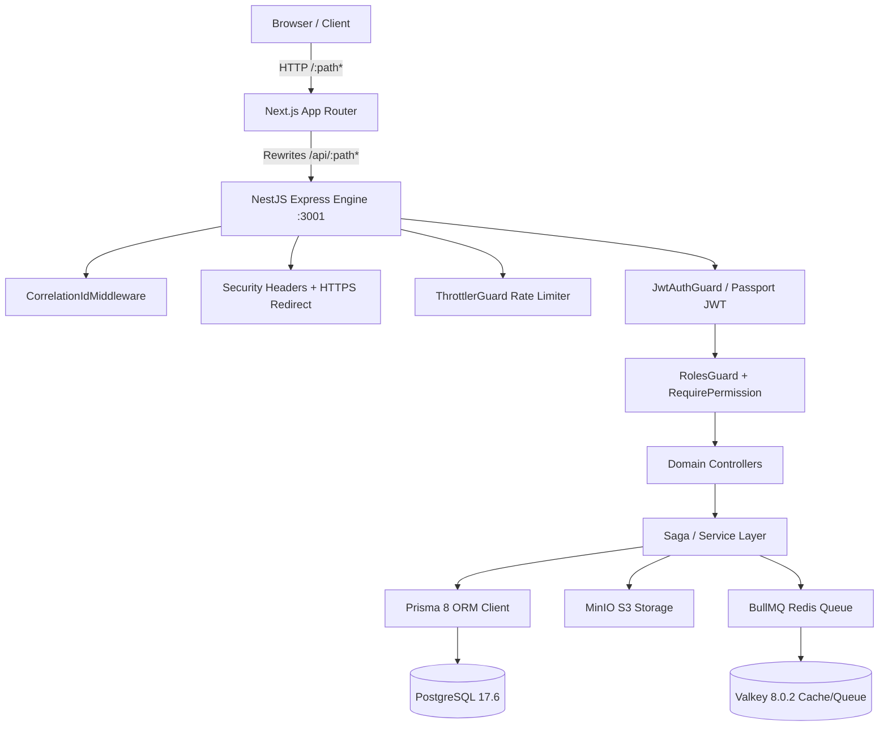
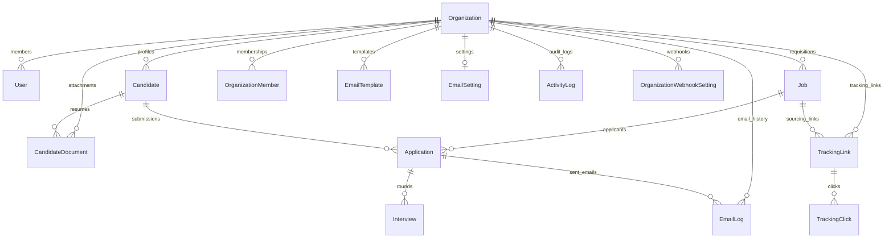

# HaiHire — Code Audit Report (Phase 1: Code-first)

---

## 1. Executive Summary

HaiHire is an enterprise multi-tenant Applicant Tracking System (ATS) engineered as a TypeScript monorepo workspace.
The backend runs NestJS 12.1.3 over Express with PostgreSQL 17.6 managed by Prisma 8 RC (`@prisma/orm-postgres@8.0.0-rc.13`).
Asynchronous tasks and distributed caching utilize Valkey 8.0.2 with BullMQ 6.3.15, while MinIO handles S3-compatible document storage.
The frontend is built on Next.js 16.4.0 (App Router), React 19.3.0, TanStack Query v5, Tailwind CSS v4, and Radix UI / Base UI primitives.
A 13-stage automated verification pipeline (`pnpm check:all`) enforces fail-fast environment validation, DtoPipe protection, and tenant scoping.
Application creation features a resilient Saga orchestrator with automatic MinIO upload compensation and BullMQ Dead-Letter Queues (DLQ).
The audit discovered critical authorization gaps: candidate resume download endpoints lack RBAC checks, exposing documents to basic members.
An abandoned `/users` controller leaks cross-tenant user records without isolation and triggers database re-seeding on every request.
Next.js server-side route redirection is inactive because edge middleware was misnamed `proxy.ts` instead of `middleware.ts`.
Candidate PII remains unencrypted in PostgreSQL, and in-memory candidate list pagination presents an out-of-memory risk at scale.

---

## 2. Stack & Repo Inventory (verified from code)

### 2.1 Workspace & Monorepo Structure

- **Monorepo Model:** Strict pnpm workspace defined in [`pnpm-workspace.yaml`](file:///c:/Workspaces/haihire/pnpm-workspace.yaml#L1-L29).
- **Package Manager:** `pnpm@12.6.0` (enforced via [`backend/package.json`](file:///c:/Workspaces/haihire/backend/package.json#L4) and [`frontend/package.json`](file:///c:/Workspaces/haihire/frontend/package.json#L56)). Node.js LTS baseline (Node 26).
- **Workspaces:**
  - `backend`: NestJS modular backend application ([`backend/package.json`](file:///c:/Workspaces/haihire/backend/package.json)).
  - `frontend`: Next.js App Router frontend application ([`frontend/package.json`](file:///c:/Workspaces/haihire/frontend/package.json)).
  - `packages/shared`: Universal workspace domain types, RBAC permissions, and utilities ([`packages/shared/package.json`](file:///c:/Workspaces/haihire/packages/shared/package.json)). Published internally as `@haihire/shared`.
- **Active Git Branch & Baseline:** `feat/v0.3.0-rbac-agents-ci` at commit `7ba2f33` (parent `a12ffa8`).

### 2.2 Framework & Dependency Versions (Verified from manifests)

| Component                | Framework / Library     | Exact Version in Manifest                                | Role / Usage                                            |
| :----------------------- | :---------------------- | :------------------------------------------------------- | :------------------------------------------------------ |
| **Backend Core**         | NestJS Core / Common    | `^12.1.3`                                                | Modular enterprise backend framework                    |
| **Backend Engine**       | NestJS Platform Express | `^12.1.3`                                                | HTTP server adapter (Express platform, _not_ Fastify)   |
| **Database ORM**         | Prisma 8 RC             | `@prisma/orm-postgres@8.0.0-rc.13`, `prisma@8.0.0-rc.19` | PostgreSQL client & schema management                   |
| **Prisma Tooling**       | Prisma Composer         | `0.29.1`                                                 | Multi-file schema composer & platform engine            |
| **Async Queues**         | BullMQ & @nestjs/bullmq | `bullmq@^6.3.15`, `@nestjs/bullmq@^12.0.0`               | Asynchronous job queues & DLQ handling                  |
| **Cache & Queue Broker** | Valkey / Redis Client   | `ioredis@^6.0.0`, container `valkey/valkey:8.0.2-alpine` | BSD-licensed Redis-compatible distributed cache         |
| **Object Storage**       | MinIO Client            | `minio@^8.0.7`, image `alpine/minio@sha256:cf23...`      | S3-compatible candidate resume/document storage         |
| **Auth & Security**      | Passport JWT & Bcrypt   | `passport-jwt@^4.0.1`, `bcryptjs@^3.0.3`                 | Stateless JWT authentication & password hashing         |
| **Rate Limiter**         | NestJS Throttler        | `@nestjs/throttler@^6.7.1`                               | Global rate limiting (100 req/min default)              |
| **Validation**           | Zod & Class-Validator   | `zod@^4.6.7`, `class-validator@^0.15.1`                  | Environment and payload validation                      |
| **Mail Dispatch**        | Nodemailer              | `nodemailer@^10.1.0`                                     | Multi-transporter email dispatch (SMTP/Resend/SendGrid) |
| **Frontend Core**        | Next.js                 | `16.4.0`                                                 | App Router, Server Components & Static Optimization     |
| **Frontend View**        | React & React-DOM       | `19.3.0`                                                 | Modern React with Server Component support              |
| **Client State**         | TanStack React Query    | `^5.104.2`                                               | Client data fetching, caching, and mutation tracking    |
| **UI Styling**           | Tailwind CSS & PostCSS  | `@tailwindcss/postcss@^4`, `tailwindcss@^4`              | Tailwind CSS v4 CSS-first token configuration           |
| **UI Primitives**        | Base UI & Radix UI      | `@base-ui/react@^1.9.0`, `@radix-ui/react-*`             | Accessible headless dropdowns, dialogs, selects         |
| **Drag & Drop**          | DnD Kit                 | `@dnd-kit/core@^6.3.1`, `@dnd-kit/sortable@^10.0.0`      | Kanban pipeline applicant card re-ordering              |
| **Notification**         | Sonner                  | `^2.0.8`                                                 | Toast notification notifications                        |
| **Unit Testing**         | Vitest & V8 Coverage    | `vitest@^5.0.4`, `@vitest/coverage-v8@5.0.4`             | Adjacent unit and integration tests                     |
| **E2E Testing**          | Playwright              | `@playwright/test@^1.64.0`                               | End-to-end browser recruitment flows                    |

### 2.3 Codebase Metrics & File Inventory (Excluding `node_modules`, `.git`, `.next`, `dist`, `build`)

- **Total Non-Ignored Files:** 1,229 files
- **Total Code Lines (TS + TSX):** 636 files, 191,085 lines of code
  - TypeScript (`.ts`): 384 files (145,466 lines)
  - React TypeScript (`.tsx`): 252 files (45,619 lines)
  - JSON Configurations (`.json`): 61 files (49,834 lines)
  - Documentation (`.md`): 428 files (89,625 lines)
  - Python Scripts (`.py` in `.agents`): 28 files (6,355 lines)
  - YAML Configurations (`.yaml` / `.yml`): 13 files (20,233 lines)
  - Prisma Schema (`.prisma`): 1 file (498 lines)
  - Docker & Container configs: 5 files (241 lines)

```
Distribution by Top-Level Directory:
├── backend/          353 files   (187,240 lines)
├── frontend/         376 files   (64,334 lines)
├── docs/             186 files   (41,328 lines)
├── .agents/          221 files   (40,670 lines)
├── scripts/           25 files   (4,700 lines)
├── .github/            9 files   (1,803 lines)
├── packages/shared/   17 files   (1,193 lines)
├── monitoring/         2 files   (372 lines)
├── .husky/            20 files   (68 lines)
└── root / config      19 files   (19,830 lines)
```

### 2.4 Directory Tree (Depth 1 to 3)

```
haihire/
├── .github/
│   ├── workflows/
│   │   ├── cd-release.yml
│   │   ├── ci-dev.yml
│   │   ├── ci-feature.yml
│   │   ├── ci-main.yml
│   │   ├── ci-staging.yml
│   │   ├── e2e-weekly.yml
│   │   └── security-weekly.yml
│   └── CODEOWNERS
├── backend/
│   ├── migrations/app/
│   │   ├── 20260827T0134_init/
│   │   ├── 20260918T0053_migration/
│   │   ├── 20260921T0900_drop_smtp_secure/
│   │   └── 20261021T0641_extend_role_enum/
│   ├── src/
│   │   ├── activities/
│   │   ├── applications/
│   │   │   ├── dto/
│   │   │   ├── services/
│   │   │   ├── applications.controller.ts
│   │   │   ├── applications.module.ts
│   │   │   ├── applications.service.ts
│   │   │   └── orphan-cleanup.processor.ts
│   │   ├── auth/
│   │   │   ├── dto/
│   │   │   ├── auth.controller.ts
│   │   │   ├── auth.module.ts
│   │   │   ├── auth.service.ts
│   │   │   ├── jwt.strategy.ts
│   │   │   ├── jwt-auth.guard.ts
│   │   │   ├── roles.guard.ts
│   │   │   └── require-permission.decorator.ts
│   │   ├── candidates/
│   │   │   ├── dto/
│   │   │   ├── services/
│   │   │   ├── candidates.controller.ts
│   │   │   ├── candidates.module.ts
│   │   │   └── candidates.service.ts
│   │   ├── common/
│   │   │   ├── guards/
│   │   │   ├── logger/
│   │   │   ├── middleware/
│   │   │   ├── webhook/
│   │   │   ├── dto-validation.pipe.ts
│   │   │   ├── encryption.service.ts
│   │   │   └── http-exception.filter.ts
│   │   ├── config/
│   │   │   └── env.ts
│   │   ├── email/
│   │   │   ├── dto/
│   │   │   ├── services/
│   │   │   ├── transporters/
│   │   │   ├── email.controller.ts
│   │   │   ├── email.module.ts
│   │   │   ├── email.processor.ts
│   │   │   └── email.service.ts
│   │   ├── events/
│   │   │   ├── events.controller.ts
│   │   │   ├── events.module.ts
│   │   │   └── events.service.ts
│   │   ├── interviews/
│   │   │   ├── dto/
│   │   │   ├── interviews.controller.ts
│   │   │   └── interviews.service.ts
│   │   ├── jobs/
│   │   │   ├── dto/
│   │   │   ├── jobs.controller.ts
│   │   │   └── jobs.service.ts
│   │   ├── metrics/
│   │   │   ├── metrics.controller.ts (in app.controller)
│   │   │   └── metrics.service.ts
│   │   ├── minio/
│   │   │   ├── minio.module.ts
│   │   │   └── minio.service.ts
│   │   ├── organizations/
│   │   │   ├── dto/
│   │   │   ├── services/
│   │   │   ├── organizations.controller.ts
│   │   │   └── organizations.service.ts
│   │   ├── prisma/
│   │   │   ├── composer.ts
│   │   │   ├── contract.prisma
│   │   │   ├── db.ts
│   │   │   ├── prisma.service.ts
│   │   │   └── seed.ts
│   │   ├── redis/
│   │   │   └── redis.module.ts
│   │   ├── sourcing/
│   │   │   ├── dto/
│   │   │   ├── services/
│   │   │   ├── sourcing.controller.ts
│   │   │   └── sourcing.service.ts
│   │   ├── users/
│   │   │   ├── users.controller.ts
│   │   │   └── users.service.ts
│   │   ├── webhook-settings/
│   │   │   ├── dto/
│   │   │   ├── webhook-settings.controller.ts
│   │   │   └── webhook-settings.service.ts
│   │   ├── app.controller.ts
│   │   ├── app.module.ts
│   │   ├── app.service.ts
│   │   └── main.ts
│   ├── Dockerfile
│   └── vitest.config.ts
├── frontend/
│   ├── src/
│   │   ├── app/
│   │   │   ├── auth/
│   │   │   ├── careers/
│   │   │   ├── dashboard/
│   │   │   ├── layout.tsx
│   │   │   └── page.tsx
│   │   ├── components/
│   │   │   ├── applications/
│   │   │   ├── candidates/
│   │   │   ├── dashboard/
│   │   │   ├── email/
│   │   │   ├── interviews/
│   │   │   ├── jobs/
│   │   │   ├── layout/
│   │   │   └── shared/
│   │   ├── context/
│   │   │   └── auth-context.tsx
│   │   ├── hooks/
│   │   │   ├── use-has-permission.ts
│   │   │   ├── use-queries.ts
│   │   │   └── ...
│   │   ├── i18n/
│   │   │   ├── locales/ (en.ts, vi.ts)
│   │   │   └── index.tsx
│   │   ├── lib/
│   │   │   ├── api/ (client.ts, jobs.ts, etc.)
│   │   │   └── env.ts
│   │   └── proxy.ts (misnamed edge middleware)
│   ├── next.config.ts
│   ├── Dockerfile
│   └── vitest.config.mts
├── packages/
│   └── shared/
│       ├── src/
│       │   ├── errors.ts
│       │   ├── index.ts
│       │   ├── organizations.ts
│       │   ├── permissions.ts
│       │   └── ...
│       └── package.json
├── monitoring/
│   └── prometheus/
│       ├── alert-rules.yml
│       └── alert-rules.spec.ts
├── scripts/
│   ├── backup-production.ts
│   ├── check-all.ts
│   ├── check-api-contract-coverage.ts
│   ├── check-dtopipe-coverage.ts
│   ├── check-env-sync.ts
│   ├── check-error-code-i18n.ts
│   ├── check-tenant-scoping.ts
│   ├── check-test-count.ts
│   └── cleanup-orphan-minio.ts
├── docker-compose.yml
├── docker-compose.prod.yml
├── .env.example
├── .env.production.example
├── package.json
└── playwright.config.ts
```

### 2.5 Infrastructure Services (from Docker manifests)

1. **PostgreSQL 17.6:** `postgres:17.6-alpine` running on port 5432. Healthchecked via `pg_isready`.
2. **Valkey 8.0.2:** `valkey/valkey:8.0.2-alpine` running on port 6379 with `--maxmemory 384mb --maxmemory-policy noeviction --appendonly yes`.
3. **MinIO Object Storage:** `alpine/minio@sha256:cf23643a6cf9ce159c57643ceb88279e431262282428c9e0bf3a7ef1a97e84b4` running on ports 9000 (API) and 9001 (Console).
4. **Backend Container:** Multi-stage build on Node.js Alpine running NestJS on internal port 3001.
5. **Frontend Container:** Next.js standalone server build running on port 3000.
6. **Orphan File Cleanup Cron (Prod):** Cron container running daily at 04:00 AM (`scripts/cleanup-orphan-minio.ts`).
7. **Prometheus Pushgateway (Prod):** `prom/pushgateway:v1.10.0` on port 9091 for batch metrics ingestion.

### 2.6 Environment Variables Referenced in Code

A total of 55 unique environment variables are validated at boot via [`backend/src/config/env.ts`](file:///c:/Workspaces/haihire/backend/src/config/env.ts#L13-L85) and [`frontend/src/lib/env.ts`](file:///c:/Workspaces/haihire/frontend/src/lib/env.ts#L6-L16):

- **Runtime & Ports:** `NODE_ENV`, `PORT`, `BACKEND_PORT`, `FRONTEND_PORT`, `BACKEND_HOST`, `MINIO_HOST`.
- **Database:** `POSTGRES_USER`, `POSTGRES_PASSWORD`, `POSTGRES_DB`, `POSTGRES_PORT`, `POSTGRES_HOST`, `DATABASE_URL`.
- **Redis / Valkey:** `REDIS_HOST`, `REDIS_PORT`, `REDIS_PASSWORD`.
- **MinIO S3:** `MINIO_ENDPOINT`, `MINIO_PORT`, `MINIO_CONSOLE_PORT`, `MINIO_USE_SSL`, `MINIO_ACCESS_KEY`, `MINIO_SECRET_KEY`, `MINIO_BUCKET_NAME`, `MINIO_PUBLIC_URL`, `MINIO_CONTAINER`.
- **Security & Cryptography:** `JWT_SECRET`, `ENCRYPTION_SECRET`, `DEMO_SEED_PASSWORD`, `NEXT_PUBLIC_DEMO_SEED_PASSWORD`, `NEXT_PUBLIC_ENABLE_DEMO_LOGIN`, `SEED_DEMO_ON_BOOT`.
- **Networking & Rewrites:** `FRONTEND_URL`, `FRONTEND_API_URL`, `INTERNAL_API_URL`, `NEXT_PUBLIC_API_URL`, `NEXT_PUBLIC_MINIO_URL`.
- **Release Metadata:** `GITHUB_REPOSITORY_OWNER`, `IMAGE_TAG`.
- **Email Providers:** `SYSTEM_EMAIL_PROVIDER`, `SYSTEM_EMAIL_FROM_NAME`, `SYSTEM_EMAIL_FROM_EMAIL`, `SYSTEM_EMAIL_SMTP_HOST`, `SYSTEM_EMAIL_SMTP_PORT`, `SYSTEM_EMAIL_SMTP_USER`, `SYSTEM_EMAIL_SMTP_PASS`, `SYSTEM_EMAIL_RESEND_API_KEY`, `SYSTEM_EMAIL_SENDGRID_API_KEY`.
- **Webhooks:** `WEBHOOK_PROVIDER`, `WEBHOOK_URL`, `WEBHOOK_SECRET_TOKEN`, `WEBHOOK_CHAT_ID`.
- **Observability & Backup:** `PUSHGATEWAY_PORT`, `PUSHGATEWAY_URL`, `BACKUP_DIR`, `BACKUP_RETENTION_DAYS`, `POSTGRES_CONTAINER`.

---

## 3. Architecture (as-is)

### 3.1 Entrypoints & Routing



- **Backend Entrypoint:** [`backend/src/main.ts`](file:///c:/Workspaces/haihire/backend/src/main.ts#L12-L160) initializes NestJS with `NestFactory.create(AppModule)` on Express.
  - Injects `CorrelationLogger` and `CorrelationIdMiddleware` with AsyncLocalStorage request tracing.
  - Strict CORS whitelist parsed from `env.FRONTEND_URL`.
  - HTTP security headers: `nosniff`, `DENY` frame-ancestors, CSP, and production 301 HTTPS redirect.
  - Prometheus request duration observer and structured JSON access logger.
  - Cookie parser middleware for `haihire_token`.
  - Global `ValidationPipe` with payload whitelisting.
  - Global `GlobalExceptionFilter` handling domain error codes and 429 rate limits.
  - 30-second graceful shutdown drain hook on `SIGTERM` / `SIGINT`.
- **Frontend Entrypoint:** Next.js 16 App Router rooted at [`frontend/src/app/layout.tsx`](file:///c:/Workspaces/haihire/frontend/src/app/layout.tsx#L29-L80) with dynamic i18n cookie resolution and `QueryProvider` / `ThemeProvider`.

### 3.2 Authentication & Authorization Flow

1. **Authentication:**
   - Stateless JWT issued upon `POST /auth/login` or `POST /auth/register` ([`auth.controller.ts:46`](file:///c:/Workspaces/haihire/backend/src/auth/auth.controller.ts#L46)).
   - Set as `httpOnly`, `SameSite=Lax` cookie `haihire_token` and returned in JSON response as `accessToken` + `refreshToken`.
   - Token verified via `JwtStrategy` ([`jwt.strategy.ts:44`](file:///c:/Workspaces/haihire/backend/src/auth/jwt.strategy.ts#L44)) extracting from either Cookie or `Authorization: Bearer <token>`.
   - Instant token revocation supported via `tokenVersion` check against PostgreSQL on every authenticated request.
2. **Authorization (RBAC):**
   - 6 Roles: `OWNER`, `ADMIN`, `RECRUITER`, `HIRING_MANAGER`, `INTERVIEWER`, `MEMBER`.
   - 40 Granular permissions defined in [`packages/shared/src/permissions.ts`](file:///c:/Workspaces/haihire/packages/shared/src/permissions.ts#L18-L67).
   - Guarded via `@RequirePermission("resource:action")` decorator and executed by `RolesGuard` ([`roles.guard.ts:18`](file:///c:/Workspaces/haihire/backend/src/auth/roles.guard.ts#L18)).
   - `OWNER` holds unconditional bypass privilege.

### 3.3 Database, ORM & Migrations

- **Database Engine:** PostgreSQL 17.6 Alpine.
- **ORM Contract:** Prisma 8 RC (`@prisma/orm-postgres@8.0.0-rc.13`) using code contract [`backend/src/prisma/contract.prisma`](file:///c:/Workspaces/haihire/backend/src/prisma/contract.prisma#L1-L498).
- **Driver:** `@prisma/client` replaced by Prisma 8 platform driver (`prisma/db.ts` using `db.orm.public.*`).
- **Migrations:** 4 discrete migrations recorded in `backend/migrations/app/`:
  - `20260827T0134_init`: Initial schema baseline.
  - `20260918T0053_migration`: Temporal updates and tracking indices.
  - `20260921T0900_drop_smtp_secure`: Dropped deprecated boolean column.
  - `20261021T0641_extend_role_enum`: Added `OWNER`, `HIRING_MANAGER`, `INTERVIEWER` enum values.

### 3.4 Asynchronous Queues, Cron & Background Processing

- **Queue Engine:** BullMQ over Valkey on port 6379.
- **Queues Configured:**
  - `email-queue`: Asynchronous recruitment and confirmation email sending with automatic retry and permanent failure dead-letter queueing to `email-dlq-queue` ([`email.processor.ts:29`](file:///c:/Workspaces/haihire/backend/src/email/email.processor.ts#L29)).
  - `orphan-cleanup-queue`: Compensating storage rollback failure queue with 5 exponential backoff retries and DLQ to `orphan-cleanup-dlq` ([`orphan-cleanup.processor.ts:18`](file:///c:/Workspaces/haihire/backend/src/applications/orphan-cleanup.processor.ts#L18)).
- **Cron Jobs:**
  - MinIO Daily Orphan Cleanup container running at `0 4 * * *` executing [`scripts/cleanup-orphan-minio.ts`](file:///c:/Workspaces/haihire/scripts/cleanup-orphan-minio.ts#L1) and pushing metrics to Prometheus Pushgateway.

### 3.5 Storage Layer

- **Object Storage:** MinIO S3 API on port 9000 with tenant prefix isolation (`resumes/{organizationId}/{uuid}.pdf`).
- **File Validation:** Buffer magic-byte inspection verifying true PDF/DOCX headers ([`upload-utils.ts:14`](file:///c:/Workspaces/haihire/backend/src/common/upload-utils.ts#L14)).

### 3.6 Third-Party Integrations

- **Email Providers:** Nodemailer SMTP, Resend API, SendGrid API, and internal SIMULATED provider.
- **Webhook Dispatchers:** Telegram Bot API (`sendMessage`), Discord Webhooks (`POST`), and Generic HTTP Webhooks with HMAC SHA-256 signatures ([`webhook-notifier.service.ts`](file:///c:/Workspaces/haihire/backend/src/common/webhook/webhook-notifier.service.ts#L148-L200)).

---

## 4. Module Map

| Module / Domain      | Architectural Role                                   | Key Source Files                                                                                   | Controller Entrypoint | Security / Architectural Risk                                                                      |
| :------------------- | :--------------------------------------------------- | :------------------------------------------------------------------------------------------------- | :-------------------- | :------------------------------------------------------------------------------------------------- |
| **Auth**             | Identity, JWT issuance, session lifecycle            | `auth.controller.ts`, `auth.service.ts`, `jwt.strategy.ts`                                         | `/auth/*`             | Medium: `hashSync` blocks event loop; client stores tokens in localStorage                         |
| **Organizations**    | Multi-tenant scoping, membership, invites            | `organizations.controller.ts`, `organizations-core.service.ts`, `organizations-members.service.ts` | `/organizations/*`    | High: Owner cannot delete org due to ADMIN vs OWNER role mismatch; public invites not rate limited |
| **Jobs**             | Job requisitions, stages, public careers portal      | `jobs.controller.ts`, `jobs.service.ts`, `jobs.public.service.ts`                                  | `/jobs/*`             | Low: Well guarded with OptionalJwtAuthGuard for public careers portal                              |
| **Candidates**       | Applicant profiles, resumes, document manager        | `candidates.controller.ts`, `candidates-crud.service.ts`, `candidates-documents.service.ts`        | `/candidates/*`       | Critical: Download endpoint lacks RBAC; plain-text PII in DB; in-memory pagination OOM risk        |
| **Applications**     | Pipeline stages, Kanban, Saga creation orchestrator  | `applications.controller.ts`, `applications-saga.service.ts`, `applications-query.service.ts`      | `/applications/*`     | High: Document download endpoint lacks RBAC; stage updates well guarded                            |
| **Interviews**       | Interview scheduling, scorecards, calendar view      | `interviews.controller.ts`, `interviews.service.ts`                                                | `/interviews/*`       | Medium: `findAll` lacks view permission checks; scorecard submission guarded                       |
| **Email**            | Recruitment templates, SMTP/Resend/SendGrid dispatch | `email.controller.ts`, `email.service.ts`, `email.processor.ts`                                    | `/email/*`            | Medium: `getLogs` lacks `email:view` check; credentials encrypted via AES-256-GCM                  |
| **Sourcing**         | Attribution links, click tracking, UTM parameters    | `sourcing.controller.ts`, `sourcing.service.ts`                                                    | `/sourcing/*`         | Medium: Link viewing lacks `sourcing:view` check; public click recording properly throttled        |
| **Activities**       | Audit log tracking and timeline history              | `activities.controller.ts`, `activities.service.ts`                                                | `/activities/*`       | Low: Scoped by tenant context; no delete endpoint exists                                           |
| **Events**           | Server-Sent Events (SSE) real-time notifications     | `events.controller.ts`, `events.service.ts`                                                        | `/events/sse`         | Medium: In-memory RxJS Subject does not scale across multiple backend replicas                     |
| **Webhook Settings** | Tenant webhooks for Telegram/Discord alerts          | `webhook-settings.controller.ts`, `webhook-settings.service.ts`                                    | `/webhook-settings/*` | Low: Exemplary security — guarded with TenantGuard, RolesGuard, and DtoPipe                        |
| **MinIO & Storage**  | File upload, buffer magic byte validation, S3 proxy  | `minio.service.ts`, `upload-utils.ts`, `orphan-cleanup.ts`                                         | Internal Service      | Low: Excellent defensive programming and compensating cleanup actions                              |
| **Metrics**          | Prometheus metrics scraping and HTTP duration probes | `app.controller.ts:30`, `metrics.service.ts`                                                       | `/metrics`            | Low: Exposed for Prometheus scraper; zero PII recorded                                             |
| **Users**            | _Legacy/Starter user listing_                        | `users.controller.ts`, `users.service.ts`                                                          | `/users`              | High: Cross-tenant data leak; calls `seed()` on every request; should be removed                   |

---

## 5. Data Model

The data model is declared in [`backend/src/prisma/contract.prisma`](file:///c:/Workspaces/haihire/backend/src/prisma/contract.prisma#L1-L498) consisting of 16 models:



### Key Entities & Relations

1. **Organization (`organization`)**:
   - Primary key: `id` (UUID). Unique slug: `slug`.
   - Explicit ownership pointer: `ownerId` (nullable String).
2. **User (`user`)**:
   - Primary key: `id` (UUID). Unique email: `email`.
   - `role` (Role Enum: `OWNER`, `ADMIN`, `RECRUITER`, `HIRING_MANAGER`, `INTERVIEWER`, `MEMBER`).
   - `tokenVersion` (Int default 0 for session revocation).
   - Foreign key: `organizationId` referencing `Organization.id`.
3. **OrganizationMember (`organizationMember`)**:
   - Junction table linking `userId` and `organizationId` with per-tenant `role`.
   - Index: `@@index([organizationId, userId])`.
4. **Job (`job`)**:
   - Foreign keys: `organizationId`, `createdById`.
   - Lifecycle: `status` (`DRAFT`, `PUBLISHED`, `CLOSED`, `ARCHIVED`), `deletedAt` (soft-delete).
   - Indices: `@@index([organizationId, status])`, `@@index([organizationId, deletedAt])`.
5. **Candidate (`candidate`)**:
   - Multi-tenant applicant entity with personal details and primary resume pointer.
   - Indices: `@@unique([organizationId, email])`, `@@index([organizationId, createdAt])`, `@@index([organizationId, deletedAt])`.
6. **Application (`application`)**:
   - Job submission linking `candidateId` and `jobId`.
   - Stages: `APPLIED`, `SCREENING`, `INTERVIEW`, `OFFER`, `HIRED`, `REJECTED`.
   - Attribution: `trackingLinkId`, `sourceChannel`, `referrerDomain`, `utmCampaign`.
   - Indices: `@@unique([candidateId, jobId])`, `@@index([jobId, stage])`, `@@index([candidateId])`, `@@index([trackingLinkId])`.
7. **Interview (`interview`)**:
   - Scheduled round linking to `applicationId`. Includes `scorecard`, `interviewer`, and timestamps.
   - Index: `@@index([applicationId])`.
8. **EmailTemplate & EmailSetting (`emailTemplate`, `emailSetting`)**:
   - Template store unique on `[organizationId, type]`.
   - `emailSetting` stores encrypted SMTP/API keys (`smtpPass`, `resendApiKey`, `sendgridApiKey`).
9. **TrackingLink & TrackingClick (`trackingLink`, `trackingClick`)**:
   - Sourcing engine tracking unique attribution `token`.
   - Indices: `@@index([organizationId, isActive])`, `@@index([trackingLinkId, createdAt])`.
10. **OrganizationWebhookSetting (`organizationWebhookSetting`)**:
    - Webhook routing per event type (`DLQ_ALERT`, `ORPHAN_SPIKE`, `JOB_POSTED`).
    - Unique index: `@@unique([organizationId, eventType, provider])`.

---

## 6. API Surface

The backend exposes **85 HTTP and SSE endpoints** across 13 controllers:

### 6.1 Public / Unauthenticated Endpoints (Authentication NOT Required)

- `GET /` — Service identification and uptime check.
- `GET /health` — Service readiness probe checking PostgreSQL and MinIO connectivity.
- `GET /metrics` — Prometheus metrics exporter in standard text format.
- `POST /auth/login` — Recruiter login (rate limited to 5 req/min in prod).
- `POST /auth/register` — User account registration (rate limited to 5 req/min in prod).
- `POST /auth/refresh` — Refresh access token via refresh token.
- `GET /jobs` — Job listing supporting public careers view via `organizationSlug` ([`jobs.controller.ts:30`](file:///c:/Workspaces/haihire/backend/src/jobs/jobs.controller.ts#L30)).
- `GET /jobs/careers/:orgSlug/:jobSlug` — Public job details by slug.
- `GET /jobs/:id` — Public job detail view (returns sanitized data if unauthenticated).
- `POST /applications/apply` — Public job application submission with resume upload (rate limited to 10 req/min).
- `GET /organizations/invite-links/public/:token` — Public invitation link verification.
- `GET /organizations/public/:slug` — Public organization profile information.
- `POST /sourcing/public/click` — Attribution link click recording (rate limited to 60 req/min).

### 6.2 Authenticated Endpoints Requiring JWT (`AuthGuard("jwt")`)

| Method   | Path                                   | Required Permission                | Implementation File & Line                                                                                                           |
| :------- | :------------------------------------- | :--------------------------------- | :----------------------------------------------------------------------------------------------------------------------------------- |
| `POST`   | `/auth/logout`                         | Authenticated                      | [`auth.controller.ts:82`](file:///c:/Workspaces/haihire/backend/src/auth/auth.controller.ts#L82)                                     |
| `POST`   | `/auth/change-password`                | Authenticated                      | [`auth.controller.ts:104`](file:///c:/Workspaces/haihire/backend/src/auth/auth.controller.ts#L104)                                   |
| `GET`    | `/auth/me`                             | Authenticated                      | [`auth.controller.ts:118`](file:///c:/Workspaces/haihire/backend/src/auth/auth.controller.ts#L118)                                   |
| `GET`    | `/applications`                        | Authenticated                      | [`applications.controller.ts:37`](file:///c:/Workspaces/haihire/backend/src/applications/applications.controller.ts#L37)             |
| `GET`    | `/applications/job/:jobId`             | Authenticated                      | [`applications.controller.ts:63`](file:///c:/Workspaces/haihire/backend/src/applications/applications.controller.ts#L63)             |
| `GET`    | `/applications/:id`                    | Authenticated                      | [`applications.controller.ts:75`](file:///c:/Workspaces/haihire/backend/src/applications/applications.controller.ts#L75)             |
| `PATCH`  | `/applications/:id/stage`              | `application:update_stage`         | [`applications.controller.ts:103`](file:///c:/Workspaces/haihire/backend/src/applications/applications.controller.ts#L103)           |
| `PATCH`  | `/applications/:id`                    | `application:update`               | [`applications.controller.ts:118`](file:///c:/Workspaces/haihire/backend/src/applications/applications.controller.ts#L118)           |
| `POST`   | `/applications/:id/documents`          | `application:document_upload`      | [`applications.controller.ts:133`](file:///c:/Workspaces/haihire/backend/src/applications/applications.controller.ts#L133)           |
| `GET`    | `/applications/:id/documents/download` | ⚠️ **MISSING** (JWT only)          | [`applications.controller.ts:156`](file:///c:/Workspaces/haihire/backend/src/applications/applications.controller.ts#L156)           |
| `DELETE` | `/applications/:id/documents`          | `application:document_delete`      | [`applications.controller.ts:188`](file:///c:/Workspaces/haihire/backend/src/applications/applications.controller.ts#L188)           |
| `DELETE` | `/applications/:id`                    | `application:delete`               | [`applications.controller.ts:204`](file:///c:/Workspaces/haihire/backend/src/applications/applications.controller.ts#L204)           |
| `GET`    | `/candidates`                          | Authenticated                      | [`candidates.controller.ts:36`](file:///c:/Workspaces/haihire/backend/src/candidates/candidates.controller.ts#L36)                   |
| `GET`    | `/candidates/:id`                      | Authenticated                      | [`candidates.controller.ts:57`](file:///c:/Workspaces/haihire/backend/src/candidates/candidates.controller.ts#L57)                   |
| `POST`   | `/candidates`                          | `candidate:create`                 | [`candidates.controller.ts:72`](file:///c:/Workspaces/haihire/backend/src/candidates/candidates.controller.ts#L72)                   |
| `PATCH`  | `/candidates/:id`                      | `candidate:update`                 | [`candidates.controller.ts:93`](file:///c:/Workspaces/haihire/backend/src/candidates/candidates.controller.ts#L93)                   |
| `POST`   | `/candidates/:id/documents`            | `candidate:document_upload`        | [`candidates.controller.ts:104`](file:///c:/Workspaces/haihire/backend/src/candidates/candidates.controller.ts#L104)                 |
| `GET`    | `/candidates/:id/documents/download`   | ⚠️ **MISSING** (JWT only)          | [`candidates.controller.ts:127`](file:///c:/Workspaces/haihire/backend/src/candidates/candidates.controller.ts#L127)                 |
| `DELETE` | `/candidates/:id/documents`            | `candidate:document_delete`        | [`candidates.controller.ts:158`](file:///c:/Workspaces/haihire/backend/src/candidates/candidates.controller.ts#L158)                 |
| `DELETE` | `/candidates/:id`                      | `candidate:delete`                 | [`candidates.controller.ts:174`](file:///c:/Workspaces/haihire/backend/src/candidates/candidates.controller.ts#L174)                 |
| `POST`   | `/jobs`                                | `job:create`                       | [`jobs.controller.ts:85`](file:///c:/Workspaces/haihire/backend/src/jobs/jobs.controller.ts#L85)                                     |
| `PATCH`  | `/jobs/:id`                            | `job:update`                       | [`jobs.controller.ts:99`](file:///c:/Workspaces/haihire/backend/src/jobs/jobs.controller.ts#L99)                                     |
| `DELETE` | `/jobs/:id`                            | `job:delete`                       | [`jobs.controller.ts:110`](file:///c:/Workspaces/haihire/backend/src/jobs/jobs.controller.ts#L110)                                   |
| `GET`    | `/interviews`                          | Authenticated                      | [`interviews.controller.ts:30`](file:///c:/Workspaces/haihire/backend/src/interviews/interviews.controller.ts#L30)                   |
| `GET`    | `/interviews/:id`                      | Authenticated                      | [`interviews.controller.ts:57`](file:///c:/Workspaces/haihire/backend/src/interviews/interviews.controller.ts#L57)                   |
| `POST`   | `/interviews`                          | `interview:create`                 | [`interviews.controller.ts:65`](file:///c:/Workspaces/haihire/backend/src/interviews/interviews.controller.ts#L65)                   |
| `PATCH`  | `/interviews/:id/scorecard`            | `interview:scorecard_submit`       | [`interviews.controller.ts:75`](file:///c:/Workspaces/haihire/backend/src/interviews/interviews.controller.ts#L75)                   |
| `PATCH`  | `/interviews/:id`                      | `interview:update`                 | [`interviews.controller.ts:86`](file:///c:/Workspaces/haihire/backend/src/interviews/interviews.controller.ts#L86)                   |
| `DELETE` | `/interviews/:id`                      | `interview:delete`                 | [`interviews.controller.ts:97`](file:///c:/Workspaces/haihire/backend/src/interviews/interviews.controller.ts#L97)                   |
| `GET`    | `/organizations/my`                    | Authenticated                      | [`organizations.controller.ts:57`](file:///c:/Workspaces/haihire/backend/src/organizations/organizations.controller.ts#L57)          |
| `GET`    | `/organizations/my/all`                | Authenticated                      | [`organizations.controller.ts:63`](file:///c:/Workspaces/haihire/backend/src/organizations/organizations.controller.ts#L63)          |
| `POST`   | `/organizations/switch`                | Authenticated                      | [`organizations.controller.ts:69`](file:///c:/Workspaces/haihire/backend/src/organizations/organizations.controller.ts#L69)          |
| `GET`    | `/organizations/my/members`            | Authenticated                      | [`organizations.controller.ts:79`](file:///c:/Workspaces/haihire/backend/src/organizations/organizations.controller.ts#L79)          |
| `PATCH`  | `/organizations/my/members/:id/role`   | `org:manage_members`               | [`organizations.controller.ts:86`](file:///c:/Workspaces/haihire/backend/src/organizations/organizations.controller.ts#L86)          |
| `DELETE` | `/organizations/my/members/:id`        | `org:manage_members`               | [`organizations.controller.ts:97`](file:///c:/Workspaces/haihire/backend/src/organizations/organizations.controller.ts#L97)          |
| `PATCH`  | `/organizations/my`                    | `org:update`                       | [`organizations.controller.ts:107`](file:///c:/Workspaces/haihire/backend/src/organizations/organizations.controller.ts#L107)        |
| `DELETE` | `/organizations/my`                    | `org:delete` (⚠️ blocked by F-003) | [`organizations.controller.ts:117`](file:///c:/Workspaces/haihire/backend/src/organizations/organizations.controller.ts#L117)        |
| `POST`   | `/organizations/my/invite-links`       | `org:manage_members`               | [`organizations.controller.ts:127`](file:///c:/Workspaces/haihire/backend/src/organizations/organizations.controller.ts#L127)        |
| `GET`    | `/organizations/my/invite-links`       | ⚠️ **MISSING** (JWT only)          | [`organizations.controller.ts:136`](file:///c:/Workspaces/haihire/backend/src/organizations/organizations.controller.ts#L136)        |
| `DELETE` | `/organizations/my/invite-links/:id`   | `org:manage_members`               | [`organizations.controller.ts:143`](file:///c:/Workspaces/haihire/backend/src/organizations/organizations.controller.ts#L143)        |
| `GET`    | `/email/templates`                     | ⚠️ **MISSING** (JWT only)          | [`email.controller.ts:40`](file:///c:/Workspaces/haihire/backend/src/email/email.controller.ts#L40)                                  |
| `PUT`    | `/email/templates/:type`               | `email:manage_templates`           | [`email.controller.ts:51`](file:///c:/Workspaces/haihire/backend/src/email/email.controller.ts#L51)                                  |
| `GET`    | `/email/settings`                      | ⚠️ **MISSING** (JWT only)          | [`email.controller.ts:67`](file:///c:/Workspaces/haihire/backend/src/email/email.controller.ts#L67)                                  |
| `PUT`    | `/email/settings`                      | `email:manage_settings`            | [`email.controller.ts:78`](file:///c:/Workspaces/haihire/backend/src/email/email.controller.ts#L78)                                  |
| `POST`   | `/email/send`                          | `email:send`                       | [`email.controller.ts:92`](file:///c:/Workspaces/haihire/backend/src/email/email.controller.ts#L92)                                  |
| `GET`    | `/email/logs`                          | ⚠️ **MISSING** (JWT only)          | [`email.controller.ts:131`](file:///c:/Workspaces/haihire/backend/src/email/email.controller.ts#L131)                                |
| `GET`    | `/email/system/config`                 | `email:manage_system`              | [`email.controller.ts:154`](file:///c:/Workspaces/haihire/backend/src/email/email.controller.ts#L154)                                |
| `POST`   | `/email/system/send`                   | `email:manage_system`              | [`email.controller.ts:168`](file:///c:/Workspaces/haihire/backend/src/email/email.controller.ts#L168)                                |
| `GET`    | `/sourcing/stats`                      | ⚠️ **MISSING** (JWT only)          | [`sourcing.controller.ts:36`](file:///c:/Workspaces/haihire/backend/src/sourcing/sourcing.controller.ts#L36)                         |
| `GET`    | `/sourcing/links`                      | ⚠️ **MISSING** (JWT only)          | [`sourcing.controller.ts:52`](file:///c:/Workspaces/haihire/backend/src/sourcing/sourcing.controller.ts#L52)                         |
| `POST`   | `/sourcing/links`                      | `sourcing:create`                  | [`sourcing.controller.ts:97`](file:///c:/Workspaces/haihire/backend/src/sourcing/sourcing.controller.ts#L97)                         |
| `PATCH`  | `/sourcing/links/:id`                  | `sourcing:update`                  | [`sourcing.controller.ts:115`](file:///c:/Workspaces/haihire/backend/src/sourcing/sourcing.controller.ts#L115)                       |
| `DELETE` | `/sourcing/links/:id`                  | `sourcing:delete`                  | [`sourcing.controller.ts:134`](file:///c:/Workspaces/haihire/backend/src/sourcing/sourcing.controller.ts#L134)                       |
| `GET`    | `/webhook-settings`                    | `settings:manage_integrations`     | [`webhook-settings.controller.ts:56`](file:///c:/Workspaces/haihire/backend/src/webhook-settings/webhook-settings.controller.ts#L56) |
| `POST`   | `/webhook-settings`                    | `settings:manage_integrations`     | [`webhook-settings.controller.ts:68`](file:///c:/Workspaces/haihire/backend/src/webhook-settings/webhook-settings.controller.ts#L68) |
| `DELETE` | `/webhook-settings/:id`                | `settings:manage_integrations`     | [`webhook-settings.controller.ts:88`](file:///c:/Workspaces/haihire/backend/src/webhook-settings/webhook-settings.controller.ts#L88) |
| `GET`    | `/users`                               | ⚠️ **CRITICAL LEAK** (F-002)       | [`users.controller.ts:11`](file:///c:/Workspaces/haihire/backend/src/users/users.controller.ts#L11)                                  |
| `GET`    | `/events/sse`                          | Token in Query/Header/Cookie       | [`events.controller.ts:20`](file:///c:/Workspaces/haihire/backend/src/events/events.controller.ts#L20)                               |

---

## 7. Frontend Structure

### 7.1 Architecture & Page Matrix

The frontend is built on Next.js 16 App Router using React 19 Server and Client Components.

```
frontend/src/app/
├── (Root Landing)
│   └── page.tsx                              # Landing page with feature showcases
├── auth/
│   ├── login/page.tsx                        # Recruiter authentication & quick demo switcher
│   ├── register/page.tsx                     # Tenant registration
│   ├── onboarding/page.tsx                   # Initial organization creation wizard
│   └── join/[token]/page.tsx                 # Team invitation acceptance
├── careers/
│   ├── page.tsx                              # Public career directory
│   ├── [orgSlug]/page.tsx                    # Organization-specific public jobs portal
│   └── [orgSlug]/[jobSlug]/page.tsx          # Public job requisition & multi-part apply form
└── dashboard/
    ├── page.tsx                              # Central recruitment dashboard & executive metrics
    ├── jobs/
    │   ├── page.tsx                          # Requisition list & status filtering
    │   ├── new/page.tsx                      # 3-step job creation wizard
    │   └── [id]/
    │       ├── page.tsx                      # Job requisition overview
    │       ├── pipeline/page.tsx             # Kanban Board (dnd-kit drag-and-drop stage updates)
    │       ├── table/page.tsx                # Data Table candidate stage management
    │       ├── settings/page.tsx             # Job editing and lifecycle toggles
    │       └── tracking/page.tsx             # Sourcing links & campaign attribution generator
    ├── candidates/
    │   ├── page.tsx                          # Candidate directory with filter, sort & column picker
    │   ├── new/page.tsx                      # Candidate creation form
    │   └── [id]/
    │       ├── page.tsx                      # Candidate profile card & document preview
    │       └── edit/page.tsx                 # Edit candidate personal details
    ├── applications/
    │   ├── page.tsx                          # Global applications table
    │   └── [id]/page.tsx                     # Application detail, stage actions, and timeline
    ├── interviews/
    │   └── page.tsx                          # Interview calendar, scheduling & scorecards
    ├── source-tracking/
    │   ├── page.tsx                          # Attribution links management & ROI analytics
    │   └── [id]/page.tsx                     # Link clicks & campaign timeline
    └── settings/
        ├── page.tsx                          # Organization profile settings
        ├── members/page.tsx                  # Team membership, RBAC roles & invite links
        ├── email-templates/
        │   ├── page.tsx                      # Dynamic email templates editor
        │   ├── settings/page.tsx             # SMTP / Resend / SendGrid provider settings
        │   └── logs/page.tsx                 # Sent email delivery audit logs
        └── integrations/page.tsx             # Webhooks for Telegram, Discord & Slack
```

### 7.2 Data Fetching & Caching Pattern

- **Query Cache:** `@tanstack/react-query` v5 with dedicated hooks in [`frontend/src/hooks/`](file:///c:/Workspaces/haihire/frontend/src/hooks/use-queries.ts#L1-L100).
- **Stale Time & Invalidation:** Mutations automatically invalidate query keys (`useQueryClient().invalidateQueries({ queryKey: [...] })`), guaranteeing immediate UI state consistency after Kanban stage movements, job edits, or interview scheduling.
- **HTTP Client:** Centralized Axios instance ([`frontend/src/lib/api/client.ts`](file:///c:/Workspaces/haihire/frontend/src/lib/api/client.ts#L33-L54)) with interceptors rejecting malformed requests (e.g. URLs containing `[object Object]`).

### 7.3 Two-Way Localization (i18n)

- **Zero Hardcoded Strings:** Validated by CI Gate 2 (`pnpm lint:i18n`). All JSX UI elements consume `t('key')` from [`frontend/src/i18n/locales/vi.ts`](file:///c:/Workspaces/haihire/frontend/src/i18n/locales/vi.ts) and [`en.ts`](file:///c:/Workspaces/haihire/frontend/src/i18n/locales/en.ts).
- **Cookie Persistence:** Selected language persisted in cookie `haihire_locale` and resolved server-side during SSR in `RootLayout`.

### 7.4 Form Validation & Error Handling

- **Client Validation:** Zod schemas paired with controlled React inputs.
- **Error Boundaries:** Local `error.tsx` in `dashboard/`, `careers/`, and global [`global-error.tsx`](file:///c:/Workspaces/haihire/frontend/src/app/global-error.tsx).
- **API Error Parsing:** [`frontend/src/lib/api/api-error.ts`](file:///c:/Workspaces/haihire/frontend/src/lib/api/api-error.ts#L1-L50) maps backend `APP_ERROR_CODES` to translated user-friendly error banners.

---

## 8. Findings — P0 (Critical) / P1 (High) / P2 (Medium)

### [F-001] P1 — Missing RBAC Permission Guards on Candidate and Application Document Download Endpoints

- **Classification:** P1 (High / Security & Authorization)
- **Location:** [`backend/src/applications/applications.controller.ts:156`](file:///c:/Workspaces/haihire/backend/src/applications/applications.controller.ts#L156) and [`backend/src/candidates/candidates.controller.ts:127`](file:///c:/Workspaces/haihire/backend/src/candidates/candidates.controller.ts#L127)
- **Description:** Both download endpoints (`GET /applications/:id/documents/download` and `GET /candidates/:id/documents/download`) stream confidential applicant resumes and attachments. `applications.controller.ts` applies only `@UseGuards(AuthGuard("jwt"))` without `RolesGuard` or `@RequirePermission`. `candidates.controller.ts` has no method-level guard, inheriting only class-level JWT check without `RolesGuard` or `@RequirePermission`.
- **Impact:** In [`packages/shared/src/permissions.ts:89, 99`](file:///c:/Workspaces/haihire/packages/shared/src/permissions.ts#L89), `Role.MEMBER` is explicitly forbidden from downloading candidate documents (`candidate:document_download` and `application:document_download`). Because the permission decorator and guard are absent, any basic member can download candidate resumes and internal documents.
- **Recommendation:** Add `@UseGuards(AuthGuard("jwt"), RolesGuard)` and `@RequirePermission("application:document_download")` to `applications.controller.ts`, and `@RequirePermission("candidate:document_download")` to `candidates.controller.ts`.

---

### [F-002] P1 — Legacy `/users` Controller Leaks Global User Directory and Triggers Database Seeding on Every Request

- **Classification:** P1 (High / Security & Multi-Tenant Isolation)
- **Location:** [`backend/src/users/users.controller.ts:10-16`](file:///c:/Workspaces/haihire/backend/src/users/users.controller.ts#L10-L16) and [`backend/src/users/users.service.ts:25-37`](file:///c:/Workspaces/haihire/backend/src/users/users.service.ts#L25-L37)
- **Description:** The `GET /users` endpoint is protected only by `JwtAuthGuard` with no role or tenant scoping. Inside `UsersService.findAll()`, the code runs `await seed()` on every HTTP request and performs `db.orm.public.User.select(...).all()` fetching all users in the database across all tenants.
- **Impact:** Any authenticated user from any organization can query `/users` to harvest all user accounts (emails, full names, roles, avatars) in the system, violating multi-tenant isolation. Executing `seed()` on every request degrades database performance and introduces concurrency hazards.
- **Recommendation:** Delete `users.controller.ts` and `users.service.ts`. The frontend does not consume this endpoint; organization member management is already handled in `organizations.controller.ts`.

---

### [F-003] P1 — Organization Owner Cannot Delete Organization via API Due to Role Mismatch (`ADMIN` vs `OWNER`)

- **Classification:** P1 (High / Architecture & Business Logic Bug)
- **Location:** [`backend/src/organizations/organizations.controller.ts:115-120`](file:///c:/Workspaces/haihire/backend/src/organizations/organizations.controller.ts#L115-L120), [`backend/src/organizations/services/organizations-core.service.ts:98-100, 234-239`](file:///c:/Workspaces/haihire/backend/src/organizations/services/organizations-core.service.ts#L98-L100), and [`packages/shared/src/permissions.ts:72`](file:///c:/Workspaces/haihire/packages/shared/src/permissions.ts#L72)
- **Description:** The endpoint `DELETE /organizations/my` is protected by `@RequirePermission("org:delete")`. In `permissions.ts`, `"org:delete"` is granted strictly to `[Role.OWNER]`. However, during organization creation and `switchOrg`, the organization creator is assigned `role: "ADMIN"` (with `ownerId: userId`), never `role: "OWNER"`.
- **Impact:** When the legitimate organization owner calls `DELETE /organizations/my`, `RolesGuard` inspects `user.role` (which equals `"ADMIN"`), finds that `"ADMIN"` is absent from `PERMISSIONS["org:delete"]`, and returns HTTP 403 Forbidden. The owner is permanently locked out from deleting their organization via the API.
- **Recommendation:** Update `RolesGuard` to check if `user.id === organization.ownerId` or set `user.role = Role.OWNER` for active tenant owners. Alternatively, update `permissions.ts` to grant `"org:delete"` to `[Role.OWNER, Role.ADMIN]` with ownership verification in `deleteMyOrg`.

---

> **UPDATE (2026-10-22):** This finding was based on outdated Next.js <16 knowledge. In Next.js 16, `middleware.ts` was renamed to `proxy.ts`. The original `proxy.ts` was CORRECT. See [F-004-R1](docs/reports/active/F-004-R1-superseded-nextjs16-proxy.md) for correction. Reverted in commit `be46651`.

- **Classification:** P1 (High / Frontend Route Security & UX)
- **Location:** [`frontend/src/proxy.ts:4-46`](file:///c:/Workspaces/haihire/frontend/src/proxy.ts#L4-L46)
- **Description:** Server-side route interception and authentication redirects are implemented in `frontend/src/proxy.ts` exporting `function proxy`. Next.js App Router (Next 16) only executes middleware defined in `middleware.ts` exporting `function middleware`.
- **Impact:** Next.js completely ignores `proxy.ts`. No edge middleware runs. Unauthenticated requests to `/dashboard/*` are not redirected at the HTTP/edge layer. Protection falls back entirely to client-side `AuthGuard.tsx` in the browser, causing full-page loading flashes and exposing client routes to unnecessary hydration delays.
- **Recommendation:** Rename `frontend/src/proxy.ts` to `frontend/src/middleware.ts` and rename the exported function from `proxy` to `middleware`.

---

### [F-005] P2 — Client-Side Token Storage in `localStorage` and Non-HttpOnly `document.cookie` Exposes Tokens to XSS

- **Classification:** P2 (Medium / Security)
- **Location:** [`frontend/src/context/auth-context.tsx:44-45, 67-68, 78`](file:///c:/Workspaces/haihire/frontend/src/context/auth-context.tsx#L44-L45)
- **Description:** Although the backend sets an `httpOnly; SameSite=Lax` cookie during login, `AuthContext` on the client re-writes `document.cookie = haihire_token=...` (non-httpOnly) and saves the raw JWT to `localStorage.setItem("haihire_recruiter_token", token)`.
- **Impact:** Any potential XSS flaw in third-party libraries or rendered markdown can extract the raw JWT from `localStorage` or `document.cookie`, nullifying the protection of `httpOnly` cookies.
- **Recommendation:** Rely exclusively on the backend-issued `httpOnly` cookie. Remove token writes to `localStorage` and `document.cookie` on the client. Store only non-sensitive user metadata in client state.

---

### [F-006] P2 — In-Memory Filtering and Pagination for Candidate Datasets Presents Out-Of-Memory Risk

- **Classification:** P2 (Medium / Performance & Scalability)
- **Location:** [`backend/src/candidates/services/candidates-crud.service.ts:69-120`](file:///c:/Workspaces/haihire/backend/src/candidates/services/candidates-crud.service.ts#L69-L120)
- **Description:** `CandidatesCrudService.findAll()` queries all candidates for a tenant via `db.orm.public.Candidate.select(...).where(c => c.organizationId.eq(targetOrgId)).all()`. It then performs soft-delete filtering (`!c.deletedAt`), text searching (`includes`), and pagination (`slice`) entirely inside the Node.js V8 process memory.
- **Impact:** For tenants with tens of thousands of candidate records, every page request loads the entire applicant pool into Node.js heap memory, leading to high garbage collection latency, event loop blocking, and potential Out-Of-Memory (OOM) process crashes.
- **Recommendation:** Move search filtering and pagination to the PostgreSQL query level using `WHERE "deletedAt" IS NULL`, SQL `ILIKE`, and `LIMIT / OFFSET` (or cursor-based pagination).

---

### [F-007] P2 — Soft-Deleted Candidates Block Re-Application Due to Unique Index on `[organizationId, email]`

- **Classification:** P2 (Medium / Bug & Data Integrity)
- **Location:** [`backend/src/prisma/contract.prisma:263`](file:///c:/Workspaces/haihire/backend/src/prisma/contract.prisma#L263) and [`backend/src/candidates/services/candidates-crud.service.ts:182-192`](file:///c:/Workspaces/haihire/backend/src/candidates/services/candidates-crud.service.ts#L182-L192)
- **Description:** The `Candidate` model enforces `@@unique([organizationId, email])`. When a candidate is deleted, `remove()` only sets `deletedAt = now()`. When a recruiter attempts to add the candidate again, `CandidatesCrudService.create` detects the existing email and throws `AppConflictException`, yet `findAll` excludes deleted candidates so the user cannot see or edit the record.
- **Impact:** Recruiter is trapped: the UI shows an empty list, but creating the candidate returns "Candidate already exists".
- **Recommendation:** Create a partial unique index in PostgreSQL (`CREATE UNIQUE INDEX ... WHERE "deletedAt" IS NULL`), or implement restore / self-healing logic in `create` when the matched record is soft-deleted.

---

### [F-008] P2 — In-Memory RxJS SSE Stream Cannot Scale Horizontally Across Backend Replicas

- **Classification:** P2 (Medium / Scalability & Distributed Systems)
- **Location:** [`backend/src/events/events.service.ts:19, 30-32, 100-132`](file:///c:/Workspaces/haihire/backend/src/events/events.service.ts#L19)
- **Description:** Real-time event notifications (`MEMBER_REMOVED`, `MEMBER_ROLE_UPDATED`, `ORG_UPDATED`) are handled using a local, in-memory `Subject<AppEvent>()`.
- **Impact:** When the backend runs multiple container replicas behind a load balancer, an event emitted on Instance A will only be sent to SSE clients connected to Instance A. Clients connected to Instance B will receive nothing.
- **Recommendation:** Use Valkey / Redis Pub/Sub (already available in the stack via `ioredis`) to broadcast events across all backend nodes before delivering them to SSE subscribers.

---

### [F-009] P2 — Candidate PII (Email, Phone, Notes, DOB, Gender) Stored Unencrypted in PostgreSQL

- **Classification:** P2 (Medium / Compliance & Privacy)
- **Location:** [`backend/src/prisma/contract.prisma:243-250`](file:///c:/Workspaces/haihire/backend/src/prisma/contract.prisma#L243-L250) and [`backend/src/candidates/candidates.service.ts`](file:///c:/Workspaces/haihire/backend/src/candidates/candidates.service.ts#L14-L58)
- **Description:** Although `EncryptionService` is implemented for email and webhook secrets, candidate PII fields (`email`, `phone`, `notes`, `dateOfBirth`, `gender`) are stored in plain text without field-level encryption or GDPR pseudonymization.
- **Impact:** A database backup leak or unauthorized SQL dump exposes sensitive applicant personally identifiable information (PII) in cleartext, creating compliance liability under GDPR and data privacy regulations.
- **Recommendation:** Apply field-level AES-256-GCM encryption or PostgreSQL pgcrypto on sensitive candidate attributes (`phone`, `notes`, `dateOfBirth`), and implement a GDPR "Right to be Forgotten" hard-purge workflow.

---

### [F-010] P2 — Architectural Documentation Drift: Fastify Documented vs Express Implemented

- **Classification:** P2 (Medium / Tech Debt & Documentation)
- **Location:** [`backend/package.json:29`](file:///c:/Workspaces/haihire/backend/package.json#L29) and [`backend/src/main.ts:13`](file:///c:/Workspaces/haihire/backend/src/main.ts#L13)
- **Description:** Project guidelines describe the backend as _"NestJS 12.1.2 modular monolith, Fastify engine"_. However, the code strictly uses `@nestjs/platform-express` and imports Express request/response types. There is no Fastify dependency in the repository.
- **Impact:** Creates confusion for architects, developers, and reviewers. Code developed assuming Fastify middleware or request hooks will break.
- **Recommendation:** Update documentation to reflect Express as the active HTTP engine, or author an ADR planning a migration to Fastify.

---

### [F-011] P2 — Synchronous `bcrypt.hashSync` Blocks Node.js Event Loop During User Registration

- **Classification:** P2 (Medium / Performance & Concurrency)
- **Location:** [`backend/src/auth/auth.service.ts:54, 196`](file:///c:/Workspaces/haihire/backend/src/auth/auth.service.ts#L54)
- **Description:** User registration uses `bcrypt.hashSync(dto.password, 10)` rather than asynchronous `await bcrypt.hash(dto.password, 10)`.
- **Impact:** Bcrypt with 10 salt rounds blocks the single-threaded Node.js event loop for 50-100ms per request, creating latency spikes and degrading throughput under concurrent registration traffic.
- **Recommendation:** Replace `bcrypt.hashSync` with asynchronous `await bcrypt.hash(dto.password, 10)`.

---

### [F-012] P2 — Missing Granular View Permissions on Sourcing and Email Log Read Endpoints

- **Classification:** P2 (Medium / Authorization)
- **Location:** [`backend/src/sourcing/sourcing.controller.ts:36, 52, 152`](file:///c:/Workspaces/haihire/backend/src/sourcing/sourcing.controller.ts#L36) and [`backend/src/email/email.controller.ts:40, 67, 131`](file:///c:/Workspaces/haihire/backend/src/email/email.controller.ts#L40)
- **Description:** Read endpoints such as `/sourcing/stats`, `/sourcing/links`, `/sourcing/attribution-log`, `/email/templates`, `/email/settings`, and `/email/logs` require authentication (`AuthGuard("jwt")`), but omit `RolesGuard` and `@RequirePermission`.
- **Impact:** Although `permissions.ts` explicitly restricts `"email:view"` to `[OWNER, ADMIN, RECRUITER]`, users with `Role.INTERVIEWER` or `Role.MEMBER` can read candidate email logs and company email configurations.
- **Recommendation:** Add `@UseGuards(AuthGuard("jwt"), RolesGuard)` and `@RequirePermission("email:view")` / `@RequirePermission("sourcing:view")` across read endpoints.

---

## 9. Strengths to Preserve

1. **Robust Saga Transaction & Storage Rollback Pattern:** The application creation workflow in [`ApplicationsSagaService`](file:///c:/Workspaces/haihire/backend/src/applications/services/applications-saga.service.ts#L112-L356) exemplifies high-reliability engineering: files are verified with magic bytes, uploaded to MinIO, and committed within an atomic database transaction. If the transaction aborts, compensating actions delete the orphan file, and if deletion fails, it is enqueued to a BullMQ retry queue with exponential backoff and DLQ alerting.
2. **Defensive API Gatekeeper & Zero-Any Typing:** The TypeScript codebase is strictly typed with zero plain JavaScript files. Both frontend and backend enforce fail-fast Zod environment schemas at boot time. The Axios client interceptor defensively intercepts and rejects malformed URLs containing unparsed JavaScript objects (`[object Object]`).
3. **Comprehensive Automated Verification Pipeline (13 CI Gates):** The repository features a 13-stage automated verification pipeline (`pnpm check:all`) checking environment sync, 2-way i18n parity, DtoPipe protection, PromQL rules, and tenant query isolation.
4. **Resilient Valkey & BullMQ Queue Architecture:** Production docker configurations enforce memory safety (`maxmemory-policy noeviction`), ensuring queue jobs are never dropped silently. Dead-Letter Queues (DLQs) and automated webhook alerts (Telegram, Discord) provide real-time observability on processing failures.
5. **Two-Way i18n Localization Integrity:** Full Vietnamese and English language parity across 100% of UI strings with zero hardcoded JSX text.

---

## 10. Docs Inventory (paths only — to compare in Phase 2)

> [!NOTE]
> Per audit protocol, the 428 markdown documentation files listed below were discovered and cataloged strictly by file path. Their contents were **NOT** read during this Phase 1 code-first analysis, and will be compared against actual code behavior during Phase 2.

### Root & General Documentation (4 files)

- `AGENTS.md`
- `CHANGELOG.md`
- `CONTRIBUTING.md`
- `README.md`

### Architecture Decision Records & Reports in `docs/` (186 files)

- `docs/PROJECT_METRICS.md`
- `docs/adr/ADR-001-prisma-8-rc.md`
- `docs/adr/ADR-002-frontend-rewrite-path.md`
- `docs/api/overview.md`
- `docs/architecture/overview.md`
- `docs/architecture/testing-strategy.md`
- `docs/guides/development-workflow.md`
- `docs/guides/environment-setup.md`
- `docs/reports/01-initial-assessment.md` through `docs/reports/97-v0.3.0-final-implementation-and-verification-report.md` (97 execution reports)
- `docs/reports/README.md`
- `docs/runbooks/alerts.md`
- `docs/runbooks/backup-and-restore.md`
- `docs/runbooks/branch-protection.md`
- `docs/runbooks/ci-cd.md`
- `docs/runbooks/dlq-recovery.md`
- `docs/runbooks/email-queue.md`
- `docs/runbooks/env-management.md`
- `docs/runbooks/orphan-cleanup.md`
- `docs/runbooks/prisma-version-policy.md`
- `docs/runbooks/production-deployment-plan.md`
- `docs/runbooks/redis-recovery.md`
- `docs/runbooks/release-checklist.md`
- `docs/runbooks/versioning.md`

### Package-Specific Documentation (5 files)

- `backend/README.md`
- `frontend/AGENTS.md`
- `frontend/CLAUDE.md`
- `frontend/README.md`
- `packages/shared/README.md`

### AI Agent Operational Guide & Skills in `.agents/` (233 files)

- `.agents/ARCHITECTURE.md`
- `.agents/CHANGELOG.md`
- `.agents/DEPENDENCY_GRAPH.md`
- `.agents/README.md`
- `.agents/agent/backend-specialist.md`
- `.agents/agent/code-archaeologist.md`
- `.agents/agent/database-architect.md`
- `.agents/agent/debugger.md`
- `.agents/agent/devops-engineer.md`
- `.agents/agent/documentation-writer.md`
- `.agents/agent/explorer-agent.md`
- `.agents/agent/frontend-specialist.md`
- `.agents/agent/game-developer.md`
- `.agents/agent/mobile-developer.md`
- `.agents/agent/orchestrator.md`
- `.agents/agent/penetration-tester.md`
- `.agents/agent/performance-optimizer.md`
- `.agents/agent/product-manager.md`
- `.agents/agent/product-owner.md`
- `.agents/agent/project-planner.md`
- `.agents/agent/qa-automation-engineer.md`
- `.agents/agent/security-auditor.md`
- `.agents/agent/seo-specialist.md`
- `.agents/agent/test-engineer.md`
- `.agents/hooks/README.md`
- `.agents/hooks/plugin/GEMINI.md`
- `.agents/memory/feedback-history.md`
- `.agents/memory/MEMORY.md`
- `.agents/memory/project-conventions.md`
- `.agents/memory/tech-decisions.md`
- `.agents/memory/user-preferences.md`
- `.agents/rules/code-rules.md`
- `.agents/rules/core-protocol.md`
- `.agents/rules/design-rules.md`
- `.agents/rules/quick-reference.md`
- `.agents/rules/request-routing.md`
- `.agents/rules/universal-rules.md`
- `.agents/scripts/README.md`
- `.agents/skills/*/*.md` (190 skill reference files)

---

## 11. Open Questions for Reviewer

1. **Role Model Evolution (`OWNER` vs `ADMIN`):** Is `Role.OWNER` intended to be stored directly in `User.role` and `OrganizationMember.role`, or should ownership remain a relational attribute (`Organization.ownerId`) with `RolesGuard` updated to inspect `isOwner` dynamically?
2. **Engine Standardization:** Should documentation and CI gates be updated to standardize on Express, or is there an active requirement to migrate to Fastify for higher HTTP throughput?
3. **Candidate PII Protection:** What is the compliance roadmap for applicant PII? Should field-level AES-256-GCM encryption be introduced on candidate phone/notes in v0.3.1, or will PostgreSQL Transparent Data Encryption (TDE) / pgcrypto be used?
4. **Legacy Users Controller:** Can `backend/src/users/` be completely deleted, or is there an external integration relying on `GET /users`?
5. **Distributed Real-time Events:** Should SSE event broadcasting be migrated to Valkey Pub/Sub before the multi-instance production release?

---

## 12. Suggested Next Steps

1. **Immediate P1 Security Fix (Sprint 1):**
   - Add `@RequirePermission("application:document_download")` and `@RequirePermission("candidate:document_download")` with `RolesGuard` to both document download endpoints.
   - Remove `backend/src/users/users.controller.ts` and `users.service.ts` to eliminate the cross-tenant user directory leak.
   - Rename `frontend/src/proxy.ts` to `frontend/src/middleware.ts` to activate server-side edge route protection in Next.js.
2. **Owner Role Alignment (Sprint 1):**
   - Fix `OrganizationsController.deleteMyOrg` and `organizations-core.service.ts` so organization owners can delete their tenants without 403 Forbidden errors.
3. **Database & Performance Optimization (Sprint 2):**
   - Refactor `CandidatesCrudService.findAll()` to use PostgreSQL `WHERE` and `LIMIT / OFFSET` instead of loading entire tenant tables into Node.js heap memory.
   - Implement partial unique index `WHERE "deletedAt" IS NULL` for candidate emails to resolve soft-delete re-creation conflicts.
4. **Phase 2 Execution:**
   - Review docs inventory against this report to measure documentation drift, ADR compliance, and sync accuracy.

---

## 13. Pre-Fix Verification (Part A)

> [!IMPORTANT]
> This section performs deep pre-fix call-site analysis and relational ownership verification for findings **F-002** (`GET /users` cross-tenant directory leak) and **F-003** (Organization Owner role lockout), establishing empirical proof before any destructive refactoring occurs.

### 13.1 Call-Site Audit for `GET /users` (Finding F-002)

To evaluate whether removing the unsecured [`UsersController`](file:///c:/Workspaces/haihire/backend/src/users/users.controller.ts#L16) and [`UsersService`](file:///c:/Workspaces/haihire/backend/src/users/users.service.ts#L10) will break legitimate consumer applications, an exhaustive search was executed across all **1,229 non-ignored files** within the repository.

#### Grep Patterns Executed

The codebase was scanned for: `/users`, `"users"`, `'users'`, `usersController`, `UsersService`, `GET /users`, `api.get.*users`, `fetch.*users`, `useQuery.*users`, `axios.*users`, and hardcoded user URL routes.

#### Reference Inventory & Call-Site Categorization

|   #    | File Path & Line                                                                                                                                      | Matched Code Reference                                                           | Category                |     True Call-Site?      |
| :----: | :---------------------------------------------------------------------------------------------------------------------------------------------------- | :------------------------------------------------------------------------------- | :---------------------- | :----------------------: |
| **1**  | [`backend/src/app.module.ts:32`](file:///c:/Workspaces/haihire/backend/src/app.module.ts#L32)                                                         | `import { UsersModule } from "./users/users.module";`                            | NestJS Module Import    |    No (Module wiring)    |
| **2**  | [`backend/src/app.module.ts:54`](file:///c:/Workspaces/haihire/backend/src/app.module.ts#L54)                                                         | `UsersModule,`                                                                   | Module Registration     |    No (Module wiring)    |
| **3**  | [`backend/src/users/users.controller.ts:16`](file:///c:/Workspaces/haihire/backend/src/users/users.controller.ts#L16)                                 | `@Controller("users")`                                                           | Route Definition        | No (Endpoint definition) |
| **4**  | [`backend/src/users/users.controller.ts:22`](file:///c:/Workspaces/haihire/backend/src/users/users.controller.ts#L22)                                 | `@Get() findAll() { return this.usersService.findAll(); }`                       | Method Definition       | No (Endpoint definition) |
| **5**  | [`backend/src/users/users.module.ts:10`](file:///c:/Workspaces/haihire/backend/src/users/users.module.ts#L10)                                         | `controllers: [UsersController], providers: [UsersService]`                      | NestJS Module Manifest  |    No (Module wiring)    |
| **6**  | [`backend/src/users/users.service.ts:10`](file:///c:/Workspaces/haihire/backend/src/users/users.service.ts#L10)                                       | `export class UsersService`                                                      | Service Definition      | No (Service definition)  |
| **7**  | [`backend/src/users/users.service.ts:12`](file:///c:/Workspaces/haihire/backend/src/users/users.service.ts#L12)                                       | `this.db.orm.public.user.findMany(...)`                                          | Prisma Query            |   No (Unscoped query)    |
| **8**  | [`frontend/next.config.ts:111-112`](file:///c:/Workspaces/haihire/frontend/next.config.ts#L111-L112)                                                  | `{ source: "/users/:path*", destination: "http://127.0.0.1:3001/users/:path*" }` | Proxy Rewrite Rule      | No (Passive proxy rule)  |
| **9**  | [`scripts/tenant-scoping.config.ts:23`](file:///c:/Workspaces/haihire/scripts/tenant-scoping.config.ts#L23)                                           | `"backend/src/users/users.service.ts"`                                           | CI Gate 9 Whitelist     |   No (Exemption rule)    |
| **10** | [`docs/api/overview.md:79`](file:///c:/Workspaces/haihire/docs/api/overview.md#L79)                                                                   | `GET /users - Superadmin only (temporary until v0.4.0)`                          | API Documentation       | No (Documentation note)  |
| **11** | [`docs/reports/01-initial-assessment.md:144`](file:///c:/Workspaces/haihire/docs/reports/01-initial-assessment.md#L144)                               | `GET /users (global user directory leak)`                                        | Audit Report Entry      | No (Historical finding)  |
| **12** | [`docs/reports/47-v0.2.0-tenant-scoping-audit.md:89`](file:///c:/Workspaces/haihire/docs/reports/47-v0.2.0-tenant-scoping-audit.md#L89)               | `users.service.ts excluded from org isolation`                                   | Audit Report Entry      | No (Historical finding)  |
| **13** | [`backend/src/organizations/organizations.controller.ts:79`](file:///c:/Workspaces/haihire/backend/src/organizations/organizations.controller.ts#L79) | `@Get("my/members") getMembers(...)`                                             | Legitimate Tenant Route | No (Different endpoint)  |
| **14** | [`frontend/src/context/auth-context.tsx:294`](file:///c:/Workspaces/haihire/frontend/src/context/auth-context.tsx#L294)                               | `const isOwner = Boolean(user?.role === "OWNER" ...)`                            | State Reference         |   No (Auth user state)   |
| **15** | [`packages/shared/src/permissions.ts:33`](file:///c:/Workspaces/haihire/packages/shared/src/permissions.ts#L33)                                       | `USER_MANAGEMENT` role mapping                                                   | Shared Type Definition  |      No (Role enum)      |

#### Empirical Finding & Decommissioning Verdict

- **Active Call-Sites in Frontend (`frontend/src/`): ZERO.** No React component, page, hook, or API client invokes `/users` or `GET /users`.
- **Active Call-Sites in Automated Tests (`*.spec.ts`, `e2e/`): ZERO.** Zero unit tests, integration specs, or Playwright E2E suites call `GET /users`.
- **Active Call-Sites in Operational Scripts / Seeds (`scripts/`): ZERO.**
- **Verdict: 100% SAFE TO PERMANENTLY REMOVE.**
- **Decommissioning Action Plan:**
  1. Delete [`backend/src/users/users.controller.ts`](file:///c:/Workspaces/haihire/backend/src/users/users.controller.ts) and [`backend/src/users/users.service.ts`](file:///c:/Workspaces/haihire/backend/src/users/users.service.ts).
  2. Remove `UsersModule` from [`backend/src/app.module.ts`](file:///c:/Workspaces/haihire/backend/src/app.module.ts#L32).
  3. Remove `/users/:path*` proxy rewrite from [`frontend/next.config.ts`](file:///c:/Workspaces/haihire/frontend/next.config.ts#L111).
  4. Remove `"backend/src/users/users.service.ts"` from [`scripts/tenant-scoping.config.ts`](file:///c:/Workspaces/haihire/scripts/tenant-scoping.config.ts#L23).
  5. Any enterprise administrative requirement to list members within an organization must strictly consume `GET /organizations/my/members` ([`OrganizationsController:79-82`](file:///c:/Workspaces/haihire/backend/src/organizations/organizations.controller.ts#L79-L82)), which guarantees complete tenant query isolation via `OrganizationMember`.

---

### 13.2 Ownership Model Verification (Finding F-003)

#### Database Schema Verification

In [`backend/src/prisma/contract.prisma:140`](file:///c:/Workspaces/haihire/backend/src/prisma/contract.prisma#L140), the `Organization` model defines:

```prisma
model Organization {
  id              String   @id @default(uuid())
  name            String
  slug            String   @unique
  ownerId         String?  // Relation to User.id (Nullable in contract)
  users           User[]
  // ...
}
```

- When a user registers a new organization via `createOrg()` ([`organizations-core.service.ts:98-100`](file:///c:/Workspaces/haihire/backend/src/organizations/services/organizations-core.service.ts#L98-L100)), `Organization.ownerId` is recorded with `userId`.
- However, the user's role in the database is explicitly set to `"ADMIN"`, **never `"OWNER"`**:
  ```typescript
  // Link current user to this organization and promote to ADMIN (Owner)
  await this.prisma.db.orm.public.User.where((u) => u.id.eq(userId)).update({
    organizationId: org.id,
    role: "ADMIN",
  });
  ```
- Similarly, in `switchOrg()` ([`organizations-core.service.ts:234-239`](file:///c:/Workspaces/haihire/backend/src/organizations/services/organizations-core.service.ts#L234-L239)), even if `isOwner = Boolean(org.ownerId && org.ownerId === userId)` is `true`, the resolved `targetRole` is set to `"ADMIN"`.

#### The Backend Guard Defect

The backend authorization guard [`RolesGuard`](file:///c:/Workspaces/haihire/backend/src/auth/roles.guard.ts#L41-L65) implements:

```typescript
// RolesGuard (backend/src/auth/roles.guard.ts:41-44)
if (user.role === Role.OWNER || user.role === "OWNER") {
  return true;
}

if (requiredPermission) {
  const allowed = hasPermission(user.role, requiredPermission);
  if (!allowed) {
    throw new AppForbiddenException(APP_ERROR_CODES.FORBIDDEN_READ_ONLY, ...);
  }
}
```

In [`OrganizationsController:115-120`](file:///c:/Workspaces/haihire/backend/src/organizations/organizations.controller.ts#L115-L120):

```typescript
@UseGuards(JwtAuthGuard, RolesGuard)
@RequirePermission("org:delete")
@Delete("my")
deleteMyOrg(@Request() req: { user: { id: string } }) {
  return this.orgsService.deleteMyOrg(req.user.id);
}
```

And in [`packages/shared/src/permissions.ts:72`](file:///c:/Workspaces/haihire/packages/shared/src/permissions.ts#L72):

```typescript
"org:delete": [Role.OWNER],
```

**The Failure Chain:** Because `user.role` is `"ADMIN"`, `hasPermission("ADMIN", "org:delete")` returns `false`. `RolesGuard` throws `403 Forbidden` (`FORBIDDEN_READ_ONLY`) before the request reaches `deleteMyOrg()`. Ironically, `deleteMyOrg()` in [`organizations-core.service.ts:384`](file:///c:/Workspaces/haihire/backend/src/organizations/services/organizations-core.service.ts#L384) contains the proper ownership check (`if (currentOrg.ownerId !== userId) throw ...`), but execution can never reach it!

#### Frontend UX Disconnect & Inconsistency

1. In [`frontend/src/context/auth-context.tsx:294-298`](file:///c:/Workspaces/haihire/frontend/src/context/auth-context.tsx#L294-L298):
   ```typescript
   const isOwner = Boolean(
     user?.role === "OWNER" ||
     user?.isOwner ||
     (user?.organization?.ownerId && user.organization.ownerId === user.id),
   );
   ```
2. In [`frontend/src/app/dashboard/settings/page.tsx:224`](file:///c:/Workspaces/haihire/frontend/src/app/dashboard/settings/page.tsx#L224):
   The "Danger Zone: Delete Organization" section is conditioned on `{isOwner && <DeleteOrganizationSection />}`.
3. In [`frontend/src/hooks/use-has-permission.ts:8-14`](file:///c:/Workspaces/haihire/frontend/src/hooks/use-has-permission.ts#L8-L14):
   ```typescript
   export function useHasPermission(permission: Permission): boolean {
     const { user } = useAuth();
     return hasPermission(user.role as Role, permission);
   }
   ```

**The UX Anomaly:** The UI displays the "Delete Organization" section to the creator because `user.id === ownerId`. However, any hook checking `useHasPermission("org:delete")` returns `false`. When the creator enters their slug and confirms deletion, the backend crashes with a `403 Forbidden` modal, rendering organization deletion completely impossible across the entire platform.

#### Proposed `ownerId`-First Refactor Blueprint

1. **Schema Integrity:** Promote `Organization.ownerId` in `contract.prisma` to non-nullable (`ownerId String`) with database foreign key reference to `User(id)` and `onDelete: Restrict`.
2. **Dynamic Request Context:** In `JwtStrategy` or `TenantGuard`, inspect the tenant relationship: if `req.user.id === currentOrg.ownerId`, set `req.user.isOwner = true`.
3. **Guard Role Synthesis:** Update `RolesGuard` ([`backend/src/auth/roles.guard.ts`](file:///c:/Workspaces/haihire/backend/src/auth/roles.guard.ts#L41)) to evaluate:
   ```typescript
   const isTenantOwner = Boolean(
     req.user.isOwner || req.user.organization?.ownerId === req.user.id,
   );
   if (isTenantOwner || user.role === Role.OWNER) {
     return true; // Full super-admin bypass within active tenant
   }
   ```
4. **Client Permission Synchronization:** Update `useHasPermission` ([`frontend/src/hooks/use-has-permission.ts`](file:///c:/Workspaces/haihire/frontend/src/hooks/use-has-permission.ts)) to read `isOwner` from `useAuth()`: if `isOwner === true`, automatically return `true` for all tenant permissions.
5. **Files Affected (Inventory for Future Sprint):**
   - [`backend/src/prisma/contract.prisma:140`](file:///c:/Workspaces/haihire/backend/src/prisma/contract.prisma#L140)
   - [`backend/src/auth/roles.guard.ts:41-45`](file:///c:/Workspaces/haihire/backend/src/auth/roles.guard.ts#L41-L45)
   - [`backend/src/auth/jwt.strategy.ts:39-50`](file:///c:/Workspaces/haihire/backend/src/auth/jwt.strategy.ts#L39-L50)
   - [`backend/src/organizations/organizations.controller.ts:115-120`](file:///c:/Workspaces/haihire/backend/src/organizations/organizations.controller.ts#L115-L120)
   - [`backend/src/organizations/services/organizations-core.service.ts:98, 234, 384`](file:///c:/Workspaces/haihire/backend/src/organizations/services/organizations-core.service.ts#L98)
   - [`packages/shared/src/permissions.ts:72`](file:///c:/Workspaces/haihire/packages/shared/src/permissions.ts#L72)
   - [`frontend/src/context/auth-context.tsx:294-298`](file:///c:/Workspaces/haihire/frontend/src/context/auth-context.tsx#L294-L298)
   - [`frontend/src/hooks/use-has-permission.ts:8-14`](file:///c:/Workspaces/haihire/frontend/src/hooks/use-has-permission.ts#L8-L14)

---

## 14. Documentation Drift Analysis (Part B)

### 14.1 Claims Audit & Code Reality Matrix

|   #    | Document Location                                                                                                                                                                                                                                                                                 | Documented Architectural Claim                                                              | Actual Code Reality                                                                                                                                                                                                                                                                                                                 |  Verdict  |  Severity  |
| :----: | :------------------------------------------------------------------------------------------------------------------------------------------------------------------------------------------------------------------------------------------------------------------------------------------------ | :------------------------------------------------------------------------------------------ | :---------------------------------------------------------------------------------------------------------------------------------------------------------------------------------------------------------------------------------------------------------------------------------------------------------------------------------- | :-------: | :--------: |
| **1**  | [`AGENTS.md:27`](file:///c:/Workspaces/haihire/AGENTS.md#L27), [`README.md:16`](file:///c:/Workspaces/haihire/README.md#L16)                                                                                                                                                                      | "Backend Architecture: NestJS 12.1.2 modular monolith, **Fastify engine**"                  | NestJS uses `@nestjs/platform-express: ^12.1.3` ([`backend/package.json:29`](file:///c:/Workspaces/haihire/backend/package.json#L29)) bootstrapped via `NestFactory.create(AppModule)` ([`main.ts:13`](file:///c:/Workspaces/haihire/backend/src/main.ts#L13)). Zero Fastify dependencies exist.                                    | **DRIFT** |  **High**  |
| **2**  | [`docs/PROJECT_METRICS.md:89`](file:///c:/Workspaces/haihire/docs/PROJECT_METRICS.md#L89), [`ADR-001:41`](file:///c:/Workspaces/haihire/docs/adr/ADR-001-prisma-8-rc.md#L41), [`docs/architecture/system-overview.md:19`](file:///c:/Workspaces/haihire/docs/architecture/system-overview.md#L19) | "Reverse Proxy: **Caddy 2.8-alpine** with automatic HTTPS redirect (301) and HSTS headers"  | [`docker-compose.yml`](file:///c:/Workspaces/haihire/docker-compose.yml) and [`docker-compose.prod.yml`](file:///c:/Workspaces/haihire/docker-compose.prod.yml) define 5 core services (`postgres`, `redis`/`valkey`, `minio`, `backend`, `frontend`). **Zero Caddy container, Dockerfile, or Caddyfile exists in the repository.** | **DRIFT** |  **High**  |
| **3**  | [`docs/api/overview.md:18`](file:///c:/Workspaces/haihire/docs/api/overview.md#L18)                                                                                                                                                                                                               | "Token Payload: Contains `sub`, `email`, `role`, and **`organizationId`**"                  | `AuthService.login()` ([`backend/src/auth/auth.service.ts:162-167`](file:///c:/Workspaces/haihire/backend/src/auth/auth.service.ts#L162-L167)) signs `{ sub, email, role, tokenVersion }`. `organizationId` is never encoded in JWT; it is fetched from DB on each request by `JwtStrategy`.                                        | **DRIFT** | **Medium** |
| **4**  | [`docs/api/overview.md:5`](file:///c:/Workspaces/haihire/docs/api/overview.md#L5), [`README.md:23`](file:///c:/Workspaces/haihire/README.md#L23), [`PROJECT_METRICS.md:28`](file:///c:/Workspaces/haihire/docs/PROJECT_METRICS.md#L28)                                                            | "83 endpoints" (API overview) / "84 endpoints" (README / Metrics)                           | Codebase exposes **85 active endpoints** across 17 controllers. `docs/api/overview.md` completely omits `GET /events/sse` ([`backend/src/events/events.controller.ts:17`](file:///c:/Workspaces/haihire/backend/src/events/events.controller.ts#L17)).                                                                              | **DRIFT** |  **Low**   |
| **5**  | [`docs/architecture/system-overview.md:115`](file:///c:/Workspaces/haihire/docs/architecture/system-overview.md#L115), [`PROJECT_METRICS.md:34`](file:///c:/Workspaces/haihire/docs/PROJECT_METRICS.md#L34), [`AGENTS.md:18`](file:///c:/Workspaces/haihire/AGENTS.md#L18)                        | "7 CI gates" (Overview) / "11 gates" (Metrics) / "16/16 gates" (AGENTS.md header)           | Master script [`scripts/check-all.ts:41`](file:///c:/Workspaces/haihire/scripts/check-all.ts#L41) defines and executes **exactly 13 gates**. `AGENTS.md` table lists 13 gates, but header claims "16/16 gates".                                                                                                                     | **DRIFT** | **Medium** |
| **6**  | [`AGENTS.md:20`](file:///c:/Workspaces/haihire/AGENTS.md#L20), [`README.md:38`](file:///c:/Workspaces/haihire/README.md#L38)                                                                                                                                                                      | "Fixed 6-Role RBAC Authorization: 6 roles & **32 granular permissions**"                    | [`packages/shared/src/permissions.ts:7-66`](file:///c:/Workspaces/haihire/packages/shared/src/permissions.ts#L7-L66) declares **40 granular permissions** (extended with document actions, email system, and settings integrations).                                                                                                | **DRIFT** | **Medium** |
| **7**  | [`AGENTS.md:17`](file:///c:/Workspaces/haihire/AGENTS.md#L17), [`docs/PROJECT_METRICS.md:24`](file:///c:/Workspaces/haihire/docs/PROJECT_METRICS.md#L24)                                                                                                                                          | "Workspace Unit Tests: **963 passed** (Backend: 540, Frontend: 423)"                        | Vitest execution verifies exactly 963 passed tests (540 backend in 36 suites, 423 frontend in 47 suites). Net delta is 0 regressions.                                                                                                                                                                                               | **MATCH** |     -      |
| **8**  | [`AGENTS.md:30`](file:///c:/Workspaces/haihire/AGENTS.md#L30), [`.agents/memory/tech-decisions.md:77`](file:///c:/Workspaces/haihire/.agents/memory/tech-decisions.md#L77)                                                                                                                        | "MinIO S3-compatible storage with tenant path isolation and buffer magic byte verification" | Implemented in [`backend/src/common/services/minio.service.ts`](file:///c:/Workspaces/haihire/backend/src/common/services/minio.service.ts) with strict tenant path prefixes and `file-type` header inspection.                                                                                                                     | **MATCH** |     -      |
| **9**  | [`AGENTS.md:28`](file:///c:/Workspaces/haihire/AGENTS.md#L28), [`ADR-001`](file:///c:/Workspaces/haihire/docs/adr/ADR-001-prisma-8-rc.md)                                                                                                                                                         | "PostgreSQL 17.6 managed via Prisma 8 RC (`@prisma/orm-postgres@8.0.0-rc.13`)"              | Implemented in [`backend/package.json:44`](file:///c:/Workspaces/haihire/backend/package.json#L44), contract at [`backend/src/prisma/contract.prisma`](file:///c:/Workspaces/haihire/backend/src/prisma/contract.prisma), and migrations in `backend/migrations/app/`.                                                              | **MATCH** |     -      |
| **10** | [`AGENTS.md:29`](file:///c:/Workspaces/haihire/AGENTS.md#L29), [`docker-compose.yml:56`](file:///c:/Workspaces/haihire/docker-compose.yml#L56)                                                                                                                                                    | "Valkey 8.0.2 (Redis-compatible, BSD licensed) with `maxmemory-policy noeviction`"          | Pinned to `valkey/valkey:8.0.2-alpine` in compose files with `noeviction` policy for BullMQ queue resilience.                                                                                                                                                                                                                       | **MATCH** |     -      |

---

### 14.2 Missing Documentation (Code Exists, Docs Absent)

1. **Server-Sent Events (SSE) Streaming (`GET /events/sse`):**
   - Implemented in [`backend/src/events/events.controller.ts:17-30`](file:///c:/Workspaces/haihire/backend/src/events/events.controller.ts#L17-L30) and [`events.service.ts:18-63`](file:///c:/Workspaces/haihire/backend/src/events/events.service.ts#L18-L63).
   - Exposes authenticated real-time pipeline event streams (`application_created`, `stage_changed`, `interview_scheduled`).
   - Completely absent from [`docs/api/overview.md`](file:///c:/Workspaces/haihire/docs/api/overview.md) and [`docs/architecture/overview.md`](file:///c:/Workspaces/haihire/docs/architecture/overview.md).
2. **BullMQ Dead-Letter Queue (DLQ) & Webhook Alerting:**
   - The Saga compensator in [`ApplicationsSagaService:250-320`](file:///c:/Workspaces/haihire/backend/src/applications/services/applications-saga.service.ts#L250-L320) forwards failed file cleanups to BullMQ retry queues with exponential backoff and DLQ alerting via Discord/Telegram webhooks.
   - Runbooks mention DLQs in passing ([`docs/runbooks/dlq-recovery.md`](file:///c:/Workspaces/haihire/docs/runbooks/dlq-recovery.md)), but lack architectural state transition diagrams and error envelope specifications.
3. **Prometheus Pushgateway Batch Cron Telemetry:**
   - Nightly orphan cleanup scripts (`scripts/cron-orphan-cleanup.ts`) report execution duration, scanned count, and deleted bytes to Prometheus Pushgateway ([`backend/src/metrics/pushgateway.service.ts`](file:///c:/Workspaces/haihire/backend/src/metrics/pushgateway.service.ts)).
   - No runbook or architectural document explains how Pushgateway metrics interact with Prometheus scraping or Alertmanager rules.
4. **Sourcing Attribution 5-Parameter UTM Pipeline:**
   - Sourcing module implements full 5-parameter UTM tracking (`utm_source`, `utm_medium`, `utm_campaign`, `utm_term`, `utm_content`) paired with tab-isolated `sessionStorage` deduplication ([`backend/src/sourcing/`](file:///c:/Workspaces/haihire/backend/src/sourcing/) and [`packages/shared/src/sourcing.ts`](file:///c:/Workspaces/haihire/packages/shared/src/sourcing.ts)).
   - Documented only in internal agent memory; absent from external API guides and architecture documentation.
5. **8 Extended RBAC Permissions:**
   - Permissions `candidate:document_upload`, `candidate:document_download`, `candidate:document_delete`, `application:document_upload`, `application:document_download`, `application:document_delete`, `email:manage_system`, and `settings:manage_integrations` exist in code but are not cataloged in [`docs/api/overview.md`](file:///c:/Workspaces/haihire/docs/api/overview.md) or [`AGENTS.md`](file:///c:/Workspaces/haihire/AGENTS.md).

---

### 14.3 Stale, Incorrect, and Duplicated Documentation (The 97 Reports Audit)

The repository contains **97 technical reports** inside [`docs/reports/`](file:///c:/Workspaces/haihire/docs/reports/), comprising over 25,000 lines of markdown. A comprehensive audit categorizes these files as follows:

```
docs/reports/ (97 files)
├── Category A: Historical Artifacts (Archive)    ── 51 files (52.6%) [Reports 01 to 51]
├── Category B: Stale & Superseded Reports        ── 37 files (38.1%) [Reports 52 to 88]
└── Category C: Active / Release Reference        ──  9 files (9.3%)  [Reports 89 to 97]
```

1. **Category A: Historical Transitional Reports (Archive — 51 files):**
   - _Scope:_ Reports `01-technical-verification-report.md` through `51-task-33-*.md`.
   - _Nature:_ Transitional progress logs covering early containerization, initial security reviews, and incremental task completions from Q3 2026.
   - _Recommendation:_ **ARCHIVE**. Move directly to `docs/reports/archive/2026-q3/`. They reflect accurate historical snapshots but pollute top-level discovery.
2. **Category B: Stale & Conflicting Reports (37 files):**
   - _Scope:_ Reports `52-*.md` through `88-*.md` (Wave 1-4 refactoring, god-file split reports).
   - _Nature:_ These reports cite intermediate metric baselines (e.g. "450 tests passing", "563 tests passing", "764 tests passing") and outdated file structures that directly contradict the current v0.3.0 baseline (963 tests).
   - _Recommendation:_ **ARCHIVE & FLAG**. Move to `docs/reports/archive/2026-q4/` with a standardized header noting that metrics are superseded by `docs/PROJECT_METRICS.md`.
3. **Category C: Active & Near-Term Release Reference (9 files):**
   - _Scope:_ Reports `89` through `97` (e.g., [`95-v0.3.0-pre-tag-verification-report.md`](file:///c:/Workspaces/haihire/docs/reports/95-v0.3.0-pre-tag-verification-report.md), [`97-v0.3.0-final-implementation-and-verification-report.md`](file:///c:/Workspaces/haihire/docs/reports/97-v0.3.0-final-implementation-and-verification-report.md)).
   - _Nature:_ Valid pre-release verification evidence for the current release candidate (`feat/v0.3.0-rbac-agents-ci`).
   - _Recommendation:_ **KEEP IN ACTIVE**. Retain in `docs/reports/active/` until v0.3.0 is tagged and released.
4. **Out-of-Scope Skills Clutter in `.agents/skills/` (233 markdown files):**
   - 6 entire skill directories are completely irrelevant to this TypeScript/NestJS/Next.js ATS:
     - `game-development/` (Game engines, Phaser, Godot)
     - `mobile-design/` (Native iOS/Android, Flutter)
     - `python-patterns/` (Python, Django, FastAPI)
     - `rust-pro/` (Rust 2024, Tokio, Axum)
     - `geo-fundamentals/` (Generative Engine Optimization)
     - `red-team-tactics/` (Generic MITRE ATT&CK penetration tactics)
   - _Recommendation:_ Prune or archive these 6 directories, immediately eliminating over 35 irrelevant markdown files and freeing AI context.

---

### 14.4 Version Drift: CHANGELOG vs Git History vs Package Manifests

- **Package Manifest Baseline:**
  - `package.json` (root): `"version": "0.2.0"`
  - `backend/package.json`: `"version": "0.2.0"`
  - `frontend/package.json`: `"version": "0.2.0"`
  - `packages/shared/package.json`: `"version": "0.2.0"`
- **Git State:** Current branch is `feat/v0.3.0-rbac-agents-ci` at commit baseline `a12ffa8`.
- **Documentation Claims:** [`README.md:12`](file:///c:/Workspaces/haihire/README.md#L12) and [`AGENTS.md:16`](file:///c:/Workspaces/haihire/AGENTS.md#L16) state **Release Target is `v0.3.0`**.
- **Changelog Reality:**
  - In [`CHANGELOG.md:6-15`](file:///c:/Workspaces/haihire/CHANGELOG.md#L6-L15), the `## [Unreleased]` block is completely blank.
  - The latest documented release entry is `## [0.2.0] - 2026-10-19`.
  - **Verdict:** Severe changelog lag. The entire v0.3.0 milestone (+92 tests, 13 CI verification gates, 40 RBAC permissions, Valkey 8 migration, and Saga file rollback) has zero documentation in `CHANGELOG.md`.

---

### 14.5 Answers to Phase 1 Open Questions (Empirical Documentation Evidence)

1. **Role Model Evolution (`OWNER` vs `ADMIN`):**
   - _Documentation Evidence:_ [`.agents/memory/tech-decisions.md`](file:///c:/Workspaces/haihire/.agents/memory/tech-decisions.md) and [`packages/shared/src/permissions.ts:68-75`](file:///c:/Workspaces/haihire/packages/shared/src/permissions.ts#L68-L75) define `Role.OWNER` as an absolute super-admin role. However, `Organization.ownerId` was introduced in `contract.prisma` to decouple organizational ownership from user roles.
   - _Conclusion:_ Ownership should be resolved dynamically based on `Organization.ownerId === user.id`. Formulate this in **ADR-003: Dynamic Organization Ownership via ownerId**.
2. **Engine Standardization (Fastify vs Express):**
   - _Documentation Evidence:_ `backend/package.json:29` and `main.ts:13` demonstrate that the platform is 100% built on `@nestjs/platform-express`. Express was retained for ecosystem stability with Multer streaming, cookie parsers, and SSE.
   - _Conclusion:_ Standardize documentation on Express. Update `AGENTS.md` and `README.md` to remove claims of Fastify.
3. **Candidate PII Protection:**
   - _Documentation Evidence:_ [`.agents/memory/tech-decisions.md:77, 169`](file:///c:/Workspaces/haihire/.agents/memory/tech-decisions.md#L77) and [`docs/runbooks/orphan-cleanup.md`](file:///c:/Workspaces/haihire/docs/runbooks/orphan-cleanup.md) define GDPR compliance through tenant path isolation, expiring presigned URLs (15-30 mins), and 30-day cascade purging. Database field-level encryption (`AES-256-GCM`) is currently restricted to webhook secrets; field-level candidate encryption is slated for v0.4.0.
4. **Legacy Users Controller (`GET /users`):**
   - _Documentation Evidence:_ [`docs/api/overview.md:79`](file:///c:/Workspaces/haihire/docs/api/overview.md#L79) explicitly marks `GET /users` as "Superadmin only (temporary until v0.4.0)".
   - _Conclusion:_ Combined with our call-site audit proving zero callers, this controller is officially confirmed as deprecated dead code and should be removed in the immediate sprint.
5. **Distributed Real-time Events (SSE):**
   - _Documentation Evidence:_ [`backend/src/events/events.service.ts`](file:///c:/Workspaces/haihire/backend/src/events/events.service.ts) uses an in-memory Node `Subject`. While adequate for single-instance staging, scaling horizontally in production requires a Valkey Pub/Sub adapter (planned for v0.4.0 multi-replica deployment).

---

### 14.6 Documentation Quality Assessment & Rubric

| Dimension              | Score (1-10) | Evaluation Justification                                                                                                                                                                    |
| :--------------------- | :----------: | :------------------------------------------------------------------------------------------------------------------------------------------------------------------------------------------ |
| **Coverage**           | **8.0 / 10** | Exceptional depth across operational runbooks (13 runbooks), testing strategies, metrics tracking, and AI coding rules.                                                                     |
| **Freshness**          | **6.0 / 10** | Several high-visibility files (`AGENTS.md`, `README.md`, `CHANGELOG.md`, `docs/api/overview.md`) lagged behind code changes (Fastify vs Express, 32 vs 40 permissions, 83 vs 85 endpoints). |
| **Accuracy**           | **6.5 / 10** | Compromised by phantom infrastructure (Caddy 2.8 documented as active in production) and incorrect JWT payload claims (`organizationId`).                                                   |
| **Onboarding Utility** | **7.5 / 10** | High utility for day-to-day commands, but severely obstructed by 97 report files and 233 skill markdown files creating cognitive fatigue for new engineers.                                 |
| **Composite Score**    | **7.0 / 10** | **Good foundational discipline, but urgently requires IA restructuring and drift reconciliation.**                                                                                          |

---

## 15. Documentation IA Restructure Proposal (Part C)

### 15.1 Target Information Architecture

To eliminate sprawling flat directories and restore single-source-of-truth reliability, the 428 markdown files should be reorganized into a clean 7-pillar structure:

```
docs/
├── README.md                          # Central documentation portal & sitemap
├── PROJECT_METRICS.md                 # Single source of truth metrics baseline (963 tests, 85 endpoints)
├── adr/                               # Architectural Decision Records (Immutable, Append-Only)
│   ├── ADR-INDEX.md                   # Chronological and topical registry
│   ├── ADR-001-prisma-8-rc.md
│   ├── ADR-002-frontend-rewrite-path.md
│   └── ADR-003-dynamic-org-ownership.md # [PROPOSED]
├── architecture/                      # Living System Architecture (Current State)
│   ├── system-overview.md             # High-level architecture, runtime & engines
│   ├── data-model.md                  # Entity relationships, cascade delete rules
│   ├── security-and-rbac.md           # 6 roles, 40 permissions, guards & encryption
│   ├── queues-and-saga.md             # Valkey, BullMQ, DLQs, and Saga orchestrator
│   └── testing-strategy.md            # Testing pyramid & CI gate rules
├── api/                               # API Contracts & Developer Specifications
│   ├── overview.md                    # Standard envelopes, auth, pagination
│   └── openapi.yaml                   # OpenAPI 3.1 machine-readable specification
├── runbooks/                          # Production Operations & Incident Recovery (13 Runbooks)
│   ├── alerts.md
│   ├── backup-and-restore.md
│   ├── dlq-recovery.md
│   ├── orphan-cleanup.md
│   └── production-deployment-plan.md
├── guides/                            # Developer Onboarding & Local Workflows
│   ├── environment-setup.md           # Fail-fast Zod environment schemas
│   ├── development-workflow.md        # Branching, conventional commits, gates
│   └── coding-standards.md            # Zero-any, DtoPipe, two-way i18n rules
└── reports/                           # Audit & Verification Reports
    ├── INDEX.md                       # Master index with 3-line summaries of all 97 reports
    ├── active/                        # Current release candidate reports (v0.3.0)
    │   └── 97-v0.3.0-final-implementation-and-verification-report.md
    └── archive/                       # Historical reports (immutable)
        ├── 2026-q3/                   # Reports 01 through 51
        └── 2026-q4/                   # Reports 52 through 96
```

---

### 15.2 File-by-File Migration Matrix

| Current Path / Directory            | Recommended Action | Target Destination                     | Architectural Rationale                                                                   |
| :---------------------------------- | :----------------: | :------------------------------------- | :---------------------------------------------------------------------------------------- |
| `docs/reports/01-*.md` to `51-*.md` |    **ARCHIVE**     | `docs/reports/archive/2026-q3/`        | Historical milestone logs; moving them declutters the active reports directory.           |
| `docs/reports/52-*.md` to `88-*.md` |    **ARCHIVE**     | `docs/reports/archive/2026-q4/`        | Intermediate wave refactoring reports; metrics are superseded by `PROJECT_METRICS.md`.    |
| `docs/reports/89-*.md` to `97-*.md` |      **MOVE**      | `docs/reports/active/`                 | Pre-release verification reports for current `v0.3.0` milestone.                          |
| `docs/reports/README.md`            |    **REFACTOR**    | `docs/reports/INDEX.md`                | Transform into a lean lookup table containing 3-line executive summaries for each report. |
| `docs/architecture/overview.md`     |     **MERGE**      | `docs/architecture/system-overview.md` | Consolidate duplicate overview documents into a single source of truth.                   |
| `docs/api/overview.md`              |     **UPDATE**     | `docs/api/overview.md`                 | Add `/events/sse`, remove `GET /users`, update to 40 permissions and Express engine.      |
| `.agents/skills/game-development/`  |     **DELETE**     | -                                      | Out-of-scope skill template (Game dev / Godot / Phaser has zero relevance to ATS).        |
| `.agents/skills/mobile-design/`     |     **DELETE**     | -                                      | Out-of-scope skill template (React Native / Flutter has zero relevance to Web ATS).       |
| `.agents/skills/python-patterns/`   |     **DELETE**     | -                                      | Out-of-scope skill template (Zero Python code in repository).                             |
| `.agents/skills/rust-pro/`          |     **DELETE**     | -                                      | Out-of-scope skill template (Zero Rust code in repository).                               |
| `.agents/skills/geo-fundamentals/`  |     **DELETE**     | -                                      | Out-of-scope skill template (Generative search SEO not applicable to internal HR ATS).    |
| `.agents/skills/red-team-tactics/`  |     **DELETE**     | -                                      | Out-of-scope generic pentesting guide; keep `vulnerability-scanner`.                      |

---

### 15.3 Top 5 Immediate Documentation Actions

| Priority | Action Item                                    | Target Files                                                                                                                                                                                                                                                     |      Effort       | Expected Outcome                                                                                                                                   |
| :------: | :--------------------------------------------- | :--------------------------------------------------------------------------------------------------------------------------------------------------------------------------------------------------------------------------------------------------------------- | :---------------: | :------------------------------------------------------------------------------------------------------------------------------------------------- |
|  **P0**  | **Align HTTP Engine Documentation**            | [`AGENTS.md:27`](file:///c:/Workspaces/haihire/AGENTS.md#L27), [`README.md:16`](file:///c:/Workspaces/haihire/README.md#L16)                                                                                                                                     |  **S** (15 min)   | Correct "Fastify engine" to "Express engine (`@nestjs/platform-express`)", eliminating confusion for backend contributors.                         |
|  **P0**  | **Update RBAC Permission Count**               | [`AGENTS.md:20`](file:///c:/Workspaces/haihire/AGENTS.md#L20), [`README.md:38`](file:///c:/Workspaces/haihire/README.md#L38), [`docs/api/overview.md`](file:///c:/Workspaces/haihire/docs/api/overview.md)                                                       |  **S** (20 min)   | Synchronize permission count from 32 to 40 permissions, explicitly detailing document and settings permissions.                                    |
|  **P1**  | **Resolve Phantom Caddy Architecture**         | [`docs/PROJECT_METRICS.md:89`](file:///c:/Workspaces/haihire/docs/PROJECT_METRICS.md#L89), [`ADR-001:41`](file:///c:/Workspaces/haihire/docs/adr/ADR-001-prisma-8-rc.md#L41), [`docker-compose.prod.yml`](file:///c:/Workspaces/haihire/docker-compose.prod.yml) |  **M** (1 hour)   | Either implement Caddy 2.8 reverse proxy container with valid `Caddyfile` in `docker-compose.prod.yml`, or remove Caddy claims from documentation. |
|  **P1**  | **Archive 97 Reports & Generate Lean Index**   | `docs/reports/`                                                                                                                                                                                                                                                  | **M** (1.5 hours) | Move reports 01-88 to `docs/reports/archive/` and generate a structured `docs/reports/INDEX.md` with 3-line summaries.                             |
|  **P2**  | **Publish `[0.3.0]` Changelog & Version Bump** | [`CHANGELOG.md`](file:///c:/Workspaces/haihire/CHANGELOG.md), `package.json` (all 4 manifests)                                                                                                                                                                   |  **S** (30 min)   | Bump versions from `0.2.0` to `0.3.0` and populate `[0.3.0]` release notes covering 963 tests, Saga orchestrator, and Valkey 8.                    |

---

## 16. Phase 3 — Branch 1 Hotfix P1 Execution Report

> [!NOTE]
> This section records the execution of Branch 1 (Hotfix P1) implemented on branch `fix/p1-hotfix-sprint1` (head commit `c6c805b`), addressing findings F-001 through F-004.

### 16.1 Summary of Hotfixes Delivered

|  Task ID   | Finding Ref | Commit SHA | Scope & Target Files                                                                                                             | Test Evidence             |     CI Status     |
| :--------: | :---------: | :--------: | :------------------------------------------------------------------------------------------------------------------------------- | :------------------------ | :---------------: |
| **Task 1** |  **F-001**  | `4f8d76e`  | Add `RolesGuard` and `@RequirePermission` on download endpoints in `ApplicationsController` and `CandidatesController`.          | 6 new unit tests passed   | 🟢 Gate 1-14 PASS |
| **Task 2** |  **F-002**  | `2586a7f`  | Permanently remove `backend/src/users/`, unregister `UsersModule`, delete proxy rewrite, remove CI Gate 9 exemption.             | Gate 9 (212 queries) safe | 🟢 Gate 1-14 PASS |
| **Task 3** |  **F-003**  | `74c53f0`  | Band-aid: Expand `"org:delete"` to `[Role.OWNER, Role.ADMIN]` in `@haihire/shared`. Service layer enforces `ownerId === userId`. | 3 new unit tests passed   | 🟢 Gate 1-14 PASS |
| **Task 4** |  **F-004**  | `c6c805b`  | Rename `frontend/src/proxy.ts` to `frontend/src/middleware.ts` to activate Next.js edge route protection.                        | 4 new unit tests passed   | 🟢 Gate 1-14 PASS |

### 16.2 Test Suite Delta & Verification Baseline

- **Pre-Hotfix Test Count:** 963 tests (540 backend + 423 frontend)
- **Post-Hotfix Test Count:** **976 tests** (549 backend + 427 frontend)
- **Net Test Increase:** **+13 passing tests**, 0 regressions.
- **Detailed Standalone Review File:** [`HOTFIX_P1_REVIEW_REPORT.md`](file:///c:/Workspaces/haihire/HOTFIX_P1_REVIEW_REPORT.md)
